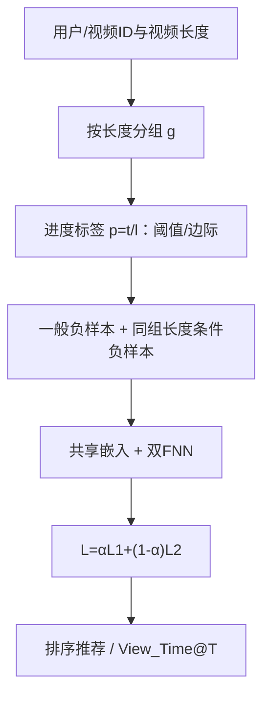
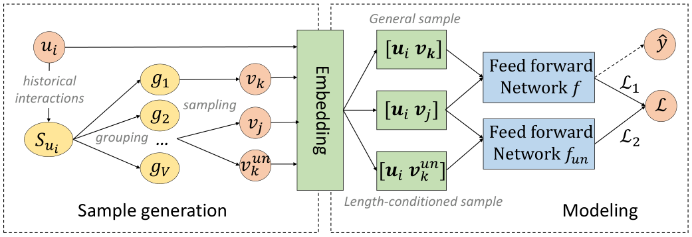

# Alleviating Video-Length Effect for Micro-video Recommendation (缓解微视频推荐中的视频长度效应)

- **会议/期刊**: TOIS 2024
- **作者与机构**: Yuhan Quan, Jingtao Ding, Chen Gao, Nian Li, Lingling Yi, Depeng Jin, Yong Li；清华大学、腾讯
- **推荐链路定位**: 精排（观看时长导向的排序学习）
- **研究方向**: 去偏公平、可信隐私与工业架构 / 多任务学习与列表级重排
- **论文原文**: [论文原文链接](https://arxiv.org/abs/2308.14276v2)
- **开源代码**: [开源代码仓库链接](https://github.com/SpongeBobSquarePants111/VLDRec)

## TL;DR (1分钟核心速览)

针对微视频自动播放场景中“视频越长越易获得高观看时长”的长度偏差，VLDRec 用播放进度标签、按长度分组的条件采样与共享嵌入双 FNN 多任务联合训练去偏，并提出固定总时长的 `View_Time@T` 评测；在快手/微信候选排序上 @120 相对最佳基线提升 **1.81%/11.32%**。

## Background & Motivation (背景与核心矛盾)

- **主流范式**: TikTok 类微视频一次只自动播放一个视频，用户不点击、只上滑切换，因此观看时长成为核心偏好信号，常见做法是回归观看时长或按时长排序。
- **前人局限**: 经验数据显示平均观看时长随视频长度近线性增长；直接以观看时长作标签会放大“长视频优势”，且长视频更易导致疲劳和退出，形成偏置放大。
- **核心洞察 (Key Insight)**: 同一视频长度组内，完成率/播放进度分布相对稳定；同长度视频之间比较播放进度，可剥离长度对观看时长的直接干扰。
- **本文切入点**: 将偏好标签从“观看时长”改为“播放进度”，并用同长度组负样本构造无偏排序对，再以多任务学习保留原始偏置样本的拟合能力。

## Method (核心方法设计)

### 1. 整体框架 (Overall Architecture)

输入用户 ID、视频 ID 与视频长度；先按长度分组 $g$，再以播放进度$p_{ij}=t_{ij}/l_j$ 构造点式硬标签与成对边际标签；采样阶段同时生成“一般负样本”和“同长度组条件负样本”；共享嵌入后接两个独立 FNN，分别拟合原始偏置样本与去偏样本，以 BPR 多任务联合优化；推理按预测分数排序，并用固定总时长的 `View_Time@T` 评估。

<figure class="paper-figure" markdown="span">
  <figcaption>图 5. VLDRec 的整体框架。</figcaption>
</figure>
图 5 VLDRec 整体框架：长度分组、条件采样与双 FNN 多任务学习。

### 2. 关键设计拆解 (Key Designs)

1. **长度分组与进度标签（把标签从时长转为进度）**：痛点在于 $t_{ij}$随$l_j$增长而偏置；本文令$p_{ij}=t_{ij}/l_j$，点式硬标签将$p_{ij}>\tau(g)$判为正，$\tau(g)$取组内$p_{80}$；成对边际标签要求$p_{ij}-p_{ik}>\epsilon$。这样同组内比较不再奖励“单纯长视频”，而奖励“看得更完整”。
2. **长度条件采样（构造同组硬负例）**：仅用全局负样本仍会混入长度差异；本文对每个正样本额外从 $S_{u_i}\cap g(v_j)$ 采样同组负例，并分别构造一般样本与长度条件样本。同组负例更接近“难负例”，能迫使模型学习内容偏好而非长度捷径。
3. **多任务训练、负采样与推理**：$\mathcal{L}_1=\mathcal{L}_{BPR}(f(u_i,v_j),f(u_i,v_k))$，$\mathcal{L}_2=\mathcal{L}_{BPR}(f_{un}(u_i,v_j),f_{un}(u_i,v_{un}^k))$，总损失$\mathcal{L}=\alpha\mathcal{L}_1+(1-\alpha)\mathcal{L}_2$；负样本从用户历史中按阈值/边际条件采样，非全库均匀负采样；推理仅需一次前向打分，训练额外开销主要来自双 FNN 与两组样本。

## Experimental Setup & Evaluation Protocol (实验设置与评估协议)

- **数据集与预处理**: 仅保留已点击/观看记录；删除重复播放超过 3 次（$p_{ij}>3$）及超长视频（快手 >60s、微信 >120s）。

| 数据集 | #Users | #Items | #Interactions | 稀疏度/密度 | 特征/场景说明 |
| :--- | :---: | :---: | :---: | :---: | :--- |
| Kuaishou | 9,829 | 136,317 | 1,945,502 | 约 0.145% | 公开数据；平均视频 17.54s |
| Wechat Channels | 54,595 | 62,569 | 3,264,803 | 约 0.096% | 工业数据；平均视频 32.97s |

- **数据划分与防穿越**: 随机划分 10% 验证、20% 测试；未采用全局时间戳切分，存在非时序随机划分风险。
- **排名评测协议**: 测试集内按用户聚合候选视频并按预测分排序，非全库 Full-Ranking；主指标 `View_Time@T` 固定推荐列表总视频长度为 $T$，$\mathrm{ViewTime}@T=\sum_{j=1}^{n}t_{ij}$ 且 $\sum_{j=1}^{n}l_j=T$，末尾视频按比例截断；辅助 `View_Time@K` 与微信类别 Intersection/JSD。
- **对比基线与超参设置**: 对比回归（TReg/RReg）、排序（TRank/RRank）、IPS 系列、CausE、DecRS、DVR；主干用 NFM/DeepFM/AutoInt，Embedding 维 8，batch 1024，Adam，网格搜索 lr/dropout/$\alpha$/$\beta$；未报告显著性检验。

## Key Experimental Results (实验关键数据)

### 1. 主实验对比 (Main Results)

NFM 主干下，`View_Time@120/240` 对比如下（VLDRec 加粗；`Improv.` 相对该列最佳基线）：

| 方法 (NFM) | 快手@120 | 快手@240 | 微信@120 | 微信@240 |
| :--- | ---: | ---: | ---: | ---: |
| TReg | 35.78 | 66.69 | 12.52 | 27.16 |
| RReg | 25.13 | 37.32 | 12.17 | 21.49 |
| TRank | 40.87 | 78.79 | 23.50 | 48.10 |
| RRank | 43.94 | 81.93 | 22.84 | 47.01 |
| IPS | 40.31 | 77.51 | 22.73 | 46.26 |
| CausE | 42.14 | 80.11 | 26.69 | 51.59 |
| DecRS | 44.16 | 71.69 | 24.54 | 43.23 |
| **VLDRec** | **44.96** | **82.37** | **29.71** | **53.52** |
| Improv. | +1.81% | +0.54% | +11.32% | +3.74% |

换 DeepFM/AutoInt 后，VLDRec 在 @120 仍至少提升 5.49%/7.31%；对回归基线，在快手分别提升 92.04%/17.56%。

### 2. 消融实验 (Ablation Study)

原文图 9 仅给曲线，未列精确数值；核心结论如下：

| 变体/超参 | 设置 | 结果趋势 |
| :--- | :--- | :--- |
| 仅原始偏置支路 | $\alpha=1$ | 缺少同组去偏约束，整体低于完整模型 |
| 仅长度条件支路 | $\alpha=0$ | 丢失原始分布拟合，整体低于完整模型 |
| 采样混合 $\beta$ | 0.1→0.9 | 性能先升后降，两种标签互补 |
| 多任务权重 $\alpha$| 0.1→0.9 |$\alpha=0.5$ 最优，拟合与去偏折中 |

### 3. 关键实验发现 (Key Findings)

1. 固定总时长指标下，VLDRec 在快手/微信 @120 达 44.96/29.71，较最佳基线 DecRS 44.16/CausE 26.69 提升 **1.81%/11.32%**；@240 也提升 **0.54%/3.74%**。
2. 换 DeepFM/AutoInt 后 @120 仍至少提升 **5.49%/7.31%**，说明收益不依赖单一 NFM；回归类方法虽能拟合组内分布，但全局排序仍被长度偏置主导。
3. 预测分布上，TReg/RReg 的平均归一化分随视频长度递增，VLDRec 在各长度组均值近乎持平、方差更大；尽管快手组内 TReg、微信组内 DecRS 局部更高，VLDRec 全局更稳且在微信类别 Intersection 最大、JSD 最小。

## Highlights & Limitations (亮点、对比与审稿批判)

- **与代表作对比 (vs. Prior Work)**: IPS 系在连续观看时长下重加权方差大；DecRS 用后门调整、DVR 用对抗式无偏目标；VLDRec 不改主干，靠长度分组条件样本与多任务正则去偏，工程侵入性更低。
- **可迁移亮点**: 组内分位数阈值 $\tau(g)$ 与同长度组硬负采样，可迁移到短视频、商品停留时长、页面浏览时长等连续曝光偏差任务；固定总时长评测也适合“资源总量约束”的推荐场景。
- **审稿级局限批判**: 分组边界、$\tau$和$\epsilon$ 依赖人工与分位数设定，换场景需重调；随机划分非时间切分、无线上 A/B，且候选集来自测试曝光而非全库，外推需谨慎。

## Rating (四维评分)

- **方法创新性 (Novelty)**: ⭐⭐⭐⭐ （新问题定义清晰，数据驱动去偏有效；BPR/多任务组件较常规）
- **评估协议与实验扎实度 (Protocol & Experiments)**: ⭐⭐⭐⭐ （两真实数据集、11 类基线、固定总时长指标较公平；随机划分与显著性不足）
- **写作与数学规范度 (Clarity & Rigor)**: ⭐⭐⭐⭐ （公式简洁、符号清楚；分组与阈值手工细节略欠自动化）
- **工业落地与复现价值 (Industrial & Practical Value)**: ⭐⭐⭐⭐ （代码数据开源、易插拔；双 FNN 训练与分组维护有额外成本）

