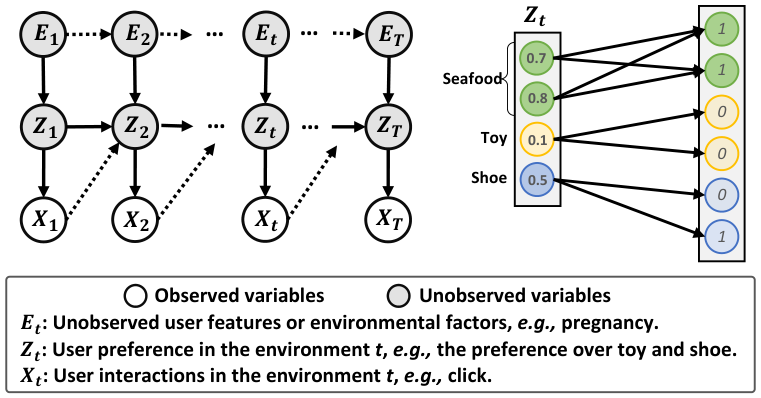
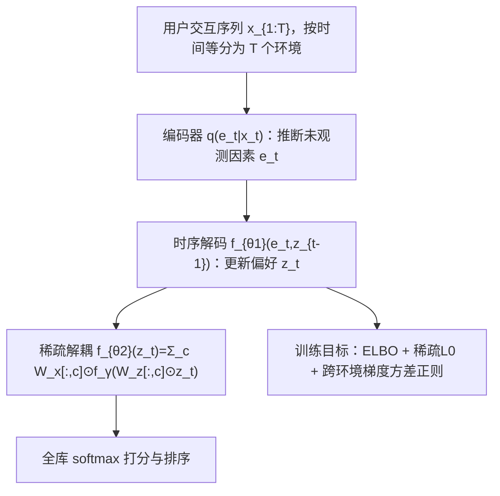

# Causal Disentangled Recommendation Against User Preference Shifts (因果解耦推荐：应对用户偏好漂移)

- **会议/期刊**: TOIS (Transactions on Information Systems)
- **作者与机构**: Wenjie Wang, Xinyu Lin, Liuhui Wang, Fuli Feng, Yunshan Ma, Tat-Seng Chua；NUS、PKU、USTC
- **推荐链路定位**: 全库排序 / 端到端协同过滤
- **研究方向**: 去偏公平、可信隐私与工业架构 / 序列与会话推荐
- **论文原文**: [论文原文链接](https://arxiv.org/abs/2303.16068v1)
- **开源代码**: [开源代码仓库链接](https://github.com/Linxyhaha/CDR)

## TL;DR (1分钟核心速览)

论文针对推荐系统在**用户偏好漂移**下的 OOD 泛化痛点：既有解耦推荐忽略跨环境时序漂移，序列模型又忽略偏好对交互的稀疏因果影响。作者将用户交互序列按时间划分为多个环境，提出 CDR：用**时序 VAE**推断未观测因素并迭代更新偏好，用两个可学习矩阵 $\mathbf{W}_z,\mathbf{W}_x$ 解耦类别级稀疏影响，并以稀疏/方差正则优化。在 Yelp、Book、Electronics 的 **Full-Ranking** 协议下，CDR 的 Recall@10 较次优提升 **19.46%/28.06%/26.86%**。

## Background & Motivation (背景与核心矛盾)

- **主流范式**: 解耦推荐（如 MacridVAE）通过独立隐因子提升鲁棒性；序列推荐（ACVAE、CauseRec 等）通过时序建模捕捉兴趣演化。
- **前人局限**: 解耦方法通常在 IID 数据上学习表征，忽略 $Z_{t-1}\to Z_t$的跨环境漂移；序列模型侧重 next-item，忽略$Z_t\to X_t$ 的**稀疏影响**——部分偏好漂移只影响少量类别交互。
- **核心洞察 (Key Insight)**: 作者抽象出因果图 $E_t\to Z_t\to X_t$与$Z_{t-1}\to Z_t$：未观测因素$E_t$（如怀孕、热点事件）导致偏好漂移；类别级偏好稀疏地作用于对应物品交互。环境按时间切分后，Amazon Book 中相邻环境交互类目余弦相似度持续下降，验证分布漂移。
- **本文切入点**: 用时序 VAE 从 $X_t$反推$E_t$并更新$Z_t$；用软掩码矩阵学习$Z_t\to X_t$ 的稀疏结构；多环境梯度方差正则平衡各环境优化。

<figure class="paper-figure" markdown="span">
  <figcaption>图 2. 多环境下交互生成过程背后的因果图。我们假设观测到的用户偏好受一些隐藏用户特征影响，且不同的用户偏好稀疏地控制与不同物品的交互。</figcaption>
</figure>
*图2：多环境交互生成的因果图，$E_t$经$Z_t$影响$X_t$，且$Z_{t-1}\to Z_t$ 表示偏好漂移。*

## Method (核心方法设计)

### 1. 整体框架 (Overall Architecture)

CDR 将每个用户交互序列按交互数等分为 $T$个时间环境。每个环境$t$中，编码器$g_\phi(\boldsymbol{x}_t)$从观测交互推断未观测因素$\boldsymbol{e}_t$；解码器$f_{\theta_1}(\boldsymbol{e}_t,\boldsymbol{z}_{t-1})$更新当前偏好$\boldsymbol{z}_t$；再由稀疏解耦模块$f_{\theta_2}(\boldsymbol{z}_t)$输出全物品交互概率。训练时以 ELBO、稀疏$L_0$正则和跨环境梯度方差正则联合优化；推理时用最新偏好$\boldsymbol{z}_T$做全库排序。核心计算在$T$个环境上循环，$\mathbf{W}_z,\mathbf{W}_x$ 跨环境共享。

### 2. 关键设计拆解 (Key Designs)

1. **多环境时序 VAE（推断 $E_t$并建模漂移）**：痛点在于$E_t$不可观测、漂移无监督。CDR 假设$\boldsymbol{e}_t\sim\mathcal{N}(0,\mathbf{I}_K)$，$\boldsymbol{z}_t\sim\mathcal{N}(\boldsymbol{\mu}_{\theta_1}(\boldsymbol{e}_t,\boldsymbol{z}_{t-1}),\mathrm{diag}\{\boldsymbol{\sigma}^2_{\theta_1}(\cdot)\})$，$\boldsymbol{x}_t\sim\mathrm{Mult}(N_t,\pi(f_{\theta_2}(\boldsymbol{z}_t)))$。编码器用变分推断估计$q(\boldsymbol{e}_t|\boldsymbol{x}_t)$，解码器以 MC 采样迭代$Z_{t-1}\to Z_t$；这使得$Z_t$ 既有短期不变偏好，又能吸收跨环境漂移。
2. **稀疏类别解耦（学习 $Z_t\to X_t$软结构）**：若用普通 MLP，偏好对所有物品稠密影响，漂移会污染大量无关预测。CDR 引入$\mathbf{W}_z\in\mathbb{R}^{H\times C}$与$\mathbf{W}_x\in\mathbb{R}^{I\times C}$，经裁剪高斯与 softmax 软分配后计算$f_{\theta_2}(\boldsymbol{z}_t)=\sum_{c=1}^{C}\mathbf{W}_x[:,c]\odot f_\gamma(\mathbf{W}_z[:,c]\odot\boldsymbol{z}_t)$。类别级掩码让部分偏好只影响对应类目，漂移时仅少量交互受扰动，提升 OOD 鲁棒性。
3. **训练目标、负采样与推理效率**：总损失为 $\mathcal{L}_u=\mathrm{ELBO}_u+\lambda_2(\|\mathbf{W}_z\|_0+\|\mathbf{W}_x\|_0)+\lambda_3\sum_t\|\nabla_\theta\mathcal{L}_{u,t}-\nabla_\theta\mathcal{L}_u\|^2$。ELBO 用 KL 退火系数$\lambda_1$平衡拟合与解耦；方差项约束各环境梯度同步。训练采用全物品多项分布 softmax，**无显式负采样**；推理用$\boldsymbol{z}_T$全库打分，开销随$T_i$ 线性增长。

## Experimental Setup & Evaluation Protocol (实验设置与评估协议)

- **数据集与预处理**:

| 数据集 | #Users | #Items | #Interactions | 密度 | 特征/场景说明 |
| :--- | :---: | :---: | :---: | :---: | :--- |
| Yelp | 11,622 | 9,095 | 487,000 | 0.004607 | 餐厅点评，保留 ≥20 交互用户/物品 |
| Book | 21,923 | 23,773 | 1,125,676 | 0.002159 | Amazon 图书评论，≥20 交互 |
| Electronics | 9,279 | 6,065 | 158,979 | 0.002825 | Amazon 电子产品，≥10 交互 |

评分 ≥4 视为正反馈；按用户交互时间排序后以 **80%/10%/10%** 划分训练/验证/测试（用户内时间顺序比例划分），测试段对应未来环境。
- **排名评测协议**: 采用 **Full-Ranking 全库未交互排序**（all-ranking），报告 Recall@10/20 与 NDCG@10/20；训练端为全物品 softmax，无采样负例。
- **对比基线与超参设置**: 覆盖 MF、LightGCN、MultiVAE、MacridVAE、DIB、COR、DIEN、MGS、DSSRec、ACVAE、CauseRec。CDR 隐维 $K,H$在 200–500 搜索，batch=500，lr=$1e^{-4}$，训练环境数$T_t$最佳为 3，推理$T_i$可增大；显著性用 one-sample t-test，$p<0.05$。

## Key Experimental Results (实验关键数据)

### 1. 主实验对比 (Main Results)

| Method | Yelp R@10 | Yelp N@20 | Book R@10 | Book N@20 | Elec. R@10 | Elec. N@20 |
| :--- | :---: | :---: | :---: | :---: | :---: | :---: |
| MF | 0.0385 | 0.0365 | 0.0206 | 0.0193 | 0.0333 | 0.0243 |
| LightGCN | 0.0402 | 0.0390 | 0.0252 | 0.0233 | 0.0365 | 0.0246 |
| MacridVAE | 0.0442 | 0.0434 | 0.0409 | 0.0378 | 0.0424 | 0.0306 |
| COR | 0.0411 | 0.0392 | 0.0400 | 0.0385 | 0.0428 | 0.0289 |
| MGS | 0.0423 | 0.0409 | 0.0515 | 0.0532 | 0.0415 | 0.0285 |
| DSSRec | 0.0413 | 0.0400 | 0.0539 | 0.0534 | 0.0503 | 0.0343 |
| ACVAE | 0.0439 | 0.0432 | 0.0563 | 0.0576 | 0.0510 | 0.0359 |
| CauseRec | 0.0433 | 0.0417 | 0.0484 | 0.0482 | 0.0445 | 0.0309 |
| **CDR** | **0.0528*** | **0.0518*** | **0.0721*** | **0.0708*** | **0.0647*** | **0.0449*** |

`*` 表示相对最佳基线 $p<0.05$ 显著。CDR 的 R@10 相对次优提升：Yelp **+19.46%**、Book **+28.06%**、Electronics **+26.86%**；N@20 分别 **+19.35%/+22.92%/+25.07%**。

### 2. 消融实验 (Ablation Study)

| 变体 | Yelp R@10 | Book R@10 | Electronics R@10 |
| :--- | :---: | :---: | :---: |
| **CDR (vanilla, $z_T$)** | **0.0528** | **0.0721** | **0.0647** |
| w/ $E_{t-1}\to E_t$ | 0.0450 | 0.0584 | 0.0549 |
| w/ $X_{t-1}\to Z_t$ | 0.0458 | 0.0572 | 0.0553 |
| avg $x_{1:T}$ 推理 | 0.0429 | 0.0288 | 0.0476 |
| $z_{T+1}$ 推理 | 0.0470 | 0.0550 | 0.0613 |
| ACVAE（最佳序列基线） | 0.0439 | 0.0563 | 0.0510 |

移除稀疏结构 $\mathbf{W}_z,\mathbf{W}_x$（图7）后性能下降，但仍优于各数据集最佳基线。

### 3. 关键实验发现 (Key Findings)

- **主实验定量归因**：Book/Electronics 时序漂移更强，ACVAE 等序列模型优于 MacridVAE；CDR 在三个数据集均显著最优，Book R@10 达 0.0721，较 ACVAE 的 0.0563 提升 28.06%，说明“跨环境漂移建模+稀疏解耦”互补。
- **额外因果边并非越多越好**：显式加入 $E_{t-1}\to E_t$或$X_{t-1}\to Z_t$ 后，Yelp R@10 从 0.0528 降至 0.0450/0.0458，Book 从 0.0721 降至 0.0584/0.0572；额外参数在有限交互上过拟合，精简因果图更利于 OOD。
- **推理必须保留最新时序偏好**：直接平均 $x_{1:T}$使 Book R@10 仅 0.0288，远低于$z_T$的 0.0721；$z_{T+1}$虽考虑部分漂移仍逊于$z_T$。训练小$T_t$、推理大$T_i$ 在 Book/Electronics 更有效，可平衡环境内密度与环境间漂移。

## Highlights & Limitations (亮点、对比与审稿批判)

- **与代表作对比 (vs. Prior Work)**: MacridVAE 仅做 IID 解耦，缺少跨环境 $Z_{t-1}\to Z_t$；ACVAE/CauseRec 侧重序列对比/反事实增广，忽略$Z_t\to X_t$ 稀疏结构；COR 依赖观察特征做因果 OOD，未建模时间偏好漂移。CDR 首次把多环境时序 VAE 与稀疏因果结构结合。
- **可迁移亮点**: 用 $\mathbf{W}_z,\mathbf{W}_x$软掩码实现类别级可学习稀疏连接，可迁移到多兴趣解耦与跨域迁移；训练/推理使用非对称环境数$T_t<T_i$，对时序推荐调度有参考价值。
- **审稿级局限批判**: 环境按等交互数硬切，未利用时间间隔或事件边界，可能割裂真实漂移点；推理需在 $T_i$个环境上迭代编码，线上延迟随$T_i$线性增长；类别数$C$ 最佳仅为 2，与真实类目数差距大，且未引入物品类目监督，稀疏结构可解释性有限。

## Rating (四维评分)

- **方法创新性 (Novelty)**: ⭐⭐⭐⭐ （因果图驱动多环境时序 VAE 与软稀疏结构结合，较现有解耦/序列方法有明确增量）
- **评估协议与实验扎实度 (Protocol & Experiments)**: ⭐⭐⭐⭐ （三数据集 Full-Ranking、显著性与多组消融完整；但缺少采样排序与更多工业数据验证）
- **写作与数学规范度 (Clarity & Rigor)**: ⭐⭐⭐⭐ （生成过程、ELBO 与损失定义清晰；环境划分与推理假设稍强）
- **工业落地与复现价值 (Industrial & Practical Value)**: ⭐⭐⭐ （开源代码完整，全库 softmax 与多环境迭代带来训练/推理开销，线上需蒸馏或缓存优化）

