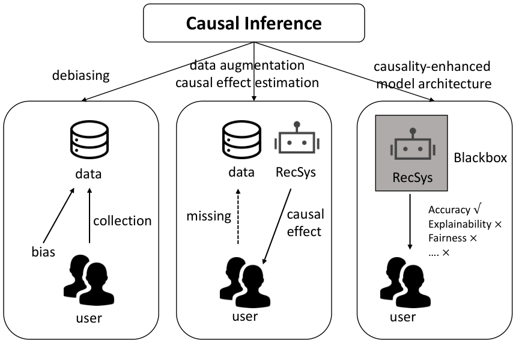
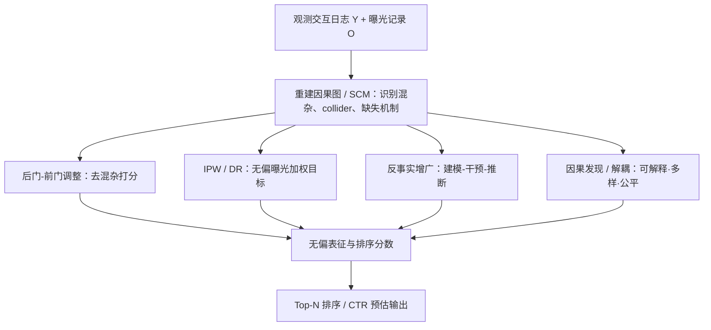
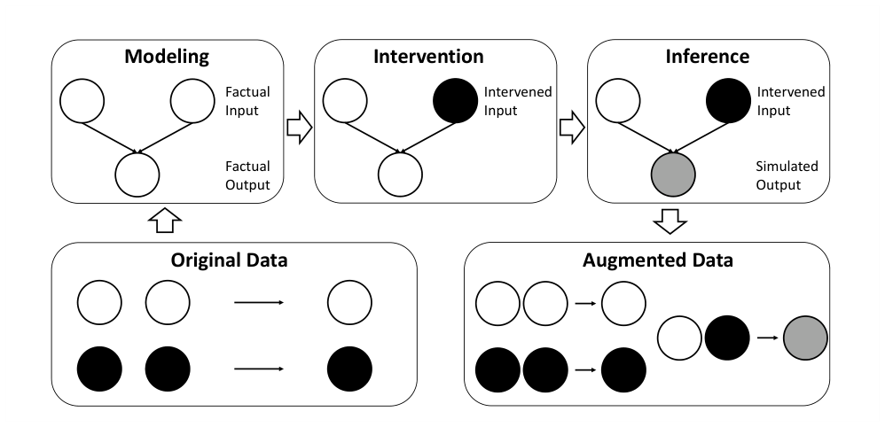

# Causal Inference in Recommender Systems: A Survey and Future Directions (推荐系统中的因果推断：综述与未来方向)

- **会议/期刊**: ACM Transactions on Information Systems (TOIS)
- **作者与机构**: Chen Gao, Yu Zheng, Yong Li（清华大学电子系/信息国家研究中心）；Wenjie Wang（新加坡国立大学）；Fuli Feng, Xiangnan He（中国科学技术大学）
- **推荐链路定位**: 召回与精排（方法论层面，横跨 CF 与 CTR 两条主线）
- **研究方向**: 去偏/公平/可信/工业架构 / 自监督与交互去噪
- **论文原文**: [https://arxiv.org/abs/2208.12397v2](https://arxiv.org/abs/2208.12397v2)
- **开源代码**: 暂未开源

## TL;DR (1分钟核心速览)

现有推荐系统在"相关性范式"下拟合 $P(y\mid x)$，必然把曝光策略、流行度、从众等混杂信号一并学进模型，同时受制于未观测反馈缺失与隐式反馈噪声。本文是首篇系统综述，以"数据偏差 / 数据缺失与噪声 / 超越精度目标"三大病理为轴，把 40 篇（2016–2023）代表工作归为后门-前门调整、IPW 与双稳健（DR）估计、反事实数据增广（建模-干预-推断三步）、因果发现与解耦表示四类因果工具，并指出"缺乏统一基准与统一评估协议"是该领域首要开放问题。

## Background & Motivation (背景与核心矛盾)

- **主流范式**: CF 依赖行为相关性（MF 内积 → NCF MLP → NGCF 图传播），CTR 依赖特征-特征/特征-行为相关性（FM/DeepFM/AutoInt 高阶交叉），二者本质都是关联拟合，且部署后新交互回流形成放大偏差的反馈回路。
- **前人局限**: 其一，日志是观测数据而非实验数据，混杂变量同时影响输入与交互，模型会给出"高于其应得"的分数（流行度偏差、曝光偏差、点击诱饵、从众偏差）；其二，item 池远大于用户曝光面，未交互≠不喜欢，隐式反馈还含误点与延迟转化，纯关联方法无法区分"因推荐而买"与"本就该买"。
- **核心洞察 (Key Insight)**: 多数偏差可写成 DAG 中的后门路径 $X\leftarrow Z\rightarrow Y$，剔除$Z$的混杂效应即可去偏；从众偏差则是 collider 结构$X\rightarrow Y\leftarrow Z$，条件化$Y$ 反而制造兴趣与从众之间的伪相关；缺失数据则对应"若当时给出不同推荐列表，反馈会是什么"的反事实世界。
- **本文切入点**: 不做算法堆砌，而以"病理 → 因果工具 → 可识别性假设"的映射关系组织文献，使每类方法对应一种可诊断的数据生成机制。

<figure class="paper-figure" markdown="span">
  <figcaption>图 4. 非因果推荐模型三种典型问题以及因果推断如何……的图示。</figcaption>
</figure>
图 4：非因果推荐模型的三类典型问题及因果推断的对应解法（原文图 4）

## Method (核心方法设计)

### 1. 整体框架 (Overall Architecture)

综述将因果推荐建模抽象为四步闭环：①依据推荐业务重绘数据生成过程的因果图/SCM，显式区分 treatment（用户偏好/曝光）、outcome（点击/购买）与混杂 $Z$；②按病理选工具——观测混杂走后门调整、未观测混杂走前门调整或 IPW、缺失反馈走反事实推理、超越精度目标走解耦表示与因果发现；③把因果算子嵌入既有 CF/CTR/序列骨干（多为对损失加权或对表征做路径分离），端到端训练；④推理阶段多数方法零额外开销（仅训练期重加权/增广），仅反事实策略学习类需在线探索。

### 2. 关键设计拆解 (Key Designs)

1. **后门调整的去偏打分（切断混杂捷径）**：痛点是以往把 item 流行度、类目分布、封面/时长等特征当作有效信号，实则它们经由后门同时抬高了曝光与点击。核心算子是把这些变量显式设为混杂 $W$并做干预边缘化$P(y\mid do(t))=\sum_{w}P(y\mid t,w)P(w)$，实现上等价于"按混杂分布对样本重加权再求和"（PD、DecRS 的近似算子），DCR 进一步把任意"可疑特征"统一视为混杂并用 MoE 承载该算子。直觉上它把"流行度红利"从分数中扣掉，只保留在给定混杂水平下的净效应。
2. **IPW 与双稳健（DR）的无偏曝光目标**：曝光偏差下把"是否被曝光"当 treatment，$\hat{p}_{u,i}=P(o_{u,i}=1\mid u,i)$，加权损失为$\frac{1}{|\mathcal{O}|}\sum_{(u,i)\in\mathcal{O}}\frac{l(y_{u,i},\hat{y}_{u,i})}{\hat{p}_{u,i}}$；propensity 估计方差极大，于是引入插补模型$\hat{e}_{u,i}$得 DR 估计$\frac{1}{|\mathcal{U}||\mathcal{I}|}\sum_{(u,i)}\big(\hat{e}_{u,i}+\frac{o_{u,i}(l-\hat{e}_{u,i})}{\hat{p}_{u,i}}\big)$，并用$\frac{1}{|\mathcal{O}|}\sum(l-\hat{e})^2/\hat{p}$ 联合训练插补器；AutoDebias/LTD 则以少量 RCT 随机曝光数据去校正海量观测日志。直觉是"propensity 错、插补对"或反之仍无偏，两者皆错才失效。
3. **反事实数据增广的三步范式**：针对缺失反馈，modeling 步用现成 CF/序列骨干当模拟器拟合事实数据；intervention 步有两种——随机替换（CauseRec 替换"可有可无/不可或缺"物品构造正负反事实序列）与定向替换（CPR、CASR、CF2 选取高 loss 或处于决策边界的样本做最小改动），后者信息密度更高；inference 步由模拟器输出反事实点击、反事实用户表征或反事实下一物品。核心区别在于它把"未观测"从 0 标签转为可采样的分布，而非简单负采样。
4. **训练目标、负采样与推理开销**：总损失通常为 $\mathcal{L}=\mathcal{L}_{\text{rec}}+\lambda\mathcal{L}_{\text{causal}}$，其中$\mathcal{L}_{\text{causal}}$ 为反事实增广损失、IPW 加权项或 DR 插补项；负采样沿用 Uniform/In-batch，因果发现类（CausPref）额外引入反偏好负采样。推理期 IPW/DR 与后门调整均为零开销，反事实增广仅增加训练期前向模拟，主要成本在 propensity 模型与 RCT 数据的获取。

<figure class="paper-figure" markdown="span">
  <figcaption>图 6. 面向数据缺失的反事实数据增强示意图。</figcaption>
</figure>
图 6：面向数据缺失的反事实数据增广示意图（原文图 6）

## Experimental Setup & Evaluation Protocol (实验设置与评估协议)

本文为综述，**未开展自建实验**，故下表以原文 Table 1–3 的语料构成替代数据集统计（原文未给出统一的用户/物品规模统计）：

| 病理族 | 代表方法（年份） | 因果工具 | 篇数 | 典型评估载体 |
| :--- | :--- | :--- | :---: | :--- |
| 数据偏差：流行度/诱饵/放大 | PD'21, MACR'21, CR'21, DecRS'21, DCR'23 | 后门调整、反事实推理 | 7 | 采样排序 + 流行度分桶 |
| 数据偏差：曝光 | IPS'16, MF-DR-JL'19, AutoDebias'21, USR'22, DENC'23 | IPW、DR、RCT 聚合 | 10 | 含随机曝光日志（Yahoo! R3 / Coat 类） |
| 数据缺失 | CPR'21, CauseRec'21, CASR'21, CIRS'23, CausPref'22 | 反事实增广、因果发现 | 13 | 序列 Next-Item、Top-N |
| 数据噪声 | CBDF'21 | 重要性采样重加权 | 1 | 延迟转化流式数据 |
| 超越精度 | PGPR'19, CountER'21, CLSR'22, UCRS'22, $\partial$CCF'22 | 因果发现、解耦表示 | 9 | 解释质量/多样性/公平性指标 |

- **数据划分与防穿越**: 综述内工作基本沿用原有基准的 `Leave-One-Out`（CF/序列）或 `全局时间戳切分`（CTR/流式），曝光去偏类额外要求日志保留"随机曝光"标记以估计 propensity。
- **排名评测协议**: `Sampled Ranking`（常见 1:4 或 1:99 负采样）与 `Full-Ranking` 混用，原文明确指出这是跨论文指标不可比的根因之一。
- **对比基线与超参**: 基线多为 MF/NCF/NGCF 骨干与同类因果方法的自身消融（w/o 后门、w/o DR、w/o 增广），因果模块本身几乎不引入新的嵌入维度超参。

### 消融式对照 (Causal Tool Trade-off)

原文无消融表，以下按各方法自报的消融结论整理工具级取舍：

| 因果工具 | 可处理 | 关键代价/失效条件 |
| :--- | :--- | :--- |
| 后门调整（PD/DecRS/DCR） | 可观测混杂（流行度、类目、特征捷径） | 混杂必须可观测且完备，高维 $W$ 下 positivity 难满足 |
| IPW（IPS/USR/DENC） | 曝光偏差、序列曝光 | propensity 误设 → 高方差，需单独训练倾向模型 |
| DR（MRDR/DRIB） | propensity 或插补任一对即可 | 两模型皆误时退化为有偏，训练成本翻倍 |
| RCT 聚合（AutoDebias/LTD） | 全局未知偏差 | 需线上随机曝光，伤害短期体验与营收 |
| 反事实增广（CauseRec/CASR/CPR） | 数据缺失、序列稀疏 | 模拟器偏差会被放大进增广样本；训练开销 ↑ |
| 因果发现/解耦（CausPref/DICE/CLSR） | 分布漂移、可解释、多样性 | 依赖 faithfulness 等强假设，图结构学习不稳定 |

### 关键实验发现 (Key Findings)

1. **数据噪声的代价被首次量化**：Cosley 等发现同一用户重评同一电影仅约 60% 保持一致；Amatriain 等报告含噪训练相对洁净训练的 RMSE 差异达约 40%；Wang 等在两数据集上测得噪声使 Recall@20 下降 9.56%–21.81%、NDCG@20 下降 3.92%–8.81%——这组数字构成"因果去噪值得做"的直接证据。
2. **曝光偏差是方法密度最高的分支（10/17）**，且演进路径清晰：2016 年 IPS 单倾向 → 2019–2021 年 DR 与多任务倾向学习 → 2021 年引入 RCT 聚合（AutoDebias/LTD），说明该子问题的瓶颈已从"估计器形式"转移到"实验数据稀缺"。
3. **因果发现/解耦是唯一能同时服务可解释、多样性与公平的分支（9 篇）**，但其可识别性假设最强、实验结果方差最大，恰与"超越精度目标难以度量"的现状互为因果——原文亦以此为最大开放问题。

## Highlights & Limitations (亮点、对比与审稿批判)

- **与代表作对比 (vs. Prior Work)**: 相较 8 页短文 [116]，本文覆盖 40 篇并给出统一的"病理→工具"映射；相较偏差综述 [10]（因果只是去偏手段之一），本文把缺失/噪声与超越精度目标纳入同一框架；相较因果推断综述 [26]（只讲方法不讲应用），本文补齐了推荐侧的算子落地细节。
- **可迁移亮点**: ①"建模-干预-推断"三步反事实增广可直接迁移到对比学习的难样本增广与 LLM 推荐的数据合成；②DR 估计器可迁移到延迟反馈（CVR）与多任务损失加权，用插补项替代纯重加权以降低方差。
- **审稿级局限批判**: ①未提供统一 benchmark 与统一评测协议，各方法自选数据集与负采样比例，横向数字不可比，综述层面的"结论"多依赖单篇自报增益；②对识别性假设（无未观测混杂、positivity、faithfulness）的讨论偏浅，未给出 propensity 误设的敏感性分析范式；③工业可用性讨论不足——RCT 数据的合规与营收代价、propensity 模型的在线维护成本均未被系统评估。

## Rating (四维评分)

- **方法创新性 (Novelty)**: ⭐⭐⭐⭐ （综述本身以三病理正交分类 + 工具-假设对应表立框架，组织方式新颖，但无新算法）
- **评估协议与实验扎实度 (Protocol & Experiments)**: ⭐⭐⭐ （无自建实验与统一复现，仅汇编他文结果，且明确指出采样协议不一致的隐患）
- **写作与数学规范度 (Clarity & Rigor)**: ⭐⭐⭐⭐⭐ （backdoor/frontdoor/IPW/DR 四式推导完整，三张总表与图 2/3 的概念铺垫层层递进）
- **工业落地与复现价值 (Industrial & Practical Value)**: ⭐⭐⭐⭐ （为工业团队提供去偏选型决策表，但无开源代码，落地仍需逐篇复现）

