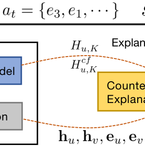
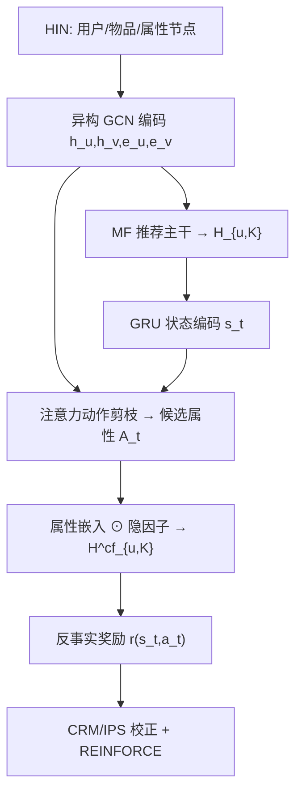
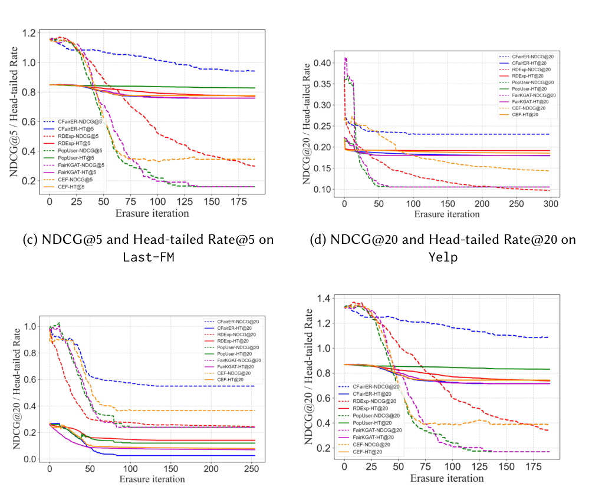

# Counterfactual Explanation for Fairness in Recommendation (推荐公平性的反事实解释)

- **会议/期刊**: TOIS 2024（arXiv 2023-07 预印本）
- **作者与机构**: Xiangmeng Wang, Qian Li, Dianer Yu, Qing Li, Guandong Xu（UTS、Curtin University、PolyU）
- **推荐链路定位**: 精排/重排之后的事后公平性诊断与解释（不改变推荐主干）
- **研究方向**: 去偏公平、可信隐私与工业架构 / 图神经网络与知识图谱推荐
- **论文原文**: [https://arxiv.org/abs/2307.04386v1](https://arxiv.org/abs/2307.04386v1)
- **开源代码**: 论文声明匿名仓库 [CFairER-anony](https://anonymous.4open.science/r/CFairER-anony/)；文中检出的 GitHub 链接实为 HIN 数据集仓库，非本文代码

## TL;DR (1分钟核心速览)

本文针对现有公平性解释方法的两大痛点：一是在高维稀疏特征上做 Shapley/扰动搜索，计算爆炸且贪心选取易产出伪解释；二是基于连续分数的优化无法作用于性别、品类等离散属性。作者提出 CFairER，将 HIN 中的属性节点视为可干预的离散实体，把"寻找能降低曝光公平性差距的最小属性集"建模为离线策略强化学习问题，配合注意力动作剪枝压缩候选空间与反事实风险最小化（CRM）做无偏校正。在 Yelp/Douban/Last-FM 三数据集、10-core 划分、擦除式评估下，E=20 时 Yelp 上 NDCG@40 相对最强基线 CEF 提升 25.9%、Gini@40 下降 36.0%。

## Background & Motivation (背景与核心矛盾)

- **主流范式**: 公平性解释分两支——feature-based（如 Shapley 值估计特征贡献）与 aspect-based（如 CEF 扰动用户/物品 aspect 分数矩阵，观察公平性位移）。
- **前人局限**: ① 扰动空间随属性数指数增长，Shapley 在深度模型高维稀疏输入上不可承受，且贪心搜索只按分数排序选 Top-$k$，容易把无关属性混入解释；② 分数式优化只能处理连续值，给 `gender=0.19` 这类赋值既无意义也无法落地，而工业画像本质上就是离散标签。
- **核心洞察 (Key Insight)**: 反事实解释天然具备**最小性 (minimality)** 与**忠实性 (faithfulness)**；HIN 中性别、品类、城市等本身就是离散节点，"删掉/替换某个属性节点后模型公平性是否改变"这一干预可直接在图上执行，无需构造连续分值。
- **本文切入点**: 把解释搜索从贪心排序改写为一个可探索的序贯决策问题，用离线 RL 在反事实区域中寻找最小属性集。

## Method (核心方法设计)

### 1. 整体框架 (Overall Architecture)

CFairER 由三块组成：异构图编码模块（带节点类型矩阵 $W_{\phi(u)}$与边类型矩阵$W_{\psi(e)}$的异构 GCN，逐层求和聚合得到用户、物品及属性嵌入）、推荐主干（MF + 交叉熵，产出原始 Top-$K$列表$H_{u,K}$），以及反事实公平性解释（CFE）模型。CFE 在一个由均匀采样日志策略$\pi_0$产生的离线环境里优化解释策略$\pi_E$：状态$s_t=(u,H_{u,K})$经 GRU 编码，动作即 HIN 属性节点，经注意力剪枝得到候选集$\mathcal{A}_t$；被选属性以逐元素乘融合进用户/物品隐因子，重新生成干预后列表$H^{cf}_{u,K}$，由公平性差距变化与隐因子偏移共同构成奖励，最后用带 IPS 权重的 REINFORCE 更新$\pi_E$。

<figure class="paper-figure" markdown="span">
  <figcaption>图 2. 所提出的 CFairER 框架。</figcaption>
</figure>

### 2. 关键设计拆解 (Key Designs)

1. **属性级反事实解释与隐因子干预**：给定推荐列表 $H_{u,K}$，公平性差距定义为$\Delta(H_{u,K})=|\Psi_{DP}|+\lambda|\Psi_{EK}|$（DP 约束头部/长尾组$\mathcal{G}_0,\mathcal{G}_1$的曝光概率一致，EK 约束两组曝光比不超过$\alpha$）。目标不是找"最相关"属性，而是找最小集$V^*$使$\Delta$下降。干预算子为逐元素乘融合$\boldsymbol{U}^{cf}_{u}\leftarrow\boldsymbol{U}_{u}\odot\{\boldsymbol{e}_t\}$、$\boldsymbol{V}^{cf}_{v_i}\leftarrow\boldsymbol{V}_{v_i}\odot\{\boldsymbol{e}_t\}$。相比加减扰动，逐元素乘保证"无该属性即无该维度贡献"的语义，天然对应图上的节点删除。
2. **注意力动作剪枝**：HIN 属性总量可达数万（Last-FM 物品属性 29,577），直接全空间搜索不可行。以 $\alpha_i=\mathrm{ReLU}(\boldsymbol{W}_s s_t+\boldsymbol{W}_h \boldsymbol{e}_i+b)$打分，取 top-$n$归一化后构成候选集$\mathcal{A}_t$，随状态动态收缩。其物理直觉是：属性重要性依赖当前用户与候选列表的上下文，剪枝既提升样本效率也避免无效探索。
3. **反事实奖励与无偏策略优化**：奖励同时编码合理性（$\Delta$ 下降）与邻近性（干预前后隐因子余弦距离）：
$r(s_t,a_t)=1+\mathrm{dist}(\boldsymbol{U}_u,\boldsymbol{U}^{cf}_u)+\mathrm{dist}(\boldsymbol{V}_v,\boldsymbol{V}^{cf}_v)$若$\Delta(H_{u,K})-\Delta(H^{cf}_{u,K})\ge\epsilon$，否则仅取距离项。为消除$\pi_E$与$\pi_0$的分布偏差，用 CRM-IPS 加权：$\nabla_\Theta\hat{R}(\pi_E)=\frac{1}{T}\sum_t \gamma^t\frac{\pi_E(a_t|s_t)}{\pi_0(a_t|s_t)}r(s_t,a_t)\nabla_\Theta\log\pi_E(a_t|s_t)$。整套解释在训练好的推荐模型之上离线执行，在线仅需查表，推理零额外开销。

## Experimental Setup & Evaluation Protocol (实验设置与评估协议)

- **数据集与预处理**: 采用 `10-core` 过滤，显式评分 $\ge 4$ 二值化为正反馈。

| 数据集 | #Users | #Items | #Interactions | 密度 | 用户属性/物品属性 |
| :--- | :---: | :---: | :---: | :---: | :--- |
| Yelp | 16,239 | 14,284 | 198,397 | 0.086% | 16,250 / 558 |
| Douban Movie | 13,367 | 12,677 | 1,068,278 | 0.63% | 16,120 / 8,798 |
| Last-FM | 1,892 | 17,632 | 92,834 | 0.28% | 1,892 / 29,577 |

- **数据划分与防穿越**: 按时间戳排序后按 `60%/20%/20%` 比例做**用户内时序切分**（train/valid/test），测试集完全位于训练之后。
- **排名评测协议**: 论文未显式声明候选集规模，实验为对全体物品生成 Top-$K$ 列表（应视为 `Full-Ranking`），但**未给出负采样比说明**，属协议披露不足。
- **评价指标与擦除协议**: 采用 XAI 常用**擦除式评估**——先融合全部属性嵌入作为起点，再递归擦除解释列表前 $E\in\{5,10,15,20\}$ 个属性，观察 NDCG@40/HR@40（性能）与 Head-tailed Rate@40、Gini@40（公平性，越小越好）。
- **对比基线与超参**: RDExp（随机）、PopUser/PopItem（按曝光频次取 Top 属性）、FairKGAT（KGAT+FairKG4Rec 约束）、CEF（唯一同任务前人方法）。GCN 两层输出 $\{64,128\}$，属性嵌入与 MF 隐因子维度$d=128$，SGD 优化，$\epsilon$、学习率、$L_2$、$\gamma$ 均网格搜索；未报告显著性检验。

## Key Experimental Results (实验关键数据)

### 1. 主实验对比 (Main Results)

擦除长度 $E=20$、$K=40$（↑越大越好，↓越小越好）：

| 数据集 | 方法 | NDCG↑ | HR↑ | HT↓ | Gini↓ |
| :--- | :--- | :---: | :---: | :---: | :---: |
| Yelp | RDExp | 0.0118 | 0.1029 | 0.1872 | 0.3701 |
| Yelp | PopItem | 0.0131 | 0.1084 | 0.1848 | 0.3359 |
| Yelp | FairKGAT | 0.0138 | 0.1277 | 0.1823 | 0.3542 |
| Yelp | CEF | 0.0231 | 0.1501 | 0.1420 | 0.3088 |
| Yelp | **CFairER** | **0.0291** | **0.1868** | **0.1301** | **0.1974** |
| | *Improv. vs CEF* | *+25.9%* | *+24.4%* | *−8.4%* | *−36.0%* |
| Douban | FairKGAT | 0.0421 | 0.1308 | 0.1436 | 0.3483 |
| Douban | CEF | 0.0809 | 0.1901 | 0.0945 | 0.3001 |
| Douban | **CFairER** | **0.0901** | **0.2238** | 0.1101 | **0.2593** |
| Last-FM | FairKGAT | 0.0621 | 0.8165 | 0.7408 | 0.3433 |
| Last-FM | CEF | 0.1001 | 0.8509 | **0.5601** | 0.3375 |
| Last-FM | **CFairER** | **0.1187** | **0.8921** | 0.5737 | **0.2385** |

### 2. 消融实验 (Ablation Study)

$E=20$、$K=20$，$\neg$表示移除模块，$\to$ 表示替换：

| 变体 | NDCG↑ | HR↑ | HT↓ | Gini↓ |
| :--- | :---: | :---: | :---: | :---: |
| Yelp CFairER | 0.0238 | 0.1871 | 0.1684 | 0.1990 |
| $\neg$ Attentive Pruning | 0.0164 (−31.1%) | 0.1682 (−10.1%) | 0.1903 (+13.0%) | 0.2159 (+8.5%) |
| CRM $\to$ Cross-Entropy | 0.0197 (−17.2%) | 0.1704 (−8.9%) | 0.1841 (+9.3%) | 0.2101 (+5.6%) |
| Douban CFairER | 0.0583 | 0.2043 | 0.1149 | 0.2871 |
| $\neg$ Attentive Pruning | 0.0374 (−35.9%) | 0.1537 (−24.8%) | 0.1592 (+38.6%) | 0.3574 (+24.5%) |
| CRM $\to$ Cross-Entropy | 0.0473 (−18.9%) | 0.1582 (−22.6%) | 0.1297 (+12.9%) | 0.3042 (+6.0%) |
| Last-FM CFairER | 0.1142 | 0.7801 | 0.6914 | 0.2670 |
| $\neg$ Attentive Pruning | 0.0987 (−13.6%) | 0.7451 (−4.5%) | 0.7833 (+13.3%) | 0.2942 (+10.2%) |
| CRM $\to$ Cross-Entropy | 0.0996 (−12.8%) | 0.7483 (−4.1%) | 0.7701 (+11.4%) | 0.2831 (+6.0%) |

### 3. 关键实验发现 (Key Findings)

1. **解释的忠实性来自"最小性"而非"高分性"**：擦除 CFairER 给出的属性集后，Yelp 上 Gini 从 0.3088（CEF）进一步压到 0.1974，同时 NDCG 不降反升 25.9%。说明被反事实挑中的属性是真正驱动曝光偏差的因果因子，而贪心 Top-$k$ 解释里混杂了大量与准确率耦合的伪因子，擦掉它们只会同步损伤性能。
2. **属性空间越大，注意力剪枝越关键**：Douban 物品属性数最多（8,798），去掉剪枝后 NDCG 塌陷 35.9%、HT 恶化 38.6%；而属性较少的 Last-FM 仅下降 13.6%/13.3%。这印证剪枝的收益与 HIN 属性规模正相关，本质上是在做随状态变化的自适应候选召回。
3. **离线偏差校正是必需项而非锦上添花**：将 CRM 换成朴素交叉熵后，三数据集 Gini 分别劣化 5.6%/6.0%/6.0%，NDCG 掉 12.8%–18.9%，说明 $\pi_E$与均匀日志策略$\pi_0$的分布漂移在无 IPS 加权时确实会引入系统性高估。此外**需注意反例**：Last-FM 上$E=20$ 时 CEF 的 HT@40（0.5601）仍优于 CFairER（0.5737），说明头部集中度指标上本文并非全面占优，其优势主要体现在 Gini 与性能维度。

<figure class="paper-figure" markdown="span">
  <figcaption>图 5. 基于擦除的 Top-5 和 Top-20 推荐评估。NDCG@𝐾 值揭示模型的推荐性能，而 Head-tailed Rate@𝐾 值反映模型公平性。为更好展示，NDCG@𝐾 值乘以 10。每个数据点通过累积擦除解释中前 10 个（即 𝐸=10）属性生成。</figcaption>
</figure>

## Highlights & Limitations (亮点、对比与审稿批判)

- **与代表作对比 (vs. Prior Work)**: 相较 Shapley 类方法（Begley et al.），本文彻底避开指数级特征子集枚举；相较 CEF（Ge et al.），本文不再扰动连续 aspect 分数矩阵，而是直接在 HIN 离散属性节点上做干预，并用 RL 替代贪心排序，从"选最相关"转为"选最小充分"。
- **可迁移亮点**: ① "属性嵌入 ⊙ 隐因子"的干预算子可无缝迁移到任何 embedding-based 推荐模型的归因与反事实生成；② CRM-IPS 加权思路可直接用于其他"离线日志训练的推荐策略"纠偏场景。
- **审稿级局限批判**: ① 评测仅用 MF 作为主干、NDCG@40 这类小 $K$值，缺乏在深度序列模型或工业级双塔上的验证，解释的模型无关性未被检验；② 未报告显著性检验，且候选规模、是否全库排序等协议细节缺失；③ Yelp 上单 epoch 284s，比 FairKGAT 的 232s 慢约 22%、比 CEF 快 25%，但解释需对每个用户独立跑 RL 轨迹，用户规模扩大时成本线性上升，缺少增量/摊销方案；④ 公平性定义局限于头部/长尾二分（$\mathcal{G}_0$/$\mathcal{G}_1$），对多群体（性别、种族）交叉公平性未做实验。

## Rating (四维评分)

- **方法创新性 (Novelty)**: ⭐⭐⭐⭐ （首次把 HIN 离散属性 + 反事实干预 + 离线 RL 三者缝合，将公平性解释从"贪心归因"重构为"最小干预搜索"，问题定义层面有实质推进）
- **评估协议与实验扎实度 (Protocol & Experiments)**: ⭐⭐⭐ （擦除式评估 + 三域数据集 + 双组件消融较完整，但缺显著性检验、排名协议未交代、主干仅 MF、$K$ 值偏小且无线上验证）
- **写作与数学规范度 (Clarity & Rigor)**: ⭐⭐⭐⭐ （MDP 五要素、奖励函数、CRM 梯度推导链条清晰，复杂度分析给出 $O(|O|+\sum_l(|G|+|O^+|)d_ld_{l-1}+2T|O^+|n^2d^2)$ 的显式上界）
- **工业落地与复现价值 (Industrial & Practical Value)**: ⭐⭐⭐ （解释离线生成、在线零开销，思路易接入现有画像体系；但 RL 训练对超参 $\epsilon,n$ 敏感、代码为匿名临时仓库、缺少大规模工业数据验证）

