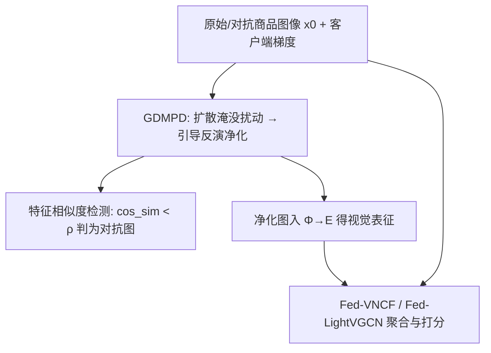
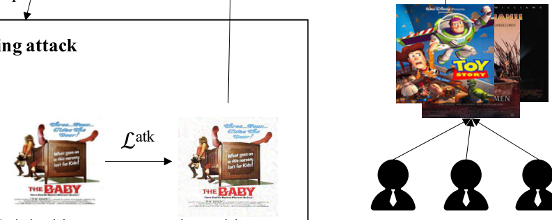

# Manipulating Visually-aware Federated Recommender Systems and Its Countermeasures (视觉感知联邦推荐系统的操控攻击及其防御)

- **会议/期刊**: ACM TOIS (arXiv 2305.08183, 2023-05)
- **作者与机构**: Wei Yuan, Hongzhi Yin (The University of Queensland); Shilong Yuan (Nanjing University); Chaoqun Yang, Quoc Viet Hung Nguyen (Griffith University)
- **推荐链路定位**: 端到端联邦训练（召回/排序共用一套公共参数）
- **研究方向**: 去偏公平、可信隐私与工业架构 / 多模态推荐
- **论文原文**: [https://arxiv.org/abs/2305.08183v2](https://arxiv.org/abs/2305.08183v2)
- **开源代码**: 暂未开源

## TL;DR (1分钟核心速览)

视觉联邦推荐（FedRec）中，现有 SOTA 模型投毒攻击（A-hum、PSMU）因图像辅助信号缓解了协同数据稀疏而**集体失效**（ER@5 恒为 0）；但视觉信息由外部商家上传，本文提出首个**图像投毒攻击 PSMU(V)**——只需 $\epsilon=4$的人眼不可察扰动，即在 ML/AZ 上 5–10 轮把冷门目标物品 ER@5 推到 1.0，叠加模型投毒（PSMU++）更快；防御端提出免训练的 **GDMPD**：用预训练 DDPM 的“扩散淹没 + 引导反演”净化每张上传图像，使全部攻击（$\epsilon\le 32$）ER@5 归零，且 NDCG@20 反升 2.3%–26.3%。

## Background & Motivation (背景与核心矛盾)

- **主流范式**: FedRec 由中心服务器与客户端只交换公共参数（物品嵌入 $\mathbf{V}$、视觉变换矩阵$\mathbf{E}$、塔参数$\boldsymbol{\Theta}$——本文用$\boldsymbol{\Theta}$ 记），以保护用户嵌入；近期为缓解协同信号稀疏，普遍引入预训练 CNN 提取的商品图像特征（VBPR 式融合）。
- **前人局限**: ① 所有定向投毒工作（PipAttack、FedRecAttack、A-hum、PSMU）只在**纯协同数据**上验证，其有效性被隐性归因于交互稀疏；② 一旦接入图像，物品表征由“稀疏 ID 嵌入”变为“稠密语义特征”，攻击的可控性未知；③ 集中式视觉攻击（EXPA 类）依赖白盒反馈与训练后阶段，与 FedRec 协议不兼容。
- **核心洞察 (Key Insight)**: 实验证实视觉信号使现有模型投毒全部失效（需 5–25 倍恶意用户才勉强生效）——稀疏性既是攻击的“杠杆”，也是防御的“缺口”；但图像上传通道本身是新的、更低成本的攻击面（一条图片 = 一次攻击，无需恶意客户端）。
- **本文切入点**: 沿“模型投毒 → 图像投毒 → 二者协同”逐级加压，再在服务器侧用扩散模型“洗图 + 验图”封堵该通道。

## Method (核心方法设计)

### 1. 整体框架 (Overall Framework)

视觉 FedRec 客户端本地用 $\hat{r}_{ij}=\sigma(\mathrm{FFN}([\mathbf{u}_i,\mathbf{v}_j,\mathbf{E}\Phi(i_j)]))$打分（VNCF），或把图像特征直接注入 LightGCN 传播$\mathbf{u}_i^{l}=\sum_{j\in\mathcal{N}_{u_i}}\frac{\mathbf{v}_j^{l-1}+\mathbf{E}\Phi(i_j)}{\sqrt{|\mathcal{N}_{u_i}||\mathcal{N}_{v_j}|}}$（LightVGCN），仅上传$\nabla\mathbf{V},\nabla\mathbf{E},\nabla\boldsymbol{\Theta}$。攻击侧分三档：PSMU 用合成用户算出的伪造梯度污染公共参数；PSMU(V) 由“物品图片提供方”在每轮迭代中上传扰动图；PSMU++ 让恶意用户把合成用户嵌入共享给图片提供方，实现两种攻击的梯度级协同。防御侧在中心服务器入口插一道 GDMPD：每张新上传图先经$T=1000$步扩散—引导反演得到净化图$\hat{\mathbf{x}}_0$，再据特征余弦相似度判定是否为对抗图。

<figure class="paper-figure" markdown="span">
  <figcaption>图1. 新威胁“图像投毒攻击”与我们所提出的基于扩散模型的防御机制概览。</figcaption>
</figure>

### 2. 关键设计拆解 (Key Designs)

1. **图像投毒 PSMU(V)：把不可微的 ER@5 换成可微的边际排序损失**。ER@5 不可导且 FedRec 拿不到良性用户反馈，作者用合成用户 $\tilde{\mathbf{U}}$（每轮随机采 30 个物品当“历史”，固定公共参数只训私有嵌入，即$\tilde{\mathbf{U}}=\arg\min \mathcal{L}_{rec}$，每轮重采以放大“少量恶意用户”的等效规模），把攻击目标松弛为强制目标物品压过推荐列表：
$\widetilde{\mathcal{L}}_{att}=\sum_{\tilde{u}_i}\sum_{v_t\in\widetilde{\mathcal{V}},v_t\notin\widetilde{\mathcal{V}}_i^+}\sum_{v_j\in\widehat{\mathcal{V}}_i,v_j\notin\widetilde{\mathcal{V}}}\sigma(\hat{r}_{ij}-\hat{r}_{it})$，
再对图像求带约束扰动 $\boldsymbol{\delta}^{t-1}=\arg\min_{\|\boldsymbol{\delta}\|\le\epsilon}\widetilde{\mathcal{L}}_{att}$。直觉：梯度只需把目标物品特征推入“热门语义簇”，与协同稀疏度解耦，故$\epsilon=4$ 即可奏效。

2. **扩散引导净化 GDMPD：用“前向淹没 + 受控反演”抹掉精巧扰动**。核心物理直觉来自前向式 $\mathbf{x}^{adv}_t=\sqrt{\bar\alpha_t}\mathbf{x}_0+\sqrt{\bar\alpha_t}\boldsymbol{\delta}+\sqrt{1-\bar\alpha_t}\boldsymbol{\zeta}$——$\boldsymbol{\delta}$随$\sqrt{\bar\alpha_t}$指数衰减、高斯噪声随$\sqrt{1-\bar\alpha_t}$上升，扰动被淹没而$\mathbf{x}_0$语义仍在；风险在于$t$太小洗不净、$t$ 太大语义漂移。为此在反向采样中注入扩散步引导：
$z\sim\mathcal{N}\big(\boldsymbol{\mu}_w(\hat{\mathbf{x}}_t,t)+\lambda\Sigma_w(\hat{\mathbf{x}}_t,t)\nabla_{\hat{\mathbf{x}}_t}\|\mathbf{x}_t-\hat{\mathbf{x}}_t\|,\ \Sigma_w I\big)$，
以退化前向图 $\mathbf{x}_t$作为“锚”抑制 DDPM 生成先验带来的语义改写（$\lambda=1000$）。因预训练 DDPM 只在干净图流形上学习过，反演天然把图拉回干净域。

3. **免训练对抗图检测与训练开销**。净化即“归一化”，故原始图与净化图的特征差是攻击强度的指示器：$\cos\_sim(\Phi(\mathbf{x}_0),\Phi(\hat{\mathbf{x}}_0))<\rho$判为对抗图，$\rho$由 ImageNet 干净图像相似度分布的下界$\rho_0=0.62$标定，无需任何对抗样本训练（避免“先有攻击才能检测”的循环）。总损失仍为客户端交叉熵$\mathcal{L}_{rec}$（式 1）+ 服务器端聚合，GDMPD 不参与训练、不引入负采样；代价是每张新图像一次 1000 步 DDPM 推理（仅在上传时触发，非每轮重复）。

## Experimental Setup & Evaluation Protocol (实验设置与评估协议)

- **数据集与预处理**: 二值化评分，每正例采 1:4 负例；所有用户 ≥5 交互。

| 数据集 | #Users | #Items | #Interactions | 密度 | 特征/场景说明 |
| :--- | :---: | :---: | :---: | :---: | :--- |
| ML (MovieLens-1M) | 6,040 | 3,706 | 1,000,208 | 4.46% | 3,301 物品有海报图 |
| AZ (Amazon Cell Phone) | 13,174 | 5,970 | 103,593 | 0.13% | 5,877 物品有图，极稀疏 |

- **数据划分与防穿越**: 沿用 PSMU 协议的全量交互训练（无时间切分），在**第 8 个全局轮**统一发起攻击，训练至收敛或最大轮数；目标物品取**最冷门物品**（最易被操控的分位）。
- **排名评测协议**: 攻击侧指标为 $\mathrm{ER@K}$（$K=5$，目标物品进入用户 Top-5 且用户此前未交互的比例），在全体用户上做全库打分，**非采样排序**；防御侧同时报告 NDCG@20（排序质量）与对抗图检测准确率。
- **对比基线与超参**: 基模型 Fed-NCF / Fed-LightGCN 及视觉版 Fed-VNCF / Fed-LightVGCN；攻击基线 No Attack、Popularity Attack（渐进式 EXPA 变体）、A-hum、PSMU。嵌入维度 $d=32$（图像经$\mathbf{E}$压到 32 维）、LightGCN 传播 1 层、Adam lr=0.001、恶意用户比$\xi=0.1\%$、$\epsilon=4$、合成用户交互数 30、DDPM 为 256×256 无条件预训练模型。

## Key Experimental Results (实验关键数据)

### 1. 主实验对比 (Main Results)

由于原文攻击结果以 ER@5 曲线（图 3–5、7）呈现，下表按“达到 ER@5=1.0 所需全局轮数 / 是否失效”整理核心数值：

| 目标模型 / 数据 | 攻击 | 恶意用户比 $\xi$ | 达 ER@5=1.0 轮数 | 结论 |
| :--- | :--- | :---: | :---: | :--- |
| Fed-NCF / ML | **PSMU** | 0.1% | **≈4** | 纯协同下强威胁 |
| Fed-LightGCN / ML | PSMU | 0.1% | ≈3 | — |
| Fed-NCF / AZ | PSMU | 0.1% | ≈3 | 越稀疏越易攻 |
| Fed-LightGCN / AZ | PSMU | 0.1% | **≈1** | 极稀疏 1 轮即破 |
| Fed-VNCF / ML | A-hum、PSMU | 0.1% | **失效 (ER@5=0)** | 视觉信号免疫 |
| Fed-LightVGCN / ML | A-hum、PSMU | 0.1% | 失效 (ER@5=0) | 视觉注入传播更稳 |
| Fed-VNCF / ML | PSMU | 1.5% | 有效 | 成本 ×15 |
| Fed-VNCF / AZ | PSMU | 0.5% | 有效 | 成本 ×5 |
| Fed-LightVGCN / ML | PSMU | 2.5% | 有效 | 成本 ×25 |
| Fed-LightVGCN / AZ | PSMU | 2.0% | 有效 | 成本 ×20 |
| Fed-VNCF / ML | **PSMU(V)** | 0.1% | **9** | 图像后门成立 |
| Fed-LightVGCN / ML | PSMU(V) | 0.1% | 10 | — |
| Fed-VNCF / AZ | PSMU(V) | 0.1% | **5** | 稀疏更易 |
| Fed-LightVGCN / AZ | PSMU(V) | 0.1% | 7 | — |
| 全部四组 | No Attack / Popularity | 0.1% | 恒 0 | 基线无效 |

### 2. 消融实验 (Ablation Study)

净化模块消融（指标 NDCG@20，括号为相对 original 的提升）：

| 防御配置 | ML-VNCF | ML-LVGCN | AZ-VNCF | AZ-LVGCN | PSMU++ 的 ER@5 |
| :--- | :---: | :---: | :---: | :---: | :---: |
| 无净化 (original) | 0.03985 | 0.03831 | 0.02786 | 0.02065 | **1.0** |
| GDMPD(-guidance) | 0.04833 (+21.3%) | 0.04494 (+17.3%) | 0.02806 (+0.7%) | 0.02135 (+3.4%) | 0.0 |
| **GDMPD (full)** | **0.05032 (+26.3%)** | **0.04623 (+20.7%)** | **0.02849 (+2.3%)** | **0.02246 (+8.8%)** | **0.0** |

鲁棒性扫描：$\epsilon\in\{4,8,16,32\}$× 2 模型 × 2 数据集共 8 格，全部为$(x,y)=(1.0,\,0.0)$，即无防御时攻击必达 ER@5=1.0、有 GDMPD 时一律降为 0.0。

### 3. 关键实验发现 (Key Findings)

1. **视觉信号是“攻防双刃剑”，且强度不对称**：接入图像后 PSMU 需 5–25 倍恶意用户才生效（$\xi$从 0.1% 抬到 0.5%–2.5%），但对手只需做一个图片提供方，$\epsilon=4$ 即在 5–10 轮达到同等 ER@5=1.0——防御收益以指数成本换取，攻击收益却以近乎零成本获得。
2. **图像特征“注入越深越稳”**：Fed-LightVGCN 在传播中（式 5）注入视觉特征，比 Fed-VNCF 的拼接式（式 4）更抗模型投毒（$\xi$ 需求 25× vs 15×），但面对 PSMU(V) 时两者均在 10 轮内沦陷，说明鲁棒性来自融合方式而非视觉本身。
3. **净化反而是“正则项”**：GDMPD 使 NDCG@20 全面上升（最高 +26.3%），根源是不同商家图像质量方差大（Blur 标准差 ML 2444.68→801.02、AZ 1682.55→523.75；Brisque 11.82→8.62、18.138→16.59），DDPM 反演把图像拉回统一干净流形；而检测器在 $\rho_0=0.62$下准确率 0.72、零误报，$\rho_1=0.69$ 时可达 1.0。

## Highlights & Limitations (亮点、对比与审稿批判)

- **与代表作对比 (vs. Prior Work)**: 相比 PipAttack/FedRecAttack（需大量恶意客户端或先验交互数据），PSMU(V) 把攻击者从“客户端”降级为“图片供应商”，无需任何私有反馈；相比集中式视觉攻击 EXPA（白盒 + 训练后生效），本文攻击在 FedRec 训练**过程中迭代执行**，且不触碰用户私有参数；相比 SGL/对比鲁棒类防御，GDMPD 是首个把扩散模型用于 FedRec 安全的工作。
- **可迁移亮点**: ① 把不可微的榜单指标松弛为“目标 vs 已推荐物品”的成对边际损失，是攻击/对抗训练的通用技巧；② “用扩散步锚定引导反演做净化”，可作为任何多模态推荐（短图、封面图）的入口清洗层；③ 用“原图–净化图特征相似度”做免训练 OOD 检测，无需对抗样本即可上线。
- **审稿级局限批判**: ① **缺自适应攻击评估**——攻击者在知晓净化器后可用 EOT/BPDA 穿透 1000 步 DDPM，本文仅评估非自适应 PSMU(V)，防御结论偏乐观；② **检测阈值 $\rho$依赖 ImageNet 统计且公开**，攻击者可将扰动压到$\rho$ 之下规避，0.72 的实测准确率也偏低；③ **系统开销未量化**：每张上传图需 1000 步 256×256 DDPM 推理，工业场景（百万级 SKU、秒级上新）代价存疑；④ 缺少冷/热物品分桶的完整数值表，多数攻击结论需从曲线读数。

## Rating (四维评分)

- **方法创新性 (Novelty)**: ⭐⭐⭐⭐ （首次定义 FedRec 图像投毒及其与模型投毒的协同，并以扩散模型“淹没扰动 + 引导反演”作为新防御范式，机制新颖且有清晰物理直觉）
- **评估协议与实验扎实度 (Protocol & Experiments)**: ⭐⭐⭐ （两数据集两基模型 + $\epsilon$ 扫描与检测可视化较完整，但攻击结果多以曲线呈现、无显著性检验，且缺自适应攻击这一必答题）
- **写作与数学规范度 (Clarity & Rigor)**: ⭐⭐⭐⭐ （攻击优化式、扩散前/反向与引导采样推导链条完整，$\epsilon=4$与集中式$\epsilon\ge32$ 的对比论证到位；但 ER@5 松弛的近似误差未讨论）
- **工业落地与复现价值 (Industrial & Practical Value)**: ⭐⭐⭐ （净化+检测即插即用、免训练免标注，但 1000 步扩散的在线延迟与显存开销未给出，且未开源代码，复现门槛较高）

