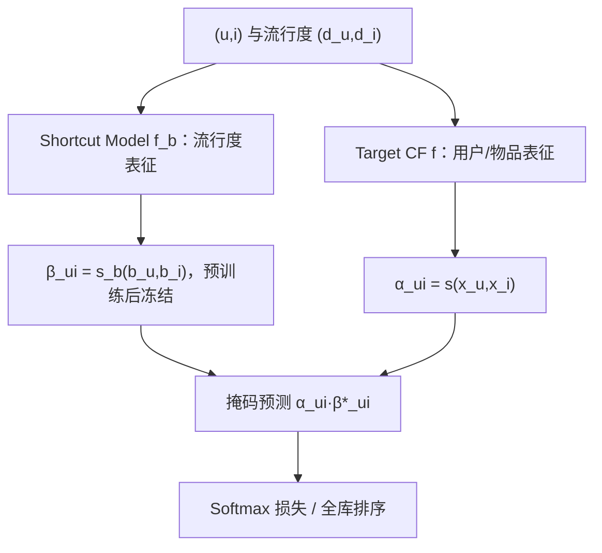
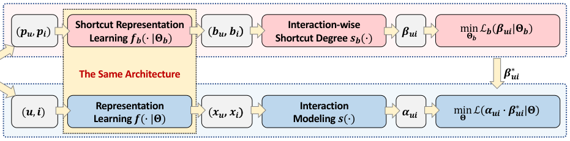

# Robust Collaborative Filtering to Popularity Distribution Shift (面向流行度分布漂移的鲁棒协同过滤)

- **会议/期刊**: TOIS 2024
- **作者与机构**: An Zhang, Wenchang Ma, Jingnan Zheng, Xiang Wang, Tat-Seng Chua；NUS、USTC 等
- **推荐链路定位**: 召回（CF 表征学习与 Top-N 排序）
- **研究方向**: 去偏公平、可信隐私与工业架构 / 协同过滤
- **论文原文**: [https://arxiv.org/abs/2310.10696v1](https://arxiv.org/abs/2310.10696v1)
- **开源代码**: [https://github.com/anzhang314/PopGo](https://github.com/anzhang314/PopGo)

## TL;DR (1分钟核心速览)

针对 CF 把流行度当捷径、在流行度分布漂移的 OOD 测试上失效的问题，PopGo 用同构 shortcut model 学习用户-物品交互级流行度捷径度 $\beta$，并以$\alpha\cdot\beta^*$ 调整预测，无需假设测试分布。四基准全库排序下，OOD/ID NDCG@20 相对最强去偏基线最高提升 42.86%/48.43%。

## Background & Motivation (背景与核心矛盾)

- **主流范式**: MF、LightGCN 等在训练交互上学习用户/物品表征，以 softmax/BPR 优化 Top-N 排序；DICE、MACR、IPS、CausE 等再去偏。
- **前人局限**: IPS/CausE 多以物品频率等单侧统计量衡量捷径，无法刻画同一物品对不同用户的交互级差异；DICE/MACR 等需预知测试分布或依赖无偏数据调参。
- **核心洞察**: 训练集与 ID 测试流行度近同，OOD 测试流行度显著漂移；现有方法常以牺牲 ID 换 OOD，并非真正提升泛化。图1直观展示了 Tencent 上该分布漂移与 ID/OOD 性能分化。
- **本文切入点**: 用一个与目标 CF 同构、仅输入 $(d_u,d_i)$ 的 shortcut model 拟合“纯流行度可解释部分”，再将该交互级捷径度作为掩码训练目标模型。

<figure class="paper-figure" markdown="span">
  ![图 1. (a) Tencent 数据集 \[65\] 的训练集、验证集、OOD 测试集和 ID 测试集的流行度分布。(b) 在 ID 和 OOD 测试评估中，去偏策略在 Tencent 数据集上的性能。对于蓝色和红色策略，被去偏的目标 CF 模型分别为 MF 和 LightGCN。](../../../../assets/papers/2310.10696v1/figure_1.png)<figcaption>图 1. (a) Tencent 数据集 [65] 的训练集、验证集、OOD 测试集和 ID 测试集的流行度分布。(b) 在 ID 和 OOD 测试评估中，去偏策略在 Tencent 数据集上的性能。对于蓝色和红色策略，被去偏的目标 CF 模型分别为 MF 和 LightGCN。</figcaption>
</figure>

## Method (核心方法设计)

### 1. 整体框架 (Overall Architecture)

输入用户-物品对 $(u,i)$及其流行度特征$(d_u,d_i)$。PopGo 先训练 shortcut model：$f_b$将流行度当类别特征编码为$b_u,b_i$，$s_b$输出交互级捷径度$\beta_{ui}$；随后冻结 shortcut model，训练目标 CF 模型，以$\alpha_{ui}\beta^*_{ui}$替换原 logits 做 softmax。推理时关闭 shortcut model，仅用$\alpha_{ui}$，不增加线上打分开销。

<figure class="paper-figure" markdown="span">
  <figcaption>图 2. PopGo 的整体框架。</figcaption>
</figure>

### 2. 关键设计拆解 (Key Designs)

1. **交互级 shortcut model（替代单侧频率）**：针对 IPS 只用物品频率、无法区分“同一物品对不同用户”的捷径差异，PopGo 令 $\beta_{ui}=s_b(f_b(d_u,d_i);\Theta_b)$，把用户与物品流行度组合成可学习交互级捷径度；相同流行度的用户/物品共享嵌入，参数量远小于 DICE 的个体 conformity 嵌入。

2. **掩码式去偏目标（把捷径变为难度权重）**：先以 $\mathcal{L}_b$ 训练 shortcut model 拟合流行度到交互的概率，再最小化
$$
\mathcal{L}=-\sum_{(u,i)\in\mathcal{O}^{+}}\log\frac{\exp(\alpha_{ui}\beta^*_{ui}/\tau)}{\sum_{j\in\mathcal{N}^{+}_u}\exp(\alpha_{uj}\beta^*_{uj}/\tau)} .
$$
$\beta^*_{ui}\approx1$的样本成为“容易样本”，$\beta^*_{ui}$小的样本被迫追求更高$\alpha_{ui}$，从而挖掘流行度无关的难例。

3. **因果/信息论解释与训练推理**：因果上，$\mathcal{L}_b$估计 pure indirect effect（PIE），掩码后的$\mathcal{L}$估计总效应并留下 total direct effect；信息论上先最大化$I(B;Y)$，再最大化$I(X;Y\mid B)$，即条件化流行度后学习用户-物品偏好。训练用采样 softmax，MF 版每正样本 64 负，LightGCN 版用 in-batch 负采样；shortcut model 预训练 5 epoch 后冻结，$\tau=0.07$。

## Experimental Setup & Evaluation Protocol (实验设置与评估协议)

- **数据集与预处理**: 采用 10-core 过滤；主实验四个数据集构造 ID/OOD 测试，Douban 做时间切分，Yahoo!R3 做无偏测试。

| 数据集 | #Users | #Items | #Interactions | 稀疏度 | 用途/场景 |
| :--- | :---: | :---: | :---: | :---: | :--- |
| Yelp2018 | 31,688 | 38,048 | 1,561,406 | 0.00130 | ID/OOD |
| Tencent | 95,709 | 41,602 | 2,937,228 | 0.00074 | ID/OOD |
| Amazon-Book | 52,643 | 91,599 | 2,984,108 | 0.00062 | ID/OOD |
| Alibaba-iFashion | 300,000 | 81,614 | 1,607,813 | 0.00007 | ID/OOD |
| Douban Movie | 36,644 | 22,226 | 5,397,926 | 0.00663 | 时间切分 |
| Yahoo!R3 | 14,382 | 1,000 | 129,748 | 0.00902 | 无偏测试 |

- **数据划分与防穿越**: 主四集按“训练/ID 验证/ID 测试/OOD 测试”划分；OOD 测试随机抽取 20% 交互、按物品等概率采样，构造均匀流行度测试集，剩余再按 50%/10%/20% 划分。Douban 按时间戳 70%/10%/20%；Yahoo!R3 用 MCAR 无偏测试。
- **排名评测协议**: 采用 all-ranking（测试阶段对未交互物品全库排序），报告 HR@20、Recall@20、NDCG@20；训练阶段使用负采样，非全库负例。
- **对比基线与超参**: 基线含 ItemPop、MF、LightGCN、UltraGCN，以及 IPS-CN、CausE、DICE、MACR、SAM-REG；$d=64$，LightGCN 2 层，Adam，学习率 1e-3，显著性$p<0.05$。

## Key Experimental Results (实验关键数据)

### 1. 主实验对比 (Main Results)

下表为 LightGCN 骨干下的 NDCG@20；PopGo 在 OOD 与 ID 上同时最优，未出现“OOD 升、ID 降”的权衡。

| 方法 | Yelp OOD | Yelp ID | Tencent OOD | Tencent ID | Amazon OOD | Amazon ID | iFashion OOD | iFashion ID |
| :--- | :---: | :---: | :---: | :---: | :---: | :---: | :---: | :---: |
| LightGCN | 0.0141 | 0.1210 | 0.0054 | 0.1067 | 0.0208 | 0.1224 | 0.0014 | 0.0318 |
| + IPS-CN | 0.0153 | 0.1030 | 0.0082 | 0.0878 | 0.0304 | 0.1149 | 0.0017 | 0.0276 |
| + DICE | 0.0161 | 0.0418 | 0.0104 | 0.0683 | 0.0186 | 0.0630 | 0.0020 | 0.0315 |
| + MACR | 0.0164 | 0.0832 | 0.0082 | 0.0967 | 0.0267 | 0.1082 | 0.0017 | 0.0235 |
| + SAM-REG | 0.0213 | 0.0893 | 0.0101 | 0.0663 | 0.0295 | 0.1080 | 0.0028 | 0.0229 |
| **+ PopGo** | **0.0231** | **0.1402** | **0.0113** | **0.1286** | **0.0398** | **0.1575** | **0.0040** | **0.0472** |
| **Improv.%** | **8.54%** | **15.87%** | **8.65%** | **20.52%** | **30.92%** | **23.34%** | **42.86%** | **48.43%** |

### 2. 消融实验 (Ablation Study)

| 消融项 | 观察 | 关键数字/证据 |
| :--- | :--- | :--- |
| 去掉 shortcut model（PopGo-S） | OOD 与 ID 均显著下降 | NDCG@20 最大降幅：MF 37.3%/58.3%，LightGCN 33.7%/81.8%（OOD/ID） |
| 相关性分析 | 掩码后预测更少依赖流行度 | $\mathcal{L}_b$与$\alpha$-loss 的相关性低于与$\alpha\beta^*$-loss 的相关性 |
| 表征可视化 | 去偏后物品表征边界更清晰 | t-SNE 中 MF+PopGo 按流行度分层更明显，流行/长尾物品均更可分 |

### 3. 关键实验发现 (Key Findings)

1. **真正提升泛化而非折中**：LightGCN+PopGo 在 iFashion 上 OOD NDCG@20 从最强基线 0.0028 升至 0.0040（+42.86%），ID 从 0.0318 升至 0.0472（+48.43%），说明不是牺牲 ID 换 OOD。
2. **shortcut model 是核心增益来源**：移除后 OOD/ID NDCG 大幅下降；且 $\mathcal{L}_b$与去偏预测损失相关性更低，证明$\alpha$ 确实剥离了流行度捷径。
3. **图模型受益更大**：LightGCN+PopGo 相对 LightGCN 的 OOD 增益普遍高于 MF+PopGo，符合图传播放大流行度偏差的机制；PopGo 通过同构 shortcut model 将模型相关偏差也一并刻画。

## Highlights & Limitations (亮点、对比与审稿批判)

- **与代表作对比**: IPS-CN 只用物品频率重加权，CausE 依赖 10% 无偏数据，DICE 学个体 conformity 嵌入，MACR 需测试分布先验调参；PopGo 的交互级 shortcut 不需测试先验，且同构克隆可捕获模型结构放大后的偏差。
- **可迁移亮点**: “克隆骨干网络为 shortcut model + 用 $\alpha\beta^*$ 做难度重加权”可迁移到序列推荐、多任务精排中的流行度/位置捷径抑制。
- **审稿级局限**: (1) 额外 shortcut model 增加显存与预训练开销，虽推理关闭但训练成本仍高于骨干；(2) OOD 测试为人工均匀采样，真实漂移更复杂，且仅针对流行度偏差，未覆盖曝光/选择偏差。

## Rating (四维评分)

- **方法创新性 (Novelty)**: ⭐⭐⭐⭐ （交互级 shortcut 与掩码去偏简洁有效，兼具因果与信息论解释）
- **评估协议与实验扎实度 (Protocol & Experiments)**: ⭐⭐⭐⭐ （ID/OOD/时间/无偏四类协议齐全，但 OOD 构造偏人工）
- **写作与数学规范度 (Clarity & Rigor)**: ⭐⭐⭐⭐ （PIE/TDE 与互信息推导清晰，公式符号统一）
- **工业落地与复现价值 (Industrial & Practical Value)**: ⭐⭐⭐⭐ （代码开源，推理零额外开销；训练需多一个同构模型）

