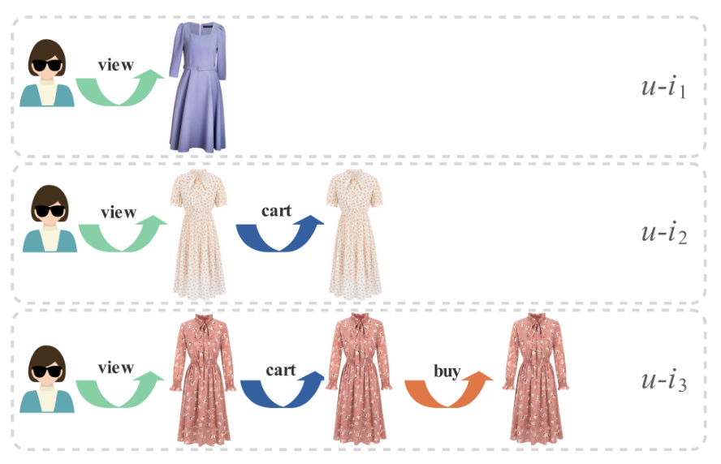
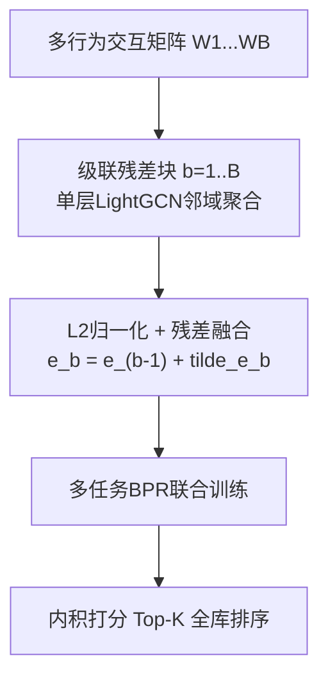
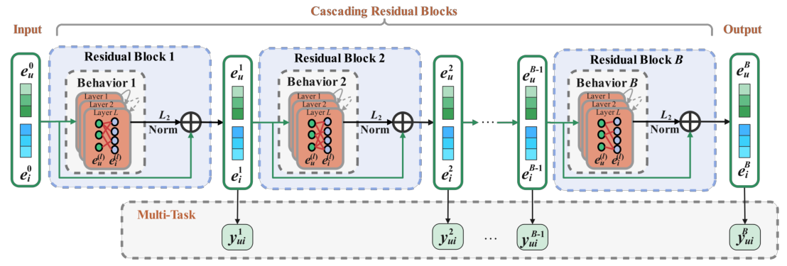

# Cascading Residual Graph Convolutional Network for Multi-Behavior Recommendation (级联残差图卷积多行为推荐)

- **会议/期刊**: ACM TOIS 2024
- **作者与机构**: Mingshi Yan, Zhiyong Cheng, Chen Gao, Jing Sun, Fan Liu, Fuming Sun, Haojie Li；齐鲁工业大学（山东省科学院）、大连民族大学、清华大学、新加坡国立大学、大连理工大学
- **推荐链路定位**: 召回/精排（Top-N 全库排序）
- **研究方向**: 图神经网络与知识图谱推荐 / 多任务学习与列表级重排
- **论文原文**: [论文原文链接](https://arxiv.org/abs/2205.13128v2)
- **开源代码**: [开源代码仓库链接](https://github.com/MingshiYan/CRGCN)

## TL;DR (1分钟核心速览)

针对单行为buy极度稀疏、现有多行为模型“先分行为建模再融合”忽略行为顺序且参数重的问题，CRGCN把view→collect→cart→buy串成级联残差块：每块用单层LightGCN提行为特征，L2归一化后残差注入上一块嵌入，多任务BPR联合训练，仅保留用户/物品ID嵌入。Leave-One-Out全库排序下，三数据集HR@K平均较S-MBRec提升24.76%/27.28%/25.10%。

## Background & Motivation (背景与核心矛盾)

- **主流范式**: 多行为推荐把view/cart/collect等辅助行为当辅助信号；主流做法是分行为建GCN或矩阵分解，再按贡献融合。
- **前人局限**: ①行为顺序蕴含偏好依赖，但多数模型只在预测分数层传递（NMTR）或在统一图上注意力聚合（MBGCN/GNMR），未把顺序关系显式写进嵌入学习；②为提升精度堆叠注意力/多GCN，参数与算力膨胀。
- **核心洞察 (Key Insight)**: 用户对物品的行为序列对应决策过程，后置行为揭示更具体偏好（图1）；若把前一行为学到的嵌入作为后一行为的上下文，可逐级精化且不增参数。
- **本文切入点**: 用“LightGCN + L2归一化 + 残差短路”组成级联块，按行为顺序串联，多任务BPR训练。

<figure class="paper-figure" markdown="span">
  <figcaption>图1. 不同类型行为的顺序与关系示意图。</figcaption>
</figure>

## Method (核心方法设计)

### 1. 整体框架 (Overall Architecture)

输入是按业务顺序排列的多行为交互矩阵 $W=[W^1,\ldots,W^B]$。每个级联残差块先在对应行为二分图上做单层LightGCN邻域聚合，得到行为特征；经L2归一化后与上一块输出残差相加，逐级精化用户/物品嵌入；各块输出分别接BPR损失做多任务联合训练；推理用最终嵌入内积对全库物品排序。除用户/物品ID嵌入外无额外可学习参数。

<figure class="paper-figure" markdown="span">
  <figcaption>图2. 我们CRGCN模型的结构。</figcaption>
</figure>

### 2. 关键设计拆解 (Key Designs)

1. **单行为LightGCN聚合（行为内协同信号提取）**：痛点：多行为模型常为每类行为配独立复杂网络。本文在每个行为二分图上只做单层无变换GCN：$\boldsymbol{e}_{u}^{(l)}=\sum_{i\in N_u}\frac{1}{\sqrt{|N_u|}\sqrt{|N_i|}}\boldsymbol{e}_{i}^{(l-1)}$，物品对称更新；一阶邻域已足够，避免高阶噪声。

2. **级联残差与L2归一化（跨行为偏好精化）**：痛点：GCN输出与上一块输入量纲不同，直接相加会被一方主导；且浅层行为信息易丢失。先归一化$\tilde{\boldsymbol{e}}_{u}=\boldsymbol{e}'_{u}/\|\boldsymbol{e}'_{u}\|_2$，再$\boldsymbol{e}_{u}^{b}=\boldsymbol{e}_{u}^{b-1}+\tilde{\boldsymbol{e}}_{u}^{b}$；短路保留旧信息，顺序串联注入行为依赖。

3. **多任务BPR与推理效率**：每个行为一个BPR任务：$\mathcal{L}_b=\sum_{(u,i,j)\in O}-\ln\sigma(\hat{y}_{ui}-\hat{y}_{uj})$，总损失$\mathcal{L}=\sum_b\mathcal{L}_b+\beta\|\Theta\|_2$；训练每正例采4负例，推理用最终嵌入内积全库排序；除P,Q外无额外可学习参数，复杂度≈LightGCN。

## Experimental Setup & Evaluation Protocol (实验设置与评估协议)

- **数据集与预处理**: 未显式5-core过滤；重复用户-物品交互保留最早一条。

| 数据集 | #Users | #Items | #Interactions | 稀疏度/密度 | 特征/场景说明 |
| :--- | :---: | :---: | :---: | :---: | :--- |
| Tmall | 41,738 | 11,953 | 2,292,594 | 0.46% | view/collect/cart/buy 4行为 |
| Beibei | 21,716 | 7,997 | 3,359,784 | 1.93% | view/cart/buy，固定顺序 |
| Jdata | 93,334 | 24,624 | 2,110,317 | 0.092% | view/collect/cart/buy 4行为 |

- **数据划分与防穿越 (Splitting Strategy)**: `Leave-One-Out`：每用户最后一条目标行为作测试正样本，倒数第二条作验证；测试候选为该正样本+所有训练未交互物品。
- **排名评测协议 (Ranking Protocol)**: 无偏`Full-Ranking (全库未交互排序)`，报告HR@K/NDCG@K（K=10,20,50,80）；训练每行为每用户采样1正4负。
- **对比基线与超参设置**: 2个单行为（MF-BPR、LightGCN）+6个多行为（R-GCN、NMTR-NCF、NMTR-GCN、MBGCN、GNMR、S-MBRec）；d=64，batch=1024，Adam，学习率搜索{1e-2,3e-3,1e-3,1e-4}，正则{1e-2,1e-3,3e-4,1e-4}，HR@20早停20轮；论文未报显著性检验。

## Key Experimental Results (实验关键数据)

### 1. 主实验对比 (Main Results)

**表1 主实验（HR@20/NDCG@20）**

| Method | Tmall HR@20 | Tmall NDCG@20 | Beibei HR@20 | Beibei NDCG@20 | Jdata HR@20 | Jdata NDCG@20 |
| :--- | :---: | :---: | :---: | :---: | :---: | :---: |
| MF-BPR | 0.0316 | 0.0144 | 0.0427 | 0.0179 | 0.2192 | 0.1325 |
| LightGCN | 0.0538 | 0.0243 | 0.0478 | 0.0204 | 0.2825 | 0.1582 |
| R-GCN | 0.0489 | 0.0198 | 0.0561 | 0.0219 | 0.3418 | 0.1588 |
| NMTR-NCF | 0.0847 | 0.0330 | 0.0587 | 0.0214 | 0.4086 | 0.1966 |
| MBGCN | 0.0799 | 0.0345 | 0.0639 | 0.0259 | 0.3603 | 0.1790 |
| GNMR | 0.0619 | 0.0247 | 0.0640 | 0.0280 | 0.3694 | 0.1944 |
| S-MBRec | 0.1009 | 0.0438 | 0.0770 | 0.0324 | 0.4957 | 0.2989 |
| **CRGCN** | **0.1238** | **0.0540** | **0.0944** | **0.0361** | **0.6190** | **0.3225** |
| Improv. vs best | 22.70% | 23.29% | 22.60% | 11.42% | 24.87% | 7.90% |

### 2. 消融实验 (Ablation Study)

**表2 消融（HR@20/NDCG@20）**

| 变体 | Tmall HR@20 | Tmall NDCG@20 | Beibei HR@20 | Beibei NDCG@20 | Jdata HR@20 | Jdata NDCG@20 |
| :--- | :---: | :---: | :---: | :---: | :---: | :---: |
| w/o short-cut（保留L2） | 0.0225 | 0.0086 | 0.0249 | 0.0095 | 0.2046 | 0.0999 |
| w/o L2（保留short-cut） | 0.1059 | 0.0455 | 0.0615 | 0.0244 | 0.5093 | 0.2613 |
| Full CRGCN | **0.1238** | **0.0540** | **0.0944** | **0.0361** | **0.6190** | **0.3225** |

### 3. 关键实验发现 (Key Findings)

1. **残差短路是主增益，L2归一化是稳定器**：Tmall上完整模型HR@20=0.1238，去掉short-cut骤降至0.0225（-81.8%）；去掉L2降至0.1059（-14.5%）。Beibei/Jdata同样下滑，说明“保留上一行为特征+尺度对齐”缺一不可。

2. **行为顺序与密度决定多行为收益**：Tmall逐行为层数实验中，[1,1,1,1]的T1取得HR@20=0.1223；把view层数从1增到2的T2降至0.1036，说明错误顺序/高阶噪声会污染后续行为。Beibei固定view→cart→buy时，B4（buy多一层）HR@20=0.0927高于B1的0.0812，后置行为更可信。

3. **轻量模型仍显著优于复杂基线**：CRGCN仅保留P,Q两组可学习参数，Tmall/Beibei/Jdata的HR@20较最强基线S-MBRec分别提升22.70%/22.60%/24.87%，平均HR@K提升24.76%/27.28%/25.10%；单层GCN最优，堆到2层在Tmall T2反降至0.1036。

## Highlights & Limitations (亮点、对比与审稿批判)

- **与代表作对比 (vs. Prior Work)**: NMTR只在预测分数层传递级联关系，CRGCN把级联写进嵌入；MBGCN用统一图+可学习行为权重，GNMR用注意力递归传播，S-MBRec用多GCN+对比学习；CRGCN无额外参数、单层GCN，靠残差+归一化取得更高精度。
- **可迁移亮点**: ①L2归一化后再残差融合，可防止不同来源特征量纲失衡；②按业务决策顺序串联轻量GCN块，可作为多行为/多场景特征精化模板。
- **审稿级局限批判**: ①各行为任务等权，论文自己也承认非最优，需调权或自动加权；②行为顺序需人工预设，Tmall/Jdata顺序并不严格，错误顺序会掉点；③仅离线全库排序与模拟冷启动，缺线上A/B和时延报告。

## Rating (四维评分)

- **方法创新性 (Novelty)**: ⭐⭐⭐⭐ （级联残差把行为顺序写进嵌入学习，结构简单但切中“无额外参数”的工程痛点；理论分析以复杂度为主，缺谱域解释）
- **评估协议与实验扎实度 (Protocol & Experiments)**: ⭐⭐⭐⭐ （三真实数据集、Leave-One-Out全库排序、7个基线、消融/层数/顺序/冷启动齐全；未报显著性检验）
- **写作与数学规范度 (Clarity & Rigor)**: ⭐⭐⭐⭐ （符号清晰、公式简洁，L2与残差动机解释到位；复杂度分析略粗）
- **工业落地与复现价值 (Industrial & Practical Value)**: ⭐⭐⭐⭐⭐ （开源、仅P/Q参数、复杂度≈LightGCN，易嵌入现有多行为召回/精排）

