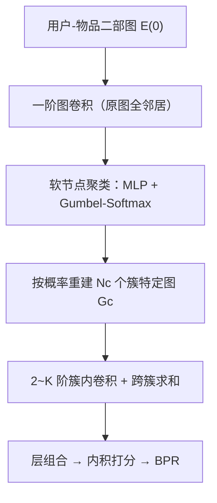
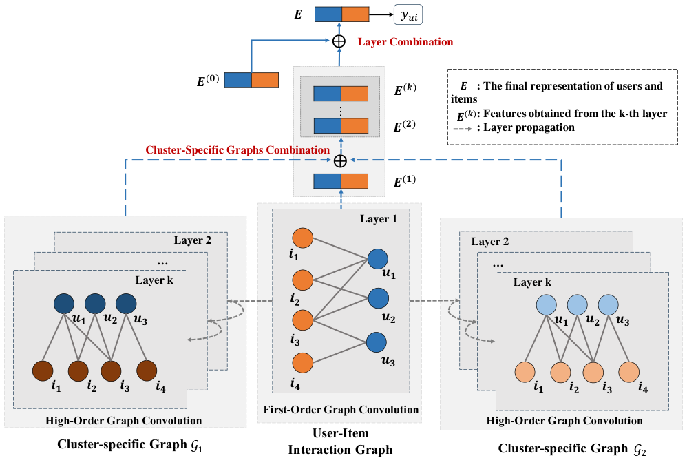

# Cluster-based Graph Collaborative Filtering (基于聚类的图协同过滤)

- **会议/期刊**: ACM TOIS 2024
- **作者与机构**: Fan Liu, Mohan Kankanhalli (NUS)；Shuai Zhao (齐鲁工大)；Zhiyong Cheng (合工大)；Liqiang Nie (哈工大深圳)
- **推荐链路定位**: 召回（图协同过滤表征学习）
- **研究方向**: 图神经网络与知识图谱推荐 / 协同过滤
- **论文原文**: [https://arxiv.org/abs/2404.10321v2](https://arxiv.org/abs/2404.10321v2)
- **开源代码**: [https://github.com/zhao254014/ClusterGCF](https://github.com/zhao254014/ClusterGCF)

## TL;DR (1分钟核心速览)

现有 GCN 推荐在**高阶卷积时不区分邻居**：既把兴趣不相似用户传来的噪声混入目标表征，又在多层堆叠后迅速过平滑（LightGCN 类模型 3~4 层即崩）。本文提出 ClusterGCF——先做一次全图一阶传播，再用 Gumbel-Softmax **可微软聚类**把用户与物品同时分配到多个簇，按软分配概率重建若干「簇特定图」，二阶级以上卷积只在簇内传播。在 Office/Kindle/Gowalla/Yelp2018 四个数据集、Recall/HR/NDCG@20 上全面超越 IMP-GCN、GTN、NCL 等 8 个基线，`Improv.` 达 2.2%–5.2%，且最优层数从 3~4 层加深到 6~7 层。

## Background & Motivation (背景与核心矛盾)

- **主流范式**: NGCF → LightGCN（去特征变换/非线性）→ UltraGCN（免消息传递）、DGCF（意图解耦）、NCL（对比学习）、GTN（交互可靠性自适应），核心均是在用户-物品二部图上做邻居聚合以捕获高阶协同信号。
- **前人局限**: ① 高阶邻居被无差别聚合，兴趣无关用户（如悬疑读者接收到园艺书信号）的噪声污染目标节点表征；② 无差别卷积使图拉普拉斯被反复平滑，堆叠层数一多节点表征趋同，性能陡降。
- **核心洞察 (Key Insight)**: IMP-GCN 用**硬聚类**（每个用户只属一个子图）来区分高阶邻居，但真实用户兴趣天然重叠——同一用户可同时偏好科幻与爱情片，同一物品也可同属多类；硬分配把跨界兴趣直接切断，信息利用率受损（见图 1 用户簇示意）。
- **本文切入点**: 用**软聚类 + 概率加权图**替代硬子图划分，让节点按隶属度同时存在于多个簇图中，并把聚类与推荐目标端到端联合优化。

## Method (核心方法设计)

### 1. 整体框架 (Overall Architecture)

模型遵循「一阶走原图、高阶走簇图」的混合传播范式：输入用户/物品 ID 嵌入 $E^{(0)}$，第 1 层在原二部图上做标准对称归一化聚合（保留最可靠的一阶直接交互）；同时用「ID 嵌入 + 一阶结构嵌入」经两层 MLP 得到簇 logits，再由 Gumbel-Softmax 输出软分配概率$P$；以$P$为节点权重、保留原图拓扑重建$|\mathcal{N}_c|$个簇特定图，第 2 至$K$层在这些簇图上分别传播并逐层跨簇求和；最后按 LightGCN 方式做层组合得$e_u,e_i$，内积打分，BPR 损失训练。

<figure class="paper-figure" markdown="span">
  <figcaption>图2. 我们的含两个簇特定图的 ClusterGCF 模型概览。在 ClusterGCF 中，一阶传播在原始用户-物品交互图上进行，高阶传播在簇特定图 G1 和 G2 上进行。簇特定图通过根据原始用户-物品交互图中节点与不同簇的关联为其分配概率来构建。</figcaption>
</figure>

### 2. 关键设计拆解 (Key Designs)

1. **软节点聚类（Gumbel-Softmax 可微分配）**：硬聚类的离散指派不可导、且无法表达多重兴趣。本文先融合结构信息得 $F_u=\sigma(W_1(e_u^{(0)}+e_u^{(1)})+b_1)$，再投影为$|\mathcal{N}_c|$维 logits$H_u$，用$P_u=\mathrm{Softmax}\left((H_u+g)/\tau\right)$输出可微软分配，$g$为 Gumbel 噪声、$\tau$ 为温度；用户与物品**都参与**聚类。可微性使聚类边界能被推荐损失直接反传修正，无需任何簇标签。

2. **簇特定图构建与高阶簇内卷积**：原来的问题是高阶聚合会跨越兴趣边界。这里以软概率为节点权重、原边为骨架重建簇图，第 2 阶起在簇 $c$上传播$e_u^{(c,k)}=\sum_{i\in\mathcal{N}_u}\frac{p_i^c}{\sqrt{|\mathcal{N}_u||\mathcal{N}_i|}}e_i^{(c,k-1)}$，并在层间做跨簇求和$e_u^{(k)}=\sum_{c\in\mathcal{N}_c}e_u^{(c,k)}$。权重$p$使「兴趣不匹配」的邻居消息被自动压低（如图 9 中$u_{126}$ 的三个物品在两簇中权重互补，任一簇内其影响都被削弱），从而在**不丢弃任何边**的前提下实现软去噪；同时各簇保留差异化表征，抑制过平滑。

3. **训练目标与复杂度**：BPR 成对损失 $\min\sum_{(u,i^+,i^-)}-\ln\phi(\hat{r}_{ui^+}-\hat{r}_{ui^-})+\lambda\|\Theta\|_2^2$，$\hat r_{ui}=e_u^\top e_i$。实现上采用矩阵形式$E_c^{k}=L\times(P_c\odot E_c^{k-1})$，即一次稀疏矩阵乘 + 一次逐元素加权，额外开销仅$O(|\mathcal{N}_c|\cdot|E|\cdot d)$，与 LightGCN 同阶；负采样为每个正样本配 1 个均匀随机负样本。推理时直接内积全库排序。

## Experimental Setup & Evaluation Protocol (实验设置与评估协议)

- **数据集与预处理**:

| 数据集 | #Users | #Items | #Interactions | 稀疏度 | 说明 |
| :--- | :---: | :---: | :---: | :---: | :--- |
| Office | 4,874 | 2,406 | 52,957 | 99.55% | Amazon 5-core |
| Kindle Store | 14,356 | 15,885 | 367,477 | 99.83% | Amazon 10-core |
| Gowalla | 29,858 | 40,981 | 1,027,370 | 99.92% | LBS 签到，10-core |
| Yelp2018 | 31,668 | 38,048 | 1,561,406 | 99.87% | 商户点评，10-core |

- **数据划分与防穿越**: 每个用户交互**随机 80:20 划分**训练/测试，再从训练集抽 10% 作验证集调参；非严格时间切分，存在轻度未来信息泄漏风险。
- **排名评测协议**: `Sampled Ranking`——测试阶段对每个正样本配 1 个随机负样本（1:1）排序，报告 Recall@20 / HR@20 / NDCG@20，**未采用 Full-Ranking**，指标绝对值偏高。
- **对比基线与超参**: 基线含 NeuMF、GCMC、NGCF、LightGCN、UltraGCN、DGCF、IMP-GCN、NCL、GTN；嵌入维度 $d=64$（Xavier 初始化），Adam lr=1e-3，batch 1024（Office/Kindle）/2048（Gowalla/Yelp），$L_2$系数与层数$\{1..8\}$网格搜索，簇数$\{2,3,4\}$，温度$\{10^{-2},\dots,10^{2}\}$；原表以 `*` 标注显著性（$p<0.05$）。

## Key Experimental Results (实验关键数据)

### 1. 主实验对比 (Main Results)

| 数据集 / 指标 | Office R@20 | Office N@20 | Kindle R@20 | Gowalla R@20 | Gowalla N@20 | Yelp R@20 | Yelp N@20 |
| :--- | :---: | :---: | :---: | :---: | :---: | :---: | :---: |
| NeuMF | 6.92 | 6.29 | 6.83 | 12.95 | 11.18 | 4.70 | 3.72 |
| NGCF | 12.57 | 7.42 | 9.41 | 15.70 | 13.27 | 5.81 | 4.75 |
| LightGCN | 13.19 | 7.83 | 9.94 | 18.09 | 15.42 | 6.33 | 5.12 |
| UltraGCN | 13.52 | 8.13 | 10.70 | 18.60 | 15.72 | 6.70 | 5.47 |
| DGCF | 13.27 | 7.89 | 10.05 | 18.24 | 15.51 | 6.37 | 5.08 |
| NCL | 13.40 | 8.08 | 10.65 | 18.57 | 15.66 | 6.63 | 5.38 |
| IMP-GCN | 13.48 | 8.11 | 10.77 | 18.62 | 15.76 | 6.66 | 5.45 |
| GTN | 13.54 | 8.16 | 10.78 | 18.65 | 15.83 | 6.75 | 5.54 |
| **ClusterGCF** | **13.97**\* | **8.46**\* | **11.16**\* | **19.07**\* | **16.21**\* | **7.06**\* | **5.83**\* |
| **Improv.** | +3.18% | +3.68% | +3.53% | +2.25% | +2.40% | +4.59% | +5.23% |

### 2. 消融实验 (Ablation Study)

| 变体 | 说明 | Office R@20 | Kindle R@20 | Gowalla R@20 | Yelp R@20 |
| :--- | :--- | :---: | :---: | :---: | :---: |
| IMP-GCN | 硬聚类子图（最强基线） | 13.48 | 10.77 | 18.62 | 6.66 |
| ClusterGCF$_F$ | 一阶也在簇图上 | 13.78 | 10.94 | 18.74 | 6.74 |
| ClusterGCF$_T$ | 前两阶走原图 | 13.86 | 11.05 | 18.88 | 6.86 |
| ClusterGCF$_{user}$ | 仅聚类用户 | 13.88 | 11.03 | 18.97 | 6.94 |
| ClusterGCF$_{item}$ | 仅聚类物品 | 13.72 | 10.84 | 18.85 | 6.82 |
| **ClusterGCF** | 完整模型 | **13.97** | **11.16** | **19.07** | **7.06** |

### 3. 关键实验发现 (Key Findings)

1. **软聚类 > 硬聚类，且物品侧聚类不可省**：相对 IMP-GCN，仅聚类用户即涨（Office 13.48→13.88），但加上物品侧聚类才到 13.97；说明「物品的多重属性」与「用户的多重兴趣」同等重要，而 IMP-GCN 只用同兴趣用户及其物品构图，丢失了物品侧去噪。
2. **过平滑明显被缓解**：LightGCN/NCL/GTN 在 3~4 层见顶后急跌，IMP-GCN 峰值在第 5~6 层，ClusterGCF 在 Office/Yelp 峰值延后到 **6/7 层**且深层持续领先——簇内传播避免了跨兴趣混合，使加深层数仍带来增益而非趋同。
3. **温度与簇数存在明显折中**：$\tau=10^{-1}$时最优，$\tau$过大则分配趋于均匀、簇失去区分度导致掉点；$\tau$过小退化为硬聚类；簇数在 Office 上以 2 最佳，簇过多会细化过度、削弱近距邻居的有价值信息。此外 ClusterGCF$_F$ 最差，证明一阶邻居必须无差别保留，去噪只应作用于二阶及以上。

## Highlights & Limitations (亮点、对比与审稿批判)

- **与代表作对比 (vs. Prior Work)**: 与 IMP-GCN 的本质差异在于「软 vs 硬」与「双侧 vs 单侧」——IMP-GCN 用硬子图 + 仅用户侧分组且聚类不可学；GTN 通过趋势滤波对边做自适应平滑（边粒度），本文则是节点粒度、可端到端优化的多簇隶属；相对 LightGCN 则引入了一个几乎零额外推理成本的高阶去噪算子。
- **可迁移亮点**: ① Gumbel-Softmax 软分配权重可直接乘进任何归一化邻接矩阵，作为「软子图掩码」插件挂到 LightGCN/UltraGCN 上；② 「一阶留原图、高阶才分簇」的分层策略是通用工程经验，避免过度细化切断可靠近邻；③ 层组合 + 跨簇求和的实现可完全写成稀疏矩阵乘，易落地。
- **审稿级局限批判**: ① 评测采用 1:1 负采样排序，而非 Full-Ranking，且各基线是否统一调参/统一采样未充分说明，指标虚高与可比性存疑，缺少方差与多次运行报告；② 每层需对 $|\mathcal{N}_c|$个簇图各做一次传播，显存与计算随簇数线性增长，论文未给出训练时长/显存实测；③ 聚类质量完全依赖 ID 嵌入与结构，冷启动物品缺乏一阶邻居时$F_i$ 不可靠，且未在冷启动或长尾分桶上验证。

## Rating (四维评分)

- **方法创新性 (Novelty)**: ⭐⭐⭐⭐ （软聚类 + 可微分配替代硬子图，思路朴素但切中多重兴趣这一真实痛点，缺理论/谱域分析支撑）
- **评估协议与实验扎实度 (Protocol & Experiments)**: ⭐⭐⭐ （四数据集 + 9 基线 + 层数/簇数/温度/节点类型多角度消融很完整，但仅 1:1 采样排序、无 Full-Ranking 与方差报告）
- **写作与数学规范度 (Clarity & Rigor)**: ⭐⭐⭐⭐ （公式与矩阵化传播规则清晰、图中示例直观，个别符号如 $k=2$ 处记号略混）
- **工业落地与复现价值 (Industrial & Practical Value)**: ⭐⭐⭐⭐ （代码已开源、稀疏矩阵实现与 LightGCN 同阶开销、可按簇并行，适合作为召回层图模型的即插即用增强）

