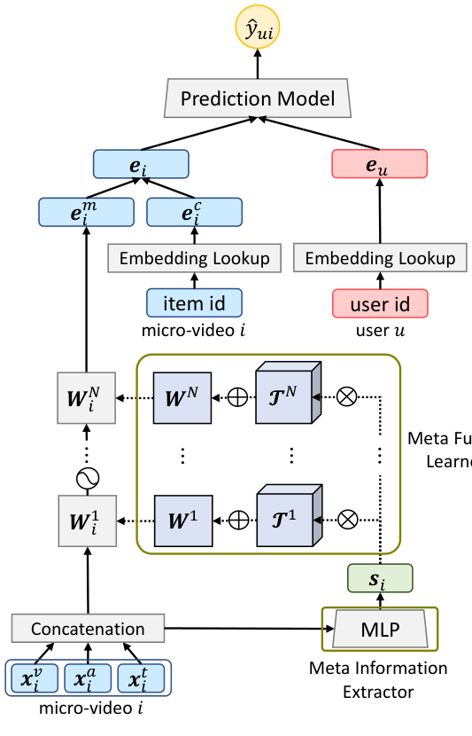
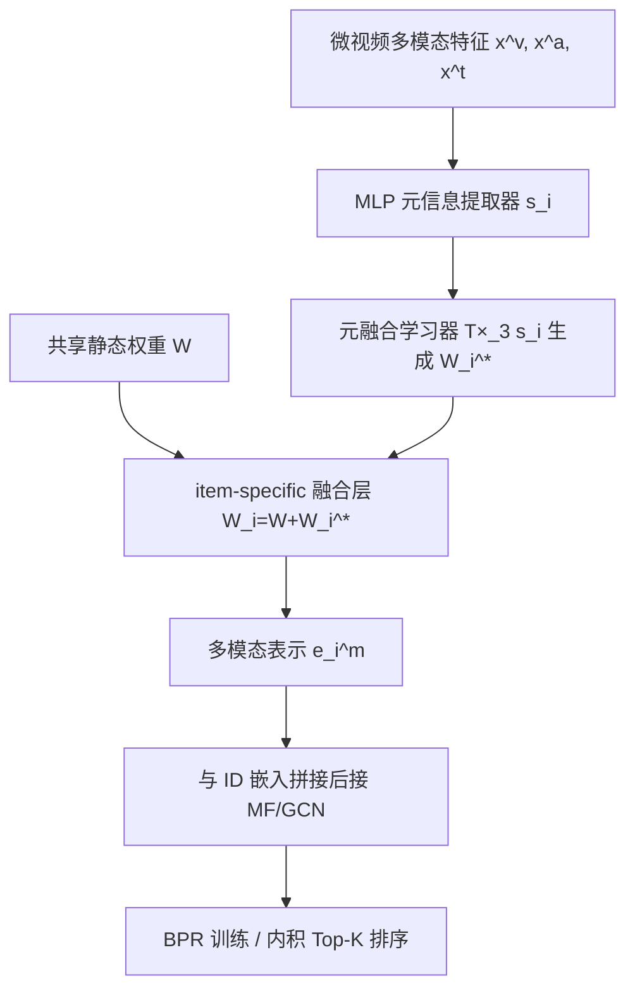

# Dynamic Multimodal Fusion via Meta-Learning Towards Micro-Video Recommendation (基于元学习的动态多模态融合微视频推荐)

- **会议/期刊**: ACM Transactions on Information Systems (TOIS)
- **作者与机构**: Han Liu, Yinwei Wei, Fan Liu, Wenjie Wang, Liqiang Nie, Tat-Seng Chua；山东大学、新加坡国立大学、哈工大（深圳）
- **推荐链路定位**: 召回/精排（通用表示学习与 Top-K 排序）
- **研究方向**: 多模态推荐 / 动态融合
- **论文原文**: [论文原文链接](https://arxiv.org/abs/2501.07110v1)
- **开源代码**: [开源代码仓库链接](https://github.com/hanliu95/MetaMMF)

## TL;DR (1分钟核心速览)

针对微视频静态多模态融合无法刻画不同视频模态关系的问题，本文把每个视频的融合视作独立任务，用元学习由多模态特征生成 item-specific 融合网络权重，并以 CP 分解压缩 3D 张量。在 MovieLens/TikTok/Kwai 的 per-user 80/10/10 划分与全库排序下，MetaMMF_GCN 的 NDCG@10 较最强基线分别提升 5.27%/6.54%/4.46%。

## Background & Motivation (背景与核心矛盾)

- **主流范式**: 微视频推荐通常将视觉、声学、文本特征通过线性组合、注意力或 GCN 聚合为静态融合表示，再与 ID 嵌入拼接做 MF/GCN 打分。
- **前人局限**: 静态融合隐含两个强假设——同一模态在不同视频中作用相似、一个全局融合函数足以覆盖所有视频；但音乐类视频的视觉/声学常互补，教育类视频的声学/文本更一致，模态关系随内容变化。
- **核心洞察 (Key Insight)**: 每个微视频应拥有自己的融合函数；元学习可由单个任务的内容特征快速生成自适应参数，并借共享参数缓解单物品样本不足。
- **本文切入点**: 将 item 级多模态融合建模为 meta-task，用元信息条件化生成融合层权重，实现动态而非静态融合。

## Method (核心方法设计)

### 1. 整体框架 (Overall Architecture)

输入为微视频 $i$的视觉/声学/文本特征及其 ID；MLP 先抽取低维元信息$\mathbf{s}_i$，元融合学习器用共享 3D 张量与$\mathbf{s}_i$相乘生成 item-specific 融合层权重，并叠加共享权重$\mathbf{W}$得到$\mathbf{W}_i$。多层堆叠后输出多模态表示$\mathbf{e}_i^m$，与 ID 嵌入拼接送入 MF 或 GCN，以 BPR 端到端训练，最终内积全库排序。CP 分解将 3D 张量参数压缩，在保持动态融合能力的同时降低显存与训练开销。

<figure class="paper-figure" markdown="span">
  <figcaption>图 2. 所提模型的示意图。</figcaption>
</figure>
图 1：MetaMMF 整体架构（原图 2）。

### 2. 关键设计拆解 (Key Designs)

1. **元信息条件化动态融合**：静态融合为 $\mathbf{e}_i^m=\mathbf{W}[\mathbf{x}_i^v;\mathbf{x}_i^a;\mathbf{x}_i^t]$，所有物品共享$\mathbf{W}$，无法适配不同模态关系。本文先抽元信息$\mathbf{s}_i=\phi_{out}(\phi_{mid}(\phi_{in}([\mathbf{x}_i^v;\mathbf{x}_i^a;\mathbf{x}_i^t])))$，再生成$\mathbf{W}_i=\mathbf{W}+\mathcal{T}\times_3\mathbf{s}_i$，并输出$\mathbf{e}_i^m=\mathbf{W}_i[\mathbf{x}_i^v;\mathbf{x}_i^a;\mathbf{x}_i^t]$。直觉上，$\mathbf{W}$学全局共性，$\mathcal{T}\times_3\mathbf{s}_i$ 按内容对 2D 权重矩阵做线性组合，实现“千视频千融合”。

2. **多层塔式融合与 CP 压缩**：第 $n$层权重为$\mathbf{W}_i^n=\mathbf{W}^n+\mathcal{T}^n\times_3\mathbf{s}_i$，多层堆叠提升非线性融合能力，但 3D 张量参数随层数膨胀。本文对$\mathcal{T}^n$做 CP 分解$\mathcal{T}^n\approx\sum_{r=1}^R\mathbf{a}_r^n\circ\mathbf{b}_r^n\circ\mathbf{c}_r^n$，空间复杂度由$O(PQZ)$降至$O(R(P+Q+Z))$；$R=8/16$ 时可压到原始约 1%，并缓解 GCN 组合下的过拟合。

3. **训练目标、负采样与推理效率**：采用 BPR pairwise 损失 $\mathcal{L}=\sum_{(u,i,j)}-\ln\sigma(\hat{y}_{ui}-\hat{y}_{uj})+\lambda\|\Phi\|_2^2$，每个正样本配训练集未交互负样本；用户/物品表示内积排序。物品融合可离线预计算，在线主要查表与内积；元网络前向主要发生在训练与新物品编码阶段。

## Experimental Setup & Evaluation Protocol (实验设置与评估协议)

- **数据集与预处理**: 采用 MMGCN/GRCN 公开版本，原文未提 5-core 过滤；MovieLens 用预告片与描述提取多模态特征，TikTok 使用发布特征，Kwai 缺声学模态。

| 数据集 | #Users | #Items | #Interactions | 密度 | 模态特征维度 |
| :--- | :---: | :---: | :---: | :---: | :--- |
| MovieLens | 55,485 | 5,986 | 1,239,508 | 0.37% | v2048 / a128 / t100 |
| TikTok | 36,656 | 76,085 | 726,065 | 0.03% | 128 / 128 / 128 |
| Kwai | 7,010 | 86,483 | 298,492 | 0.05% | 2048 / - / 128 |

- **数据划分与防穿越 (Splitting Strategy)**: 每用户随机划分 80% 训练、10% 验证、10% 测试；**非时间戳切分**，存在未来交互泄漏风险，但验证集仅用于调参。
- **排名评测协议 (Ranking Protocol)**: 测试时排除训练已交互物品，对全库其余物品打分排序，属于 **Full-Ranking 全库排序**；训练阶段为每个正样本采样未交互负样本做 BPR。
- **对比基线与超参设置**: 对比 MF 类 VBPR、GCN 类 LightGCN/GAT/NGCF、 多模态类 MMGCN/GRCN/LATTICE/InvRL；表示维度 $d=64$，Adam，学习率$1e-3$，$\lambda=1e-6$，元信息维度$d_s=5$，batch 3000，单样本 t 检验$p<0.05$。

## Key Experimental Results (实验关键数据)

### 1. 主实验对比 (Main Results)

| 方法 | ML HR@10 | ML N@10 | TikTok HR@10 | TikTok N@10 | Kwai HR@10 | Kwai N@10 |
| :--- | :---: | :---: | :---: | :---: | :---: | :---: |
| VBPR | 0.1512 | 0.1207 | 0.0496 | 0.0397 | 0.0220 | 0.0221 |
| LightGCN | 0.1753 | 0.1525 | 0.0705 | 0.0565 | 0.0314 | 0.0357 |
| MMGCN | 0.1900 | 0.1535 | 0.0706 | 0.0570 | 0.0309 | 0.0361 |
| GRCN | 0.1925 | 0.1653 | 0.0717 | 0.0586 | 0.0320 | 0.0367 |
| LATTICE | 0.1939 | 0.1669 | 0.0714 | 0.0583 | 0.0323 | 0.0379 |
| InvRL | 0.1934 | 0.1666 | 0.0726 | 0.0612 | 0.0324 | 0.0381 |
| MetaMMF_MF | 0.1539 | 0.1268 | 0.0521 | 0.0422 | 0.0285 | 0.0336 |
| **MetaMMF_GCN** | **0.2018** | **0.1757** | **0.0775** | **0.0652** | **0.0340** | **0.0398** |

MetaMMF_GCN 相对最强基线：N@10 提升 **5.27%/6.54%/4.46%**，HR@10 提升 **4.07%/6.75%/4.94%**，均通过 $p<0.05$ 显著性检验。

### 2. 消融实验 (Ablation Study)

| 变体 | ML HR@10 | ML N@10 | TikTok HR@10 | TikTok N@10 | Kwai HR@10 | Kwai N@10 |
| :--- | :---: | :---: | :---: | :---: | :---: | :---: |
| **MetaMMF_GCN（最优层数）** | **0.2018** | **0.1757** | **0.0775** | **0.0652** | **0.0340** | **0.0398** |
| w/o 静态权重 $\mathbf{W}$ | 0.2016 | 0.1753 | 0.0769 | 0.0638 | 0.0312 | 0.0370 |
| 仅 1 层融合 | 0.1965 | 0.1709 | **0.0775** | **0.0652** | **0.0340** | **0.0398** |
| 4 层融合 | **0.2018** | **0.1757** | 0.0757 | 0.0630 | 0.0308 | 0.0374 |

### 3. 关键实验发现 (Key Findings)

1. **动态融合整体有效，且与 GCN 组合收益最大**：MetaMMF_MF 已优于 VBPR（Kwai HR@10 0.0285 vs 0.0220），但 MetaMMF_GCN 进一步借图传播把 N@10 推至 0.1757/0.0652/0.0398，说明动态融合提供高质量初始化，GCN 负责高阶协同信号。
2. **融合层数应随稀疏度调整**：MovieLens 较密，4 层优于 1 层（N@10 0.1757 vs 0.1709）；TikTok/Kwai 稀疏，1 层最佳，增至 4 层反而降至 0.0630/0.0374，表明深层元融合在稀疏数据上易过拟合。
3. **CP 分解兼顾效率与效果，共享静态权重不可省**：$R=8/16$可把参数压至约 1%，MovieLens 上 MetaMMF_GCN 收敛从 55–60 epoch 降至 40–45，训练时间 12.41→11.69 min/ep；去掉静态$\mathbf{W}$ 后 Kwai N@10 由 0.0398 降至 0.0370，说明“共享共性 + 动态个性”缺一不可。

## Highlights & Limitations (亮点、对比与审稿批判)

- **与代表作对比 (vs. Prior Work)**: MMGCN 用模态感知 GCN 但融合仍为线性静态；LATTICE 构建物品-物品模态图，融合函数仍全局共享；InvRL 学不变表示但直接拼接多模态。MetaMMF 的本质区别是 **按内容生成 item-specific 融合网络**，t-SNE 轮廓系数 0.1248 也高于 InvRL 的 0.0753。
- **可迁移亮点**: 用内容特征经元学习生成融合/适配参数，可迁移到新物品冷启动与跨域多模态对齐；CP 分解 3D 张量的做法可复用于其他张量参数化网络。
- **审稿级局限批判**: 随机 80/10/10 划分非时间切分，不能完全排除未来交互泄漏；融合层数与 $R$ 需按数据集调参，且 Kwai 缺声学模态时未显式建模缺失模态，在线新物品仍需元网络前向开销。

## Rating (四维评分)

- **方法创新性 (Novelty)**: ⭐⭐⭐⭐ （将每个物品融合视为独立 task，用元学习生成融合层权重并以 CP 压缩，机制新颖且有工程化考量）
- **评估协议与实验扎实度 (Protocol & Experiments)**: ⭐⭐⭐⭐ （三数据集、全库排序、显著性检验与消融较完整；随机划分非时间切分略降）
- **写作与数学规范度 (Clarity & Rigor)**: ⭐⭐⭐⭐ （公式链条清晰，CP 复杂度分析到位；符号偏多但可读）
- **工业落地与复现价值 (Industrial & Practical Value)**: ⭐⭐⭐⭐ （代码开源，CP 后参数约 1%，融合可离线预计算；新物品在线元前向与多数据集调参需权衡）

