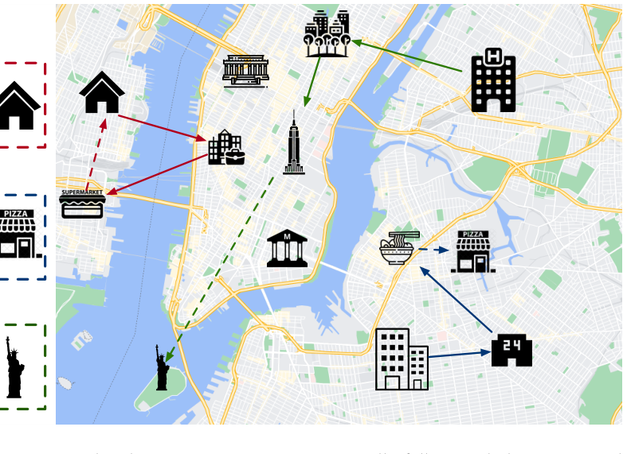
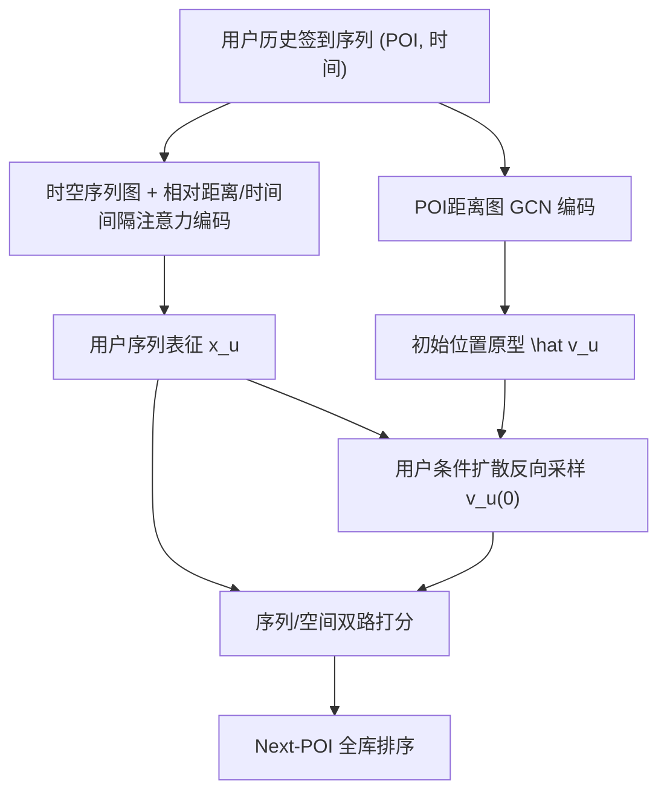
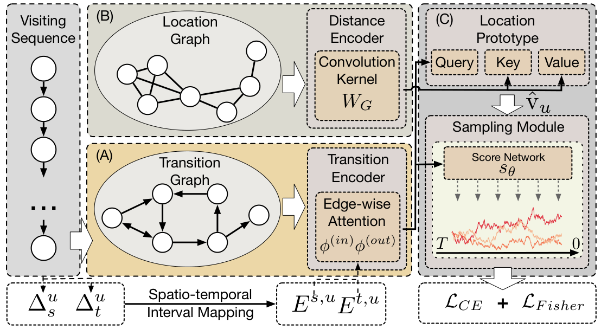

# A Diffusion model for POI recommendation (面向POI推荐的扩散模型)

- **会议/期刊**: ACM TOIS (2024 目录；原文 2023 在线)
- **作者与机构**: Yifang Qin, Hongjun Wu, Wei Ju, Xiao Luo, Ming Zhang；北京大学、UCLA
- **推荐链路定位**: 召回/精排（Next-POI 全库排序）
- **研究方向**: 时空轨迹与POI本地生活推荐 / 生成式推荐
- **论文原文**: [arXiv:2304.07041v5](https://arxiv.org/abs/2304.07041v5)
- **开源代码**: [Yifang-Qin/Diff-POI](https://github.com/Yifang-Qin/Diff-POI)

## TL;DR (1分钟核心速览)

针对“聚合历史位置导致新区域探索不足、序列偏好与空间偏好融合弱”的痛点，Diff-POI 用时空序列图与POI距离图分别编码用户和位置，再以用户条件扩散反向SDE从空间后验采样下一POI偏好。四个LBSN数据集在`5-core`、逐用户8:1:1时序划分、**全库排序**协议下，R@10较最佳基线提升5.3%–11.9%。

## Background & Motivation (背景与核心矛盾)

- **主流范式**: STAN/LSTPM/DRAN 等以RNN、注意力或双图聚合历史签到，学习用户序列与POI地理表征后做下一POI打分。
- **前人局限**: ①聚合式位置表征只能复现历史访问附近的位置，难以推荐新区域POI；②序列信号与空间偏好通常被拼接/解耦建模，缺少“历史分布→未来偏好分布”的显式迁移。
- **核心洞察 (Key Insight)**: 用户历史签到构成源分布，下一POI偏好是目标分布；扩散模型的逐步随机传输与反向Langevin采样，正好可学习该分布桥接。
- **本文切入点**: 将用户历史编码为条件，参数化用户特定空间后验，并用反向SDE采样位置原型，再与序列表征联合排序。

<figure class="paper-figure" markdown="span">
  <figcaption>图 1. 不同地理访问模式的简单示例。用户1通常遵循日常作息，在工作场所与家之间通勤，并偶尔顺路去超市等地点。用户2居家办公，有兴趣探索住所周围的餐馆。用户3刚抵达酒店，即将游览城市中的著名旅游景点。虽然各种隐含的位置偏好存在于历史访问中，但以往基于聚合的表示不足以探索陌生地点的 POI。</figcaption>
</figure>

## Method (核心方法设计)

### 1. 整体框架 (Overall Architecture)

Diff-POI 由三部分组成：时空序列图编码器抽取用户细粒度转移偏好；POI距离图GCN生成地理嵌入；上下文驱动扩散模块以用户表征初始化位置原型，并通过反向SDE采样未来空间偏好。训练时联合交叉熵与Fisher散度，推理时对全部POI进行双路相似度排序。

<figure class="paper-figure" markdown="span">
  <figcaption>图 2. 所提出框架 Diff-POI 的示意图。Diff-POI 旨在基于用户的空间偏好和历史访问模式进行个性化 POI 推荐，由三个主要部分组成：(A) 时空图编码器，(B) 基于距离的图卷积编码器，以及 (C) 基于扩散的采样模块。部分 (C) 的细节将在后续章节说明。</figcaption>
</figure>

### 2. 关键设计拆解 (Key Designs)

1. **时空间隔感知的序列图编码**：常规GNN只看邻接，无法区分“短时同游”与“跨日偏好迁移”。本文把相对距离与时间间隔离散化并嵌入：$s^{u}_{ij}=\lfloor A_d(l_i,l_j)/s_{\min}\rfloor$，$t^{u}_{ij}=\lfloor (t_j-t_i)/t_{\min}\rfloor$，裁剪后查表得$e^{s,u}_{ij},e^{t,u}_{ij}$。双向消息为  
$m_i=\sum_{\langle l_j,l_i\rangle\in E_u}\alpha^{(in)}_{ij}e_{l_j}+\sum_{\langle l_i,l_k\rangle\in E_u}\alpha^{(out)}_{ik}e_{l_k}$，  
注意力logit显式加入$e_{l_i}\odot e_{l_j}+e^{s,u}_{ij}+e^{t,u}_{ij}$，使边权同时反映序列方向与时空邻近性，最后用自注意力readout聚合全局依赖。

2. **距离图上的地理原型初始化**：仅对历史POI均值池化会丢失用户个性。距离图GCN以$w_{ij}=e^{-A_d(l_i,l_j)}$衰减远距离影响，层更新为  
$h_i^{(l)}=\sum_{j\in\mathcal{N}_i}\frac{w_{ij}}{\sqrt{|\mathcal{N}_i||\mathcal{N}_j|}}W_G^{(l-1)}h_j^{(l-1)}$。  
再用用户表征$x_u$对历史POI地理嵌入做target attention，得$\hat v_u$，作为扩散采样起点。

3. **用户条件扩散采样与训练目标**：前向VP-SDE为$dv_u=-\frac12\beta(t)v_u dt+\sqrt{\beta(t)}dw$；反向采样为  
$dv_u=[-\frac12\beta(t)v_u-\beta(t)\nabla_{v_u}\log p_t(v_u)]dt+\sqrt{\beta(t)}d\bar w$。  
分数网络$s_\theta(v_u(t))=\mathrm{MLP}([v_u(t);x_u])$以用户历史为条件；总损失  
$\mathcal{L}_{Total}=\mathcal{L}_{CE}+\gamma\mathcal{L}_{Fisher}$，  
其中Fisher项对齐真实后验梯度。最终打分为$\hat y_{u,i}=\mathrm{Softmax}(\alpha e_{l_i}x_u^{\top}+(1-\alpha)e_{g,i}v_u(0)^{\top})$。训练采用全库softmax交叉熵，无显式负采样；推理反向SDE约100步（步长0.01），复杂度$O((|E_g|+n^2+T)d)$。

## Experimental Setup & Evaluation Protocol (实验设置与评估协议)

- **数据集与预处理**: Gowalla与Foursquare三个城市子集均按`5-core`过滤；签到按时间排序。

| 数据集 | #Users | #Items | #Interactions | 密度 | 场景 |
| :--- | ---: | ---: | ---: | ---: | :--- |
| Gowalla | 10,162 | 24,237 | 456,820 | 0.19% | 全球签到 |
| Singapore | 2,321 | 5,596 | 194,108 | 1.49% | Foursquare-SIN |
| Tokyo | 2,293 | 15,177 | 494,807 | 1.42% | Foursquare-TKY |
| NYC | 1,083 | 9,989 | 179,468 | 1.66% | Foursquare-NYC |

- **数据划分与防穿越**: 逐用户按签到时间做80%/10%/10%训练/验证/测试切分；非随机留一。
- **排名评测协议**: 无偏`Full-Ranking`，测试时全部POI作候选；指标Recall@K、NDCG@K，K∈{2,5,10}。
- **对比基线与超参**: MF、GRU4Rec、LightGCN、DGCF、SR-GNN、GeoIE、LSTPM、STAN、SGRec、DRAN；嵌入64，Adam，lr=1e-3；距离阈值1km，$\delta_s=\delta_t=256$，$\alpha=0.5,\gamma=0.2,\lambda=10^{-3}$；显著性$p<0.05$非配对t检验。

## Key Experimental Results (实验关键数据)

### 1. 主实验对比 (Main Results)

R@10/N@10；Diff-POI的R@10括号为相对原表最佳基线的原文报告提升。

| 数据集 | 指标 | GRU4Rec | LightGCN | SR-GNN | LSTPM | STAN | SGRec | DRAN | Diff-POI |
| :--- | :--- | ---: | ---: | ---: | ---: | ---: | ---: | ---: | ---: |
| Gowalla | R@10 | .2164 | .1699 | .2384 | .2618 | .2994 | .2718 | .3056 | **.3421 (+11.9%)** |
| Gowalla | N@10 | .1449 | .1432 | .1751 | .1742 | .2268 | .1704 | .2367 | **.2872** |
| Singapore | R@10 | .2774 | .2419 | .3080 | .3791 | .3280 | .3884 | .3921 | **.4294 (+9.5%)** |
| Singapore | N@10 | .2040 | .1892 | .2549 | .2749 | .2892 | .2916 | .3297 | **.3643** |
| Tokyo | R@10 | .5205 | .4936 | .5458 | .5795 | .6167 | .6173 | .6210 | **.6681 (+7.6%)** |
| Tokyo | N@10 | .4520 | .4403 | .4908 | .4962 | .5554 | .5112 | .5602 | **.6160** |
| NYC | R@10 | .5238 | .4519 | .5951 | .6312 | .6533 | .6424 | .6478 | **.6884 (+5.4%)** |
| NYC | N@10 | .4587 | .3903 | .5495 | .5681 | .6124 | .5613 | .5956 | **.6745** |

### 2. 消融实验 (Ablation Study)

W/O-G.=去全部图编码；W/O-L.=去位置嵌入；W/O-S.=去扩散采样；W/O-C.=去分数网络用户条件。

| 数据集/指标 | W/O-G. | W/O-L. | W/O-S. | W/O-C. | Ori. |
| :--- | ---: | ---: | ---: | ---: | ---: |
| Gowalla R@10 | .3177 | .3025 | .3199 | .3402 | **.3421** |
| Gowalla N@10 | .2561 | .2565 | .2658 | .2794 | **.2872** |
| Singapore R@10 | .4032 | .3921 | .4026 | .4258 | **.4294** |
| Singapore N@10 | .3263 | .3241 | .3396 | .3568 | **.3643** |
| Tokyo R@10 | .6480 | .6365 | .6581 | .6603 | **.6681** |
| Tokyo N@10 | .5829 | .5784 | .6027 | .6122 | **.6160** |
| NYC R@10 | .6527 | .6509 | .6695 | .6862 | **.6884** |
| NYC N@10 | .6104 | .6255 | .6575 | .6706 | **.6745** |

### 3. 关键实验发现 (Key Findings)

- **全库排序优势稳定**：Gowalla R@10从DRAN .3056升至.3421（+11.9%），Singapore .3921→.4294（+9.5%），Tokyo .6210→.6681（+7.6%），NYC对STAN .6533→.6884（+5.4%），说明扩散采样并非仅提升采样负例排序。
- **扩散采样模块是主要增益源**：去采样W/O-S使Gowalla R@10 .3421→.3199（-6.5%）、Singapore .4294→.4026（-6.2%）、NYC .6884→.6695（-2.7%）；保留采样后N@10同步提升，表明反向SDE确实补充了未来空间偏好。
- **位置图与用户条件缺一不可**：去位置W/O-L在Tokyo R@10降至.6365（-4.7%）、Singapore N@10 .3643→.3241；去条件W/O-C虽降幅较小，但Gowalla N@10 .2872→.2794，说明用户历史条件对采样方向有校准作用。

## Highlights & Limitations (亮点、对比与审稿批判)

- **与代表作对比**: STAN/LSTPM/DRAN依赖历史位置聚合或解耦表征，倾向推荐邻近POI；Diff-POI把“下一POI偏好”建模为条件分布采样，和SGRec的序列图增强相比多了一层生成式空间后验。
- **可迁移亮点**: ①离散化时空间隔嵌入可迁移到任意序列图推荐；②用用户表征条件化score network，可在不改变主排序器的情况下采样个性化偏好。
- **审稿级局限批判**: ①反向SDE约100步带来额外推理延迟，全库softmax和全候选排序在超大规模POI库上开销偏高；②实验仅离线全库排序，未给线上A/B、冷启动/新城市划分，1km阈值与$\beta(t)$、步长、$\alpha,\gamma$的敏感性仍需更充分披露。

## Rating (四维评分)

- **方法创新性 (Novelty)**: ⭐⭐⭐⭐ （将扩散分布桥接引入Next-POI空间偏好采样，区别于聚合式地理编码，机制新颖且有SDE理论支撑）
- **评估协议与实验扎实度 (Protocol & Experiments)**: ⭐⭐⭐⭐ （四个真实LBSN、5-core、全库排序、显著性检验与消融较完整，但缺少线上与冷启动划分）
- **写作与数学规范度 (Clarity & Rigor)**: ⭐⭐⭐⭐ （整体符号清晰、SDE与损失定义完整；前向/反向SDE初始化表述略绕，需对照图4理解）
- **工业落地与复现价值 (Industrial & Practical Value)**: ⭐⭐⭐ （代码开源、结构可插拔；但扩散采样步数与全库打分带来延迟，落地需蒸馏或缓存优化）

