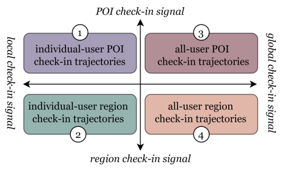
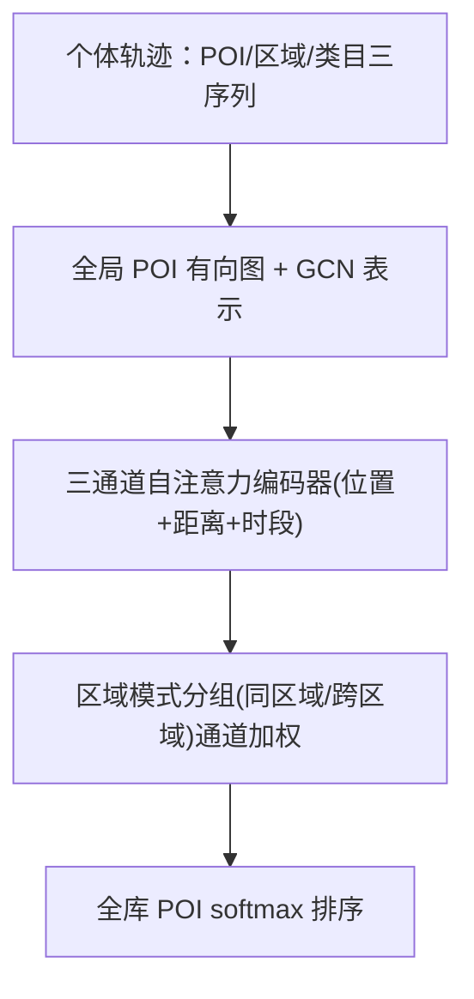

# A Multi-Channel Next POI Recommendation Framework with Multi-Granularity Check-in Signals (多粒度签到信号驱动的多通道下一 POI 推荐框架)

- **会议/期刊**: TOIS (ACM Transactions on Information Systems)
- **作者与机构**: Zhu Sun, Yu Lei, Lu Zhang, Chen Li, Yew-Soon Ong, Jie Zhang；A*STAR IHPC/CFAR、燕山大学、南洋理工大学
- **推荐链路定位**: 召回（下一 POI 全库排序）
- **研究方向**: 时空轨迹与 POI 本地生活推荐 / 序列与会话推荐
- **论文原文**: [https://arxiv.org/abs/2209.00472v1](https://arxiv.org/abs/2209.00472v1)
- **开源代码**: [https://github.com/2022MCMG/MCMG](https://github.com/2022MCMG/MCMG)

## TL;DR (1分钟核心速览)

现有下一 POI 推荐只吃"个体用户 POI 轨迹"，而 Foursquare 上单条轨迹日均仅约 2 个 POI，稀疏到无法学出稳定偏好。MCMG 提出两条正交粒度轴——POI/区域（细-粗）与个体/群体（局部-全局），用全局 POI 有向图 GCN 学表示、三通道自注意力分别编码 POI/区域/类目转移，并用"同区域 vs 跨区域"分组学习的通道权重化解三路预测互相矛盾的问题。四城市 Full-Ranking 下相对最强基线 SGRec 平均提升 HR 9.7%、NDCG 14.2%（$p<0.01$）。

## Background & Motivation (背景与核心矛盾)

- **主流范式**: RNN/LSTM 及其时空门控变体（ST-RNN、ATST-LSTM、STGN、LSTPM）与自注意力序列模型（GeoSAN、STAN、CTLE）建模个体 POI 轨迹；GNN 类（STP-UDGAT、ASGNN、SGRec）额外用全用户 POI 图补全局规律。
- **前人局限**: ① 只沿"个体→全局"一个方向扩粒度（图1 中 1○+3○），从未同时下沉到"区域"这一粗粒度地理层；② 少数用区域的模型（HST-LSTM 的功能区、JIM/SH-CDL 的异地推荐、MPR 的多级空间）只做区域预测或跨城场景，不建模"区域转移 + POI 预测"的联合序列。
- **核心洞察 (Key Insight)**: 数据统计给出四条硬事实——80% 以上的日轨迹只在 1 个区域内；约 70% 用户日活跃区域 ≤2；跨区域签到中 70% 的时间间隔 <4h 且集中在 12–16 点；跨区域目标区域有 50% 落在当前区域最近的 top-2。即"区域"能把候选空间缩小一个量级，而群体签到提供"shop⇌shop、shop⇌food"这类共现规律。
- **本文切入点**: 把轨迹拆成 POI / 区域 / 类目三条并行序列，三通道各自预测、再按区域签到模式的复杂度动态分配可信度。

<figure class="paper-figure" markdown="span">
  <figcaption>图1. 两个正交视角下的多粒度用户签到信号。</figcaption>
</figure>

## Method (核心方法设计)

### 1. 整体框架 (Overall Architecture)

输入为按天切分的用户 POI 轨迹 $\mathcal{L}_{u,i}$、区域轨迹$\mathcal{R}_{u,i}$、类目轨迹$\mathcal{C}_{u,i}$。全局模块用全体用户连续 POI 对建有向图并经 GCN 得到 POI 表示$\mathbf{H}^{(Z)}$；局部模块把该表示连同距离、时段、位置嵌入送入三路双向自注意力编码器，分别输出 POI/区域/类目级用户意图$\mathbf{F}_l,\mathbf{F}_r,\mathbf{F}_c$；加权策略按轨迹所属分组给出三通道权重做凸组合，最终与$\mathbf{H}^{(Z)}$ 内积在全库 POI 上 softmax 排序。训练端三路各设交叉熵，联合优化。

### 2. 关键设计拆解 (Key Designs)

1. **全局 POI 图编码（把人群规律注入稀疏个体）**：个体轨迹太短，POI 嵌入几乎训不动。将全体轨迹中每个相邻访问对 $(l_{t_{k-1}},l_{t_k})$连成有向边，用入度归一化 GCN 传播：$\mathbf{H}^{(z+1)}=\mathrm{ReLU}(\tilde{\mathbf{D}}^{-1}\tilde{\mathbf{A}}\mathbf{H}^{(z)}\mathbf{W}^{(z)})$，其中$\tilde{\mathbf{A}}=\mathbf{A}+\mathbf{I}$。直觉：连边频率即"从 A 到 B 的人群转移概率"，使冷门 POI 也能借邻居获得可用表示——这也是 MCMG-GCN 变体掉点最严重的根因。

2. **三通道编码 + 区域模式分组的自适应加权（化解多任务矛盾）**：MCARNN/iMTL 这类多任务模型常出现"预测的 POI 不在预测的区域里"的冲突。MCMG 不改预测头，而是改聚合：按轨迹是否跨区域分成同区域组 $G_s$与跨区域组$G_c$，各组独立学一组和为 1 的权重
$\mathbf{f}_{t_{k+1}}=w^{G}_{f_l}\mathbf{f}_{l,t_k}+w^{G}_{f_r}\mathbf{f}_{r,t_k}+w^{G}_{f_c}\mathbf{f}_{c,t_k},\ \text{s.t.}\sum w^{G}_{f}=1$。
物理直觉：同区域内区域通道几乎必然命中区域，可信度高，应让位于区域通道；跨区域时区域预测不再可靠，改由类目通道（"去哪个片区的酒吧街"）主导。学出的权重正好印证该假设（见下表）。

3. **训练目标、负采样与推理效率**：损失为三路二元交叉熵之和 $\mathcal{J}=\mathcal{J}_l+\mathcal{J}_r+\mathcal{J}_c$，每路以 one-hot 目标对**全部候选**做 softmax（即隐含全库负样本，无额外负采样）；GCN 层数、注意力块数、头数均取 1 最优。推理时仅需一次 GCN 前向与三通道注意力，再与 POI 矩阵做一次全库内积，无候选剪枝、无重排级联。

## Experimental Setup & Evaluation Protocol (实验设置与评估协议)

- **数据集与预处理**: Foursquare 2012.04–2013.09 四城市；按天切轨迹，过滤轨迹数 <3 的用户；区域由 k-means 对 POI 经纬度聚成 **9 个地理簇**（最大簇中心与真实 CBD 吻合）。

| 数据集 | #Users | #Items(POI) | #Interactions | 密度 | 特征/场景说明 |
| :--- | :---: | :---: | :---: | :---: | :--- |
| CAL | 435 | 3,013 | 13,911 | 1.06% | 293 类目，9 区域 |
| PHO | 2,946 | 7,247 | 47,980 | 0.22% | 344 类目，最稀疏之一 |
| SIN | 8,648 | 33,712 | 355,337 | 0.12% | 398 类目，跨区域多 |
| NY | 16,387 | 56,252 | 511,431 | 0.06% | 420 类目，规模最大 |

- **数据划分与防穿越**: 按用户时间序**比例划分**——前 80% 轨迹训练、次 10% 验证、最后 10% 测试，严格防未来泄漏。
- **排名评测协议**: **Full-Ranking**（对全部 POI 未交互集合排序），指标 HR@5/10、NDCG@5/10；每方法跑 5 次取均值，配对 t 检验（** $p<0.01$，***$p<0.001$）。
- **对比基线与超参设置**: 8 个基线覆盖 MostPop/BPRMF（非序列）、ST-RNN/ATST-LSTM（RNN）、MCARNN/iMTL（多任务）、SASRec（自注意力）、LightGCN/SGRec（GNN）；嵌入维度在 {60…210} 网格中，用 Bayesian HyperOpt（30 trials）以验证集 NDCG@10 选优，MCMG 取 120（CAL 180），lr ∈ [1e-4, 1e-2]。

## Key Experimental Results (实验关键数据)

### 1. 主实验对比 (Main Results)

| 数据集 | 指标 | BPRMF | ST-RNN | ATST-LSTM | MCARNN | iMTL | SASRec | LightGCN | SGRec | **MCMG** | Improv. |
| :--- | :--- | :---: | :---: | :---: | :---: | :---: | :---: | :---: | :---: | :---: | :---: |
| CAL | HR@10 | 0.1046 | 0.1731 | 0.2898 | 0.3286 | 0.3104 | 0.4108 | 0.3731 | 0.4854 | **0.5333** | +9.9% |
| CAL | NDCG@10 | 0.0793 | 0.1508 | 0.2236 | 0.2693 | 0.2545 | 0.2723 | 0.2076 | 0.3112 | **0.3743** | +20.3% |
| PHO | HR@10 | 0.0585 | 0.2028 | 0.2377 | 0.2726 | 0.2747 | 0.3325 | 0.3151 | 0.3401 | **0.3843** | +13.0% |
| PHO | NDCG@10 | 0.0304 | 0.1229 | 0.1385 | 0.1617 | 0.1632 | 0.2101 | 0.2194 | 0.2249 | **0.2489** | +10.7% |
| SIN | HR@10 | 0.0525 | 0.1370 | 0.1933 | 0.2692 | 0.1801 | 0.2885 | 0.2691 | 0.2953 | **0.3338** | +13.0% |
| SIN | NDCG@10 | 0.0380 | 0.0794 | 0.1476 | 0.1591 | 0.1423 | 0.1524 | 0.1335 | 0.1739 | **0.1987** | +14.3% |
| NY | HR@10 | 0.0468 | 0.1826 | 0.2031 | 0.2397 | 0.2422 | 0.2401 | 0.2229 | 0.2443 | **0.2531** | +3.6% |
| NY | NDCG@10 | 0.0339 | 0.1303 | 0.1638 | 0.1870 | 0.1861 | 0.1398 | 0.1209 | 0.1877 | **0.1997** | +6.4% |

### 2. 消融实验 (Ablation Study)

| 变体 / 分组 | CAL 权重(l/cat/reg) | PHO | SIN | NY | 结论 |
| :--- | :---: | :---: | :---: | :---: | :--- |
| w/o GCN (MCMG-GCN) | — | — | — | — | 掉点最大，全局图不可缺 |
| w/o 类目通道 (MCMG-C) | — | — | — | — | 中等掉点 |
| w/o 区域通道 (MCMG-R) | — | — | — | — | 掉点 > MCMG-C，区域更关键 |
| w/o 双辅助通道 (MCMG-CR) | — | — | — | — | 掉点最大（除 GCN 外） |
| 同区域组 $G_s$（学得权重） | .20/.22/**.58** | .23/.22/**.55** | .21/.25/**.54** | .23/.21/**.56** | 区域通道权重≈类目 2 倍 |
| 跨区域组 $G_c$（学得权重） | .25/**.48**/.27 | .28/**.43**/.29 | .24/**.49**/.27 | .31/**.50**/.19 | 类目通道反超 |
| 聚合策略: concat / avg / attn | 均低于 MCMG | 同 | 同 | 同 | 分组加权 > 全局注意力 > 平均 > 拼接 |

### 3. 关键实验发现 (Key Findings)

1. **粒度下潜的收益是"稀疏度驱动"的**：数据越稀疏增益越大——NY（密度 0.06%）仅 +3.6% HR@10，而 CAL（1.06%，用户数最少但密度最高）NDCG@10 提升 20.3%；说明 MCMG 主要在个体轨迹提供不了信息时靠区域/全局信号兜底。
2. **通道权重的分布本身就是证据**：同区域组区域通道权重 0.54–0.58，跨区域组骤降至 0.19–0.29、类目通道升至 0.43–0.50，即模型自动复现了"区域内可预测、跨区域靠活动类型"的数据统计（Q1/Q5），加权策略有效性有可解释支撑。
3. **全局 GCN 是最大单一贡献项，但单通道远不够**：Table 5 中同区域组区域通道 HR@5 达 1.0000（区域内必中，属平凡上界），而它单独用于最终 POI 预测时 NDCG@5 仅 0.944（同区域）/0.645（跨区域）；去掉三通道任一路均掉点、去两路掉点更多，说明三路互补而非冗余。

## Highlights & Limitations (亮点、对比与审稿批判)

- **与代表作对比 (vs. Prior Work)**: 相比 SGRec（GAT + 类目 + 单向位置注意力），MCMG 多了区域粒度与分组加权；相比 iMTL/MCARNN 的多任务联合预测，MCMG 不共享预测头而是共享表示后按区域模式重加权，从根上缓解了"POI 与类目不匹配"的冲突；相比 HST-LSTM 的功能区，本文区域是纯地理 k-means 簇，适用范围更广。
- **可迁移亮点**: ①"按轨迹难度分组、每组独立学一组和为 1 的融合权重"这一 trick 可低成本移植到多路召回融合/多目标精排；②用 k-means 地理簇作为粗粒度离散 token，可作生成式 POI 推荐的语义 ID 前置层级。
- **审稿级局限批判**: ① 区域数硬编码为 9，未讨论 k 的敏感性，也未与行政边界/路网划分对比；② 评测仅有 HR/NDCG 离线指标，无覆盖率/新颖性、无线上 A/B，且 Full-Ranking 下区域通道在同区域组的 1.0 命中使部分增益被平凡化；③ 每用户轨迹极短（~2 POI/天），三路 BCE 联合训练在超大 POI 集（NY 5.6 万）上的显存与收敛成本未给出复杂度分析。

## Rating (四维评分)

- **方法创新性 (Novelty)**: ⭐⭐⭐⭐ （"正交双轴多粒度 + 区域模式分组加权"视角新颖，但各组件本身均为成熟算子的组合）
- **评估协议与实验扎实度 (Protocol & Experiments)**: ⭐⭐⭐⭐ （四城市 Full-Ranking、5 次重复 + 配对 t 检验、8 基线充分；扣分在缺 k 敏感性与线上验证）
- **写作与数学规范度 (Clarity & Rigor)**: ⭐⭐⭐⭐ （公式与符号表清晰、数据统计到设计的推导链完整；Table 5 中 POI 通道列语义与最终预测混同，略显含糊）
- **工业落地与复现价值 (Industrial & Practical Value)**: ⭐⭐⭐⭐ （代码已开源，GCN 1 层 + 单头注意力，推理开销低，区域聚类可离线预计算，易部署到 LBS 召回链路）

