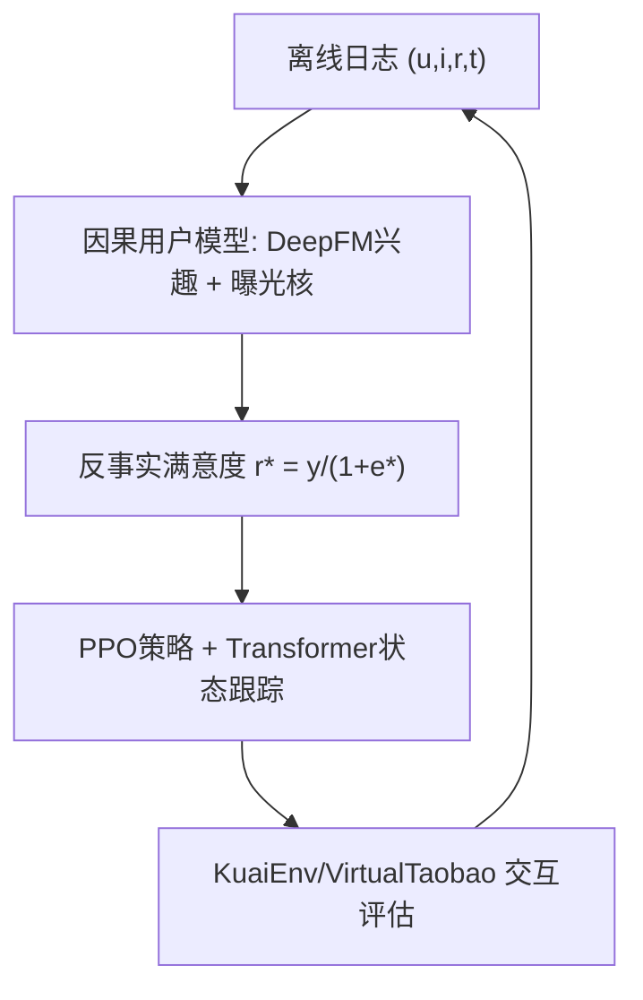
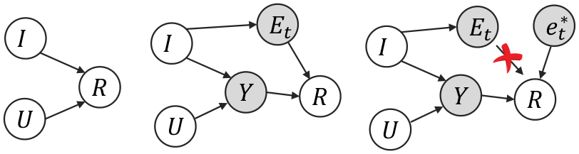
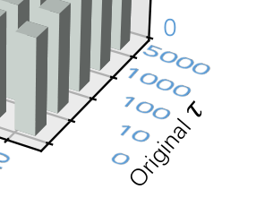

# CIRS: Bursting Filter Bubbles by Counterfactual Interactive Recommender System (CIRS：用反事实交互推荐系统击破过滤气泡)

- **会议/期刊**: TOIS
- **作者与机构**: Chongming Gao 等；中国科学技术大学、重庆大学、浙江大学、四川大学、快手
- **推荐链路定位**: 交互式策略/重排（端到端策略学习）
- **研究方向**: 强化学习与动态探索推荐 / 去偏公平、可信隐私与工业架构
- **论文原文**: [arXiv:2204.01266v2](https://arxiv.org/abs/2204.01266v2)
- **开源代码**: [CIRS-codes](https://github.com/chongminggao/CIRS-codes)

## TL;DR (1分钟核心速览)

针对静态推荐无法建模重复曝光、在线RL试错成本高的问题，CIRS 先用因果用户模型将内在兴趣 $y$与曝光效应$e_t$解耦，再以$do(E_t=e_t^*)$ 生成反事实满意度作为离线 PPO 奖励；在 VirtualTaobao 与全观测 KuaiEnv 上以 100 条轨迹累积满意度评测，较 PPO 基线约提升 27%–43%。

## Background & Motivation (背景与核心矛盾)

- **主流范式**: 过滤气泡研究多依赖静态推荐中的多样性、惊喜度或公平性启发式；交互推荐则用 RL 最大化长期奖励，但很少显式建模“重复曝光导致无聊”。
- **前人局限**: 静态/序列监督把用户满意度等同于内在兴趣，无法捕捉动态过曝光；在线 RL 训练慢且会伤害真实用户，离线 RL 又缺乏对“无聊退出”这一偏差的因果校正。
- **核心洞察 (Key Insight)**: 快手真实日志显示，1 小时内同类视频越多、距上次观看同类视频的间隔越短，评论区停留时长与视频观看完成率越低，说明过曝光确实折减满意度。
- **本文切入点**: 把过滤气泡视为因果路径 $I\rightarrow E_t\rightarrow R$，用曝光核估计$e_t$，并在规划阶段干预$E_t$ 生成反事实奖励，交给离线 RL 规划。

## Method (核心方法设计)

### 1. 整体框架 (Overall Architecture)

CIRS 形成三阶段闭环：离线日志预训练因果用户模型，其中 DeepFM 估内在兴趣、曝光核估近期相似内容造成的满意度折减；Transformer+门控状态跟踪器把用户、历史动作与反馈编码为状态；PPO 策略以反事实满意度为奖励做规划；最后在 KuaiEnv/VirtualTaobao 的“无聊即退出”机制下评估累积满意度。

### 2. 关键设计拆解 (Key Designs)

1. **曝光效应核与满意度折减**：前人只拟合 $U,I$到$R$，默认兴趣等于满意度。CIRS 增加$I\rightarrow E_t\rightarrow R$，将过曝光定义为
   $e_t(u,i)=\alpha_u\beta_i\sum_{(u,i_l,t_l)\in S_u,t_l<t}\exp(-\frac{t-t_l}{\tau\cdot \mathrm{dist}(i,i_l)})$，
   并以 $\hat r_{ui}=\hat y_{ui}/(1+e_t(u,i))$折减满意度。相似且近期重复越多，$e_t$越大，满意度越低；$\alpha_u$表示用户敏感度，$\beta_i$ 表示物品“耐看度”。
2. **反事实干预奖励**：RL 规划会产生新轨迹 $S_u^*$，若直接沿用历史$e_t$会与策略动作失配。CIRS 做$do(E_t=e_t^*)$，用
   $e_t^*(u,i)=\gamma^*\alpha_u\beta_i\sum_{(u,i_l^*,t_l^*)\in S_u^*,t_l^*<t}\exp(-\frac{t-t_l^*}{\tau^*\cdot \mathrm{dist}(i,i_l^*)})$，
   $\hat r_{ui}^*=\hat y_{ui}/(1+e_t^*(u,i))$ 作为 PPO 奖励。这样既切断观测曝光路径，又保留“如果继续重复推荐会无聊”的反事实效应。
3. **训练目标、负采样与推理效率**：用户模型在 VirtualTaobao 用 MSE、在 KuaiEnv 用 BPR：$\mathcal{L}_{BPR}=-\sum\log\sigma(\hat r_{ui}-\hat r_{uj})$，$j\sim p_n$；策略用 PPO 目标$\mathbb{E}_t[\min(\rho_t\hat A_t,\mathrm{clip}(\rho_t,1-\epsilon,1+\epsilon)\hat A_t)]$，$\rho_t=\pi_\theta/\pi_{\theta old}$。推理从策略分布采样，而非 top-1，以避免人为过曝光；无额外 ANN 检索开销。

<figure class="paper-figure" markdown="span">
  <figcaption>图 4. 传统 IRS 模型（a）和 CIRS 模型（b-c）的因果图。𝑈：用户，𝐼：物品，𝑅：用户满意度（由点击或观看时长等反馈量化），𝑌：内在兴趣，𝐸𝑡 和 𝑒∗</figcaption>
</figure>

## Experimental Setup & Evaluation Protocol (实验设置与评估协议)

- **数据集与预处理**:

| 数据集 | #Users | #Items | #Interactions | 稀疏度/密度 | 特征/场景说明 |
| :--- | :---: | :---: | :---: | :---: | :--- |
| Kuaishou 田野研究 | 7,176 | 3,110,886 视频 | 34,215,294 次观看 | — | 31 类标签，验证过曝光效应 |
| VirtualTaobao | — | — | 100,000 日志 | — | 用户 88 维，物品 27 维连续向量 |
| KuaiRec / KuaiEnv | 7,176 | 10,728 | 大矩阵 12.53M / 小矩阵 4.68M | 小矩阵 99.6% | 全观测小矩阵用于评测，大矩阵稀疏日志用于预训练 |

- **数据划分与防穿越 (Splitting Strategy)**: 非传统比例划分；VirtualTaobao 用 10 万离线日志训练；KuaiEnv 用全观测小矩阵做策略评测，用大矩阵预训练用户模型，避免评测阶段缺失值穿越。
- **排名评测协议 (Ranking Protocol)**: 不是 `Full-Ranking` 或 `Sampled Ranking`，而是交互式累积奖励：策略在环境中滚动推荐，统计 100 条轨迹的累积满意度；静态基线用 Softmax 采样而非 top-1 打分。
- **对比基线与超参设置**: 基线含 DeepFM、IPS、PD、DICE、Random、$\epsilon$-greedy、UCB、MLP、PPO（CIRS w/o CI）。$\tau,\tau^*$网格搜索，$\gamma^*=10$；VirtualTaobao 取$N=5,d_Q=3.0$，KuaiEnv 取$N=1,n_Q=1$；最大轮数 50/100，有限轮数 10/30；原文未报告显著性检验。

## Key Experimental Results (实验关键数据)

### 1. 主实验对比 (Main Results)

原文主结果以 Fig.7 曲线呈现，未给数值表；下表为按坐标轴估读的终值，用于趋势对比，精确值以复现代码为准。

| 方法 | VT CumSat ↑ | KuaiEnv CumSat ↑ | KuaiEnv Len ↑ |
| :--- | ---: | ---: | ---: |
| Random | ≈12 | ≈18 | ≈20 |
| DeepFM+Softmax | ≈28 | ≈50 | ≈55 |
| IPS | ≈30 | ≈48 | ≈65 |
| PD | ≈31 | ≈52 | ≈60 |
| DICE | ≈30 | ≈51 | ≈58 |
| UCB | ≈38 | ≈60 | ≈30 |
| CIRS w/o CI (PPO) | ≈42 | ≈75 | ≈100 |
| **CIRS** | **≈60** | **≈95** | **≈100** |
| **Improv. vs 最强基线** | **+42.9%** | **+26.7%** | — |

### 2. 消融实验 (Ablation Study)

| 变体 | VT CumSat ↑ | KuaiEnv CumSat ↑ | 说明 |
| :--- | ---: | ---: | :--- |
| CIRS | **≈60** | **≈95** | 完整因果曝光建模 |
| CIRS w/o CI / $\tau=\tau^*=0$ | ≈42 | ≈75 | 去掉曝光核，退化为普通 PPO |
| $\tau$-$\tau^*$ 失配 | ≈48 | ≈82 | 干预尺度不当，弱于完整模型 |

### 3. 关键实验发现 (Key Findings)

- **因果模块带来稳定增益**：VirtualTaobao 约 $60$vs$42$（+42.9%），KuaiEnv 约$95$vs$75$（+26.7%）；CIRS w/o CI 在后期出现性能退化，说明仅靠 PPO 会被过曝光策略拖入气泡。
- **长期收益来自“长度×单轮满意度”平衡**：UCB 的单轮满意度最高，但 KuaiEnv 交互长度仅约 30；CIRS 将长度推至 100，同时保持较高单轮满意度，累积收益最大。
- **学到的参数符合直觉**：图 9 显示 $\alpha_u$与用户活跃度正相关、$\beta_i$与物品流行度正相关；图 10 中$\tau=\tau^*=0$退化为 w/o CI，合适$\tau$-$\tau^*$ 组合才最优。

<figure class="paper-figure" markdown="span">
  <figcaption>图 9. 学习到的 𝛼𝑢、𝛽𝑖 与数据统计量（用户活跃度和物品流行度）之间的关系。</figcaption>
</figure>

## Highlights & Limitations (亮点、对比与审稿批判)

- **与代表作对比 (vs. Prior Work)**: IPS/PD/DICE 主要去静态曝光或流行度偏差，不建模动态“无聊”；Huang 等 model-based offline RL 只用用户模型供奖励，未解耦过曝光因果效应；CIRS 首次把因果干预嵌入离线 RL 的奖励生成。
- **可迁移亮点**: 曝光核 $e_t$ 可作为任意推荐策略的奖励塑形项；全观测 KuaiEnv + “无聊退出”机制为离线 RL 评测提供了可复用的交互环境范式。
- **审稿级局限批判**: 曝光核依赖手设指数衰减与 Hamming/欧氏距离，语义相似度较粗；评测仍依赖模拟退出机制与 100 条轨迹，缺少线上 A/B；$\tau,\tau^*$ 较敏感，且策略采样可能牺牲单轮满意度。

## Rating (四维评分)

- **方法创新性 (Novelty)**: ⭐⭐⭐⭐ （首次将因果干预与离线 RL 结合用于过滤气泡，曝光核形式简洁且有田野证据支撑）
- **评估协议与实验扎实度 (Protocol & Experiments)**: ⭐⭐⭐⭐ （KuaiEnv 全观测矩阵与退出机制较扎实，但主结果仅曲线、缺显著性检验）
- **写作与数学规范度 (Clarity & Rigor)**: ⭐⭐⭐⭐ （因果图与公式链条清晰，但曝光核的因果假设与超参敏感性讨论仍可加强）
- **工业落地与复现价值 (Industrial & Practical Value)**: ⭐⭐⭐⭐ （代码开源、无 ANN 额外开销，曝光核易接入现有 RL 策略，线上需调参）

