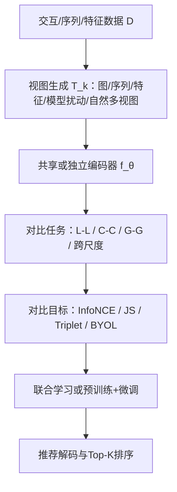
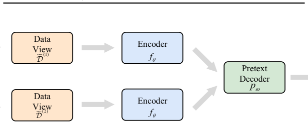

# Contrastive Self-supervised Learning in Recommender Systems: A Survey (对比自监督学习在推荐系统中的应用：综述)

- **会议/期刊**: ACM Transactions on Information Systems (TOIS)
- **作者与机构**: Mengyuan Jing, Yanmin Zhu, Tianzi Zang, Ke Wang；上海交通大学
- **推荐链路定位**: 表征学习/召回（跨链路通用）
- **研究方向**: 自监督对比学习与交互去噪 / 图推荐
- **论文原文**: [论文原文链接](https://arxiv.org/abs/2303.09902v2)
- **开源代码**: 暂未开源

## TL;DR (1分钟核心速览)

深度推荐依赖稀疏的用户-物品交互，易受过拟合与冷启动困扰；对比自监督学习因轻量、灵活、无需领域标签，已成为自监督推荐的主流分支。本文不提出新模型，而是提出统一框架，按“视图生成—对比任务—对比目标”三维分类，系统梳理约80项代表性工作，并给出组件选择指南与开放问题。由于是综述，原文未设统一 Full-Ranking 主实验与消融，本文以方法汇总和定性比较替代，避免虚构指标。

## Background & Motivation (背景与核心矛盾)

- **主流范式**: 深度推荐以监督式交互拟合为主，图神经网络、序列模型与多行为/多域建模构成主干。
- **前人局限**: 交互矩阵极稀疏，监督信号不足导致过拟合与泛化误差；现有对比学习综述多聚焦 CV/NLP，或仅把推荐作为附属，缺少面向推荐稀疏性、同质性与任务多样性的细粒度分析。
- **核心洞察 (Key Insight)**: 推荐数据中存在大量可自监督结构（图边、序列顺序、特征、跨域/多行为视图）；对比学习可在不增加人工标签的前提下学习噪声不变表征。
- **本文切入点**: 用统一框架把视图生成、pretext task 与对比目标解耦，并讨论不同组件的适用边界。

## Method (核心方法设计)

### 1. 整体框架 (Overall Architecture)

给定数据 $\mathcal{D}$，通过$K$个视图生成策略得到$\tilde{\mathcal{D}}^{(k)}=T_k(\mathcal{D})$，再由编码器$f_{\theta_k}$得到表示$\boldsymbol{h}_k=f_{\theta_k}(\tilde{\mathcal{D}}^{(k)})$；投影头$g_{\xi}$可选。训练时最大化正对互信息、最小化负对互信息，并与推荐损失联合或分阶段优化。下游推荐用$f_{\theta^*}$接推荐解码器$q_{\phi}$。框架价值在于把纷繁方法统一为“视图—任务—目标”三元组，便于横向比较。

<figure class="paper-figure" markdown="span">
  <figcaption>图 1. 对比学习流程。</figcaption>
</figure>
图 1：对比学习通用流程。

### 2. 关键设计拆解 (Key Designs)

1. **视图生成：数据级、模型级与无增强三路线**：数据级在图/序列/特征上做扰动，如边扰动 $T(\mathbf{A})=\mathbf{A}\circ(1-\mathbf{L})+(1-\mathbf{A})\circ\mathbf{L}$；模型级直接扰动编码器（message dropout、embedding noise、参数噪声、架构扰动）；无增强则利用跨域、多行为、KG、社交等自然多视图。前两者引入随机性但需调参，后者语义保真但依赖领域知识。

2. **对比任务：按实例尺度分同尺度与跨尺度**：局部 L（节点/物品）、上下文 C（子图/子序列）、全局 G（整图/整序列）。同尺度含 L-L、C-C、G-G；跨尺度含 L-C、L-G、C-G。图 CF 主流为 L-L 节点自判别；序列推荐主流为 G-G 序列自判别；跨尺度用于捕获局部—全局层次语义。

3. **对比目标、负采样与训练策略**：InfoNCE 最常见，配合 in-batch 负采样：$\mathcal{L}_{con}=-\log\frac{\exp(\boldsymbol{h}_u^{(1)\top}\boldsymbol{h}_u^{(2)}/\tau)}{\sum_{v\in\mathcal{B}}\exp(\boldsymbol{h}_u^{(1)\top}\boldsymbol{h}_v^{(2)}/\tau)}$。目标分有下界（InfoNCE、JS、Triplet）与无下界（BYOL，无负样本）。训练分联合学习$\mathcal{L}=\mathcal{L}_{rec}+\lambda\mathcal{L}_{con}$ 与预训练+微调；前者任务确定时性能好，后者跨任务泛化更好但两阶段开销高。

<figure class="paper-figure" markdown="span">
  ![图 3. 基于对比学习的推荐分类体系。“JS”指 Jensen-Shannon。“InfoNCE”损失指 Oord 等人 \[68\] 提出的损失，其中“NCE”表示噪声对比估计器（Noise-Contrastive Estimator）。“BYOL”（Bootstrap Your Own Latent）损失指 Grill 等人 \[28\] 提出的对比损失。](../../../../assets/papers/2303.09902v2/figure_3.png)<figcaption>图 3. 基于对比学习的推荐分类体系。“JS”指 Jensen-Shannon。“InfoNCE”损失指 Oord 等人 [68] 提出的损失，其中“NCE”表示噪声对比估计器（Noise-Contrastive Estimator）。“BYOL”（Bootstrap Your Own Latent）损失指 Grill 等人 [28] 提出的对比损失。</figcaption>
</figure>
图 3：基于对比学习的推荐分类体系。

## Experimental Setup & Evaluation Protocol (实验设置与评估协议)

- **数据集与预处理**: 原文为综述，未报告统一数据集统计与过滤规则；下表汇总其覆盖的评测任务与常见协议，而非单一数据集统计。

| 任务类型 | 代表方法 | 常见划分 | 常见评测协议 | 负采样/候选 |
| :--- | :--- | :--- | :--- | :--- |
| 图协同过滤 | SGL, SimGCL, LightGCL | 比例划分/LOO | Full-Ranking 或采样排序 | in-batch 负采样 |
| 序列推荐 | CL4SRec, CoSeRec, DuoRec | Leave-One-Out | Full-Ranking 为主 | in-batch/监督正采样 |
| KG/社交推荐 | KGCL, SEPT | 比例划分 | 采样排序常见 | 图负采样 |
| 跨域/多行为 | CCDR, KMCLR | 域内比例划分 | 域内/跨域排序 | 域负采样 |
| 冷启动 | MPT, CLCRec | 冷启动划分 | 冷启动排序 | 少样本/迁移 |

- **数据划分与防穿越**: 综述层面无统一划分；被引工作常用 Leave-One-Out、比例划分或时间切分，需防止未来交互穿越。
- **排名评测协议**: 未统一 Full-Ranking 与 Sampled Ranking；这是综述无法做元分析的关键短板。
- **对比基线与超参设置**: 各方法自设温度 $\tau$、增强比例$\rho$、损失权重$\lambda$ 与 dropout 比例；综述建议按任务选择而非固定一套超参。

## Key Experimental Results (实验关键数据)

### 1. 主实验对比 (Main Results)

原文为综述，未提供统一主实验表与 P@K/NDCG 数值，故不标 `Improv.%`。下表节选 8 个代表性方法，汇总其组件配置：

| 方法 | Venue/Year | 视图生成 | 对比任务 | 目标 | 训练 | 任务 |
| :--- | :--- | :--- | :--- | :--- | :--- | :--- |
| SGL | SIGIR 2021 | 节点/边 dropout | L-L | InfoNCE | JL | 图CF |
| SimGCL | SIGIR 2022 | embedding noise | L-L | InfoNCE | JL | 图CF |
| LightGCL | ICLR 2023 | SVD 重构增强 | L-L | InfoNCE | JL | 图CF |
| CL4SRec | ICDE 2022 | 掩码/重排/裁剪 | G-G | InfoNCE | JL | 序列 |
| CoSeRec | arXiv 2021 | 替换/插入 | G-G | InfoNCE | JL | 序列 |
| DuoRec | WSDM 2022 | message dropout | G-G | InfoNCE | JL | 序列 |
| KGCL | SIGIR 2022 | KG 引导边扰动 | L-L | InfoNCE | JL | KG |
| CrossCBR | KDD 2022 | 边/消息 dropout | L-L | InfoNCE | JL | Bundle |

### 2. 消融实验 (Ablation Study)

原文无模型消融；以下为视图生成策略的定性比较（对应原文 Table 3）：

| 策略 | 试错成本 | 领域知识 | 泛化性 | 语义保留 |
| :--- | :---: | :---: | :---: | :---: |
| 数据级增强 | 高 | 低 | 低 | 可能破坏 |
| 模型级增强 | 中 | 低 | 较高 | 较好 |
| 无增强自然视图 | 低 | 高 | 中 | 好 |

### 3. 关键实验发现 (Key Findings)

- 按表2逐行统计，约80项工作中 L-L 同尺度对比约35项、G-G 约20项；InfoNCE+联合学习是最常见组合，说明“轻量增强+in-batch 负采样”已成事实标准。
- 图CF偏好 L-L+边/节点扰动，序列推荐偏好 G-G+序列增强；任务粒度决定对比尺度，直接套用跨任务增强往往次优。
- 冷启动场景应避免 drop 类增强（会加剧稀疏），更宜用插入/替换或模型级增强；这与 CoSeRec、MPT 的设计动机一致。

## Highlights & Limitations (亮点、对比与审稿批判)

- **与代表作对比 (vs. Prior Work)**: 相比 [135] 的 SSL 推荐综述，本文纯聚焦对比学习，加入模型级/无增强并细分为同尺度与跨尺度；相比 CV/NLP 对比学习综述，本文强调推荐数据稀疏、同质性与多任务差异。
- **可迁移亮点**: “按任务先定对比尺度，再选视图与目标”的决策顺序可直接用于新场景；模型级扰动（embedding noise/message dropout）可低成本迁移到图与序列模型。
- **审稿级局限批判**: 一是综述无统一定量基准与元分析，难以判断各方法真实增益；二是分类边界存在重叠，且对计算开销、负采样偏差与冷启动评测细节讨论不足；时效截至2023，后续生成式/LLM 推荐对比学习未覆盖。

## Rating (四维评分)

- **方法创新性 (Novelty)**: ⭐⭐⭐⭐ （统一框架与三维分类有整理价值，但非新算法）
- **评估协议与实验扎实度 (Protocol & Experiments)**: ⭐⭐ （综述无统一实验、消融与显著性检验，证据强度有限）
- **写作与数学规范度 (Clarity & Rigor)**: ⭐⭐⭐⭐ （符号与分类清晰，公式统一，组件讨论细）
- **工业落地与复现价值 (Industrial & Practical Value)**: ⭐⭐⭐ （组件选择指南实用，但缺开销基准与开源实现）

