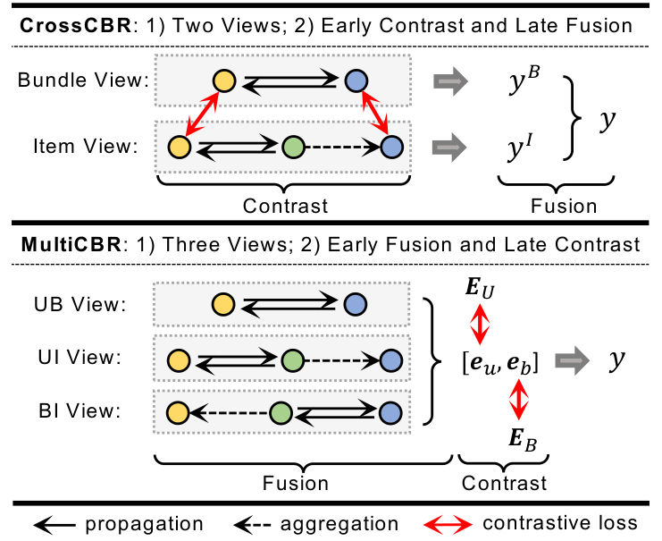
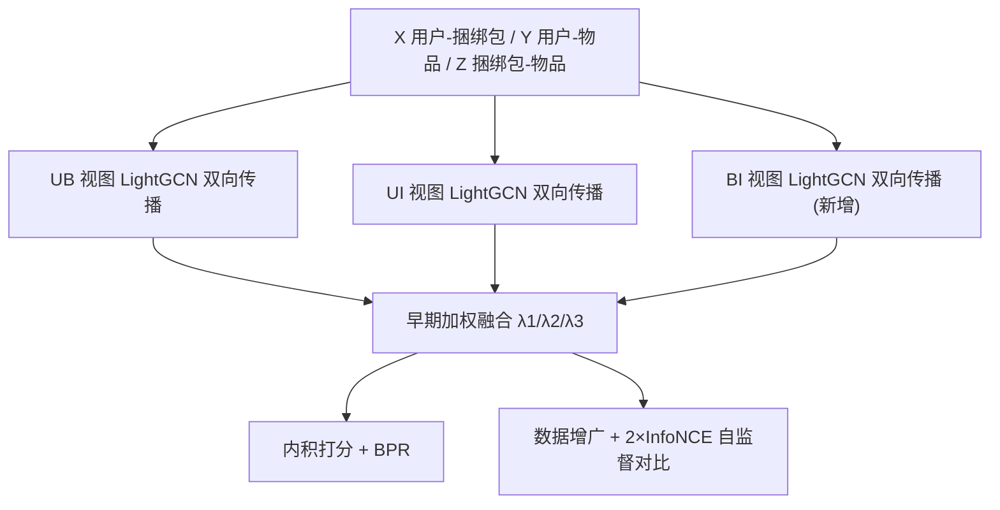

# MultiCBR: Multi-view Contrastive Learning for Bundle Recommendation (多视图对比学习捆绑包推荐)

- **会议/期刊**: ACM Transactions on Information Systems (TOIS) 2024
- **作者与机构**: Yunshan Ma, Yingzhi He, Xiang Wang (USTC), Yinwei Wei (Monash), Xiaoyu Du (NJUST), Yuyangzi Fu (eBay), Tat-Seng Chua (NUS)
- **推荐链路定位**: 召回 (User→Bundle 全库排序)
- **研究方向**: 自监督对比学习与交互去噪 / 图神经网络推荐
- **论文原文**: [https://arxiv.org/abs/2311.16751v3](https://arxiv.org/abs/2311.16751v3)
- **开源代码**: [https://github.com/HappyPointer/MultiCBR](https://github.com/HappyPointer/MultiCBR)

## TL;DR (1分钟核心速览)

捆绑包推荐中，SOTA 方法 CrossCBR 存在两大硬伤：BI（捆绑包-物品）图仅做单向聚合，无法利用捆绑包组成模式，且对稀疏捆绑包与无交互物品无能为力；"先对比后融合"范式只建模 ego-view 偏好，且视图增多时跨视图对比损失数呈二次方膨胀。MultiCBR 将异质关系统一成 UB/UI/BI 三视图做双向图传播，并反转设计为"先融合后对比"——早期加权融合表征、仅保留两个自监督 InfoNCE 损失。在 Youshu/NetEase/iFashion 全排序协议下全面超越 SOTA，iFashion 上 Recall@20 相对提升 **32.43%**。

## Background & Motivation (背景与核心矛盾)

- **主流范式**: BGCN 把用户偏好拆成 bundle 视图与 item 视图，CrossCBR 在此基础上叠加跨视图对比学习，成为该方向 SOTA。
- **前人局限一**: 两视图构造对 BI 图只做 item→bundle 的单向池化，捆绑包组成模式与稀疏物品表征完全未被挖掘；当捆绑包平均仅含 3.86 个物品（iFashion）时尤为致命。
- **前人局限二**: "early contrast and late fusion" 先算各视图独立预测再求和，本质上只建模 ego-view 偏好；若扩展到三视图，跨视图对比损失从 2 项涨到 6 项（用户/捆绑包各 3 对），优化与算力开销二次方增长。
- **核心洞察 (Key Insight)**: 把内积打在**融合后**的表征上，展开后天然分解为 cross-view 项与 ego-view 项之和，显式跨视图对齐反而成了冗余约束。
- **本文切入点**: 三视图 + 早融合晚对比，用一个统一的表征空间同时换取表达力与效率。

<figure class="paper-figure" markdown="span">
  <figcaption>图1. MultiCBR与CrossCBR的简要比较：1）MultiCBR将两个视图扩展为三个视图，其中新增的BI视图旨在捕捉BI图所隐含的捆绑包组成模式；2）MultiCBR采用“早期融合与后期对比”框架，能够在引入较少额外开销的同时更好地建模用户偏好。</figcaption>
</figure>

## Method (核心方法设计)

### 1. 整体框架 (Overall Architecture)

输入为三个二值矩阵：用户-捆绑包交互 $\mathbf{X}$、用户-物品交互$\mathbf{Y}$、捆绑包-物品归属$\mathbf{Z}$。模型分别在 UB、UI、BI 三张二部图上跑共享结构的 LightGCN（$K=2$层，逐层平均池化），得到每个用户的$\{e_u^{UB},e_u^{UI},e_u^{BI}\}$与每个捆绑包的$\{e_b^{UB},e_b^{UI},e_b^{BI}\}$；BI 视图内物品表征再单向聚合回用户。随后以视图系数$\{\lambda_1,\lambda_2,\lambda_3\}$ 在**表征层**做早期融合，用内积打分，并以 BPR 损失 + 两个 InfoNCE 损失联合优化。推理阶段只需一次内积全库排序，无额外解码开销。

### 2. 关键设计拆解 (Key Designs)

1. **BI 归属视图的双向传播（破解捆绑包稀疏）**：CrossCBR 只做 item→bundle 单向池化，导致从未被任何用户交互过的物品嵌入始终学不到。本文在 BI 二部图上对称传播：
$e_b^{BI(k)}=\sum_{i\in\mathcal{N}_b^{BI}}\frac{1}{\sqrt{|\mathcal{N}_b^{BI}|}\sqrt{|\mathcal{N}_i^{BI}|}}e_i^{BI(k-1)}$，物品侧同理反向更新；再由$e_u^{BI}=\frac{1}{|\mathcal{N}_u^{UI}|}\sum_{i\in\mathcal{N}_u^{UI}}e_i^{BI}$ 把组成语义回传用户。直觉：捆绑包共现构成了一条独立于用户行为的"组成监督信号"，直接为零交互物品注入表征。

2. **早期融合与后期对比（Early Fusion & Late Contrast）**：痛点在于后期融合只建模 ego-view。本文先融合 $e_u=\sum_{v}\lambda_v e_u^{v}$、$e_b=\sum_v\lambda_v e_b^{v}$，再打分$y^*_{u,b}=e_u\cdot e_b$，展开即
$y^*_{u,b}=\underbrace{\sum_{v\neq v'}e_u^{v}\cdot e_b^{v'}}_{\text{cross-view}}+\underbrace{\sum_{v}e_u^{v}\cdot e_b^{v}}_{\text{ego-view}}$。
对比学习则退化为在融合表征上做两路 InfoNCE：$\mathcal{L}_C^u=\frac{1}{|\mathcal{U}|}\sum_u-\log\frac{\exp(\cos(e_u',e_u'')/\tau)}{\sum_{v}\exp(\cos(e_u',e_v'')/\tau)}$，捆绑包侧同构。正样本由 edge dropout / message dropout / noise 增广生成，负样本用 in-batch 采样。如此无论视图数多少，损失项恒为 2。

3. **训练目标与推理效率**：$\mathcal{L}=\mathcal{L}_{BPR}+\beta_1\mathcal{L}_C+\beta_2\|\Theta\|_2^2$，其中$\mathcal{L}_C=\frac{1}{2}(\mathcal{L}_C^u+\mathcal{L}_C^b)$，负样本为均匀随机未交互捆绑包；参数仍只有$E_U,E_B,E_I$三组嵌入，空间复杂度$\mathcal{O}((M+N+O)d)$，与 CrossCBR 相同。消融显示移除对比损失后性能崩至 0.0498，说明"晚对比"是"早融合"生效的前提。

## Experimental Setup & Evaluation Protocol (实验设置与评估协议)

- **数据集与预处理**: 沿用 CrossCBR 的三份公开数据与划分，无额外 5-core 过滤说明：

| 数据集 | #Users | #Items | #Bundles | #U-I | #U-B | 场景 / 平均捆绑包大小 |
| :--- | :---: | :---: | :---: | :---: | :---: | :--- |
| Youshu | 8,039 | 32,770 | 4,771 | 138,515 | 51,377 | 书单 / 37.03 |
| NetEase | 18,528 | 123,628 | 22,864 | 1,128,065 | 302,303 | 歌单 / 77.80 |
| iFashion | 53,897 | 42,563 | 27,694 | 2,290,645 | 1,679,708 | 穿搭 / 3.86 |

- **数据划分与防穿越**: 沿用 CrossCBR 的 train/valid/test 划分（用户级留出式划分，测试集仅取最后一次交互），严格按同一划分复现基线。
- **排名评测协议**: 无偏 **Full-Ranking 全库未交互捆绑包排序**，指标 Recall@$\{20,40\}$与 NDCG@$\{20,40\}$。
- **对比基线与超参**: 基线含 User-Item 类（MFBPR / LightGCN / SGL / XSimGCL / LightGCL）与 Bundle 类（DAM / BundleNet / BGCN / MIDGN / CrossCBR）；嵌入维度 $d=64$，$K=2$，batch 2048，Adam，Xavier 初始化；$\lambda$于$[0,1]$网格搜索，$\tau,\beta_1\in\{0.05\sim0.4\}$，$\beta_2\in\{10^{-5},10^{-6},10^{-7}\}$；每组实验重复 3 次取均值，数据增广差异做 ANOVA 显著性检验（$p<0.05$）。

## Key Experimental Results (实验关键数据)

### 1. 主实验对比 (Main Results)

| Model | Youshu R@20 | Youshu N@20 | NetEase R@20 | NetEase N@20 | iFashion R@20 | iFashion N@20 |
| :--- | :---: | :---: | :---: | :---: | :---: | :---: |
| LightGCN | 0.2286 | 0.1344 | 0.0496 | 0.0254 | 0.0837 | 0.0612 |
| SGL | 0.2622 | 0.1551 | 0.0716 | 0.0386 | 0.1000 | 0.0739 |
| XSimGCL | 0.2644 | 0.1560 | 0.0710 | 0.0376 | 0.1003 | 0.0744 |
| LightGCL | 0.2710 | 0.1556 | 0.0705 | 0.0371 | 0.0894 | 0.0653 |
| DAM | 0.2082 | 0.1198 | 0.0411 | 0.0210 | 0.0629 | 0.0450 |
| BGCN | 0.2436 | 0.1329 | 0.0626 | 0.0328 | 0.0802 | 0.0582 |
| MIDGN | 0.2682 | 0.1527 | 0.0678 | 0.0343 | 0.0856 | 0.0473 |
| CrossCBR | 0.2823 | 0.1670 | 0.0844 | 0.0458 | 0.1132 | 0.0872 |
| **MultiCBR** | **0.2842** | **0.1693** | **0.0907** | **0.0494** | **0.1500** | **0.1203** |
| *Improv.%* | +0.66 | +1.39 | +7.49 | +7.82 | **+32.43** | **+37.96** |

### 2. 消融实验 (Ablation Study)

| 变体 | NetEase R@20 | NetEase N@20 | iFashion R@20 | iFashion N@20 |
| :--- | :---: | :---: | :---: | :---: |
| SGL (仅 UB 视图) | 0.0716 | 0.0386 | 0.1000 | 0.0739 |
| MultiCBR-UI | 0.0871 | 0.0472 | 0.1357 | 0.1110 |
| MultiCBR-BI | 0.0882 | 0.0474 | 0.1328 | 0.1044 |
| CrossCBR | 0.0844 | 0.0458 | 0.1132 | 0.0872 |
| CrossCBR+BI（三视图但先对比后融合，6 项对比损失） | 0.0789 | 0.0420 | 0.1293 | 0.1042 |
| CrossCBR-CL（去对比） | 0.0608 | 0.0320 | 0.0852 | 0.0626 |
| MultiCBR-CL（去对比） | 0.0498 | 0.0260 | 0.0671 | 0.0482 |
| **MultiCBR** | **0.0907** | **0.0494** | **0.1500** | **0.1203** |

### 3. 关键实验发现 (Key Findings)

1. **BI 视图对越稀疏的组成关系越关键**：在 Youshu 上随机丢弃 80% 的 BI 边后，CrossCBR 掉至 R@20 = 0.2553，而 MultiCBR 仍保持 0.2817，相对增益从原始 0.67% 放大到 **10.33%**；NetEase 同条件增益从 7.46% 升至 **12.33%**（N@20 达 14.65%），证明性能红利正是来自 BI 图上的双向传播而非其他因素。
2. **"早融合晚对比"是组合效应，不能拆开使用**：单独加入 BI 视图的 CrossCBR+BI 在 NetEase 上反而**退化**（0.0844→0.0789），说明二次方跨视图对比在视图增多时彼此干扰；而 MultiCBR-CL（去掉对比损失）跌至 0.0498，甚至低于 CrossCBR-CL 的 0.0608，即"晚对比"是"早融合"生效的前置条件。
3. **跨视图对齐指标变差却性能更好，挑战了现有直觉**：表 6 显示 MultiCBR 的跨视图余弦对齐度普遍低于 CrossCBR+BI（如 iFashion 上 $A_B^{UB,UI}$ 0.9425→0.6409），但推荐指标显著更优，说明显式拉齐跨视图表征与推荐目标并非一致，直接分解建模 cross-view 偏好更有效。

## Highlights & Limitations (亮点、对比与审稿批判)

- **与代表作对比**: BGCN 首创双视图但仅后期融合；CrossCBR 引入跨视图对比却受限于两视图与二次方损失；MIDGN 走 local/global 视图但需意图解耦。MultiCBR 的本质差异是用**乘积展开的偏好分解**替代**余弦对齐的对比约束**，把跨视图交互从损失函数搬到打分函数里。
- **可迁移亮点**: (1) "先融合后打分"把视图协作成本从 $\mathcal{O}(V^2)$降到$\mathcal{O}(V)$，可直接迁移到多行为/多场景推荐的视图组合；(2) 为无交互节点建一条非用户行为的关系通路（如 BI 图）注入表征，可复用至冷启动物品与知识图谱补全。
- **审稿级局限批判**: (1) 视图系数 $\{\lambda_1,\lambda_2,\lambda_3\}$ 为数据集级全局超参，需网格搜索，图 5 显示 BI 系数对两数据集最优值明显不同，缺乏用户/捆绑包级自适应；(2) 收益高度依赖 BI 图密度——Youshu 增益仅 0.66%，且每 epoch 训练时间由 5.11s 升至 8.17s（Titan V），BI 视图在图稠密场景下性价比存疑；(3) 仅用 ID 关系数据，未引入物品图像/描述等多模态内容，冷启动新物品仍无解。

## Rating (四维评分)

- **方法创新性 (Novelty)**: ⭐⭐⭐⭐ （"早融合晚对比"的反转虽简单，但配合内积交叉项分解给出了清晰的理论解释，且指出跨视图对齐与推荐目标不一致，颇具反直觉价值）
- **评估协议与实验扎实度 (Protocol & Experiments)**: ⭐⭐⭐⭐⭐ （三数据集全排序、重复三次取均值、ANOVA 显著性检验，并额外构造 BI 边丢弃与 B-I-U 稀疏分桶实验做归因，消融覆盖"三视图+融合顺序+对比损失"三维）
- **写作与数学规范度 (Clarity & Rigor)**: ⭐⭐⭐⭐ （式 10 的偏好分解推导简洁有力，复杂度分析逐项对比 CrossCBR；但视图系数的融合公式与最终打分的推导中省略了归一化细节，读者需自行补全）
- **工业落地与复现价值 (Industrial & Practical Value)**: ⭐⭐⭐⭐ （仅增一组嵌入共享参数的 BI 图传播，推理无额外开销，代码与数据已开源；但每 epoch 训练成本较 CrossCBR 增加约 60%，稠密 BI 场景需权衡）

