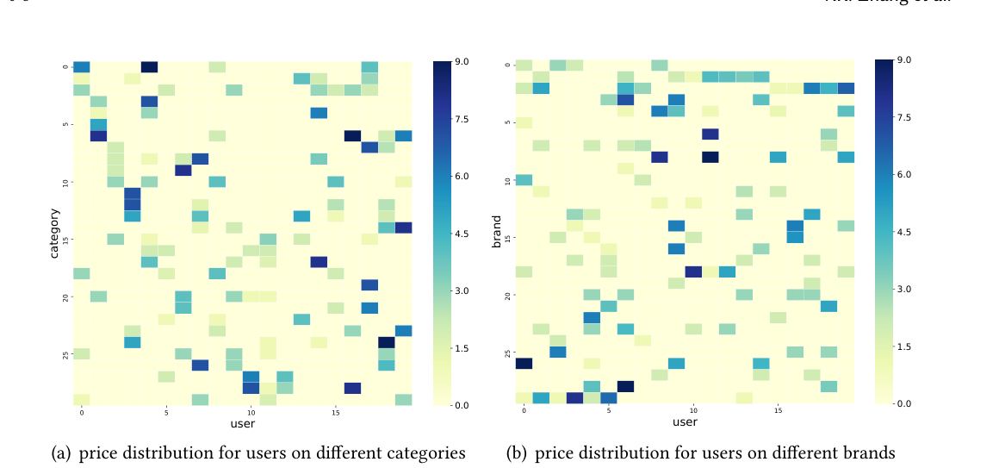
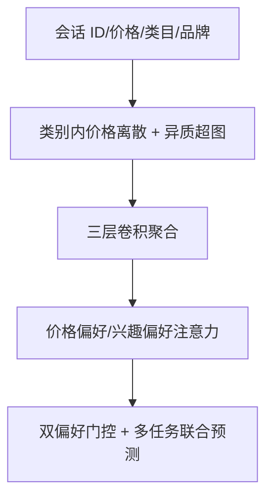
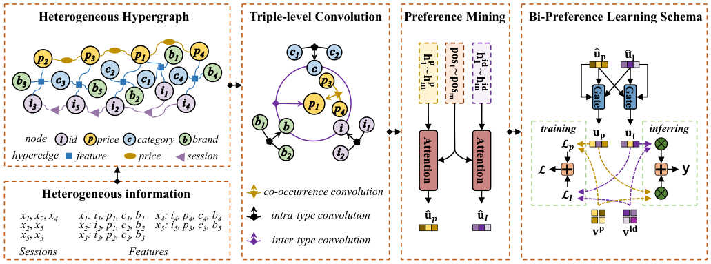

# Bi-Preference Learning Heterogeneous Hypergraph Networks for Session-based Recommendation (面向会话推荐的双偏好学习异质超图网络)

- **会议/期刊**: ACM TOIS 2024
- **作者与机构**: Xiaokun Zhang, Bo Xu, Fenglong Ma, Chenliang Li, Yuan Lin, Hongfei Lin；大连理工大学、宾夕法尼亚州立大学、武汉大学
- **推荐链路定位**: 召回/排序（会话级 next-item 预测）
- **研究方向**: 序列与会话推荐 / 图神经网络与知识图谱推荐
- **论文原文**: [论文原文链接](https://arxiv.org/abs/2311.01125v1)
- **开源代码**: [开源代码仓库链接](https://github.com/Zhang-xiaokun/BiPNet)

## TL;DR (1分钟核心速览)

针对匿名会话推荐只建模兴趣、忽略价格偏好的痛点，BiPNet 将价格离散为类别内逻辑斯谛等概率档，构建含 ID/价格/类目/品牌的异质超图，用三层卷积与双偏好多任务学习联合预测下一物品的价格档和 ID。在 Cosmetics/Grocery/Toys 的 70/20/10 划分、全库排序协议下，Prec@20 较最强基线 CoHHN 提升 1.08%–2.39%，验证价格信号价值。

## Background & Motivation (背景与核心矛盾)

- **主流范式**: SBR 主要用 RNN/CNN/Attention/GNN/超图，基于 item ID 序列建模用户兴趣并预测下一物品。
- **前人局限**: 现有方法只建模“喜欢什么”，忽略“愿意花多少钱”；价格偏好依赖类目/品牌，且价格与兴趣相互牵制，普通异质图只能建模 pair-wise 关系，难以表达 `<price, category, brand>` 三元高阶语义。
- **核心洞察 (Key Insight)**: 图1的价格热图显示同一用户在不同类目/品牌上的可接受价格差异显著，不同用户间亦高度分化；绝对价格不可直接比较，需按类目归一化。
- **本文切入点**: 用异质超图编码高阶异构关系，并以多任务方式联合学习价格偏好与兴趣偏好。

<figure class="paper-figure" markdown="span">
  <figcaption>图1. 用户在不同类别或品牌上的价格热力图。颜色深浅表示用户愿意在相应类别/品牌上花费的金额。</figcaption>
</figure>

## Method (核心方法设计)

### 1. 整体框架 (Overall Architecture)

输入会话中的 item ID、价格、类目、品牌，先按类别内逻辑斯谛分布将绝对价格离散为价格档，并构建三类超边：特征超边连接同一物品的 ID/价格/类目/品牌，价格超边连接会话内价格节点，会话超边连接会话内 ID 节点。随后用三层卷积聚合共现、类型内、类型间信息，分别经价格序列自注意力与 ID 序列注意力得到价格偏好、兴趣偏好；最后用门控双偏好学习与双任务损失联合训练，推理时融合价格档打分与 ID 打分。

<figure class="paper-figure" markdown="span">
  <figcaption>图3. 所提 BiPNet 的示意图。基于定制的异质超图，提出三层卷积，通过挖掘各种节点间的共现关系、类型内关系和类型间关系来学习节点嵌入。随后利用两个注意力层挖掘用户价格偏好和兴趣偏好。最后设计双偏好学习方案，通过探索这两种偏好之间的相互关系来联合预测用户价格偏好和兴趣偏好。（建议彩色查看）</figcaption>
</figure>

### 2. 关键设计拆解 (Key Designs)

1. **类别感知价格离散化与异质超图**：解决绝对价格跨类目不可比、异构高阶关系难建模。对类目内价格用逻辑斯谛 CDF 等概率分档：$p_i=\mathrm{round}\left(\frac{\Phi(x_p)-\Phi(min)}{\Phi(max)-\Phi(min)}\rho\right)$，使中间价格更细、各档样本更均衡；再用特征/价格/会话三类超边同时编码共现与异构语义，避免普通图仅能两两连边。
2. **三层卷积**：解决异质图 pair-wise 建模不足与 GCN 过平滑。先对同类型共现节点做平均池化，再用类型内注意力聚合同类邻域：$\mathbf{e}_i^\tau=\sum_k\alpha_k\mathbf{v}_k^\tau$，$\alpha_k=\mathrm{softmax}_k((\mathbf{v}_i^t)^\top\mathbf{W}\mathbf{v}_k^\tau)$；最后用门控融合多类型信息：$\mathbf{h}_i=\mathbf{v}_i^t+\sum_{\tau}\mathbf{g}_\tau\odot\mathbf{e}_i^\tau$。共现保留相似语义，类型内区分重要性，类型间保留异构互补。
3. **双偏好学习与多任务目标**：解决价格/兴趣互相影响、单兴趣监督不足。用门控互相增强：$\mathbf{u}_p=r_p\odot\hat{\mathbf{u}}_p+(1-r_p)\odot\hat{\mathbf{u}}_I$，兴趣侧对称融合；训练目标为$\mathcal{L}=\mathcal{L}_p+\mathcal{L}_I$，分别用下一物品价格档与 item ID 做全库 softmax 监督，无额外负采样。推理打分$\hat{y}_i=\mathrm{softmax}((\mathbf{u}_p)^\top\mathbf{v}_{p_i}+(\mathbf{u}_I)^\top\mathbf{v}_{id_i})$，开销随会话长度与超边数近线性增长。

## Experimental Setup & Evaluation Protocol (实验设置与评估协议)

- **数据集与预处理**: 删除长度 1 的会话，采用 10-core：每个 item 至少出现 10 次，且每个价格档/类目/品牌至少含 10 个 item。

| 数据集 | #Items | #Sessions | #Interactions | 价格档/类目/品牌 | Avg Len | 场景 |
| :--- | :---: | :---: | :---: | :---: | :---: | :--- |
| Cosmetics | 13,026 | 109,251 | 654,947 | 10/226/148 | 5.99 | 美妆购买/加购 |
| Grocery | 6,230 | 153,383 | 365,415 | 5/550/1,306 | 2.38 | Amazon 食品 |
| Toys | 18,979 | 287,733 | 714,770 | 5/430/1,429 | 2.48 | Amazon 玩具 |

- **数据划分与防穿越 (Splitting Strategy)**: 每个会话最后一项为 ground truth；按最早 70% 会话训练、接下来 20% 验证、剩余 10% 测试。
- **排名评测协议 (Ranking Protocol)**: 全库未交互候选全排序（softmax over all items，文中未描述负采样），报告 Prec@10/20、MRR@10/20。
- **对比基线与超参设置**: 覆盖 S-POP/SKNN、GRU4Rec/NARM/BERT4Rec、SR-GNN/SR-GNN+/LESSR、S2-DHCN/COTREC、MGS/DGNN/CoHHN；嵌入维度 $d=128$，Adam，lr=0.001，batch=100，会话截断 19，5 次随机种子平均，t-test$p<0.01$。主要超参：价格档$\rho\in\{2,5,10,50,100,200\}$，卷积重复$r\in\{1,2,3,4\}$，注意力头$h\in\{1,4,8,16,32\}$。

## Key Experimental Results (实验关键数据)

### 1. 主实验对比 (Main Results)

| 方法 | Cosmetics Prec@20 / MRR@20 | Grocery Prec@20 / MRR@20 | Toys Prec@20 / MRR@20 |
| :--- | :---: | :---: | :---: |
| NARM | 48.52 / 34.50 | 71.54 / 62.81 | 48.42 / 37.81 |
| BERT4Rec | 49.40 / 25.01 | 71.01 / 61.45 | 47.44 / 35.66 |
| SR-GNN | 50.75 / 34.78 | 71.68 / 63.03 | 49.48 / 38.05 |
| LESSR | 50.18 / 26.64 | 70.24 / 61.14 | 47.10 / 35.67 |
| S2-DHCN | 49.79 / 33.33 | 63.28 / 50.87 | 41.18 / 30.61 |
| COTREC | 51.41 / 34.93 | 72.17 / 51.43 | 50.17 / 33.89 |
| MGS | 52.28 / 35.16 | 71.87 / 62.53 | 50.02 / 37.99 |
| CoHHN（最强基线） | 54.50 / 35.42 | 72.87 / 63.35 | 51.43 / 38.81 |
| **BiPNet** | **55.28 / 35.94** | **73.66 / 63.69** | **52.66 / 39.02** |

> Improv. vs CoHHN：Cosmetics +1.43%/+1.47%，Grocery +1.08%/+0.54%，Toys +2.39%/+0.54%（Prec@20/MRR@20）。

### 2. 消融实验 (Ablation Study)

| 变体 | Cosmetics Prec/MRR@20 | Grocery Prec/MRR@20 | Toys Prec/MRR@20 |
| :--- | :---: | :---: | :---: |
| w/o 价格建模 (BiPNet-p) | 54.38 / 35.12 | 72.89 / 62.61 | 51.79 / 37.65 |
| w/o 价格/类目/品牌 (w/o pcb) | 52.15 / 32.67 | 71.87 / 61.63 | 50.94 / 36.84 |
| w/o 双偏好学习 (BiPNet-BiP) | 54.76 / 35.43 | 73.21 / 62.80 | 51.86 / 38.41 |
| 单损失 CE (BiPNet_CE) | 54.99 / 35.74 | 73.41 / 62.52 | 52.38 / 38.53 |
| **BiPNet** | **55.28 / 35.94** | **73.66 / 63.69** | **52.66 / 39.02** |

### 3. 关键实验发现 (Key Findings)

1. **价格不是附属特征**：去掉全部侧信息后，Cosmetics Prec@20 从 55.28 降至 52.15、MRR@20 从 35.94 降至 32.67；仅去价格也降至 54.38，说明价格须与类目/品牌联合建模。
2. **双偏好互促有效**：去掉双偏好学习降至 54.76/35.43，单损失 CE 为 54.99/35.74，均低于完整模型；增益来自价格档与 ID 监督的相互约束，而非简单多输入。
3. **高阶聚合与短会话收益**：图5 将三层卷积换成普通 GCN 后性能下降；图6 各价格档 BiPNet 均优于 MGS；图7 短会话增益更大，说明异质高阶信息与价格信号共同缓解匿名短会话稀疏。

## Highlights & Limitations (亮点、对比与审稿批判)

- **与代表作对比 (vs. Prior Work)**: CoHHN 仅用价格+类目且简单超图，BiPNet 增加品牌、重构异质超图、三层卷积与双偏好多任务；相比 MGS 仅用类目/品牌，额外显式价格监督；相比 SR-GNN/LESSR 的 pair-wise 图，能建模高阶异构关系。
- **可迁移亮点**: 类别内逻辑斯谛等频分档可迁移到年龄、消费额等连续侧信息；门控双任务融合适合价格/兴趣、点击/转化等互依目标。
- **审稿级局限批判**: 价格档依赖类目价格统计与 $\rho$ 选择，跨域迁移需重估分布；全库 softmax、超图构建与多层卷积在商品规模大时训练/推理开销偏高，且缺少线上 A/B 与冷启动价格缺失场景验证。

## Rating (四维评分)

- **方法创新性 (Novelty)**: ⭐⭐⭐⭐ （首次把价格偏好系统引入 SBR，异质超图+三层卷积+双偏好多任务组合完整，但门控多任务本身较常见）
- **评估协议与实验扎实度 (Protocol & Experiments)**: ⭐⭐⭐⭐ （三个真实数据集、5 次种子、t-test 与充分消融，但仅离线全库排序，无采样排序或线上验证）
- **写作与数学规范度 (Clarity & Rigor)**: ⭐⭐⭐⭐ （价格离散化与三层卷积公式清晰，符号较密；部分实现细节与复杂度分析可更充分）
- **工业落地与复现价值 (Industrial & Practical Value)**: ⭐⭐⭐⭐ （代码开源，价格/类目/品牌在电商可得；需权衡超图与全库 softmax 的工程开销）

