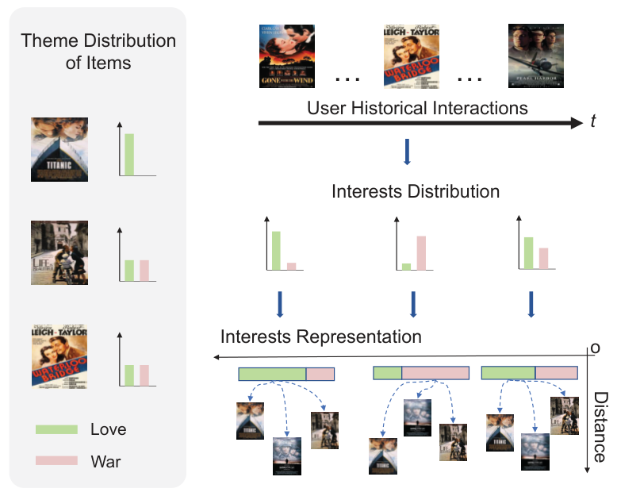
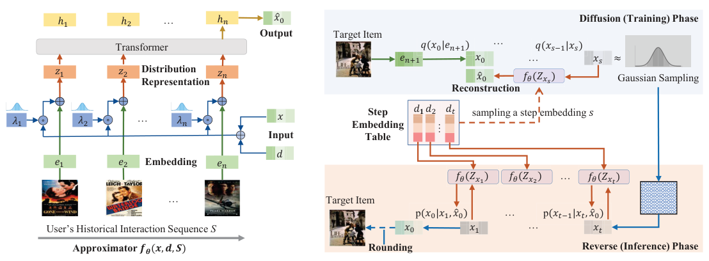
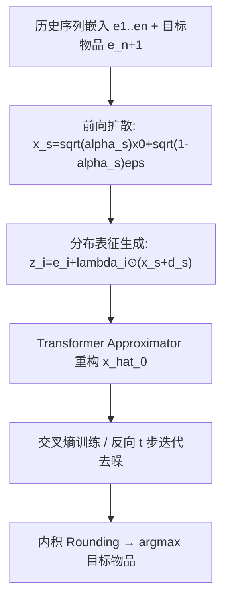

# DiffuRec: A Diffusion Model for Sequential Recommendation (面向序列推荐的扩散模型)

- **会议/期刊**: ACM Transactions on Information Systems (TOIS), Vol.37, No.4, Article 111
- **作者与机构**: Zihao Li, Chenliang Li (武汉大学 空天信息安全与可信计算教育部重点实验室), Aixin Sun (南洋理工大学)
- **推荐链路定位**: 召回（下一物品预测，全库排序）
- **研究方向**: 序列与会话推荐 / 生成式推荐（扩散生成推荐）
- **论文原文**: [https://arxiv.org/abs/2304.00686v4](https://arxiv.org/abs/2304.00686v4)
- **开源代码**: [https://github.com/WHUIR/DiffuRec](https://github.com/WHUIR/DiffuRec)

## TL;DR (1分钟核心速览)

主流序列推荐把物品编码成**固定向量**，无法同时刻画物品的多潜在方面、用户的多兴趣、意图的不确定性，也难以利用目标物品作为引导信号。DiffuRec 首次把扩散模型引入 SR：前向把目标物品嵌入退化为高斯分布并用以重加权历史物品表征，反向依据用户历史从纯噪声迭代还原目标表征，再经内积 rounding 完成全库排序。在 4 个真实数据集、`Leave-One-Out` + `Full-Ranking` 协议下，HR@5/NDCG@5 相对最优基线最高提升 57.26%/56.72%，四个数据集全指标均显著优于 9 个基线（t-test, $p<0.05$）。

## Background & Motivation (背景与核心矛盾)

- **主流范式**: SASRec/BERT4Rec 用单向/双向 Transformer 建模转移模式；ComiRec/TiMiRec 用动态路由或注意力抽取多兴趣；SVAE/ACVAE/STOSA 用 VAE 或高斯分布 + Wasserstein 距离注入不确定性。
- **前人局限**: 其一，多兴趣方法必须**启发式预设兴趣数 $K$**，该固定数目既限制表征柔性又需调参；其二，VAE 类方法存在**后验坍塌与表征退化**，且难以在统一框架内同时表达物品多方面性与用户多兴趣。
- **核心洞察 (Key Insight)**: 用户对物品不同潜在方面（如电影的"爱情/战争"主题）的关注会随场景漂移，静态向量对所有用户共享，本质上是"一刀切"；扩散模型天然生成**分布而非点**，且其加噪—去噪过程可自然把目标物品的监督信号与随机不确定性一并注入。
- **本文切入点**: 不做"打分排序"，而是把"目标物品表征"当作待生成的连续变量，用用户历史作条件做条件扩散生成，最后落到离散物品空间。

<figure class="paper-figure" markdown="span">
  <figcaption>图 1</figcaption>
</figure>

## Method (核心方法设计)

### 1. 整体框架 (Overall Architecture)

给定历史序列 $(i_1,\dots,i_n)$与目标物品$i_{n+1}$，先对其嵌入$\mathbf{e}_{n+1}$做一步扩散得到$\mathbf{x}_0$，再采样扩散步$s\sim U(0,t)$得到噪声表征$\mathbf{x}_s$；用$\mathbf{x}_s$与步嵌入$\mathbf{d}_s$逐物品重加权历史表征$\mathbf{Z}_{x_s}$，送入 Transformer Approximator 重构$\hat{\mathbf{x}}_0$，并以交叉熵对齐真实目标物品。推理时从$\mathbf{x}_t\sim\mathcal{N}(\mathbf{0},\mathbf{I})$出发迭代$t=32$步反演得到$\mathbf{x}_0$，用内积 rounding 在全库上取 argmax。训练与推理共享同一 Approximator，属端到端序列生成范式。

<figure class="paper-figure" markdown="span">
  <figcaption>图 2</figcaption>
</figure>

### 2. 关键设计拆解 (Key Designs)

1. **目标引导的分布表征生成（取代预设兴趣数）**：痛点是不预设 $K$ 就无法表达多兴趣。DiffuRec 让每个历史物品按逐物品、逐扩散步的随机系数被目标表征"染色"：
 $\mathbf{z}_i=\mathbf{e}_i+\lambda_i\odot(\mathbf{x}_s+\mathbf{d}_s),\quad \lambda_i\sim\mathcal{N}(\delta,\delta)$ $\lambda_i$ 的高斯采样使同一物品在不同反演步被赋予不同权重，等价于**连续而非离散的兴趣维度**，同时把目标物品作为辅助监督（思路近于 TiMiRec）与不确定性注入合二为一。

2. **截断线性噪声调度（Truncated Linear Schedule）**：因模型只用**一步** $\mathbf{x}_s$估计$\mathbf{x}_0$，需要中段陡峭、两端平缓的破坏曲线：
 $\beta_s=\begin{cases}a t_s+b & \beta_s\le\tau\\ \tfrac{1}{10}(a t_s+b) & \text{otherwise}\end{cases}$截断阈值$\tau=1$ 抑制过大噪声导致的嵌入失真；相比 sqrt/cosine/linear，该调度在 Beauty/Baby 上最优，但并非所有数据集都占优。

3. **交叉熵目标 + 内积 Rounding（替代 MSE 与余弦匹配）**：标准扩散用 MSE 预测噪声，但推荐中物品嵌入是**静态离散集合**，MSE 训练不稳定；且排序本质用内积衡量相关性：
 $\hat{y}=\mathrm{softmax}(\hat{\mathbf{x}}_0\mathbf{E}^{\top}),\quad \mathcal{L}_{CE}=-\tfrac{1}{|\mathcal{U}|}\sum_{u}-\log\hat{y}_{i_{n+1}}$推理端 `Rounding`$(\mathbf{x}_0)=\arg\max_{i}\mathbf{x}_0\cdot\mathbf{e}_i^{\top}$，与训练目标严格一致。**训练**：每步随机采样$s$，维度$d=128$、4 层 4 头 Transformer、batch 1024、Adam$10^{-3}$、$\delta=0.001$；**推理**：32 步反演 + 全库内积，复杂度$O(nd^2+dn^2)$，与 SASRec 同级。

## Experimental Setup & Evaluation Protocol (实验设置与评估协议)

- **数据集与预处理**: 全部视为隐式反馈并按时间戳排序，过滤交互数 $<5$ 的用户/物品（等价 5-core）：

| 数据集 | #Sequences | #Items | #Interactions | 平均长度 | 稀疏度 |
| :--- | :---: | :---: | :---: | :---: | :---: |
| Amazon Beauty | 22,363 | 12,101 | 198,502 | 8.53 | 99.93% |
| Amazon Toys | 19,412 | 11,924 | 167,597 | 8.63 | 99.93% |
| Movielens-1M | 6,040 | 3,416 | 999,611 | 165.50 | 95.16% |
| Steam | 281,428 | 13,044 | 3,485,022 | 12.40 | 99.90% |

- **数据划分与防穿越**: `Leave-One-Out`——最后一项测试、倒数第二项验证、其余训练；最大序列长度 ML-1M 取 200，其余取 50。注意该划分按用户内部时序，未做全局时间戳切分，存在跨用户时间穿越风险。
- **排名评测协议**: **无偏 `Full-Ranking`**（对全部未交互候选打分排序），作者明确指出采样评估在负样本少时会产生不一致。
- **对比基线与超参**: 9 个基线覆盖三类——常规序列模型（GRU4Rec、Caser、SASRec、BERT4Rec）、多兴趣（ComiRec、TiMiRec）、VAE/不确定性（SVAE、ACVAE、STOSA）。指标 HR@{5,10,20}、NDCG@{5,10,20}，5 次重复取均值，配对 student $t$-test 检验$p<0.05$，嵌入维度统一$d=128$。

## Key Experimental Results (实验关键数据)

### 1. 主实验对比 (Main Results)

| 数据集 | 指标 | SASRec | BERT4Rec | TiMiRec | ACVAE | STOSA | **DiffuRec** | Improv. |
| :--- | :--- | :---: | :---: | :---: | :---: | :---: | :---: | :---: |
| Beauty | HR@10 | 6.2648 | 3.7160 | 3.3434 | 3.8832 | 6.2048 | **7.9068** | +26.21% |
| Beauty | NDCG@10 | 3.2305 | 1.8291 | 1.7044 | 2.1389 | 3.2085 | **4.7494** | +47.02% |
| Toys | HR@10 | 6.5496 | 2.9312 | 1.8169 | 3.0749 | 6.9393 | **7.4587** | +7.48% |
| Toys | NDCG@10 | 3.7533 | 1.4870 | 0.9123 | 1.8452 | 3.8806 | **4.7724** | +22.98% |
| ML-1M | HR@10 | 16.8941 | 20.5675 | 23.7142 | 19.9313 | 14.3941 | **26.2647** | +10.76% |
| ML-1M | NDCG@10 | 7.7277 | 11.1251 | 13.3059 | 10.5417 | 6.0771 | **14.7909** | +11.16% |
| Steam | HR@10 | 8.3763 | 7.9448 | 9.6697 | 9.2783 | 8.5870 | **10.7520** | +11.19% |
| Steam | NDCG@10 | 4.0489 | 4.0002 | 5.0446 | 4.7290 | 4.1191 | **5.5981** | +10.97% |

（HR@5/NDCG@5 处最大增益出现在 Beauty：5.5758 vs. STOSA 3.5457，+57.26%；4.0047 vs. 2.5554，+56.72%。）

### 2. 消融实验 (Ablation Study)

| 变体 | Beauty HR@10 / NDCG@10 | Toys | ML-1M | Steam |
| :--- | :---: | :---: | :---: | :---: |
| w GRU（换骨架） | 4.6685 / 2.7075 | 3.4150 / 2.0849 | 24.6094 / 13.5348 | 10.1723 / 5.2548 |
| w R*（换余弦式 round） | 2.2902 / 1.1130 | 0.4133 / 0.1510 | 6.0872 / 3.4297 | 2.5977 / 1.2582 |
| **DiffuRec** | **7.9068 / 4.7494** | **7.4587 / 4.7724** | **26.2647 / 14.7909** | **10.7520 / 5.5981** |

### 3. 关键实验发现 (Key Findings)

1. **Rounding 才是命门，骨架不是**：把内积 rounding 换成 DiffuSeq 式余弦项后，HR@10 在 Toys 上从 7.4587 崩到 0.4133（-94%），Beauty 掉 -71%，说明生成式检索必须让训练目标（softmax 内积）与推理度量（内积 argmax）严格同构。
2. **分布建模的收益来自扩散框架本身，而非 Transformer**：换成 GRU Approximator 后 ML-1M/Steam 仅掉 6.3%/5.4%（26.26→24.61、10.75→10.17），却在 Beauty 掉 41%，暗示短序列下表征容量更依赖注意力；训练时间上 SASRec/ACVAE/STOSA/DiffuRec 均在 14–18 s/batch，扩散未成为训练瓶颈。
3. **不确定性与多样性可量化**：对同一序列用 100 个不同高斯噪声反演，Beauty 的 top-20 中唯一物品数达 643（ML-1M 为 82），使召回阶段可并行采样出多样化候选；对比 LoUO 长度分桶，Beauty 在长序列上增益更大，ML-1M 则随长度递减（80% 序列长于 37），说明超长序列仍是共同短板；同时 head 物品性能约为长尾的 5 倍以上，长尾差距明显。

## Highlights & Limitations (亮点、对比与审稿批判)

- **与代表作对比 (vs. Prior Work)**: 相较 TiMiRec（用目标物品做辅助损失但仍需预设兴趣数、且推理是确定性点估计），DiffuRec 用连续随机系数 $\lambda_i$取代离散$K$ 个兴趣槽位；相较 STOSA（把自注意力内积换成 Wasserstein 距离，本质仍是静态分布参数化），DiffuRec 用**迭代去噪**生成目标表征，表达能力随步数递增；相较 Diffusion-LM/DiffuSeq（文本条件生成），本文把"条件"换成用户历史序列，并把 MSE 重建换成排序交叉熵。
- **可迁移亮点**: ①"训练目标与推理 rounding 度量必须同构"这一经验可直接迁移到 TIGER/RQ-VAE 类语义 ID 生成式检索；②用 $\lambda_i\odot(\mathbf{x}+\mathbf{d})$ 把生成信号注入历史编码器，是一种轻量的条件注入范式，几乎不增加参数量。
- **审稿级局限批判**: ①推理需 32 步迭代，单样本耗时随步数指数上升（$t=2$时才与 SASRec 持平），线上召回若无 GPU 批并行则成本不可接受；②训练仅做**一步**$s\to\mathbf{x}_0$估计，$\epsilon$-prediction 与 RMSE 变体均无法收敛，说明该方法对扩散目标函数选择高度敏感；③截断线性调度并非全部数据集最优（ML-1M/Steam 上 sub-optimal），且$\lambda$ 增至 0.1 即导致性能骤降，超参鲁棒性偏弱；④未拆分"高斯噪声注入"与"目标引导"两路增益的独立消融。

## Rating (四维评分)

- **方法创新性 (Novelty)**: ⭐⭐⭐⭐ （首个把扩散生成引入 SR 的工作，把"固定向量→分布表征"的重构做得自洽，但扩散本身非新算子）
- **评估协议与实验扎实度 (Protocol & Experiments)**: ⭐⭐⭐⭐ （4 数据集 + 9 基线 + Full-Ranking + t-test 检验较规范，但 Leave-One-Out 无全局时间切分，消融维度略少）
- **写作与数学规范度 (Clarity & Rigor)**: ⭐⭐⭐⭐ （前向/反向推导、VLB 拆解与算法伪代码完整，符号一致；稍显冗长，超参分析偏经验）
- **工业落地与复现价值 (Industrial & Practical Value)**: ⭐⭐⭐ （代码开源、训练开销与 SASRec 同级；但 32 步反演推理延迟与全库内积 rounding 在高并发召回场景成本偏高）

