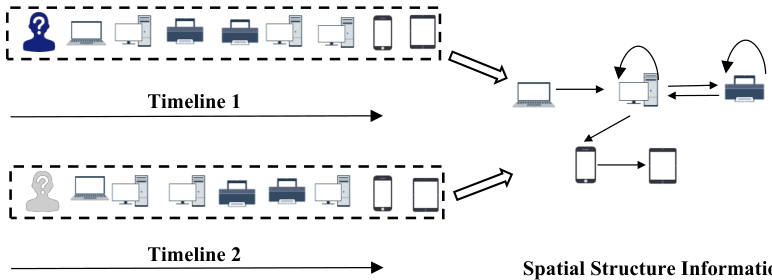
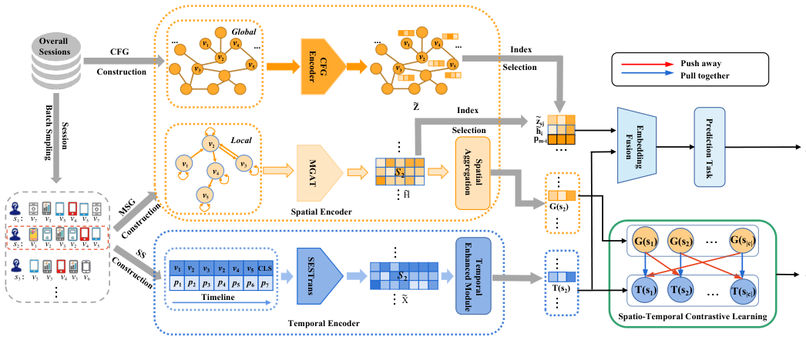
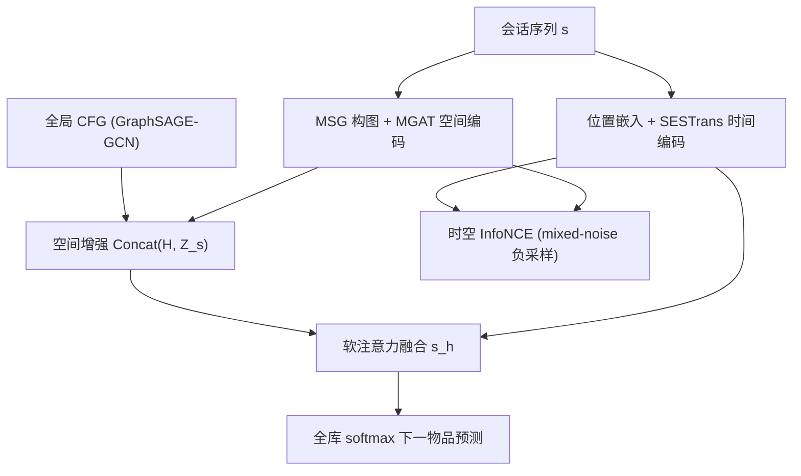

# Spatio-Temporal Contrastive Learning Enhanced GNNs for Session-based Recommendation (时空对比学习增强图神经网络的会话推荐)

- **会议/期刊**: ACM Transactions on Information Systems (TOIS) 2024
- **作者与机构**: Zhongwei Wan (Ohio State University), Xin Liu (HKUST), Benyou Wang (CUHK-SZ), Jiezhong Qiu (Tencent), Boyu Li / Ting Guo / Yang Wang (UTS), Guangyong Chen (Zhejiang Lab)
- **推荐链路定位**: 召回（会话级候选全库打分）
- **研究方向**: 序列与会话推荐 / 自监督对比学习与交互去噪
- **论文原文**: [https://arxiv.org/abs/2209.11461v4](https://arxiv.org/abs/2209.11461v4)
- **开源代码**: [https://github.com/SUSTechBruce/RESTC-Source-code](https://github.com/SUSTechBruce/RESTC-Source-code)

## TL;DR (1分钟核心速览)

GNN 会话推荐把会话转成物品转移图做消息传递，但聚合算子是置换不变的，会丢掉会话内的时序先后——两个产生不同下一跳的会话可被编码成同一张图；而已有的时序增强模型只是把时间戳/子图拼接进来，空间与时间两视图在隐空间缺乏交互。RESTC 提出"空间 MGAT + 时间 SESTrans"双编码器，用辅助 InfoNCE 跨视图对比学习把两个表征拉齐，并以全局协同过滤图 (CFG) 嵌入增强空间视图、缓解短会话稀疏。在 6 个公开数据集、全库排序协议下，Tmall 上较最强基线 GCE-GNN 提升 27.08% HR@20 与 20.10% MRR@20。

## Background & Motivation (背景与核心矛盾)

- **主流范式**: SR-GNN / FGNN / GCE-GNN 将会话建模为有向（加权）转移图，用门控 GNN 或图注意力聚合邻居，再从全局会话图补协同信号。
- **前人局限**: ① GNN 的置换不变聚合无法区分邻居时序，Diginetica 中 23.85% 的会话图入度大于 1，存在有向环，导致原序列不可唯一还原；② 时序增强方法（TASRec 动态图快照、TMI-GNN、GNG-ODE）引入时间信息，但只是"额外输入"，两视图在潜在空间无有效交互，且子图快照带来冗余结构。
- **核心洞察 (Key Insight)**: 会话同时具备**时间视图**（一条带顺序的行为序列）与**空间视图**（与时间正交的物品转移图）——两者语义互补，应像 SimCLR 那样用 alignment/uniformity 目标把同一会话的两个视图拉近、不同会话推远。
- **本文切入点**: 不做序列裁剪/掩码/子图采样这类会破坏时序完整性的增广（会话图节点少，增广极易引入语义不一致噪声），而是把"另一个编码器对同一会话的编码"本身当作正样本。

<figure class="paper-figure" markdown="span">
  <figcaption>图1. 若忽略时间信息，两个不同的会话可能被表示为同一张图，这表明应充分考虑时间模式，以补充用于SBR任务的基于GNN的模型。</figcaption>
</figure>

## Method (核心方法设计)

### 1. 整体框架 (Overall Architecture)

会话 $s$同时送入两条支路：空间侧先构建**多关系会话图 (MSG)**，用多关系图注意力 MGAT 编码得$\tilde{\mathbf{H}}$，再与位置嵌入、全局 CFG 嵌入$\tilde{\mathbf{Z}}_s$拼接得增强空间表征$\mathbf{H}_g$；时间侧在序列尾部加 `[CLS]`、叠加可学习绝对位置嵌入后送入 2 层 SESTrans，经时序增强注意力池化得$\mathbf{T}(s)$。批内$(\mathbf{G}(s_i),\mathbf{T}(s_i))$构成正对，跨视图 InfoNCE 作为辅助任务；主任务用软注意力融合空间与时间得$\mathbf{s}_h$，softmax 打分预测下一物品，与对比损失多任务联合训练。

<figure class="paper-figure" markdown="span">
  <figcaption>图4. RESTC概览。MGAT、SESTrans、CFG encoder分别表示第4.2节的多关系图注意力网络、第4.1节的会话Transformer、第5.1节的协同过滤图编码器。</figcaption>
</figure>

### 2. 关键设计拆解 (Key Designs)

1. **多关系 MSG + 多关系注意力 (MGAT)**：解决单一加权图把 in/out/bi-direction/self-loop 四种转移语义混为一谈的问题。关系感知注意力 $e_{ij}=\boldsymbol{r}_{ij}^{\top}(\mathbf{h}_i\circ\mathbf{h}_j)$，四种关系头分别归一化后**相加**而非拼接：$\tilde{\mathbf{h}}_i=\sum_{r=1}^{4}\sum_{j\in\mathcal{N}_i}\alpha^{(r)}_{ij}\mathbf{h}_j$。直觉：同一邻居在不同转移方向下应贡献不同权重，按关系分头可让"反向边"不再污染"正向兴趣流"。

2. **时序增强模块 (SESTrans + 时序池化)**：标准 Transformer 的均值/首 token 池化无法区分"偏好演化"。以 `[CLS]` 输出为全局查询 $\mathbf{Q}'$、其余位置输出为键$\mathbf{K}'$、**原始带位置嵌入的输入**$\mathbf{X}'$为值$\mathbf{V}'$：$\gamma_t=\mathrm{softmax}(\mathrm{ReLU}(\mathbf{Q}'\mathbf{W}_3+\mathbf{K}'\mathbf{W}_4+\mathbf{b}_3)\mathbf{f}_t)$，$\mathbf{h}_t=\sum_{i}\gamma_{ti}\mathbf{v}'_i$，最终$\mathbf{T}(s)=\mathrm{L2Norm}(\mathrm{FFN}([\mathbf{h}_t;\mathbf{x}_c]))$。用未过 Transformer 的原始嵌入作 value，等价于把"原始时序位置信号"直接注入聚合向量，避免深层注意力把顺序磨平。

3. **CFG 增强 + 融合与训练目标**：全局 CFG 以所有会话的相邻物品对为加权边，GraphSAGE-GCN 均值传播 $\mathbf{Z}^{(k)}=\mathrm{LeakyReLU}(\tilde{\mathbf{D}}^{-1}\tilde{\mathbf{A}}\mathbf{Z}^{(k-1)}\mathbf{W}_c^{(k)})$（3 层最优），$\mathbf{H}_g=\mathrm{Concat}(\mathbf{P}_e,\tilde{\mathbf{H}},\tilde{\mathbf{Z}}_s)\mathbf{W}_g$；融合$\mathbf{s}_h=\sum_{i}\rho_{si}(\tilde{\mathbf{z}}_{si}+\tilde{\mathbf{h}}_i)$。负采样采用 **mixed-noise**：对批内时间表征做列向 shuffle 生成$C$个噪声样本，与原有$C$个时间表征组成$2C$负候选池再抽$C$个，$\mathcal{L}_{cont}=-\sum_i\log\frac{\exp(\mathrm{sim}(\mathbf{G}(s_i),\mathbf{T}(s_i))/\tau)}{\sum_{s^-\in\mathcal{C}^-}\exp(\mathrm{sim}(\mathbf{G}(s_i),\mathbf{T}(s^-))/\tau)}$；总损失$\mathcal{L}=\mathcal{L}_{main}+\eta_1\mathcal{L}_{cont}+\eta_2\|\Theta\|_2^2$，$\mathcal{L}_{main}$ 为全库 softmax 交叉熵。推理时仅用主任务分支，对比分支不增加线上开销。

## Experimental Setup & Evaluation Protocol (实验设置与评估协议)

- **数据集与预处理**: 过滤长度 <1 的会话与全库出现次数 <5 的物品（物品级 5-core），训练集内做前缀切分增广 $([v_1],v_2),\dots$。

| 数据集 | #Items | #Clicks | #Train | #Test | 平均长度 |
| :--- | :---: | :---: | :---: | :---: | :---: |
| Tmall | — | 818,479 | 351,268 | 25,898 | 6.69 |
| Diginetica | 43,097 | 982,961 | 719,470 | 60,858 | 5.12 |
| RetailRocket | 36,968 | 710,586 | 433,648 | 15,132 | 5.43 |
| Gowalla | 29,510 | 1,122,788 | 419,200 | 155,332 | 3.85 |
| Nowplaying | 60,417 | 1,367,963 | 825,304 | 89,824 | 7.42 |
| LastFM | 38,615 | 3,835,706 | 2,837,330 | 672,833 | 11.78 |

- **数据划分与防穿越**: **全局时间戳切分**——最后 7 天为测试集，之前为训练集（非 Leave-One-Out），避免未来会话泄漏。
- **排名评测协议**: **Full-Ranking 全库排序**（输出层对全部 $N$个物品做 softmax，未采样负例），指标 HR@10/20、MRR@10/20；显著性$p<0.001$。
- **对比基线与超参**: 序列类 (FPMC/GRU4Rec/NARM/STAMP/SASRec/BERT4Rec)、GNN 类 (SR-GNN/GC-SAN/CSRM/FGNN/GCE-GNN)、时序增强类 (TASRec/TMI-GNN/GNG-ODE)、对比学习类 (CL4Rec/DuoRec/CORE/S2-DHCN/COTREC)。维度 $d\in\{100,\dots,350\}$（TM/DG 取 300、RR 取 200），batch 512，2 层 SESTrans、1 层 MGAT、3 层 CFG，$\eta_1\approx5\times10^{-3}$，Adam + Step/Cosine 调度。

## Key Experimental Results (实验关键数据)

### 1. 主实验对比 (Main Results)

| 数据集 | 指标 | SR-GNN | STAMP | SASRec | GCE-GNN | TASRec | S2-DHCN | COTREC | RESTC |
| :--- | :---: | :---: | :---: | :---: | :---: | :---: | :---: | :---: | :---: |
| Tmall | HR@20 | 27.57 | 26.47 | 27.72 | 33.42 | 29.58 | 31.42 | 35.19 | **42.47** |
| Tmall | MRR@20 | 13.72 | 13.36 | 12.11 | 15.42 | 14.51 | 15.05 | 17.55 | **18.52** |
| Diginetica | HR@20 | 50.73 | 45.64 | 48.78 | 54.22 | 52.53 | 53.66 | 53.85 | **55.93** |
| Diginetica | MRR@20 | 17.59 | 14.32 | 17.22 | 19.04 | 18.22 | 18.51 | 18.82 | **19.65** |
| RetailRocket | HR@20 | 50.32 | 50.96 | 45.85 | 55.78 | 54.23 | 53.66 | — | **57.81** |
| RetailRocket | MRR@20 | 26.57 | 25.17 | 23.39 | 28.72 | 28.37 | 27.30 | — | **30.82** |
| Gowalla | HR@20 | 50.29 | 50.15 | 48.53 | 52.48 | 53.55 | 53.34 | — | **56.38** |
| Gowalla | MRR@20 | 24.31 | 24.03 | 22.52 | 24.68 | 23.73 | 23.88 | — | **25.92** |

相对最强基线 GCE-GNN：Tmall **+27.08% HR@20 / +20.10% MRR@20**，Diginetica +3.15% / +3.20%，RetailRocket +3.64% / +7.31%，Gowalla +7.43% / +5.02%。

### 2. 消融实验 (Ablation Study)

| 变体 | TM HR@20 | TM MRR@20 | DG HR@20 | DG MRR@20 | RR HR@20 | RR MRR@20 |
| :--- | :---: | :---: | :---: | :---: | :---: | :---: |
| w/o SESTrans | 36.61 | 16.08 | 54.31 | 19.11 | 52.65 | 27.11 |
| w/o CFG | 36.96 | 16.38 | 54.28 | 18.84 | 56.28 | 28.94 |
| w/o Cont. | 39.27 | 17.11 | 54.65 | 19.35 | 57.01 | 29.13 |
| w/o PE-G | 40.81 | 17.75 | 51.98 | 18.04 | 53.51 | 27.96 |
| w/o PE-S | 41.05 | 17.92 | 54.45 | 19.29 | 56.98 | 30.03 |
| RESTC | **42.47** | **18.52** | **55.93** | **19.65** | **57.81** | **30.82** |

### 3. 关键实验发现 (Key Findings)

1. **对比学习是主增益源，且 CFG 专治短会话稀疏**：Tmall 去掉对比损失 HR@20 由 42.47 掉到 39.27（-7.5%）；而 RetailRocket 上 w/o CFG 掉 1.53 个点、Tmall 掉 5.51 个点，说明全局图主要补足短会话的共现信号（长会话本身信息足够，边际收益递减）。
2. **空间视图必须显式补顺序**：w/o PE-G 在 Diginetica 上跌幅最大（55.93→51.98，-3.95），是唯一让 DG 掉到 GCE-GNN 水平的变体，量化印证了"GNN 置换不变 = 丢失时序"这一动机；相比之下 w/o PE-S 影响温和（TM -1.42），说明时序位置信号已部分被 SESTrans 的 self-attention 吸收。
3. **负采样构造与 batch 规模强耦合**：mixed-noise 在 batch=512 时最优（TM HR@20 42.47），同策略降到 128 只有 41.95，仍低于 Spatial-only 之外的全部变体；Spatial-only（41.33）最差，证明负样本必须来自时间侧才能完成跨视图对齐。温度 $\tau$ 过大（1.0）难分难负例、过小（0.1）快速过拟合，需按数据集在 0.1–1 间取。

## Highlights & Limitations (亮点、对比与审稿批判)

- **与代表作对比 (vs. Prior Work)**: 与 S²-DHCN、COTREC 同属"对比学习 + 会话图"，但二者用超图/线图或会话内外部连边做同类视图增广，本质仍是空间侧自监督；RESTC 的关键差别是把**时间编码器输出**当作跨视图正样本，从而把时序信息"注入"空间分支。与 TASRec/GNG-ODE 相比，则用对比正则代替动态图快照，避免多快照的冗余结构，且框架模型无关（可换 GGNN/GraphSAGE/GAT 骨干）。
- **可迁移亮点**: ① "另一视图编码器即正样本、免手工增广"的范式可直接搬到跨域/多场景双塔对齐；② mixed-noise 负采样（shuffle 生成 $2C$池再抽$C$）实现简单、对 batch 敏感但增益稳定，适合作为通用自监督插件。
- **审稿级局限批判**: ① CFG 需对全量会话构图并 3 层传播，会话增量更新时需重建/局部刷新，工业级流式场景的构图与内存开销未讨论；② 数据集均为小规模公开基准，最长的 LastFM 平均长度 11.78，缺少超长会话与大模型对照（未与 BERT4Rec 之外的自注意力基线做等参数量对齐），且 Tmall/Diginetica 的绝对提升（3 个点）远小于 Tmall 的 27%，跨数据集方差较大。

## Rating (四维评分)

- **方法创新性 (Novelty)**: ⭐⭐⭐⭐ （"跨视图正样本代替序列增广"切入角度干净，多关系 MSG 的四头相加聚合与 mixed-noise 负采样均是具体可复用的算子改进）
- **评估协议与实验扎实度 (Protocol & Experiments)**: ⭐⭐⭐⭐ （6 数据集 + Full-Ranking + $p<0.001$，消融覆盖模块、位置嵌入、骨干、负采样、温度、会话长度分桶与 t-SNE，仅缺线上或大规模验证）
- **写作与数学规范度 (Clarity & Rigor)**: ⭐⭐⭐⭐ （公式编号完整、符号一致，时间/空间视图的动机图与有向环统计（23.85%）有说服力；但 Table 1 存在排版错行、部分基线数值缺失）
- **工业落地与复现价值 (Industrial & Practical Value)**: ⭐⭐⭐⭐ （代码开源，对比分支只在训练期启用、推理零额外延迟，主要成本在全局 CFG 构图，适合离线批式召回场景）

