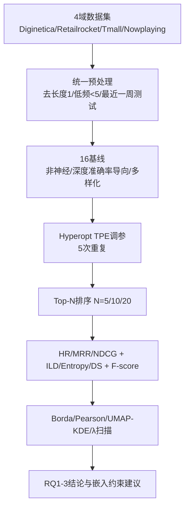

# Understanding Diversity in Session-Based Recommendation (会话推荐中的多样性理解)

- **会议/期刊**: TOIS 2024
- **作者与机构**: Qing Yin, Hui Fang (上海财经大学)；Zhu Sun (A*STAR IHPC/CFAR)；Yew-Soon Ong (A*STAR CFAR/NTU)
- **推荐链路定位**: 召回/重排评估（端到端会话推荐）
- **研究方向**: 序列与会话推荐 / 去偏公平与可信评测
- **论文原文**: [论文原文链接](https://arxiv.org/abs/2208.13453v2)
- **开源代码**: [开源代码仓库链接](https://github.com/qyin863/Understanding-Diversity-in-SBRSs)

## TL;DR (1分钟核心速览)

本文系统复盘会话推荐中的准确率与多样性：统一 4 个跨域数据集、16 个代表性基线、Hyperopt 调参与 Top-N 全库排序，发现非多样化模型也能取得高多样性，准确率-多样性并非固定 trade-off，并给出 F-score、Borda、Pearson 与嵌入均匀性诊断。

## Background & Motivation (背景与核心矛盾)

- **主流范式**: SBRS 以 GRU4Rec、NARM、STAMP、SR-GNN、GCE-GNN 等准确率导向模型为主，多样化 SBRS 仅 MCPRN、ComiRec、IDSR 等少数。
- **前人局限**: 多样化模型很少与准确率导向模型在统一协议下同时比较准确率与多样性；多数工作默认“多样性提升必牺牲准确率”，但缺乏跨模型、跨数据验证。
- **核心洞察 (Key Insight)**: 作者发现非多样化模型（POP、S-POP、GRU4Rec）的多样性可接近甚至超过 IDSR；准确率与多样性还可能同向变化（win-win/lose-lose）。
- **本文切入点**: 不做新模型，而以受控实证研究回答 RQ1 性能差异、RQ2 关系形态、RQ3 影响因素。

## Method (核心方法设计)

### 1. 整体框架 (Overall Architecture)

本文构建可复现的评测闭环：先统一 4 个电商/音乐数据集预处理与时间切分，再并行跑传统非神经、深度准确率导向、深度多样化三类基线；所有深度模型用 Hyperopt TPE 调参并重复 5 次；随后在 Top-N 列表上计算准确性、多样性及 F-score，最后用 Borda 聚合、HR-ILD 散点、Pearson、λ 扫描、UMAP/vMF KDE 做归因分析。

### 2. 关键设计拆解 (Key Designs)

1. **三族基线正交对比 + 统一调参**：痛点是对比不公平、结论不可比。本文覆盖 POP/S-POP/Item-KNN/BPR-MF/FPMC、GRU4Rec/NARM/STAMP/SR-GNN/GC-SAN/GCE-GNN、MCPRN/NARM+MMR/IDSR(λ)，用同一数据切分、同一 Top-N 协议与 Hyperopt TPE 调参，避免“调参差异伪装成模型差异”。
2. **双视角刻画准确率-多样性关系**：除跨模型比较外，还做模型内 λ 扫描（IDSR 的 $\lambda$、NARM+MMR 的$\lambda$），并用 Pearson 相关检验指标间关系。核心统计量为$r=\frac{\sum_i(x_i-\bar{x})(y_i-\bar{y})}{\sqrt{\sum_i(x_i-\bar{x})^2}\sqrt{\sum_i(y_i-\bar{y})^2}}$，用于判断两组指标是同向还是反向。
3. **影响因素与嵌入均匀性诊断**：从类别粒度、数据集会话多样性、推荐列表长度三因素拆解多样性差异；再用 UMAP 与 vMF KDE 观察物品嵌入的类间重叠。直观上，类间嵌入越可分，Top-N 越偏向主导类目，多样性越低；类间重叠越高，列表越易跨类。

### 3. 训练目标、负采样与推理效率

本文不提出新损失，沿用各基线原训练目标：GRU4Rec 等用 pairwise ranking，Item-KNN/POP 无训练负采样，IDSR 用 $\lambda\cdot rel+(1-\lambda)\cdot div$加权损失，NARM+MMR 用$s_{rel}+\lambda s_{div}$ 后处理重排。推理为 Top-N 全库排序；IDSR/MMR 需额外多样化打分或重排开销，GNN 类因构图与消息传递开销更高。

## Experimental Setup & Evaluation Protocol (实验设置与评估协议)

- **数据集与预处理**: 过滤长度 1 会话与出现次数 $<5$ 的低频物品（近似 5-core），并过滤测试集未登录物品；序列切分用于非 session-parallel 模型。

| 数据集 | #Users | #Items | #Interactions | #Categories | Avg. Len | 场景/特征 |
| :--- | :---: | :---: | :---: | :---: | :---: | :--- |
| Diginetica | 匿名 | 43,097 | 993,483 | 995 | 4.8504 | 电商搜索/view |
| Retailrocket | 匿名 | 48,893 | 1,082,246 | 944 | 3.5253 | 电商/view/30min 会话 |
| Tmall | 匿名 | 96,182 | 1,505,683 | 822 | 6.0775 | 电商/buy+view/按天 |
| Nowplaying | 匿名 | 60,622 | 1,227,583 | 11,558 | 8.4056 | 音乐/ArtistId 类目 |

- **数据划分与防穿越**: 全局时间切分，最近一周为测试集，其余为训练；测试会话数分别为 18,101 / 12,206 / 51,894 / 1,680。
- **排名评测协议**: Top-N 全库未交互物品排序（Full-Ranking，未采用采样负例），$N=\{5,10,20\}$，主表报告 @10/@20，5 次均值并用 paired t-test，$p<0.05$。
- **对比基线与超参**: 16 个基线，Adam 优化；深度模型用 Hyperopt TPE 搜索嵌入维度、学习率、batch、epoch、dropout、GNN 步数等；GCE-GNN 因显存固定 embedding/batch 为 100，MCPRN batch 为 50。

## Key Experimental Results (实验关键数据)

### 1. 主实验对比 (Main Results)

下表摘取 Diginetica、$N=10$ 的代表性结果（原文表 5；完整结果见原文表 5–8）：

| 模型 | NDCG@10 | HR@10 | ILD@10 | F@10 |
| :--- | ---: | ---: | ---: | ---: |
| S-POP | 0.1625 | 0.2083 | 1.1147 | 0.2152 |
| Item-KNN | 0.1313 | 0.2343 | 0.1653 | 0.0375 |
| GRU4Rec | 0.1220 | 0.2141 | 0.8351 | 0.0970 |
| NARM | 0.3191 | 0.5162 | 0.1811 | 0.0921 |
| GCE-GNN | **0.3458*** | **0.5324*** | 0.1124 | 0.0627 |
| MCPRN | 0.2321 | 0.3829 | 0.2671 | 0.1100 |
| NARM+MMR | 0.2321 | 0.3684 | 0.8823 | **0.2979** |
| IDSR($\lambda=0.2$) | 0.1677 | 0.2521 | **1.3108*** | 0.2829 |

相对 GCE-GNN，IDSR($\lambda=0.2$) 的 ILD@10 提升约 1066%，但 NDCG@10 下降 51.5%；NARM+MMR 的 F@10 较 NARM 提升 223.5%。

### 2. 消融实验 (Ablation Study)

本文不提出新模型，无传统 `w/o` 组件消融；以下为受控因素拆解：

| 受控因素 | 操作 | 主要观察 |
| :--- | :--- | :--- |
| 类别粒度 | 不同数据集/类目体系 | ILD/Entropy/DS 对粒度敏感，跨数据集绝对值不可直接比较 |
| 会话多样性 | 输入数据集/测试样本多样性 | 多样性表现与输入会话多样性正相关 |
| 列表长度 | $N=10\to20$ | 多数模型 ILD 上升（NARM 0.1811→0.2519，GCE 0.1124→0.1623），但 IDSR(0.2) 1.3108→1.2460 |
| 嵌入约束 demo | 约束学习到的物品嵌入 | 作者用 demo 证明可改善综合表现，作为多样化 SBRS 设计建议 |

### 3. 关键实验发现 (Key Findings)

- **准确率与多样性可分离**：GCE-GNN 在 Diginetica 取得 NDCG@10 0.3458、HR@10 0.5324，但 ILD@10 仅 0.1124；Borda 聚合中其准确率第 1、多样性第 16，NARM 为准确率第 2、多样性第 15。
- **多样化方法有效但有代价**：IDSR($\lambda=0.2$) 的 ILD@10 达 1.3108（最优），但 NDCG@10 仅 0.1677；NARM+MMR 以 ILD 0.8823、HR 0.3684 取得最高 F@10 0.2979，说明“后处理重排 + 小 λ”更易兼顾两者。
- **关系并非固定 trade-off**：Diginetica 上 IDSR $\lambda=0.2\to0.5\to0.8$时 NDCG@10 由 0.1677 升至 0.2681，ILD@10 由 1.3108 降至 0.4105（trade-off）；但 Tmall 上$\lambda=0.2\to0.5$时 NDCG 0.0040→0.0055、ILD 1.3274→1.3483（win-win）；Retailrocket 上$\lambda=0.5\to0.8$ 时 NDCG 0.2494→0.2192、ILD 1.2677→0.8265（lose-lose）。

## Highlights & Limitations (亮点、对比与审稿批判)

- **与代表作对比 (vs. Prior Work)**: 相比 Ludewig 等综述只比较准确率/覆盖度，本文首次统一比较 16 个 SBRS 的准确率与个体多样性；相比 IDSR/ComiRec/MCPRN 只验证自身多样化设计，本文揭示非多样化模型也可高多样性，并给出关系形态与影响因素。
- **可迁移亮点**: F-score 调和平均 + Borda 聚合适合多指标模型选型；λ 扫描 + HR-ILD 散点可诊断“真 trade-off”还是“数据/模型导致的同向变化”；嵌入类间重叠分析可指导多样性约束。
- **审稿级局限批判**: 多样性指标依赖类目粒度，ILD 用类目 one-hot 距离，跨数据集可比性有限；仅 3 个多样化 SBRS 且无线上 A/B/用户研究，结论外推需谨慎；未覆盖 SASRec/BERT4Rec 等序列推荐，且 GNN 类推理开销未系统量化。

## Rating (四维评分)

- **方法创新性 (Novelty)**: ⭐⭐⭐ （非新模型，但以系统实证揭示“非多样化亦可高多样性”与混合关系，问题视角有新意）
- **评估协议与实验扎实度 (Protocol & Experiments)**: ⭐⭐⭐⭐⭐ （4 数据集、16 基线、Hyperopt 统一调参、5 次重复与 t-test，Borda/Pearson/λ 扫描完整）
- **写作与数学规范度 (Clarity & Rigor)**: ⭐⭐⭐⭐ （ILD/Entropy/DS/F-score 定义清楚，关系分析严谨；部分影响因素仅定性/图示）
- **工业落地与复现价值 (Industrial & Practical Value)**: ⭐⭐⭐⭐ （开源代码与统一评测流程可直接复用；但多样性类目依赖与重排开销需业务侧校准）

