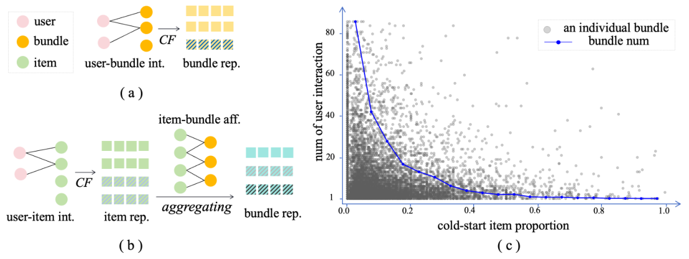
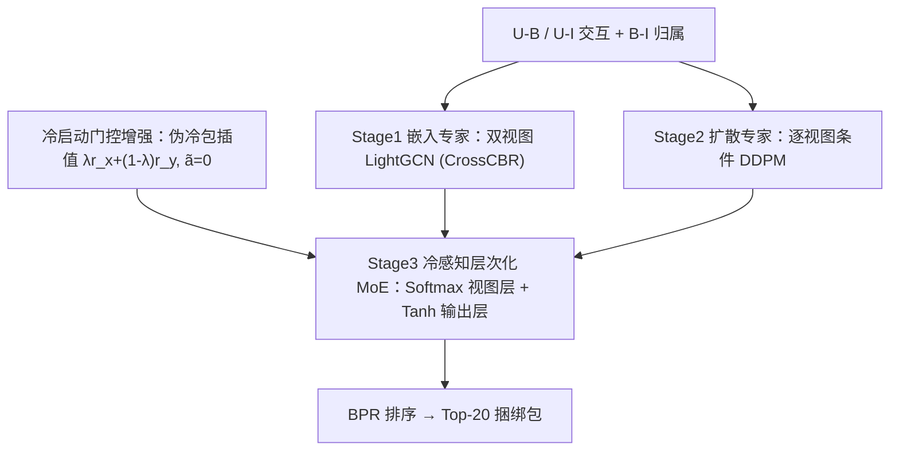
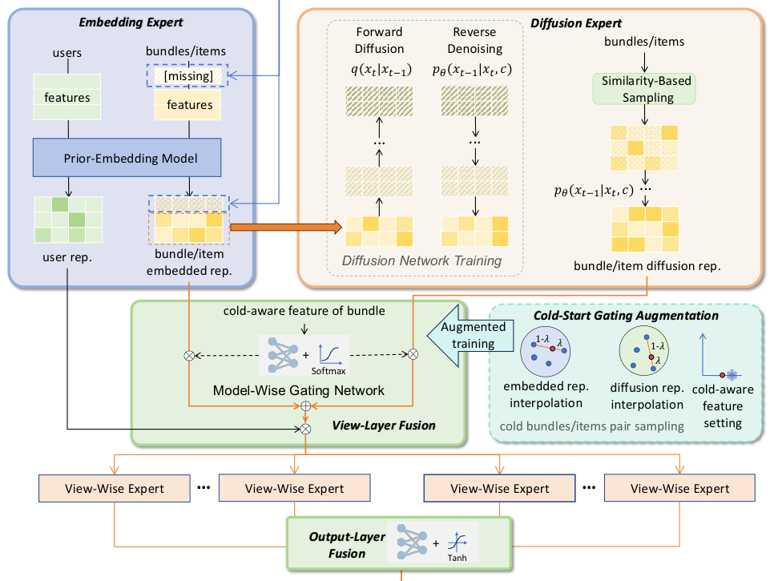

# Divide-and-Conquer: Cold-Start Bundle Recommendation via Mixture of Diffusion Experts (分而治之：基于扩散专家混合的冷启动捆绑包推荐)

- **会议/期刊**: TOIS 2026（arXiv 2505.05035v1）
- **作者与机构**: Ming Li, Lin Li, Xiaohui Tao, Dong Zhang, Jimmy Xiangji Huang（武汉理工大学 / 约克大学 / 南昆士兰大学）
- **推荐链路定位**: 召回（Top-20 捆绑包排序）
- **研究方向**: 冷启动与长尾推荐 / 生成式推荐
- **论文原文**: [https://arxiv.org/abs/2505.05035v1](https://arxiv.org/abs/2505.05035v1)
- **开源代码**: [https://github.com/snudatalab/CoHeat](https://github.com/snudatalab/CoHeat)（仅提供数据集划分与 CoHeat 基线，MoDiffE 主体暂未开源）

## TL;DR (1分钟核心速览)

捆绑包推荐的"非原子性"使其冷启动同时存在于捆绑包层与物品层、且各视图异构，现有方法（如 CoHeat）只解决捆绑包层、并依赖已存在的物品交互，无法覆盖"冷捆绑包内含冷物品"的复合情形。本文提出 MoDiffE：把冷启动拆为若干同构子问题，用条件 DDPM 直接从暖表征分布中"生成"缺失特征实体的表征，再以冷感知层次化 MoE 逐层融合。在 Youshu/NetEase/iFashion 的 all-unrated-item 全库排序协议下，冷启动 Recall@20 相对 CoHeat 提升 23%–561%，all-bundle 场景最高相对提升 47.43%。

## Background & Motivation (背景与核心矛盾)

- **主流范式**: 捆绑包推荐已演化出"双层双视图"架构——捆绑包层从用户-捆绑包图学 CF 信号，物品层从用户-物品图学物品表征再按归属聚合（BGCN / CrossCBR / HyperMBR）。
- **前人局限**: ① 物品级冷启动方法（DropoutNet、CLCRec、CVAR 等）把捆绑包当原子物品，忽略包内冷物品；② 唯一的捆绑包冷启动工作 CoHeat 用课程学习从 U-B 转向 U-I，但未意识到冷包中同样存在冷物品，且放弃捆绑包层信号后与原始包组合分布产生 gap。
- **核心洞察 (Key Insight)**: 不同层、不同视图的冷启动子问题虽异构，但都可归约为同一形态——先验嵌入模型对"特征缺失实体"只能输出塌缩到初始化点的表征。因此无需逐个子问题设计专用模型。
- **本文切入点**: 用"分布生成"替代"特征映射"：既然暖表征的分布可学，就从该分布中采样出冷实体的确定性表征，再用 MoE 处理不同冷启动情形的自适应融合。

<figure class="paper-figure" markdown="span">
  <figcaption>图 1. (a) 捆绑包级交互视图表示学习。(b) 物品级交互视图表示学习。(c) 真实数据集 NetEase 中的捆绑包分布。</figcaption>
</figure>

## Method (核心方法设计)

### 1. 整体框架 (Overall Architecture)

MoDiffE 采用三阶段解耦流水线。**Divide**：按"层→视图"顺序把冷启动拆为若干子问题并统一为 $r=f_\theta^{v}(h=\varnothing)=\varnothing$。**Conquer**：对每个视图训练一个条件 DDPM，输入暖捆绑包/物品的 LightGCN 嵌入并学习其分布，推理时以相似包锚点为起点做$T'$ 步反向去噪，直接产出扩散表征；物品层再做均值池化聚合到包层。**Combine**：视图层用 Softmax 门控竞争式融合"嵌入专家 + 扩散专家"，输出层用 Tanh 门控合作式融合多视图打分。训练分三阶段（BPR 预训练 → L2 扩散训练 → 增强后的门控训练），互不干扰。

<figure class="paper-figure" markdown="span">
  <figcaption>图 2. MoDiffE 框架</figcaption>
</figure>

### 2. 关键设计拆解 (Key Designs)

1. **表征级扩散生成（Conquer）**：痛点在于冷实体无特征输入、嵌入专家输出退化。本文不做特征→表征的映射，而是把暖表征 $x_0$当作数据样本，标准前向加噪$x_t=\sqrt{\bar\alpha_t}x_0+\sqrt{1-\bar\alpha_t}\boldsymbol{\epsilon}$，并令网络**直接预测$x_0$而非噪声**：$\mathcal{L}_{\text{diff}}=\mathbb{E}_{t,x_0,\epsilon}\lVert x_0-\hat{x}_0\rVert_2^2$，$\hat{x}_0=\text{MLP}(x_t,c,t)$。直接回归原表征可稳定表征尺度，使生成结果与其他专家输出可比（这点对后续内积排序至关重要）。推理不用高斯噪声起步，而以同构成相似度 Top-N 暖包的嵌入均值为锚点，$r_b^{\text{anchor}}=\text{MeanPooling}(\text{TopN}(\text{Sim}(b,\mathcal{B}_w\setminus b,Z),R_b^{e}))$，再以$T'=20$ 步 ODE 快速求解，显著提升生成稳定性。

2. **冷感知层次化 MoE（Combine）**：扁平 MoE 用单一门控融合异质专家会破坏全库排序所需的表征分布一致性，也无法适配多样冷启动情形。本文改为两级：视图层 $g^{v}(a_b^{v})=\text{Softmax}(\mathbf{W}^{v}a_b^{v})$竞争式融合两专家得$r_b^{v}$；输出层$g^{out}(a_b^{out})=\text{Tanh}(\mathbf{W}^{out}a_b^{out})$合作式重加权各视图打分$\hat{y}_{u,b}=\sum_{v}g^{out}(a_b^{out})_v\,(r_u^{v})^{\top}r_b^{v}$。冷感知特征$a^{v}_b$ 即交互数（冷启动时天然为 0），Tanh 允许权重非归一、可正可负，显式重建被扩散专家扰动过的视图协作关系。

3. **冷启动门控增强与训练目标**：冷包不在训练集中，门控对其输出必然失准。作者不挖掘伪交互（会污染真实 ID 分布），而在**伪 ID 空间**做线性插值：$\tilde{r}_{b_{xy}}=\lambda r_{b_x}+(1-\lambda)r_{b_y}$，$\lambda\sim\text{Beta}(\alpha,\alpha)$，并令$\tilde{a}^{v}=0$模拟冷态；插值量由比例$\eta=|S|/|Q|$控制。最终门控用$\mathcal{L}_{\text{BPR}}=\sum_{(u,b,b')\in Q\cup S}-\ln\sigma(\hat{y}_{u,b}-\hat{y}_{u,b'})$ 优化，负样本为均匀采样。

## Experimental Setup & Evaluation Protocol (实验设置与评估协议)

- **数据集与预处理**（沿用 CoHeat 官方划分，均经至少 10-core 稀疏过滤）：

| 数据集 | #Users | #Bundles | #Items | U-B 交互 | U-I 交互 | B-I 归属 | 平均包长 | 冷物品占比 |
| :--- | :---: | :---: | :---: | :---: | :---: | :---: | :---: | :---: |
| Youshu | 8,039 | 4,771 | 32,770 | 51,377 | 138,515 | 176,667 | 37.03 | 35.81% |
| NetEase | 18,528 | 22,864 | 123,628 | 302,303 | 1,128,065 | 1,778,838 | 77.80 | 26.78% |
| iFashion | 53,897 | 27,694 | 42,563 | 1,679,708 | 2,290,645 | 106,916 | 3.86 | 5.13% |

- **数据划分与防穿越**: 三套场景。冷启动场景按 **捆绑包 7:1:2 比例划分**（冷包的全部交互仅出现在测试集）；暖启动场景按用户-捆绑包交互 7:1:2；all-bundle 场景为二者混合（各占一半测试交互），最贴近真实分布。
- **排名评测协议**: `All-unrated-item` 即 **Full-Ranking 全库未交互物品排序**（对每个用户保留训练集中未交互的全部捆绑包作为候选），$K=20$，指标 Recall@20 / NDCG@20，无采样负例偏置。
- **对比基线与超参**: 8 个基线覆盖鲁棒性 (DropoutNet)、约束式 (CB2CF, Heater)、生成式 (GAR-CF/GNN, CVAR)、对比式 (CLCRec, CCFCRec)、捆绑包冷启动 (CoHeat)。嵌入维度 $d=64$；骨干为 CrossCBR；$T=500$、$T'=20$、Top-$n=5$、$\alpha=0.9$、$\eta$ 按场景取 0 / 0.3 / 0.5。原文未报告显著性检验。

## Key Experimental Results (实验关键数据)

### 1. 主实验对比 (Main Results)

Recall@20（括号内为冷启动 / 全包场景相对 CoHeat 的提升）：

| 场景 | DropoutNet | Heater | CVAR | CLCRec | CCFCRec | CoHeat | MoDiffE | Improv. |
| :--- | :---: | :---: | :---: | :---: | :---: | :---: | :---: | :---: |
| Youshu 冷启动 | 0.0022 | 0.0016 | 0.0008 | 0.0137 | 0.0044 | 0.0183 | **0.1210** | +561.2% |
| Youshu 全包 | 0.0148 | 0.0541 | 0.0829 | 0.0367 | 0.0702 | 0.1247 | **0.1838** | +47.4% |
| NetEase 冷启动 | 0.0028 | 0.0021 | 0.0002 | 0.0136 | 0.0007 | 0.0191 | **0.0235** | +23.0% |
| NetEase 全包 | 0.0046 | 0.0102 | 0.0156 | 0.0259 | 0.0130 | 0.0453 | **0.0503** | +11.0% |
| iFashion 冷启动 | 0.0009 | 0.0015 | 0.0007 | 0.0053 | 0.0005 | 0.0170 | **0.0294** | +72.9% |
| iFashion 全包 | 0.0039 | 0.0123 | 0.0125 | 0.0126 | 0.0252 | 0.0658 | **0.0698** | +6.1% |
| Youshu 暖启动 | 0.0336 | 0.1753 | 0.1958 | 0.0626 | 0.1554 | 0.2804 | **0.2846** | +1.5% |

NDCG@20 趋势一致（Youshu 冷启动 0.0890 vs. CoHeat 0.0105；all-bundle 0.1090 vs. 0.0833）。

### 2. 消融实验 (Ablation Study)

Recall@20（Youshu / NetEase / iFashion）：

| 变体 | 冷启动 (Y / N / i) | 全包 (Y / N / i) |
| :--- | :---: | :---: |
| MoDiffE 完整 | **0.1210 / 0.0235 / 0.0294** | **0.1838 / 0.0503 / 0.0698** |
| w/o aug（去冷启动门控增强） | 0 / 0 / 0 | 0.1294 / 0.0470 / 0.0609 |
| w/o moe（专家直接相加） | 0.0100 / 0.0012 / 0.0015 | 0.1001 / 0.0328 / 0.0415 |
| w/o diff（退化为 CrossCBR 骨干） | 0 / 0 / 0 | 0.1290 / 0.0461 / 0.0658 |

门控激活函数（表 5，Youshu）：Softmax+Tanh 得 0.1210/0.1838，优于 Softmax+Softmax (0.1171/0.1784)、Tanh+Tanh (0.0143/0.1056) 与 ReLU+ReLU (0.0104/0.1261)。

### 3. 关键实验发现 (Key Findings)

1. **扩散专家是冷启动的"必要条件"而非锦上添花**：`w/o diff` 在三个数据集的冷启动场景 Recall@20 全部为 0，因为先验嵌入模型对零交互包只能输出初始化点向量、无法与任何用户打分区分——这直接印证了论文"$f_\theta^{v}(\varnothing)=\varnothing$"的子问题归约是正确的建模。
2. **无增强则门控失效**：`w/o aug` 冷启动同样为 0，说明 MoE 门控在只见过暖包时会给出与随机无异的权重；超参图上 $\eta$从 0 到 0.1 带来断崖式跃升（Youshu 冷启动 Recall@20 从 ~0 到 ~0.12），而继续增大$\eta$ 收益饱和且显著拖慢训练，即"少量伪冷包足以激活扩散专家"。
3. **融合方式比专家本身更易出错**：`w/o moe` 在 Youshu 全包场景仅 0.1001，竟低于纯骨干 0.1290，说明朴素相加会让扩散表征的尺度扰动暖包排序；加入层次化门控后回升至 0.1838（+83.6%）。PCA 可视化进一步显示，嵌入专家下冷物品全挤在初始化点，扩散专家与最终 MoDiffE 则与暖实体均匀混布；门控案例中暖包 #494 主要走嵌入专家、冷包 #1471 主要走扩散专家，验证了自适应分工确实发生。

## Highlights & Limitations (亮点、对比与审稿批判)

- **与代表作对比 (vs. Prior Work)**: 相比 CoHeat（课程学习、仅用 U-I 信号、只解捆绑包层），MoDiffE 显式承认物品层冷启动并通过扩散在两层都补齐表征，在 iFashion 这种冷物品已被过滤至 5.13% 的"CoHeat 友好"数据集上仍领先 72.9%，说明捆绑包层信号不可被替代。相比 GAR/CVAR（特征→表征的生成映射），本文完全绕开特征依赖，因而在特征严重缺失时不会像 GAR/CVAR（Youshu 冷启动均 ≤0.0015）那样崩溃。
- **可迁移亮点**: ①"预测 $x_0$ 而非噪声 + 相似度锚点起步"这一组合，可低成本迁移到任何需要稳定尺度的表征生成场景（如冷物品 / 冷用户召回）；②在伪 ID 空间插值构造增强样本，天然规避了真实 ID 污染的负迁移，可复用于冷启动门控、多场景路由等门控训练。
- **审稿级局限批判**: ① 推理需对每个冷实体跑 $T'=20$步去噪，冷包批量涌入时（电商上新）开销显著高于一次前向，论文只给了 ODE 加速而未报告实际延迟与吞吐；② 全库排序下的量化结果未做显著性检验，且三个数据集来自同一套 CoHeat 划分，泛化证据偏薄；③ 关键超参（Top-$n$、$\alpha$、$\eta$）在两个数据集上最优值不一致（Youshu 需$n=10$、NetEase 只需 Top-1），对数据相似度分布敏感；④ 代码链接指向 CoHeat 仓库，MoDiffE 主体未开源，复现存在门槛。

## Rating (四维评分)

- **方法创新性 (Novelty)**: ⭐⭐⭐⭐ （"子问题归约为 $f(\varnothing)=\varnothing$ + 表征级扩散生成 + 冷感知两层门控"的组合颇具巧思，把冷启动从"补特征"重构为"采样分布"，思路干净；但扩散与 MoE 各自均为成熟组件的迁移应用）
- **评估协议与实验扎实度 (Protocol & Experiments)**: ⭐⭐⭐⭐ （三数据集 × 三场景 × 8 基线的 Full-Ranking 评测覆盖到位，消融逐一击中核心组件并出现"归零"的强证据；扣分在缺少显著性检验与线上/延迟评估）
- **写作与数学规范度 (Clarity & Rigor)**: ⭐⭐⭐⭐ （Divide-Conquer-Combine 的三段式叙事与公式编号呼应良好，DDPM 推导交代清楚；但式 9/10 的下标有笔误，问题定义部分符号密度偏高）
- **工业落地与复现价值 (Industrial & Practical Value)**: ⭐⭐⭐ （多阶段解耦便于模块替换、伪冷包增强对上新场景直接可用；但每冷包 20 步去噪的推理成本与未开源的实现细节，限制了即刻落地）

