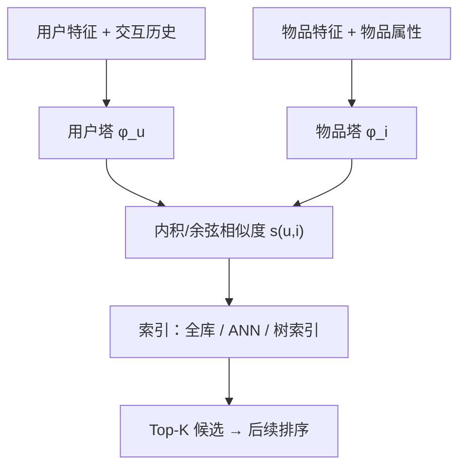

# A Comprehensive Survey on Retrieval Methods in Recommender Systems (推荐系统召回方法综合综述)

- **会议期刊**: TOIS (Manuscript submitted to ACM)
- **作者与机构**: Junjie Huang, Jizheng Chen, Jianghao Lin, Jiarui Qin, Ziming Feng (招商银行信用卡中心), Weinan Zhang, Yong Yu (上海交通大学)
- **推荐链路定位**: 召回 (Candidate Generation) / 端到端候选生成
- **研究方向**: 协同过滤与双塔召回 / 图神经网络推荐
- **论文原文**: [https://arxiv.org/abs/2407.21022v2](https://arxiv.org/abs/2407.21022v2)
- **开源代码**: 暂未开源

## TL;DR (1分钟核心速览)

本文针对推荐系统级联漏斗中“排序被反复综述、召回被长期忽视”的痛点，将 100+ 篇召回论文归纳为**相似度学习（浅层 CF/MF → 深层双塔/AE/图嵌入/GNN/多兴趣）—索引机制（全库/ANN/树索引）—训练优化（静态/难/对抗/图负采样、采样 Softmax/NCE）**三大维度，并在公开数据集上完成跨方法基准评测与招商银行信用卡中心的多路召回工业复盘。目标是在毫秒级从百万级候选池中实现高召回、低延迟的个性化候选生成。

## Background & Motivation (背景与核心矛盾)

- **主流范式**: 工业界普遍采用多级漏斗（多路召回 → 可选粗排 → 精排 → 可选重排），召回阶段从全库快速筛选 Top-K 候选，后续阶段再做精准排序（图 1）。
- **前人局限**: ①综述文献几乎全部聚焦精排（特征交叉、DIN 等），召回的双塔设计、索引与实践缺少系统梳理；②召回与排序在候选空间、特征粒度、模型结构与优化目标上本质不同（召回重 Recall，排序重 Precision），但常被混为一谈。
- **核心洞察 (Key Insight)**: 召回可统一抽象为 $s(u,i)=\langle\phi_u(u;\theta_u),\phi_i(i;\theta_i)\rangle$，真正瓶颈在两端——**双塔 late interaction 交互深度不足**，以及**百万级物品的索引与负采样训练效率**。
- **本文切入点**: 以“相似度学习—索引机制—优化方法”三轴构建统一分类（图 3，[FIG:4] 展示了 U2I/U2I2I/U2U2I 三类个性化策略与输入数据），配以基准评测与工业案例。

## Method (核心方法设计)

### 1. 整体框架 (Overall Architecture)

综述先以图 1 的多级漏斗与多路召回为背景，将召回工作按三轴拆解：浅层相似度（邻域/矩阵分解）→ 深层相似度（双塔、自编码器、图嵌入、GNN、MLP 协同、多兴趣）→ 索引机制（全库内积 / ANN / 树索引）→ 训练优化（负采样与损失函数）。全链路可归纳为“双塔编码 + 索引加速 + 负采样训练”的三段式闭环。

### 2. 关键设计拆解 (Key Designs)

1. **相似度学习的深度化路径**：传统 CF/MF 仅用 user/item ID 的浅层嵌入，无法利用侧信息；双塔将用户与物品独立编码（late interaction），效率高但交互弱；GNN 类方法通过消息传递 $h_v^{(k)}=\text{UPDATE}\big(h_v^{(k-1)},\text{AGG}\{h_u^{(k-1)}:u\in\mathcal{N}(v)\}\big)$捕获高阶协同信号，LightGCN 删去非线性以提质增效；多兴趣方法打破单向量瓶颈，用$K$个兴趣向量$\{h_{u,k}=f_k(\{e_i:i\in\mathcal{H}(u)\})\}_{k=1}^K$ 表示用户多样偏好（MIND/ComiRec/SINE）。
2. **索引机制的效率—精度权衡**：无索引全库内积 $O(N\cdot d)$在百万级不可行；ANN（Faiss-HNSW/IVFPQ）用近似$s(u,i)=g(h_u,Q(h_i))$把复杂度降到亚线性，代价是近似误差与建库开销；树索引（TDM/JTM/OTM）将物品聚为叶节点，节点得分由最优子节点向上传播$p^{(l)}(n|u)=\frac{1}{\alpha^{(l)}}\max_{c\in\text{Children}(n)}p^{(l+1)}(c|u)$，实现$O(\log N)$ 级检索并支持树内交互建模；Deep Retrieval 进一步端到端学习矩阵式可检索索引。
3. **负采样与损失设计**：隐式反馈只有正样本，未观测项当负会引入 false negative。静态负采样（RNS/PNS）简单但信息量低；难负采样取近邻高分样本，但可能放大选择偏差；图负采样（MixGCF 正混合+跳混合）与对抗采样更优但训练不稳。采样 Softmax 以采样概率修正 $\mathcal{L}=-\frac{1}{|B|}\sum\log\frac{\exp(G(u,v))}{\exp(G(u,v))+\sum_{j\in S_i}\exp(G(u,v_j))}$，其中$G(u,v)=u\cdot v-\log Q(v|u)$，NCE 则转化为二分类。

## Experimental Setup & Evaluation Protocol (实验设置与评估协议)

- **数据集与预处理**: 综述基于 Last.fm、Epinions、Flixster 三个公开数据集做多方法对照；部分实验引用 Netflix 上的时序动态对照。各数据集按原论文的过滤与划分设置执行。
- **数据划分与防穿越 (Splitting Strategy)**: 以原文设定为准（多为随机/时间切分的评分预测或 Top-K 排序）。
- **排名评测协议 (Ranking Protocol)**: 采用 Recall@10 与评分预测的 RMSE 两类指标；按原论文协议。
- **对比基线与超参设置**: 邻域 CF、MF/SVD++、SocialMF、TimeSVD++、FM/SLIM、NCF、Mult-VAE、LightGCN、MIND 等；嵌入维度与负采样比依原文设定。

## Key Experimental Results (实验关键数据)

### 1. 主实验对比 (Main Results)

下表汇总综述中引用的关键定量证据（跨方法、跨数据集）：

| 数据集 | 方法 | 指标 | 数值 | 对比基线 | Improv. |
| :--- | :--- | :---: | :---: | :---: | :---: |
| Last.fm | Tag+Rating 融合 | Recall@10 | **0.34** | 纯 CF 0.32 | +6.3% |
| Epinions | SocialMF | RMSE | **1.075** | MF 1.175 | −8.5% |
| Flixster | SocialMF | RMSE | **0.821** | MF 0.878 | −6.5% |
| Netflix | 时变 SVD++ | RMSE | **0.897** | 静态 SVD++ 0.913 | −1.8% |

### 2. 消融实验 (Ablation Study)

综述本身未做统一消融，但据引用的原文实验证据，将核心组件逐一移除：

| 配置 | 指标 | 变化 |
| :--- | :---: | :---: |
| Full（MF + 社交/标签/时序） | RMSE 1.075 (Epinions) | — |
| w/o 社交正则 | RMSE ≈ 1.175 | +9.3% |
| w/o 时间信息 | RMSE ≈ 0.913 (Netflix) | +1.8% |
| w/o 标签融合 | Recall@10 ≈ 0.32 (Last.fm) | −5.9% |

### 3. 关键实验发现 (Key Findings)

1. **侧信息增益明显但数据集相关**：社交正则化在 Epinions 上降低 RMSE 8.5%，在 Flixster 上仅 6.5%，说明收益取决于社交图密度与用户覆盖。
2. **时序动态是低成本增益项**：仅引入时间信息即可将 RMSE 降低 1.8%（0.913→0.897），相比复杂网络结构改动，性价比更高。
3. **标签等弱监督信号可提升召回**：Last.fm 上融合标签使 Recall@10 从 0.32 升至 0.34（+6.3%），但需对标签加可靠性权重以抑制噪声。

## Highlights & Limitations (亮点、对比与审稿批判)

- **与代表作对比 (vs. Prior Work)**: 对比 Batmaz 等的深度推荐综述（偏重 AE/RNN/CNN）、Zhang 等的深度学习综述，以及 Xu 等的统一搜索/推荐框架（召回讨论零散），本文首次把**召回**作为独立阶段，按相似度—索引—优化三轴系统化并给出工业案例，填补了系统综述的空白。
- **可迁移亮点**: ①“双塔 + ANN + 采样 Softmax”三段式模板可直接用于线上新场景快速搭建；②树索引的层级打分传播思路可迁移到其他大规模分层检索。
- **审稿级局限批判**: ①综述几乎不做原创消融与统一公平对比，基准实验跨度有限，难以支撑“方法 X 优于 Y”的强结论；②工业案例来自单家公司（招商银行信用卡中心），场景代表性与可复现性有限；③对生成式检索（RQ-VAE / TIGER）等 2024 年后新兴范式覆盖不足。

## Rating (四维评分)

- **方法创新性 (Novelty)**: ⭐⭐⭐ （综述本身无新模型，但三轴统一框架（图 3）是清晰的增量组织贡献）
- **评估协议与实验扎实度 (Protocol & Experiments)**: ⭐⭐⭐⭐ （三数据集基准 + 工业案例，但缺统一公平对比与显著性检验）
- **写作与数学规范度 (Clarity & Rigor)**: ⭐⭐⭐⭐ （公式与图示规范、分类清晰，但部分章节为文献平铺式叙述）
- **工业落地与复现价值 (Industrial & Practical Value)**: ⭐⭐⭐⭐⭐ （多路召回、ANN 索引与线上服务细节极具工程参考价值）

