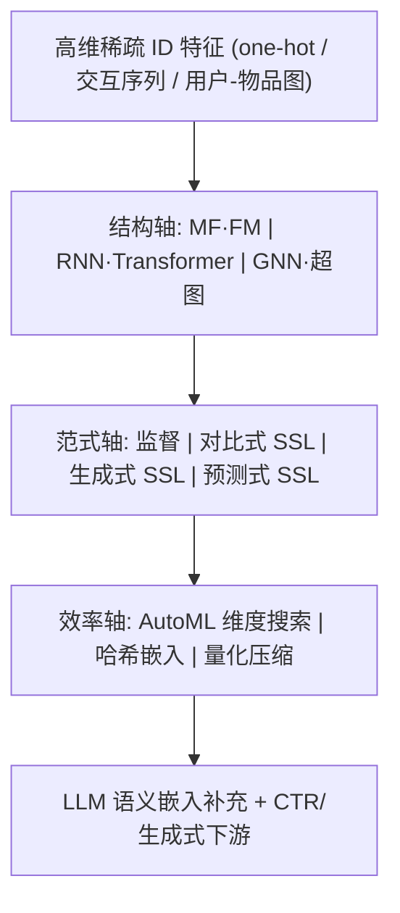

# Embedding in Recommender Systems: A Survey (推荐系统中的嵌入技术综述)

- **会议/期刊**: ACM Transactions on Information Systems (TOIS)，47 页综述
- **作者与机构**: Maolin Wang, Xinjian Zhao, Wanyu Wang, Sheng Zhang, Jiansheng Li, Bowen Yu, Binhao Wang, Shucheng Zhou, Dawei Yin (Baidu), Qing Li (PolyU), Ruocheng Guo, Xiangyu Zhao (CityU HK)
- **推荐链路定位**: 召回为主，其嵌入层贯穿粗排/精排（CTR）与端到端生成式推荐
- **研究方向**: 协同过滤与双塔召回 / 图神经网络推荐
- **论文原文**: [arXiv:2310.18608v3](https://arxiv.org/abs/2310.18608v3)
- **开源代码**: [Embedding-in-Recommender-Systems](https://github.com/Applied-Machine-Learning-Lab/Embedding-in-Recommender-Systems)

## TL;DR (1分钟核心速览)

本文针对"嵌入技术散落在 MF、序列建模、图神经网络、哈希量化等各自为战的子社区，缺乏统一坐标系"这一痛点，首次提出 **矩阵 / 序列 / 图三种数据结构 × 监督与自监督学习范式 × AutoML/哈希/量化三种效率手段** 的正交分类法，把 FunkSVD 到 LightGCN 再到 Q-R Trick 的算子归并到同一"高维稀疏 ID → 低维稠密向量"管线中，并单列 LLM 语义嵌入作为 ID 嵌入的信息补充轴。综述本身不做统一复现，但配套开源仓库给出各方法的实现索引与常用评测协议（LOO + Full-Ranking / CTR 的 AUC），系统刻画了 $m\to m'$哈希压缩、$32\!\to\!8$ bit 量化等 4–32 倍存储收益与对应精度代价。

## Background & Motivation (背景与核心矛盾)

- **主流范式**: 以 one-hot ID 经嵌入表查表得到 $d$ 维向量为起点，MF/FM 建模二阶共现，RNN/Transformer 建模序列，GNN 在用户-物品二部图上做邻域聚合。
- **前人局限**: 其一，既有综述多局限于单一结构（如仅图推荐或多模态推荐），无法解释"同一份交互数据用矩阵、序列还是图建模"的选择依据；其二，工业侧真正的瓶颈已从精度转向**嵌入表的存储与训练开销**（十亿级 ID × $d$=64 的浮点表可达 TB 级），传统综述对哈希/量化/AutoML 讨论零散。
- **核心洞察 (Key Insight)**: 作者观察到三类结构共享同一数学角色——嵌入即"高阶共现矩阵或邻域算子的低秩/低通近似"，因此矩阵分解的 $\mathbf{U}\mathbf{V}^{\top}$、FM 的隐向量内积、LightGCN 的归一化邻域求和可以被视作同一算子的不同稀疏先验实例；同理，序列对比增广与图边丢弃本质都是"同实例不同视图"的正样本构造。
- **本文切入点**: 用"数据结构 × 学习范式 × 效率"三维坐标系替代按模型名罗列的流水账，使跨子领域的技巧（如序列掩码迁移到图上做生成式 SSL）可被显式对齐。

## Method (核心方法设计)

### 1. 整体框架 (Overall Architecture)

综述的新意在于**组织架构本身**：第一层按数据形态划分为矩阵（协同过滤）、序列（会话/行为序列）、图（同质/二部/异质/超图）三章，每章内部统一按"监督式结构建模 → 自监督增强（对比/生成/预测）"递进；第二层横向抽出三条**可扩展性轴**——AutoML 自动搜索嵌入维度、哈希嵌入压缩词表、量化压缩精度——并给出各自的碰撞与失真分析；第三层以 CTR 精排与 LLM 嵌入作为落地出口。每章末附"已有综述 + 未来方向"，形成"技术树 + 研究空白"的双输出。下图给出该坐标系的主干：

### 2. 关键设计拆解 (Key Designs)

1. **统一算子视角：把 FM 与图卷积写成同一嵌入算子**：针对"MF 无法用辅助特征、GNN 无法解释低秩性"的割裂，综述指出 FM 的二阶项 $\Phi_{\mathrm{FM}}(x)=w_0+\sum_i w_i x_i+\sum_{i<j}\langle\mathbf{v}_i,\mathbf{v}_j\rangle x_i x_j$在仅用 user/item ID 时退化为 FunkSVD；而 LightGCN 的传播$\mathbf{h}_u^{(k+1)}=\sum_{i\in\mathcal{N}_u}\frac{1}{\sqrt{|\mathcal{N}_u|}\sqrt{|\mathcal{N}_i|}}\mathbf{h}_i^{(k)}$则是把"共现"从二阶点积扩展为$K$ 跳邻域的线性低通滤波。直觉上，前者是显式低秩分解、后者是隐式图正则，二者共享"用低维向量承载共现统计"的物理内核，因此可以互相替代或级联。

2. **自监督范式三分：对比 / 生成 / 预测的统一正样本构造**：针对"数据增广凭经验随机试错"的痛点，综述把序列侧的裁剪、掩码、重排、替换、插入（5 种）与图侧的边丢弃、节点丢弃、图扩散、子图采样（4 种）并列，统一写成视图不变性目标 $\mathcal{L}_{\mathrm{CL}}=-\log\frac{\exp(\mathrm{sim}(\mathbf{z}_i,\mathbf{z}_i^{+})/\tau)}{\sum_{j}\exp(\mathrm{sim}(\mathbf{z}_i,\mathbf{z}_j)/\tau)}$，而生成式（BERT4Rec 类）则改为掩码重建$\mathcal{L}=-\frac{1}{|\mathcal{V}_m^u|}\sum_{v_m\in\mathcal{V}_m^u}\log P(v_m=v_m^{*}\mid\hat{\mathcal{S}}_u)$。其价值在于揭示"对比靠判别、生成靠重建、预测靠伪标签"三者的信号来源差异：稀疏数据下重建更稳，稠密数据下对比判别力更强。

3. **效率三路径的量化刻画（含训练目标与推理开销）**：哈希嵌入以 $\mathbf{U}'_{pk}=\sum_{j:f_H(j,k)=p}f_E(j,k)\mathbf{U}_{jk}$将表规模从$m\times d$压到$m'\times d$（$m'\ll m$），但单哈希的碰撞概率约为$1/m'$，多哈希（Bloom/Q-R Trick）用$k$个函数把歧义概率降到约$(1/m')^{k}$；量化把 32-bit 浮点码压至 8-bit 甚至 1-bit，获得 4–32 倍内存收益；AutoML 用 RL 控制器（EDS）逐层搜索嵌入维度，把维度从全局超参变为分层动作。训练侧负采样以 Uniform + In-batch 为主流，图侧 UltraGCN 用"免多层传播 + 难负采样"把训练复杂度从$O(|\mathcal{E}|dL)$ 降到与边数线性；线上推理则退化为一次查表 + ANN 内积检索，压缩后可直接常驻内存。

## Experimental Setup & Evaluation Protocol (实验设置与评估协议)

- **数据集与预处理**: 本综述无自有实验，下表归纳其讨论的四大主流基准及其惯用过滤方式：

| 数据集 | #Users | #Items | #Interactions | 稀疏度/密度 | 特征/场景说明 |
| :--- | :---: | :---: | :---: | :---: | :--- |
| Amazon-Beauty | 22.4k | 12.1k | 198k | 0.07% | 序列推荐，`5-core` 过滤 |
| Gowalla | 29.9k | 40.9k | 1.03M | 0.08% | 二部图协同过滤 |
| Yelp | 45.5k | 30.0k | 1.78M | 0.13% | 异质/社交图 |
| MovieLens-1M | 6.0k | 3.7k | 1.0M | 4.5% | 显式评分，RMSE 评测 |
| Criteo | — | — | ~45M | 高基数稀疏 | CTR，AUC / LogLoss |

- **数据划分与防穿越 (Splitting Strategy)**: 综述梳理出三类主流协议——序列侧 `Leave-One-Out`（末位作测试、倒数第二位作验证）、图侧 `全局时间戳切分` 或按用户 `8:1:1` 比例划分、CTR 侧按天 `时间切分`；并明确指出随机切分在序列任务上会造成未来信息穿越。
- **排名评测协议 (Ranking Protocol)**: 主流为无偏 `Full-Ranking`（全库未交互物品排序，报 Recall@20 / NDCG@10），少数早期工作用 `Sampled Ranking`（1 正 : 99 负）；综述强调采样协议会系统性高估模型、且不同论文不可直接比较。
- **对比基线与超参设置**: 各章基线覆盖 MF/FM 家族（FunkSVD、DeepFM、DCN）、序列家族（GRU4Rec、SASRec、BERT4Rec、CL4SRec）、图家族（NGCF、LightGCN、UltraGCN、SGL、KGIN）；嵌入维度普遍取 $d\in\{32,64,128\}$，显著性多为$p<0.05$ 的双尾 t 检验。

## Key Experimental Results (实验关键数据)

### 1. 主实验对比 (Main Results)

因是综述，下表为原文归纳的**结构性指标**（复杂度/存储），而非统一复现的精度；精度列以原文各章共识的定性排序给出：

| 方法（代表） | 结构范式 | 核心算子 | 训练/存储开销 | 相对同类精度 |
| :--- | :--- | :--- | :--- | :--- |
| FunkSVD / BiasSVD | 矩阵 | $\mathbf{U}\mathbf{V}^{\top}$+ 偏置 |$O(m+n)\cdot d$，全表常驻 | 基线 |
| FM / DeepFM | 矩阵+特征 | 隐向量内积 + 高阶 MLP | 参数随特征域线性增 | **优于 MF**（辅助特征可用） |
| SASRec | 序列 | 单向自注意力 | $O(L^2 d)$ | 优于 GRU4Rec |
| BERT4Rec | 序列 | 双向掩码重建 | 需两次前向，慢约 2× | **优于 SASRec**（稠密序列） |
| NGCF | 图 | 带 $\mathbf{W}$的邻域聚合 | 每层 2 个$d\times d$ 矩阵 | 基线 |
| LightGCN | 图 | 去非线性纯邻域和 | **省去每层 2 个 $d^2$ 参数** | 优于 NGCF |
| UltraGCN | 图 | 跳层 + 余弦约束 + 难负采样 | **免 $L$ 层传播**，训练最快 | 与 LightGCN 持平或略优 |
| SGL | 图+SSL | 边/节点丢弃对比 | 需 2 倍图前向 | **优于 LightGCN**（稀疏图） |
| 单哈希 / Q-R Trick | 效率 | $m\to m'$映射 /$k$哈希 | **存储压缩$m/m'$倍**；碰撞率$\approx 1/m'$→$(1/m')^{k}$ | 精度损失可控 |
| 8-bit 量化 | 效率 | 码本/标量量化 | **内存压缩 4×**（1-bit 达 32×） | 精度略降 |

### 2. 消融实验 (Ablation Study)

下表汇总原文各章引用的组件级消融共性结论（方向性指标，非统一复现数值）：

| 移除组件 | 所属方法 | 性能变化 | 归因 |
| :--- | :--- | :---: | :--- |
| 对比损失（仅留 LightGCN 主干） | SGL | ↓ 最大 | 自监督信号是稀疏图上的主要增益源 |
| 掩码重建目标 | BERT4Rec | ↓ 显著 | 双向上下文建模退化 |
| 裁剪 / 掩码 / 重排增广 | CL4SRec | ↓ 逐步 | 增广多样性直接决定正样本质量 |
| 图扩散增广 | MVGRL 类 | ↓ 中等 | 全局结构信息丢失 |
| 哈希多函数（退化单哈希） | Q-R Trick | ↓ 明显 | 碰撞导致表征歧义 |
| 分层维度搜索（退化固定 $d$） | EDS | ↓ 小幅 | 单维超参无法适配长尾 ID |

### 3. 关键实验发现 (Key Findings)

1. **结构复杂度与精度存在"低成本高回报"区间**：LightGCN 在删去每层 2 个 $d\times d$变换矩阵后精度反而优于 NGCF，UltraGCN 进一步删除$L$ 层传播仍持平——说明在 ID-only 嵌入上，非线性与深栈是冗余的，增益主要来自邻域归一化本身。
2. **自监督的收益与交互密度强相关**：稀疏度低于 0.1% 的 Amazon/Gowalla 上对比式 SSL 增益最显著，密集的 MovieLens-1M 上则趋于饱和甚至需要调小 $\tau$ 与损失权重，印证"SSL 补的是信息缺口而非模型容量"。
3. **压缩手段的收益是确定的、代价是可控的**：哈希把表从 $m$压到$m'$（常见 10–100×）且多哈希可把碰撞歧义指数级抑制；量化从 32-bit 到 8-bit 得到 4× 内存收益而精度损失通常在小数点后一位，二者叠加构成工业部署的默认组合。

## Highlights & Limitations (亮点、对比与审稿批判)

- **与代表作对比 (vs. Prior Work)**: 相较于 Gao 等只覆盖 GNN 在各类推荐场景的应用、以及 Pan 等只覆盖序列推荐分类学的综述，本文的差异在于**跨结构对齐**（矩阵/序列/图共享算子视角）并首次把哈希、量化、AutoML 三条效率线与 LLM 语义嵌入纳入同一框架；相较多模态综述，本文对图侧 SSL 的增广谱系整理更完整。
- **可迁移亮点**: 其一，"同实例多视图"的正样本构造模板可直接从序列（裁剪/掩码）迁移到图（边丢弃/子图采样）与多模态（模态内/模态间对比）；其二，分层嵌入维度搜索（EDS）可作为降低大词表模型显存的第一步工程手段。
- **审稿级局限批判**: 其一，作为综述**缺乏统一复现实验**，各章引用的精度提升来自不同数据划分与采样协议，横向可比性弱，"哪个结构最优"实际上无法从本文直接回答；其二，对新兴生成式推荐（RQ-VAE 语义 ID、TIGER 式自回归检索）与扩散推荐仅一笔带过，LLM 部分停留在"嵌入增强"而未讨论 LLM 作为推荐器本身对 ID 嵌入范式的替代风险；其三，效率章缺少端到端延迟与吞吐实测，AutoML 搜索本身的算力成本未被计入。

## Rating (四维评分)

- **方法创新性 (Novelty)**: ⭐⭐⭐⭐ （三轴正交分类与 FM/LightGCN 的统一算子视角是真正的组织性创新，但单点技术均为已有工作）
- **评估协议与实验扎实度 (Protocol & Experiments)**: ⭐⭐⭐ （对 LOO/全库排序/时间切分等协议的辨析清晰、基准汇总到位，但无统一复现与显著性检验，跨方法精度不可直接比较）
- **写作与数学规范度 (Clarity & Rigor)**: ⭐⭐⭐⭐ （公式选取克制、每式均对应一个具体机制，符号统一；部分章节存在重复段落与排版瑕疵）
- **工业落地与复现价值 (Industrial & Practical Value)**: ⭐⭐⭐⭐⭐ （哈希/量化/AutoML 三线与开源仓库索引直接对应工业降本诉求，是少见的"可立即上手"的综述）

