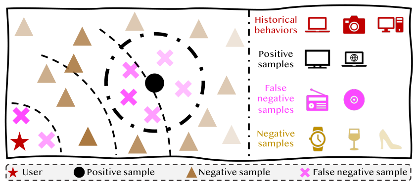
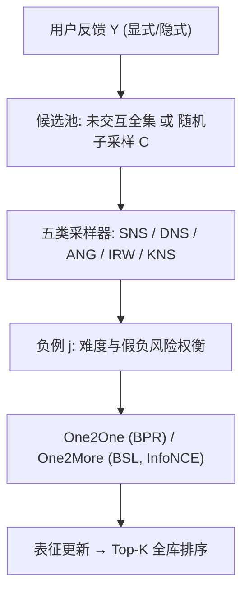

# Negative Sampling in Recommendation: A Survey and Future Directions (推荐系统中的负采样：综述与未来方向)

- **会议/期刊**: TOIS（arXiv 2409.07237v2，39 页，投稿/在审版本）
- **作者与机构**: Haokai Ma、Lei Meng（通讯）、Xiangxu Meng（山东大学）；Ruobing Xie、Xingwu Sun、Zhanhui Kang（腾讯）；Fuli Feng（中科大）；Xiaoyu Du（南邮）
- **推荐链路定位**: 召回/粗排的训练阶段（负采样器与损失函数耦合，不改变线上打分链路）
- **研究方向**: 协同过滤与双塔召回 / 自监督对比学习与交互去噪
- **论文原文**: [arxiv.org/abs/2409.07237v2](https://arxiv.org/abs/2409.07237v2)
- **开源代码**: [github.com/hulkima/NS4RS](https://github.com/hulkima/NS4RS)（论文清单与代码索引仓库）

## TL;DR (1分钟核心速览)

推荐系统长期只在"已交互正样本"上做优化，而把海量未交互物品粗暴视为负例，导致假负样本污染梯度、"信息茧房/稀疏/冷启动/反馈回路"放大偏差。本文是**该方向首篇系统综述**：先定义 NS/HNS/FNS 三层级样本与三大核心挑战（假负样本、精度-效率-稳定性三角、跨任务泛化），再把 230+ 篇文献（2005–2025，KDD/WWW 各 14.42%、SIGIR 11.06%）统一归为**静态、动态、对抗生成、重要性重加权、知识增强**五类，并横向对齐采样准则与时间复杂度（RNS $O(|I|)$→ RealHNS$O(|I|T_c/E)$），为"何时该用哪种采样器"给出可操作手册。

## Background & Motivation (背景与核心矛盾)

- **主流范式**: 隐式反馈下以 BPR/softmax 类 pairwise 目标训练，负例来自"未交互全集"，多数工业系统仅用均匀随机采样或直接用显式低分行为。
- **前人局限**: (1) 未交互 ≠ 不喜欢，模型容量提升后越"难"的负例越可能是用户真实兴趣（FNS），把 FNS 当负例反向传播会拖慢收敛并陷入局部最优；(2) 负采样精度提升必然伴随候选生成与选择开销上升，且最优"难度"随模型/数据集漂移，超参极不稳定。
- **核心洞察 (Key Insight)**: 显式低分（如评分 1–2）并不"足够负"——它至少说明用户看过该物品；隐式未交互集合同时混杂真负、假负与长尾曝光偏差，因此**负采样质量是梯度方向问题，而非数据增广问题**。
- **本文切入点**: 不做新算法，而是建立"样本层级定义 + 五类技术轨迹 + 场景化选型"的统一坐标系，并把复杂度显式写进对比表，使负采样从"默认随机"变为可设计模块。

<figure class="paper-figure" markdown="span">
  <figcaption>图3. 表示空间中不同类型负样本的示意图（左）及其对应的玩具示例（右）。这里，我们使用红色星形、黑色圆形、棕色三角形和粉色叉形来区分表示空间中的用户、正样本、负样本和假负样本，其中颜色亮度表示每个样本的“难度”。</figcaption>
</figure>

## Method (核心方法设计)

### 1. 整体框架 (Overall Architecture)

综述把训练闭环刻画为四段：真实行为采集（正样本）→ 负采样器从候选池（未交互全集或其子采样）生成负例 → 与正例配对送入 One2One（BPR）或 One2More（BSL/InfoNCE/S-DPO）损失 → 更新表征。全文围绕该闭环的**第二段**展开：先界定 NS/HNS/FNS 与损失的双向耦合（损失定义样本用法，样本的质/量/分布反过来决定梯度与收敛），再按技术轨迹切分五类采样器，最后按 CF、序列、多模态、多行为、跨域、POI、LLM 推荐等场景给出适配建议。

### 2. 关键设计拆解 (Key Designs)

1. **样本三层级与假负样本问题（概念增量）**：传统只区分正/负，本文显式补上 HNS（与正物品同类别、同社交邻居等信息量更大的负例）与 FNS（被误判为负的真实兴趣），提出 $\text{HNS}=\text{RHNS}+\text{FHNS}$ 的可分解视角，并指出所有"加难"策略（补知识、加权、正例插值）都在无意识放大 FHNS 比例——这是综述最具诊断价值的判断。
2. **五类正交分类法（组织增量）**：静态（均匀/预定义/流行度/非采样）、动态（$j=\arg\max_{j\in\mathcal{C}_u}\hat{y}_{u,j}$ 的 top-ranked DNS 及其用户相似、知识感知、分布驱动、插值、混合六种变体）、对抗生成（生成式 vs 采样式）、重要性重加权（注意力/知识/去偏）、知识增强（通用/知识图谱）——分类轴不是"用了什么模型"，而是**负例的判定依据从哪里来**，因此同一模型可跨类，便于横向比较。
3. **损失与效率的耦合分析**：$\mathcal{L}_{BPR}=-\sum_{(u,i,j)\in\mathcal{D}}\log\sigma(\hat{y}_{u,i}-\hat{y}_{u,j})$只约束相对序，故负例分布直接决定梯度；One2More 用多负例平滑假负噪声但方差更大。MixGCF 的正例插值$\boldsymbol{e}_j^{\text{mix}}=\alpha\boldsymbol{e}_i+(1-\alpha)\boldsymbol{e}_j$ 被 SDNS 证明等价于对 sigmoid 做温度缩放，即"插值=梯度重标定"而非分布重塑；训练负采样以 in-batch + 流行度补充（GRU4Rec∗/MNS）最常用于工业，推理阶段零额外开销。

## Experimental Setup & Evaluation Protocol (实验设置与评估协议)

本文为**综述，不含统一基准实验**（这是其最大结构性短板）。其"评估协议"体现为文献纳入与对比口径：

- **文献采集**: 近 20 年 SIGIR/WWW/KDD/ACL/AAAI/IJCAI/ICDM/ICDE/RecSys/WSDM/CIKM 与 TOIS/TKDE/TORS/TKDD/KBS 等，关键词 "recommendation / collaborative filtering / ranking / re-ranking / matching" × "negative samples / re-weighting / sampling"，并辅以 Google Scholar、DBLP、arXiv 检索与引文回溯（snowballing），最终 230+ 篇。
- **对比口径**: 统一用"采样准则 + 候选生成复杂度 + 负例选择复杂度"三元组对齐（$|R|\gg|I|\gg C\approx C_a$），而非 Recall/NDCG 数值；对每类方法另给出 behavior dependency、优势与挑战三列定性对比。
- **场景覆盖**: CF、序列、社交、多模态、跨域（CDR）、POI、新闻/歌曲/API 推荐、LLM4Rec；**未**给出统一的 5-core 过滤、Leave-One-Out / 时间切分、Full-Ranking vs Sampled Ranking 的元分析。

| 采样器 (Venue/Year) | 场景 | 采样准则 | 候选生成 | 负例选择 |
| :--- | :---: | :--- | :---: | :---: |
| RNS (UAI'09) | CF | 均匀随机 | $O(|I|)$|$O(T_s)$ |
| DNS (SIGIR'13) | CF | Top-ranked | $O(C)$|$O(CT_c)$ |
| PNS (WSDM'14) | CF | 流行度 | $O(|R|)$|$O(T_s)$ |
| SRNS (NeurIPS'20) | CF | 方差驱动 | $O((C{+}C_a)T_c/E)$|$O(C(T_c{+}T_v))$ |
| MixGCF (KDD'21) | 图推荐 | 正例插值 | $O(CL)$|$O(CLT_c{+}T_s)$ |
| DNS* (WWW'23) | CF | 高分区间收缩 | $O(C)$|$O(CT_c{+}T_s)$ |
| RealHNS (RecSys'23) | 跨域 | 多粒度（粗+细） | $O(|I|T_c/E)$|$O(CT_c{+}T_s)$ |

**五类策略定性对比（原文 Table 2–5 汇总）**

| 类别 | 代表 | 核心优势 | 主要挑战 |
| :--- | :--- | :--- | :--- |
| 静态 SNS | RNS、PNS、eALS、ENMF | 易部署、$O(1)$ 级开销 | 随机性致性能波动；流行度/从众偏差 |
| 动态 DNS | DNS、PinSage(2000–5000 名)、RealHNS | 通用、可插拔、收敛快 | 依赖打分质量，易踩 FNS |
| 对抗生成 ANG | IRGAN、GraphGAN、PURE | 负例多样、泛化好 | 训练复杂、模式崩塌风险 |
| 重要性重加权 IRW | PRIS、FairNeg、SGDL | 灵活、可注入公平/去偏 | 权重函数难解释、公平-精度权衡 |
| 知识增强 KNS | KGPL、GeoSAN、SamWalker++ | 可解释、利好冷启动 | 额外知识依赖与构图开销 |

### 3. 关键实验发现 (Key Findings)

- **精度与复杂度强耦合**：从 RNS 的 $O(|I|)$生成、DNS 的$O(C)$到 MixGCF 的$O(CL)$与 RealHNS 的$O(|I|T_c/E)$，精度每提升一档，候选生成或选择开销同步上升；DNS* 与 RealHNS 均以额外$O(T_s)$ 换取 FNS 抑制，说明"高效且抗假负"仍需近似策略。
- **负例难度存在"甜区"**：FB-MNS 报告纯难负样本训练的 Recall **劣于**随机负样本，改为随机:难负 ≈ 100:1、且难负取自排名 101–500 位时最优；PinSage 亦回避 top-1 而取 2000–5000 名，二者共同印证"最难 ≠ 最好"。
- **插值类方法本质是梯度重标定**：SDNS 证明 MixGCF 的正例主导插值与 BPR 中 sigmoid 温度缩放等价；SRNS 则发现 FNS 在训练中分数方差极小、可据此与真负分离——两条结论分别从"损失侧"和"统计侧"给出识别 FNS 的低成本抓手。

## Highlights & Limitations (亮点、对比与审稿批判)

- **与代表作对比**: 相对 KG 补全、深度度量学习、神经检索领域的负采样综述（如 KBG/IR 方向 survey），本文强调推荐特有的"未交互即候选"语义、HNS/FNS 与曝光偏差；相对 RealHNS、DNS*、PDRec 等单点方法论文，本文提供跨场景选型坐标系而非单一算法增益。
- **可迁移亮点**: ①"候选区间而非 top-1"的采样思想（PinSage 2000–5000 / FB-MNS 101–500）可直接移植到双塔召回与对比学习负例构造；②用分数方差/多粒度课程筛选 FNS 的判据可低成本嵌入现有 BPR 训练管线。
- **审稿级局限批判**: ①**缺统一实证**——仅定性对比与复杂度符号（$T_c, T_s, E$），无墙钟时间、无同数据同划分的元分析或复现实验，"哪个更好"仍无法回答；②对 LLM4Rec、生成式检索（semantic ID / RQ-VAE）与图对比学习（SGL/SimGCL 的三元组构造）中的负采样仅点到为止，且五类划分存在交叠（如 IRW 与 DNS 边界模糊）；③未量化 FNS 比例与超参敏感度，实用指导仍偏"经验法则"。

## Rating (四维评分)

- **方法创新性 (Novelty)**: ⭐⭐⭐⭐ （首篇推荐负采样专综述，NS/HNS/FNS 三层级与五类正交分类法具框架价值，但无新算法）
- **评估协议与实验扎实度 (Protocol & Experiments)**: ⭐⭐⭐ （文献覆盖广、复杂度对比表扎实，但无统一基准/元分析，说服力依赖定性归纳）
- **写作与数学规范度 (Clarity & Rigor)**: ⭐⭐⭐⭐ （BPR/One2More/插值等价性等关键公式点得到位，符号统一，仅复杂度记号 $E$ 缺实测锚点）
- **工业落地与复现价值 (Industrial & Practical Value)**: ⭐⭐⭐⭐⭐ （NS4RS 仓库索引 230+ 论文与代码，候选区间采样与 FNS 判据可直接落地，是工程选型手册）

