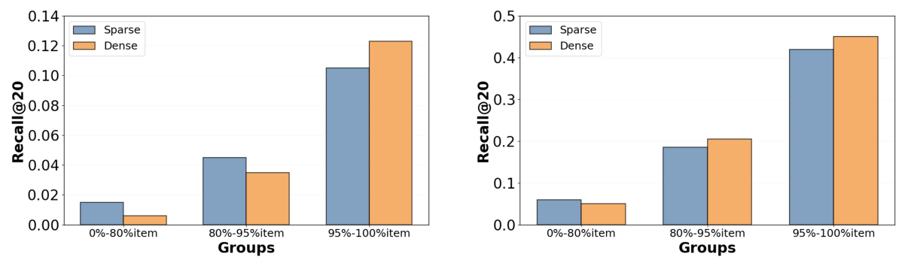
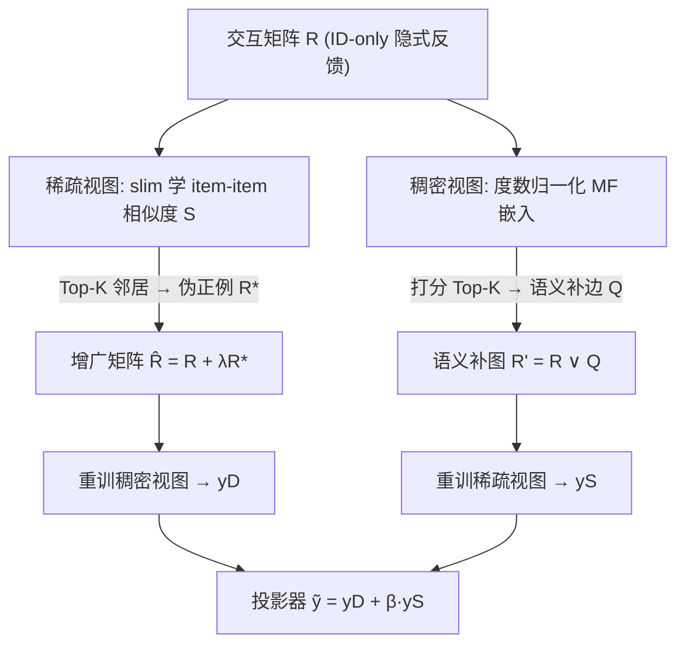

# Why not Collaborative Filtering in Dual View? Bridging Sparse and Dense Models (为什么不做双视图协同过滤？桥接稀疏与稠密模型)

- **会议/期刊**: ACM Transactions on Information Systems (TOIS)
- **作者与机构**: Hanze Guo（人大高瓴人工智能学院）、Jianxun Lian（微软亚研院）、Xiao Zhou（人大高瓴 / 通讯）
- **推荐链路定位**: 召回（ID-only 隐式反馈 Top-K 排序）
- **研究方向**: 协同过滤与双塔召回 / 冷启动与长尾推荐
- **论文原文**: [arXiv:2601.09286](https://arxiv.org/abs/2601.09286v1)
- **开源代码**: [harris26-G/SaD](https://github.com/harris26-G/SaD)

## TL;DR (1分钟核心速览)

本文指出参数化稠密嵌入（MF/LightGCN）在冷门物品上存在**信噪比天花板** $\mathrm{SNR}\lesssim\sqrt{N_i}$，而 degree normalization 无法突破该瓶颈；据此提出 SaD——把 slim 式稀疏视图（item-item 显式结构）与稠密嵌入视图做**双向伪标签对齐**：稀疏→稠密用 Top-K 邻居生成伪正例扩充样本，稠密→稀疏用嵌入打分为物品图补边。在 4 个基准、Full-Ranking 协议下，仅用 MF 作稠密骨干即全面 SOTA，Recall@20 相对提升 1.0%–5.4%（$p<10^{-2}$），并在 BARS 榜单排名第一。

## Background & Motivation (背景与核心矛盾)

- **主流范式**: 稠密嵌入 + 图卷积（LightGCN/SGL/SimGCL）已成为 CF 事实标准，近年来的改进主要靠自监督对比学习在同一潜在空间内做数据增广。
- **前人局限**: ①稠密模型在长尾/冷门物品上性能崩塌，参数估计噪声随交互数 $N_i$ 下降缓慢；②已有"混合"尝试（UltraGCN、GF-CF、PGSP）把稀疏结构当**架构内模块**使用，属于 model-specific 设计，且缺乏"融合为何有效"的理论刻画。
- **核心洞察 (Key Insight)**: 稠密模型擅长语义泛化但在长尾上方差爆炸，稀疏模型（ItemCF/slim）依靠局部邻域平均，方差 $\propto 1/K_i$，即使$N_i$ 很小也能保持高局部 SNR——两者误差**弱相关**，构成理想融合对；图 1 中 slim 在冷门物品组反超 MF 正是这一现象的直接证据。
- **本文切入点**: 不做架构级耦合，而是用"互相造伪标签样本"这一**数据层对齐**方式，把两个范式拼接成一个可插拔框架。

<figure class="paper-figure" markdown="span">
  <figcaption>图1. 物品按用户交互次数分组，并按交互次数从少到多分为三类。由于信噪比（SNR）较低，常用稠密模型在冷门物品上表现较差。</figcaption>
</figure>

## Method (核心方法设计)

### 1. 整体框架 (Overall Architecture)

SaD 是"两视图串行训练 + 对齐投影"的极简闭环：先用原始交互矩阵 $R$训 slim 得到 item-item 相似度$S$，据此为用户/物品各取 Top-K 邻居生成伪正例，得到增广矩阵$\hat{R}=R+\lambda R^*$并重训稠密 MF（得到语义嵌入$E_U,E_I$）；再反过来用稠密打分矩阵$Y^D$的 Top-K 生成伪交互$Q$，与原矩阵做逻辑或$R'=R\vee Q$ 补全稀疏视图并重训 slim；最终由线性投影器把两路打分加权融合输出。整个流程不改动任何骨干网络内部结构，MF、LightGCN、SGL、SimGCL 均可直接充当稠密视图。

### 2. 关键设计拆解 (Key Designs)

1. **SNR 天花板定理与融合判据（理论增量）**：以正负对 margin $\Delta$定义$\mathrm{SNR}=\mathbb{E}[\Delta]/\sqrt{\mathrm{Var}(\Delta)}$，在噪声协方差$\mathrm{Cov}(\varepsilon_i)\succeq \frac{c}{N_i}\mathbf{I}_d$ 下证得

$\mathrm{SNR}_{\mathrm{MF}}(u,i,j)\le \dfrac{\lVert e_i^*-e_j^*\rVert}{\sqrt{c}\sqrt{N_i}},$且归一化打分$\hat{z}_{ui}=e_u^{\top}e_i/\sqrt{d_ud_i}$只改变常数因子，瓶颈仍为$\sqrt{N_i}$（定理 2）。而凸融合$s=\alpha s_1+(1-\alpha)s_2$的 SNR 满足$\mathrm{SNR}(\alpha,\rho)\ge\min\{r_1,r_2\}$，且当$\rho\le r_{\min}/r_{\max}$ 时可超越更强单视图——这就是"选弱相关视图 + 各自提纯"的设计依据。

2. **Sparse→Dense：伪正例标签增广**：冷门物品缺样本的本质是 $N_i$太小。稀疏视图按其相似度给出高置信邻居，取双向 Top-K 并做 OR 得$r^*_{ui}=\mathbb{I}[u\in\text{Index}_i\vee i\in\text{Index}_u]$，把稠密视图的有效样本量抬到$N_i+\eta_i$，理论上$\sigma'_D\approx\sigma_D\sqrt{N_i/(N_i+\eta_i)}$、$r'_D\gtrsim(1-2\varepsilon)r_D\sqrt{1+\eta_i/N_i}$——即使伪标签含噪（噪声率$\varepsilon<1/2$），只要增益足够仍净赚 SNR。

3. **Dense→Sparse：语义补边与融合训练**：稀疏视图只保留 top-K 共现，信息覆盖不足；用稠密嵌入 Top-K 打分构成 $Q$并与$R$逻辑或，扩充每个物品的邻域数$K_i\to K_i+\kappa_i$，从而$\sigma'_S\approx\sigma_S\sqrt{K_i/(K_i+\kappa_i)}$，以几乎无偏的方式降低邻域聚合方差。稠密侧训练目标为度数归一化 BCE：

$\mathcal{L}_O=-\!\!\sum_{(u,i)\in\mathcal{N}^+}\!\! d_{ui}\log\sigma(e_u^{\top}e_i)-\!\!\sum_{(u,i)\in\mathcal{N}^-}\!\! d_{ui}\log\big(1-\sigma(e_u^{\top}e_i)\big),\quad d_{ui}=\tfrac{1}{\sqrt{D_uD_i+\alpha}}$增广样本沿用同式得$\mathcal{L}_I$；负样本从增广矩阵中采样（非免负采样）。推理时$\tilde{y}_{ui}=y^D_{ui}+\beta\, y^S_{ui}$，$\beta$ 控制稀疏视图权重；开销为 **2 次 slim + 1 次 MF**，Yelp 上总耗时 0:35，反而快于 SimGCL（0:29→同量级）与 LightGCN（11:03）。

## Experimental Setup & Evaluation Protocol (实验设置与评估协议)

- **数据集与预处理**: 沿用 LightGCN 的标准切分与过滤，Amazon-Book/Yelp/Gowalla 与 BARS 榜单一致。

| 数据集 | #Users | #Items | #Interactions | 稀疏度 | 说明 |
| :--- | :---: | :---: | :---: | :---: | :--- |
| Gowalla | 29,858 | 40,981 | 1,027,370 | 99.91% | LBS 签到 |
| Yelp2018 | 31,668 | 38,048 | 1,561,406 | 99.87% | 本地商户 |
| Amazon-Book | 52,643 | 91,599 | 2,984,108 | 99.94% | 电商图书 |
| Movielens | 6,022 | 3,043 | 796,244 | 95.65% | 电影评分 |

- **数据划分与防穿越**: `比例划分`（沿用 LightGCN 的 train/valid/test 8:1:1），非 Leave-One-Out。
- **排名评测协议**: 无偏 `Full-Ranking`（全库未交互物品排序），指标 Recall@20 / NDCG@20。
- **对比基线与超参**: 基线含通用模型（LR-GCCF、ENMF、NIA-GCN、NGCF、LightGCN、DGCF、SGL-ED、SimpleX）与隐式双视图模型（slim、GF-CF、UltraGCN、PGSP）；$d=64$、lr$1\mathrm{e}{-3}$、batch 1024、L2$1\mathrm{e}{-4}$；$\beta\in\{1,3,5,10,15,20,50,100,10^3,10^4\}$、Top-$K\in\{0,5,\dots,50\}$网格搜索，并报告$p$ 值显著性。

## Key Experimental Results (实验关键数据)

### 1. 主实验对比 (Main Results)

| 方法 | Yelp R@20 | Yelp N@20 | Gowalla R@20 | Gowalla N@20 | Amazon R@20 | Amazon N@20 | ML R@20 | ML N@20 |
| :--- | :---: | :---: | :---: | :---: | :---: | :---: | :---: | :---: |
| LightGCN | 0.1830 | 0.1554 | 0.0649 | 0.0530 | 0.0411 | 0.0315 | 0.2576 | 0.2427 |
| SGL-ED | 0.1769 | 0.1502 | 0.0675 | 0.0555 | 0.0478 | 0.0379 | 0.2577 | 0.2507 |
| SimpleX | 0.1872 | 0.1557 | 0.0701 | 0.0575 | 0.0583 | 0.0468 | 0.2802 | 0.2670 |
| SimGCL | 0.1830 | 0.1542 | 0.0724 | 0.0596 | 0.0480 | 0.0377 | 0.2728 | 0.2594 |
| slim (纯稀疏) | 0.1699 | 0.1382 | 0.0646 | 0.0541 | 0.0755 | 0.0602 | 0.2577 | 0.2507 |
| GF-CF | 0.1849 | 0.1518 | 0.0697 | 0.0571 | 0.0710 | 0.0584 | 0.2667 | 0.2549 |
| UltraGCN | 0.1862 | 0.1580 | 0.0683 | 0.0561 | 0.0681 | 0.0556 | 0.2787 | 0.2642 |
| PGSP | 0.1916 | 0.1605 | 0.0712 | 0.0587 | 0.0710 | 0.0583 | 0.2759 | 0.2627 |
| **SaD** | **0.1969** | **0.1652** | **0.0731** | **0.0602** | **0.0796** | **0.0635** | **0.2865** | **0.2743** |
| **Improv.%** | 2.8% | 2.9% | 1.0% | 1.0% | 5.4% | 5.5% | 2.3% | 2.7% |
| **$p$-value** | 7.3e-7 | 3.0e-7 | 5.5e-3 | 4.3e-3 | 2.4e-9 | 6.5e-9 | 1.4e-5 | 7.1e-6 |

### 2. 消融实验 (Ablation Study)

| 变体 | Gowalla R@20 | Yelp R@20 | Amazon R@20 | ML R@20 |
| :--- | :---: | :---: | :---: | :---: |
| Dense (仅 MF) | 0.0674 | 0.1852 | 0.0499 | 0.2777 |
| Sparse (仅 slim) | 0.0655 | 0.1635 | 0.0755 | 0.2577 |
| Ensemble (直接加权和) | 0.0682 | 0.1863 | 0.0521 | 0.2828 |
| SaD w/o align | 0.0715 | 0.1922 | 0.0765 | 0.2847 |
| w/o S2D（去稀疏→稠密） | 0.0723 | 0.1968 | 0.0779 | 0.2852 |
| w/o D2S（去稠密→稀疏） | 0.0719 | 0.1924 | 0.0775 | 0.2857 |
| **SaD (full)** | **0.0731** | **0.1969** | **0.0796** | **0.2865** |

### 3. 关键实验发现 (Key Findings)

1. **对齐贡献是主要增益，而非单纯集成**：直接 Ensemble 仅在 Gowalla 上到 0.0682，而 w/o align 已跳至 0.0715，完整 SaD 再提至 0.0731——作者称视图对齐相对无对齐带来 2%–4% 增益，说明双向伪标签是核心而非加权技巧。
2. **两个方向贡献不对称**：去掉 S2D 在 Yelp 几乎无损（0.1968 vs 0.1969），但在 Amazon 掉 0.0017、Gowalla 掉 0.0008；去掉 D2S 在 Yelp 掉 0.0045、Gowalla 掉 0.0012。即"稠密语义补边"对稠密共现丰富的数据更关键，"稀疏伪正例增广"则在极度稀疏的 Amazon 上更有价值。
3. **长尾改善与 SNR 实证对齐**：Movielens 最冷门 80% 物品子群上 SaD 相对 MF 提升约 25%，Yelp 冷门组性能约为 MF 的 2.5 倍；MovieLens-1M 上长尾 SNR 由稠密 1.79 提升至 2.05、整体 SNR 1.684→1.914、Recall@20 0.2777→0.2865，即便跨视图相关 $\rho$ 由 0.24 升至 0.26（定理 3 允许的权衡区）。此外 LightGCN+SaD 在 Yelp/Amazon 分别 +17.0%/+94.8%，SimGCL+SaD 仍再涨 ~4.4%。

## Highlights & Limitations (亮点、对比与审稿批判)

- **与代表作对比 (vs. Prior Work)**: 与 UltraGCN（用 item-item 图约束嵌入，属损失级耦合）、GF-CF/PGSP（图信号滤波把稀疏结构写进算子）不同，SaD 把稀疏视图当作**独立可替换的伪标签生成器**，对稠密骨干零侵入；对比 SGL/SimGCL 的单视图对比增广，SaD 是**跨视图**样本扩充，二者正交（实验表 6 已验证可叠加）。
- **可迁移亮点**: ①"弱相关弱模型 + 伪标签互相增广"这一数据层对齐范式，可搬到多模态/跨域召回而无需重训骨干；②用 SNR 分桶诊断（按物品流行度计算 margin 的均值/方差）作为长尾归因的量化工具，比单纯报 Recall 更有解释力。
- **审稿级局限批判**: ①Amazon-Book 上 +94.8% 的插拔增益中，纯 slim（0.0755）本身已超过所有稠密基线（0.0411），增益可能主要来自稀疏视图的绝对强度而非"对齐"，论文未做等参数量/等训练预算的对照；②训练流程需串行两次 slim + 一次 MF 且 $\beta$高度敏感（Amazon 最优 100、Yelp 最优 25，均需网格搜索），实际部署调参成本被低估；③噪声假设$\mathrm{Cov}(\varepsilon_i)\succeq\frac{c}{N_i}\mathbf{I}_d$ 与邻域局部平滑假设较强，且全部实验限于 ID-only 隐式反馈，未验证含侧信息、序列或时序漂移场景。

## Rating (四维评分)

- **方法创新性 (Novelty)**: ⭐⭐⭐⭐ （以 SNR 上限定理把"稀疏/稠密互补"从经验观察升格为可证命题，并给出 $\rho$ 与单视图增益的权衡判据，理论增量扎实；算子本身较朴素。）
- **评估协议与实验扎实度 (Protocol & Experiments)**: ⭐⭐⭐⭐ （4 主数据集 + 4 额外数据集 + Full-Ranking + $p$ 值 + 分流行度与分度数分桶 + 插拔实验齐全；但缺等预算基线对照与线上验证。）
- **写作与数学规范度 (Clarity & Rigor)**: ⭐⭐⭐⭐ （定理链条清晰、假设显式声明；部分符号如 $r'_D$推导系数与定理 3 的$\rho$ 条件表述略显跳跃，附录补全依赖原文 25 页版本。）
- **工业落地与复现价值 (Industrial & Practical Value)**: ⭐⭐⭐⭐ （代码开源、框架可插拔、Yelp 上 0:35 训练成本低于 LightGCN 一个数量级；但 $\beta$与$K$ 的调参敏感度会抬升线上维护成本。）

