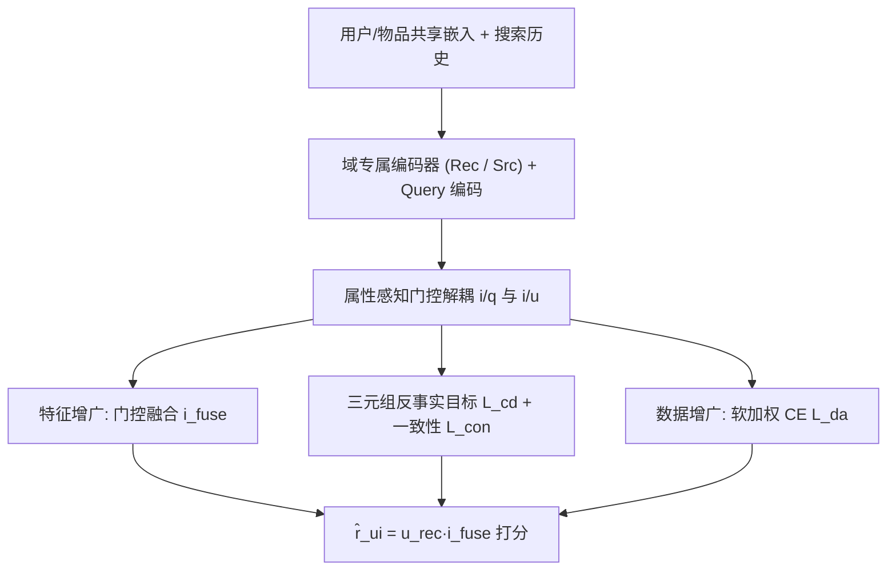
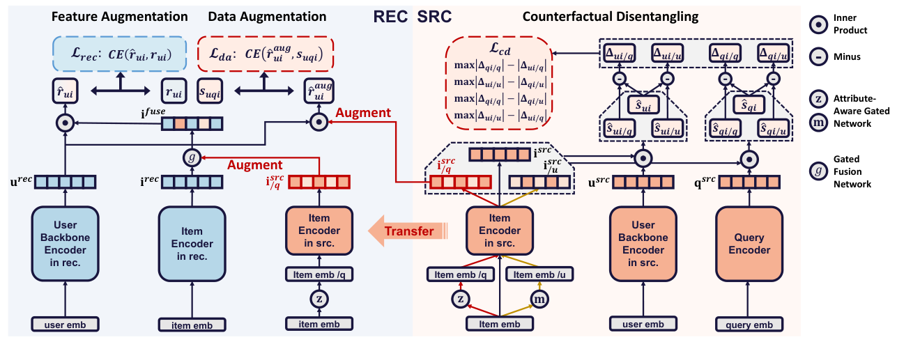

# Counterfactual Learning-Driven Representation Disentanglement for Search-Enhanced Recommendation (面向搜索增强推荐的反事实学习驱动表征解耦)

- **会议/期刊**: TOIS (ACM Transactions on Information Systems)
- **作者与机构**: Jiajun Cui, Xu Chen, Shuai Xiao, Chen Ju, Jinsong Lan, Qingwen Liu, Wei Zhang — 华东师范大学、阿里巴巴集团
- **推荐链路定位**: 召回（协同过滤用户塔 / 序列物品表示）
- **研究方向**: 跨域与多场景推荐 / 自监督表征解耦
- **论文原文**: [https://arxiv.org/abs/2411.18631v1](https://arxiv.org/abs/2411.18631v1)
- **开源代码**: 暂未开源

## TL;DR (1分钟核心速览)

搜索增强推荐面临"部分负迁移"：搜索中点击的物品既含**匹配用户通用兴趣的可迁移特征**，又含**仅反映查询专属意图的干扰特征**，直接迁移会污染推荐偏好。ClardRec 以信息检索中"用户点击物品=物品-查询匹配+物品自身吸引用户的通用特征"这一共识为锚点，用**用户-查询-物品三元组反事实目标**监督物品表征解耦，仅保留查询无关（query-independent）的通用特征，再通过**门控特征增广**与**软加权数据增广**注入推荐。在 KuaiSAR 与 E-commerce R&S 两个数据集、四类骨干（MLP/MMoE/GRU4Rec/SASRec）的采样排序（1 正 + 99 负）评估下，各指标取得 0.33%–10.84% 提升。

## Background & Motivation (背景与核心矛盾)

- **主流范式**: 搜索增强推荐（AUG 直接迁移、JSR 联合学习共享底座、IV4REC+ 用搜索行为作工具变量、SESRec 用对比学习对齐跨域兴趣）均把搜索点击行为整体当作正信号喂给推荐。
- **前人局限**: ①搜索与推荐的物品特征分布存在系统性域差——推荐偏"被动探索型"兴趣（如搞笑/恋爱类短视频），搜索偏"主动目的型"意图（如舞蹈/数码），直接迁移导致负迁移；②解耦缺乏显式监督信号，无法判断一个被点击物品的特征究竟服务于搜索专属意图还是推荐通用兴趣。
- **核心洞察 (Key Insight)**: 用户在某 query 下点击某物品，不仅因物品-query 匹配，也因物品自身颜色/风格等**与 query 无关的通用特征**吸引了用户；这些特征才是纯正反映用户底层兴趣、值得迁移的部分。图 1(a)/(b) 用 t-SNE 与类目分布证明两域分布确有明显错位，图 1(c) 给出"卡通马克杯/白色 T 恤"式迁移直觉。
- **本文切入点**: 用"若移除物品某类特征，用户-物品偏好分与 query-物品匹配分谁变化更大"的反事实推理，构造三组序关系信号来**显式监督**解耦出 query-independent 表征。

<figure class="paper-figure" markdown="span">
  ![图 1：(a) 搜索和推荐中四名活跃用户不同点击商品分布的 t-SNE 可视化。每个商品由其标题词嵌入的平均值表示，词嵌入来自 \[24\]。活跃用户采样自一周内商品点击行为超过 800 次的用户。(b) 上半部分展示搜索和推荐中点击视频的 36 个主要类别的不同概率分布。类别索引顺序按其推荐中的点击概率排序。下半部分展示五个概率最大的类别](../../../../assets/papers/2411.18631v1/figure_1.png)<figcaption>图 1：(a) 搜索和推荐中四名活跃用户不同点击商品分布的 t-SNE 可视化。每个商品由其标题词嵌入的平均值表示，词嵌入来自 [24]。活跃用户采样自一周内商品点击行为超过 800 次的用户。(b) 上半部分展示搜索和推荐中点击视频的 36 个主要类别的不同概率分布。类别索引顺序按其推荐中的点击概率排序。下半部分展示五个概率最大的类别</figcaption>
</figure>

## Method (核心方法设计)

### 1. 整体框架 (Overall Architecture)

输入层对用户/物品的 ID 与属性嵌入共享拼接（域内、跨域共用户共物品），搜索域与推荐域各设**独立参数**的用户/物品编码器（CF 用 MLP 或 MMoE，序列用 GRU4Rec 或 SASRec），query 用词嵌入均值池化。核心是三条支路：**反事实解耦**把搜索物品表征线性拆成 query-related 与 query-independent 两半，并用三元组反事实损失 + 一致性约束训练；**特征增广**把 query-independent 表征与推荐物品表征门控融合后打分；**数据增广**把搜索交互视为软正样本，以 query-independent 偏好分做置信度加权辅助交叉熵。三段损失与搜索域监督损失联合端到端优化。

<figure class="paper-figure" markdown="span">
  <figcaption>图 2：ClardRec 概览。“REC”和“SRC”分别表示推荐域和搜索域。为简洁起见，省略了序列场景中用户历史序列到用户主干编码器的输入。</figcaption>
</figure>

### 2. 关键设计拆解 (Key Designs)

1. **属性感知门控解耦 (Attribute-aware Gated Disentangling)**：直接整体切分物品嵌入粒度太粗，不同属性（如"数码"类目更偏 query 匹配，"恋爱/卡通"更偏通用兴趣）倾向不同。本文用两个 MLP 生成逐属性门控 $\mathbf{z}_{ID}$,$z_{a_j}$，令$\mathbf{m}=1-\mathbf{z}$，按位拆出
   $$\mathbf{i}^{emb}_{/q}=2\cdot[\mathbf{z}_{ID}\otimes\mathbf{i}_{ID}\,|\,z_{a_j}\mathbf{i}_{a_j}\,|\,\cdots],\quad \mathbf{i}^{emb}_{/u}=2\cdot[\mathbf{m}_{ID}\otimes\mathbf{i}_{ID}\,|\,m_{a_j}\mathbf{i}_{a_j}\,|\,\cdots]$$
   并强制 $\mathbf{i}^{emb}=(\mathbf{i}^{emb}_{/q}+\mathbf{i}^{emb}_{/u})/2$，保证分解无损；再各经物品编码器得$\mathbf{i}^{src}_{/q}$、$\mathbf{i}^{src}_{/u}$。直觉：门控在属性粒度上学习"哪些维度该归给 query 匹配、哪些该归给通用兴趣"。

2. **三元组反事实目标 (Triplet Counterfactual Objective)**：解耦缺监督，故借"移除某类特征后分值变化幅度"构造序关系。记 $\Delta_{ui/q}=\hat{s}_{ui/q}-\hat{s}_{ui}$、$\Delta_{qi/q}=\hat{s}_{qi/q}-\hat{s}_{qi}$等，需满足匹配维度$|\Delta_{qi/q}|>|\Delta_{ui/q}|$、$|\Delta_{ui/u}|>|\Delta_{qi/u}|$，以及移除维度$|\Delta_{qi/q}|>|\Delta_{qi/u}|$、$|\Delta_{ui/u}|>|\Delta_{ui/q}|$。转成 log-sigmoid 三元组损失
   $$\mathcal{L}^{/q}_{cd}=-\log\sigma(\Delta_{qi/q}-\Delta_{ui/q})-\tfrac{1}{M}\sum_{i^-}\log\sigma(\Delta_{ui^-/q}-\Delta_{qi^-/q})$$
   （另有 $\mathcal{L}^{/u}_{cd},\mathcal{L}^{qi}_{cd},\mathcal{L}^{ui}_{cd}$），并用$\mathcal{L}_{con}=\max(\Delta,0)/\max(-\Delta,0)$ 约束正样本分应下降、负样本分应上升。直觉：让"移除 query 相关特征"对 query 匹配的打击大于对用户偏好的打击，从而逼迫 query-independent 半边真正承载用户兴趣。

3. **特征/数据双增广与训练目标**：特征侧用门控 $g=\sigma(\mathrm{MLP}([\mathbf{i}_{rec}|\mathbf{i}^{src}_{/q}]))$融合$\mathbf{i}_{fuse}=g\cdot\mathbf{i}_{rec}+(1-g)\cdot\mathbf{i}^{src}_{/q}$，打分$\hat{r}_{ui}=\mathbf{u}_{rec}\cdot\mathbf{i}_{fuse}$；数据侧把搜索交互视为软正样本，$\mathcal{L}_{da}=\omega(\hat{s}_{ui/q})\,\mathrm{CE}(\hat{r}^{aug}_{ui},s_{uqi})$，$\omega$ 取 batch 内 softmax。总损失
   $$\mathcal{L}=\mathcal{L}_{rec}+\lambda\big(\mathcal{L}_{src}+\alpha\mathcal{L}_{cd}+\beta\mathcal{L}_{da}+\gamma\mathcal{L}_{con}\big)$$
   负采样为每正样本随机采 $M$ 个负例（含 batch 内负例），推理时仅需推荐塔前向，几乎无额外在线开销。

## Experimental Setup & Evaluation Protocol (实验设置与评估协议)

- **数据集与预处理**: 两个数据集均以 **5-click 过滤**（搜索与推荐交互均 <5 的用户/物品剔除）：

| 数据集 | #Users | #Items | #Interactions | 稀疏度/密度 | 特征/场景说明 |
| :--- | :---: | :---: | :---: | :---: | :--- |
| KuaiSAR | ~25,000 | — | 19 天短视频搜索+推荐 | — | 公开短视频，两域物品重叠率低 |
| E-commerce R&S | — | — | 两周电商点击（1 周 CF + 1 周序列） | — | 工业电商，搜索占比与重叠率更高 |

（注：原文将预处理后精确统计置于附录 B.1，正文未列全量数字。）

- **数据划分与防穿越**: CF 场景按用户交互划分（留一/比例，详见附录），序列场景按用户历史点击序列做 next-item 预测；验证集连续 10 epoch 不提升即早停。
- **排名评测协议**: **Sampled Ranking（采样排序）**——每个 ground-truth 配 **99 个负样本**（1:99），报告 HR@1、HR@5、NDCG@5、MRR；五次不同随机种子取均值，T-test $p\le 0.05$ 标注显著性。
- **对比基线与超参**: 基线含 AUG（直接迁移）、IV4REC+（工具变量因果）、JSR（联合学习框架）、SESRec（对比学习对齐）及原始骨干 MLP/MMoE/GRU4Rec/SASRec；统一嵌入维度 $d_e=32$、隐藏维度$d_h=128$，Adam 优化，$\lambda,\alpha,\beta,\gamma$从$\{0.01,0.1,0.2,0.5,1.0\}$ 中选取。

## Key Experimental Results (实验关键数据)

### 1. 主实验对比 (Main Results)

| 场景 | 数据集 | 方法 | HR@1 | HR@5 | NDCG@5 | MRR |
| :--- | :--- | :--- | :---: | :---: | :---: | :---: |
| CF | KuaiSAR | MLP | 0.1125 | 0.2264 | 0.1724 | 0.1756 |
| CF | KuaiSAR | +AUG | 0.1096 | 0.2180 | 0.1667 | 0.1679 |
| CF | KuaiSAR | +IV4REC+ | 0.1130 | 0.2247 | 0.1717 | 0.1744 |
| CF | KuaiSAR | JSR+MMoE | 0.1152 | 0.2327 | 0.1768 | 0.1817 |
| CF | KuaiSAR | **ClardRec(MMoE)** | **0.1165\*** | **0.2415\*** | **0.1817\*** | **0.1886\*** |
| CF | E-com | MLP | 0.1271 | 0.3550 | 0.2429 | 0.2498 |
| CF | E-com | +IV4REC+ | 0.1270 | 0.3553 | 0.2430 | 0.2500 |
| CF | E-com | JSR+MMoE | 0.1276 | 0.3633 | 0.2473 | 0.2530 |
| CF | E-com | **ClardRec(MMoE)** | **0.1317\*** | **0.3710\*** | **0.2534\*** | **0.2581\*** |
| Seq | KuaiSAR | SASRec | 0.3196 | 0.5112 | 0.4213 | 0.4146 |
| Seq | KuaiSAR | +AUG | 0.2770 | 0.4549 | 0.3718 | 0.3703 |
| Seq | KuaiSAR | SESRec | 0.3222 | 0.4611 | 0.3978 | 0.3980 |
| Seq | KuaiSAR | **SASRec+ClardRec** | **0.3331** | **0.5140** | **0.4294** | **0.4238** |
| Seq | E-com | SASRec | 0.2880 | 0.6069 | 0.4546 | 0.4379 |
| Seq | E-com | +IV4REC+ | 0.2989 | 0.6259 | 0.4698 | 0.4501 |
| Seq | E-com | **SASRec+ClardRec** | **0.3321\*** | **0.6561\*** | **0.5024\*** | **0.4808\*** |

提升幅度（相对最强基线）: CF KuaiSAR +1.18%/+3.81%/+2.77%/+3.76%；CF E-com +3.21%/+2.14%/+2.47%/+2.02%；Seq KuaiSAR +3.94%/+0.33%/+2.18%/+1.85%；Seq E-com **+10.84%/+4.82%/+6.93%/+6.82%**。

### 2. 消融实验 (Ablation Study)

| 骨干 | 变体 | KuaiSAR HR@1 | KuaiSAR NDCG@5 | E-com HR@1 | E-com NDCG@5 |
| :--- | :--- | :---: | :---: | :---: | :---: |
| MMoE(CF) | ClardRec | **0.1165** | **0.1817** | **0.1317** | **0.2534** |
| MMoE(CF) | -CD | 0.1157 | 0.1789 | 0.1305 | 0.2512 |
| MMoE(CF) | -FA | 0.1145 | 0.1769 | 0.1291 | 0.2500 |
| MMoE(CF) | -DA | 0.1163 | 0.1816 | 0.1296 | 0.2494 |
| SASRec(Seq) | ClardRec | **0.3331** | **0.4294** | **0.3321** | **0.5024** |
| SASRec(Seq) | -CD | 0.3191 | 0.4181 | 0.3066 | 0.4752 |
| SASRec(Seq) | -FA | 0.3261 | 0.4249 | 0.3031 | 0.4716 |
| SASRec(Seq) | -DA | 0.3324 | 0.4291 | 0.3195 | 0.4901 |

### 3. 关键实验发现 (Key Findings)

1. **负迁移被直接量化**：AUG（直接迁移搜索点击）在四个骨干上几乎全面掉点（如 Seq KuaiSAR SASRec 的 HR@1 从 0.3196 跌到 0.2770，降 13.3%），而 ClardRec 同场景升到 0.3331，证明确有"搜索专属意图"污染推荐，且解耦能把它剔除。
2. **特征增广（FA）与解耦（CD）是主贡献**：去掉 FA 掉点最多（MMoE KuaiSAR HR@1 0.1165→0.1145，SASRec E-com 0.3321→0.3031），去掉 CD 次之；说明"把解耦出的通用表征直接融进候选物品打分"比"仅在训练侧软加权"更关键。
3. **数据增广（DA）收益受两域物品重叠率支配**：DA 在 E-com（重叠率高）对 SASRec 贡献 0.4901 vs 0.5024 的 NDCG@5 差距，而在 KuaiSAR（重叠率极低）几乎无损（0.1816 vs 0.1817），说明 DA 本质是借搜索样本扩充推荐正例池，重叠不足时收益受限，需与 FA 互补。

## Highlights & Limitations (亮点、对比与审稿批判)

- **与代表作对比 (vs. Prior Work)**: AUG 无差别整体迁移 → 引发负迁移；IV4REC+ 用工具变量挑"因果"物品嵌入但未从特征粒度解耦；SESRec 用对比学习对齐两域共享兴趣，仍以推荐行为定义"共享"，未显式从搜索提取 query-independent 表征。ClardRec 首次以 query 为锚点、用反事实序关系**显式监督**特征级解耦。
- **可迁移亮点**: ①"移除某特征后两路分值变化幅度"的序关系，可迁移到任意多任务/多域特征筛选（如曝光特征与兴趣特征、场景特征与通用特征）；②无需人工标注、仅用"点击=匹配+通用吸引"这一弱先验构造三元组监督，工程上极易复用于搜索-推荐、广告-推荐等域。
- **审稿级局限批判**: ①仅评估 **1:99 采样排序**，未做 Full-Ranking，负样本选择可能放大优势，且未报训练/推理延迟；②依赖两域**用户与物品重叠**，搜索物品重叠率低时（KuaiSAR）DA 几乎失效，冷启动跨域或非重叠场景适用性未验证；③三元组反事实目标需为每个 $(u,q,i)$采样$M$负例并计算四组$\Delta$，训练开销明显高于基线，且$\alpha,\beta,\gamma$ 敏感度仅在附录讨论。

## Rating (四维评分)

- **方法创新性 (Novelty)**: ⭐⭐⭐⭐ （以 query 为锚点的反事实序关系解耦思路新颖，"移除特征看谁掉分更多"的监督构造简洁且有信息检索理论支撑）
- **评估协议与实验扎实度 (Protocol & Experiments)**: ⭐⭐⭐ （两数据集 + 四骨干 + 五次随机种子 + T-test 较完整，但仅用 1:99 采样排序、缺 Full-Ranking 与效率分析）
- **写作与数学规范度 (Clarity & Rigor)**: ⭐⭐⭐⭐ （门控解耦与四组反事实损失符号清晰、约束项定义完整，$\Delta$ 变化方向的正负号推理交代到位）
- **工业落地与复现价值 (Industrial & Practical Value)**: ⭐⭐⭐⭐ （阿里电商真实数据验证，推理仅需推荐塔前向、几乎零额外线上开销；但未开源，训练期负例采样成本略高）

