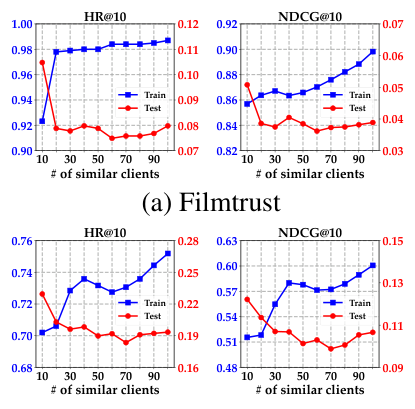
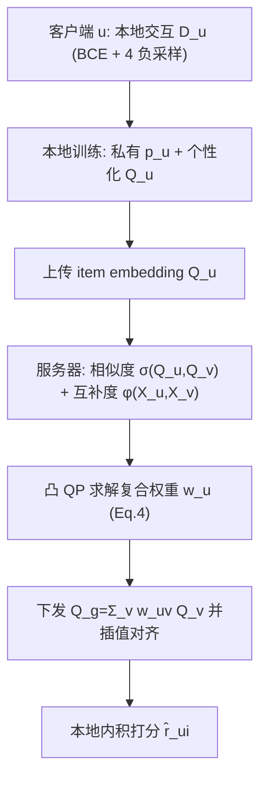
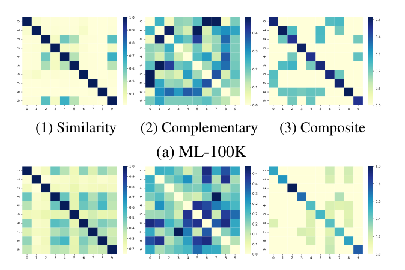

# Beyond Similarity: Personalized Federated Recommendation with Composite Aggregation (超越相似性：基于复合聚合的个性化联邦推荐)

- **会议/期刊**: TOIS 2026
- **作者与机构**: Honglei Zhang, Haoxuan Li, Jundong Chen, Sen Cui, Kunda Yan, Abudukelimu Wuerkaixi, Xin Zhou, Zhiqi Shen, Yidong Li（北京交通大学、北京大学、清华大学、南洋理工大学）
- **推荐链路定位**: 召回（联邦化 item embedding 表聚合）
- **研究方向**: 去偏公平、可信隐私与工业架构 / 冷启动与长尾推荐
- **论文原文**: [https://arxiv.org/abs/2406.03933v1](https://arxiv.org/abs/2406.03933v1)
- **开源代码**: [https://github.com/hongleizhang/FedCA](https://github.com/hongleizhang/FedCA)

## TL;DR (1分钟核心速览)

联邦推荐（FR）借用视觉联邦的“相似客户端加权聚合”，但 FR 模型是一对一的 item embedding 表：聚合只会反复强化已训练的 embedding 行，未交互行（灰色行）始终得不到更新，形成 **embedding skew**。本文提出 FedCA，把聚合权重同时约束在“模型相似性”与“数据互补性”上，并将权重求解写成可闭式求解的凸二次规划。在 PMF/NCF 双骨干、四个真实数据集、Leave-One-Out + 采样排序协议下，ML-100K 上 HR@10 达 0.8738（相对最强基线 PFedRec 提升 20.5%），NDCG@10 提升 63.4%。

## Background & Motivation (背景与核心矛盾)

- **主流范式**: FCF/FedAvg 全局平均或按数据量加权，PerFedRec 聚类聚合，FedAtt 注意力聚合，pFedGraph 图学习相似度——本质都是“相似客户端获得更大权重”的相似性假设。
- **前人局限**: ①视觉联邦的骨干是结构化参数（CNN 卷积核），每个参数都参与所有样本的前向，而 FR 的 embedding 表是稀疏行访问，客户端只更新自己交互过的行；②因此相似性聚合在 FR 上退化为“对已训练行的重复强化”，对未见 item 无任何知识注入，测试集泛化反而随聚合客户端数增加而下降。
- **核心洞察 (Key Insight)**: 把异构性分解为 $p(\boldsymbol{x},\boldsymbol{y})=p(\boldsymbol{x})p(\boldsymbol{y}|\boldsymbol{x})$：相似性聚合只对齐条件分布$p(\boldsymbol{y}|\boldsymbol{x})$，却抹掉了边际分布$p(\boldsymbol{x})$的差异；而$p(\boldsymbol{x})$ 的差异正是“互补信息”所在，可用于补齐未训练行。
- **本文切入点**: 在同一个目标里同时约束相似（对齐条件分布）与互补（保留并利用边际分布差异），让聚合既能强化已训练 embedding、也能更新未训练 embedding。

<figure class="paper-figure" markdown="span">
  <figcaption>图2：训练集和测试集上 HR@10 与 NDCG@10 的实证结果。</figcaption>
</figure>

## Method (核心方法设计)

### 1. 整体框架 (Overall Architecture)

每轮服务器先向客户端下发聚合后的 item embedding，客户端用本地交互数据以 BCE 损失训练私有 user embedding $\boldsymbol{p}_u$与个性化 item 表$\mathbf{Q}_u$，仅上传$\mathbf{Q}_u$；服务器据上传的 embedding 计算两两相似度$\sigma(\cdot)$与互补度$\phi(\cdot)$，为每个客户端解一个小规模凸二次规划得到个性化权重$\boldsymbol{w}_u$，再聚合下发；客户端推理前用插值把上一轮本地表与当前全局表做空间对齐，最后内积打分。

### 2. 关键设计拆解 (Key Designs)

1. **复合聚合的统一优化目标**：把服务器聚合与本地训练写进同一目标，权重受相似、互补与数据量三方约束：
$\min_{\{\boldsymbol{p}_u,\mathbf{Q}_u,\boldsymbol{w}_u\}}\sum_{u=1}^{n}\big[\mathcal{L}_u+\alpha\sum_{v}\mathcal{F}_s(w_{uv};\mathbf{Q}_u,\mathbf{Q}_v)+\beta\sum_{v}\mathcal{F}_c(w_{uv};\mathcal{D}_u,\mathcal{D}_v)\big],\ \text{s.t. } \boldsymbol{1}^{\top}\boldsymbol{w}_u=1,\ \boldsymbol{w}_u>0$。
服务器无法访问 $\mathcal{L}_u$，故用相对数据量$p_v$做代理，得到可解形式$\min_{\boldsymbol{w}_u}\sum_v (w_{uv}-p_v)^2+\alpha (w_{uv}-\sigma(\mathbf{Q}_u,\mathbf{Q}_v))^2-\beta w_{uv}\cos\phi(\boldsymbol{X}_u,\boldsymbol{X}_v)$。直觉：三项都是$w_{uv}$ 的二次/线性项，权重自然在“数据量—相似—互补”之间取平衡点。

2. **相似项与互补项的算子设计**：相似项取 $\mathcal{F}_s=(w_{uv}-\sigma)^2$，$\sigma=1/(1+\lVert\mathbf{Q}_u-\mathbf{Q}_v\rVert_2)$，保证相似模型权重上抬；互补项用中间特征代理本地数据——对交互 item 子表$\mathbf{Q}^s_u$做 SVD 取前$k$个左奇异向量得$\boldsymbol{X}_u$（既降维又抵御输入重构攻击），并以主角度度量$\phi(\boldsymbol{X}_u,\boldsymbol{X}_v)=\frac{1}{k}\sum_{l=1}^{k}\arccos(\boldsymbol{x}^l_u{}^\top\boldsymbol{x}^l_v)$，$\mathcal{F}_c=-w_{uv}\cos\phi$。当两客户端子空间正交时互信息最小、互补性最大，权重被抬高——相当于用“未被该客户端覆盖的 item 语义方向”去更新其未训练行。

3. **训练目标、负采样与推理效率**：本地损失为 BCE，$\mathcal{L}_u=-\sum_{(u,i)\in\mathcal{D}_u}r_{ui}\log\hat{r}_{ui}+(1-r_{ui})\log(1-\hat{r}_{ui})$，每正样本均匀采样 4 个负例；**刻意不加 FedProx 式近端项**（消融显示近端项反而掉点），以保留强个性化。推理时用$\mathbf{Q}^t_u=\rho\mathbf{Q}^{t-1}_u+(1-\rho)\mathbf{Q}^t_g$ 缓解“user 向量滞留上一轮、item 向量已换轮”的空间错位。计算开销全在服务器（QP 用经典凸求解器），客户端复杂度与 FCF 同阶。

## Experimental Setup & Evaluation Protocol (实验设置与评估协议)

- **数据集与预处理**: 三个显式反馈电影数据集（评分 $>0$ 二值化为 1）加一个隐式短视频数据集，**每个用户视作一个独立客户端**，天然高异构：

| 数据集 | #Users | #Items | #Interactions | 稀疏度/密度 | 特征/场景说明 |
| :--- | :---: | :---: | :---: | :---: | :--- |
| ML-100K | 943 | 1,682 | 100K | 6.30% | 电影，显式转隐式 |
| Filmtrust | 1,508 | 2,071 | 35K | 1.14% | 电影，显式转隐式 |
| ML-1M | 6,040 | 3,706 | 1M | 4.47% | 电影，规模最大 |
| MC-100K | ≈1,000 | ≈12.8K | 100K | ≈0.8% | 短视频，隐式反馈 |

- **数据划分与防穿越 (Splitting Strategy)**: `Leave-One-Out`，每个客户端留最后一条交互作测试。
- **排名评测协议 (Ranking Protocol)**: `Sampled Ranking`——测试正例与 4 个均匀采样负例（正负比 1:4）共同排序，报告 HR@10 与 NDCG@10，5 次重复取均值。
- **对比基线与超参设置**: 8 个基线（Local、FCF、FedAvg、PerFedRec、FedAtt、FedFast、pFedGraph、PFedRec），骨干分别用 PMF 与 NCF 验证模型无关性；SVD 列数 $k=4$；$\rho,\alpha,\beta\in[0,1]$ 逐数据集网格搜索。

## Key Experimental Results (实验关键数据)

### 1. 主实验对比 (Main Results)

| Backbone / Model | ML-100K HR@10 | NDCG@10 | Filmtrust HR@10 | NDCG@10 | ML-1M HR@10 | NDCG@10 | MC-100K HR@10 | NDCG@10 |
| :--- | :---: | :---: | :---: | :---: | :---: | :---: | :---: | :---: |
| PMF + Local | 0.4128 | 0.2203 | 0.4760 | 0.2410 | 0.4264 | 0.2314 | 0.1246 | 0.0567 |
| PMF + FedAvg | 0.4878 | 0.2786 | 0.6517 | 0.5126 | 0.4912 | 0.2751 | 0.1295 | 0.0601 |
| PMF + PerFedRec | 0.4973 | 0.2797 | 0.6577 | 0.5247 | 0.4623 | 0.2622 | 0.1255 | 0.0599 |
| PMF + FedAtt | 0.4645 | 0.2558 | 0.6088 | 0.3359 | 0.4310 | 0.2168 | 0.0982 | 0.0445 |
| PMF + FedFast | 0.4984 | 0.2747 | 0.6527 | 0.5191 | 0.5061 | 0.2898 | 0.1278 | 0.0600 |
| PMF + pFedGraph | 0.5928 | 0.4025 | 0.6961 | 0.5430 | 0.7904 | 0.6347 | 0.1324 | 0.0605 |
| PMF + PFedRec | 0.7254 | 0.4648 | 0.7096 | 0.5629 | 0.8032 | 0.6519 | 0.1334 | 0.0621 |
| **PMF + FedCA** | **0.8738** | **0.7597** | **0.7725** | **0.5945** | **0.8348** | **0.7118** | **0.1351** | **0.0678** |
| NCF + PFedRec | 0.6931 | 0.5031 | 0.6732 | 0.5031 | 0.6826 | 0.4041 | 0.1422 | 0.0687 |
| **NCF + FedCA** | **0.8452** | **0.7444** | **0.6836** | **0.5099** | **0.7815** | **0.6662** | **0.1465** | **0.0782** |
| Improv.% (vs. 最强基线, PMF) | +20.5% | +63.4% | +8.9% | +5.6% | +3.9% | +9.2% | +1.3% | +9.2% |

### 2. 消融实验 (Ablation Study)

| 变体 (PMF 骨干) | ML-100K HR@10 | ML-100K NDCG@10 | ML-1M HR@10 | ML-1M NDCG@10 |
| :--- | :---: | :---: | :---: | :---: |
| 仅 $\mathcal{L}_u$（退化为 FedAvg） | 0.4878 | 0.2786 | 0.4912 | 0.2751 |
| $\mathcal{L}_u+\mathcal{F}_c$（仅互补） | 0.8431 | 0.6983 | 0.8049 | 0.6585 |
| $\mathcal{L}_u+\mathcal{F}_s$（仅相似） | 0.8653 | 0.7457 | 0.8103 | 0.6987 |
| **$\mathcal{L}_u+\mathcal{F}_s+\mathcal{F}_c$** | **0.8738** | **0.7597** | **0.8348** | **0.7118** |
| w/ 近端项（FedProx 式） | 0.8469 | 0.7274 | 0.8168 | 0.6801 |
| $\rho=0.5$/$0.8$/$0.9$/$1.0$ | 0.6681 / **0.8738** / 0.8611 / 0.7922 | 0.4930 / **0.7595** / 0.7432 / 0.6329 | 0.6833 / 0.8278 / **0.8348** / 0.8008 | 0.4892 / 0.6949 / **0.7118** / 0.6918 |

### 3. 关键实验发现 (Key Findings)

1. **相似与互补缺一不可，且互补不可被相似替代**：仅相似聚合（$\mathcal{L}_u+\mathcal{F}_s$）把 ML-100K HR@10 从 0.4878 拉到 0.8653，仍低于完整模型 0.8738；而仅互补已达 0.8431，说明“更新未训练行”贡献了绝大部分增量（NDCG@10 从 0.2786 → 0.6983，约 2.5 倍）。
2. **训练数据越稀疏，复合聚合收益越大**：40% 训练数据时 FedCA 在 ML-100K、MC-100K 上领先幅度最大，而聚类式 PerFedRec 在 40% 设置下最差且训练曲线不稳——因为 K-Means 需人工选簇数且稀疏下相似度估计失真，而 FedCA 用统一损失平滑地“软选”相似客户端，无需调簇数。
3. **FR 任务应“去近端项 + 加插值对齐”**：加 FedProx 近端项使 ML-100K HR@10 从 0.8738 降到 0.8469（NDCG 0.7597→0.7274），说明强个性化比向全局靠拢更重要；而推理期插值 $\rho$极敏感（$\rho=0.5$时 HR@10 仅 0.6681，$\rho=0.8/0.9$ 最优），过大过小都破坏 user-item 空间一致性。

<figure class="paper-figure" markdown="span">
  <figcaption>图5：相似性、互补性与复合聚合权重的可视化结果。</figcaption>
</figure>

## Highlights & Limitations (亮点、对比与审稿批判)

- **与代表作对比 (vs. Prior Work)**: 相比 pFedGraph/FedAtt 等只做相似性图/注意力加权，FedCA 首次指出 FR 的 embedding 表导致“skew”这一结构性差异，并引入互补性约束；相比 PerFedRec/FedFast 的硬聚类+簇间聚合，FedCA 把“选相似/选不相似”统一为凸 QP，避免簇数超参；相比 PFedRec 的双重个性化，本文不额外参数化打分函数，而以聚合算子为切入点，插件化接入任意骨干。
- **可迁移亮点**: ①用 SVD 左奇异向量 + 主角度（$\arccos$内积均值）作为“隐私友好的数据互补性代理”，可直接迁移到跨域/多场景联邦迁移与冷启动物品表征补全；②推理期$\rho$ 插值对齐全局 item 表与本地 user 向量的技巧，可复用于任何“部分参数全局同步、部分参数本地私有”的联邦模型。
- **审稿级局限批判**: ①$\alpha,\beta,\rho$仍需逐数据集网格搜索，作者亦承认需自动化调权；②互补性代理完全建立在交互 item 子表 SVD 上，若客户端交互极少（< 4 条）则$\boldsymbol{X}_u$ 估计不稳，本文未给出低交互客户端的分桶结果；③隐私讨论仅停留在“不上传原始数据”，SVD 表征与 QP 权重仍可能泄露交互频次，缺少形式化 DP 或攻击实验。

## Rating (四维评分)

- **方法创新性 (Novelty)**: ⭐⭐⭐⭐ （把 FR 聚合从“相似性加权”重构为“相似+互补”双约束凸优化，问题识别（embedding skew）比算子本身更有价值）
- **评估协议与实验扎实度 (Protocol & Experiments)**: ⭐⭐⭐⭐ （四数据集 × 双骨干 × 8 基线 + 稀疏度曲线 + 三项消融较完整，但评测为 1:4 采样排序、非 Full-Ranking，且无显著性检验）
- **写作与数学规范度 (Clarity & Rigor)**: ⭐⭐⭐⭐ （从 $p(\boldsymbol{x})p(\boldsymbol{y}|\boldsymbol{x})$ 分解推导互补性动机清晰，QP 退化关系说明到位；互补度主角度度量的理论依据偏启发式）
- **工业落地与复现价值 (Industrial & Practical Value)**: ⭐⭐⭐⭐ （服务器侧仅需小规模 QP、客户端开销与 FCF 同阶，代码已开源，适合端侧联邦召回落地；但每轮 $O(n^2)$ 相似/互补矩阵计算在大规模客户端下需采样）

