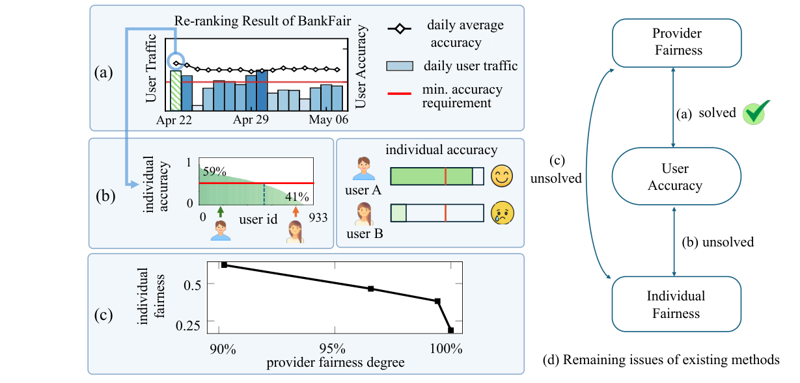
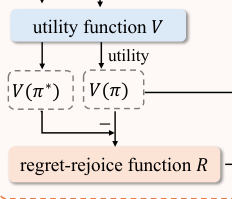
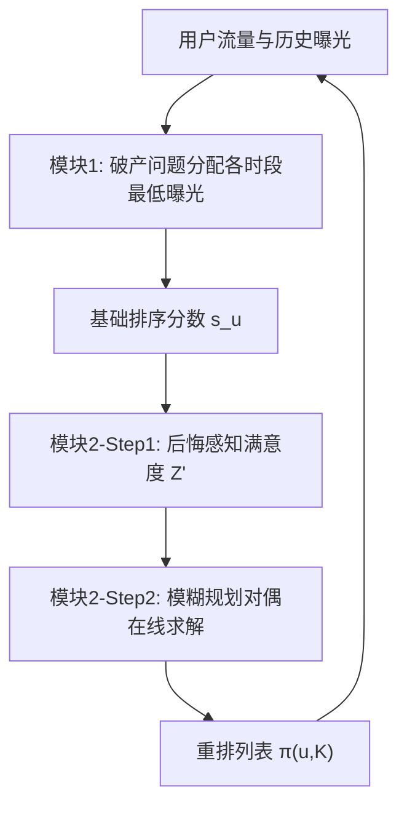

# Regret-aware Re-ranking for Guaranteeing Two-sided Fairness and Accuracy in Recommender Systems (兼顾双边公平与准确性的后悔感知重排序)

- **会议/期刊**: TOIS 2026（扩展自 CIKM 2024 的 BankFair）
- **作者与机构**: Xiaopeng Ye, Chen Xu, Jun Xu 等（中国人民大学高瓴人工智能学院）；Xuyang Xie, Gang Wang, Zhenhua Dong（华为诺亚方舟实验室）
- **推荐链路定位**: 重排
- **研究方向**: 去偏公平、可信隐私与工业架构 / 多任务学习与列表级重排
- **论文原文**: [论文原文链接](https://arxiv.org/abs/2504.14550v1)
- **开源代码**: 暂未开源

## TL;DR (1分钟核心速览)

针对现有多方推荐重排只保提供方曝光与平均准确率、却造成用户个体准确率长尾的痛点，BankFair+ 将后悔理论的非线性满意度与模糊规划引入在线重排；在 KuaiRand-1K/Huawei-Video 按时间切分、Top-10 位置衰减曝光评估下，可比 Gini<0.1 时 NDCG@10 至少高于 P-MMF 0.20，75% ESP 下 MMR@10 达 0.741。

## Background & Motivation (背景与核心矛盾)

- **主流范式**: 双边公平重排多在最低曝光约束下用 LP、贪心或在线对偶最大化平均准确率，代表为 CPFair、TFROM、BankFair。
- **前人局限**: (1) 线性满意度假设忽略“低准确率导致非线性和后悔”的个体长尾；(2) 为每个用户加硬约束会使 LP 约束爆炸并相互冲突，提供方公平度提高时个体公平反而恶化。图1显示平均 NDCG 达标时仍有约 41% 用户低于阈值。
- **核心洞察**: 用户对低于参考列表的损失是非对称放大的；多目标冲突下，模糊目标比硬约束更适合在线重排。
- **本文切入点**: 用后悔理论重塑用户满意度，用模糊规划在线平衡个体公平与提供方公平，同时继承 BankFair 的流量自适应曝光分配。

<figure class="paper-figure" markdown="span">
  <figcaption>图1. 尽管 (a) 现有工作能够同时保证用户平均准确率和提供方公平性，但 (b) 用户准确率的严重个体不公平性仍然存在。(c) 随着提供方公平程度的提高，这种个体级不公平性趋于加剧。(d) 现有方法的剩余问题：如何在保证提供方公平性和用户准确率的同时确保个体公平性。</figcaption>
</figure>

## Method (核心方法设计)

### 1. 整体框架 (Overall Architecture)

BankFair+ 保留 BankFair 的两模块结构：模块1按流量波动，用破产问题/Talmud 规则把长周期最低曝光拆到各时段；模块2对每个到达用户先接收基础排序分数，再计算后悔感知满意度，最后通过模糊规划的对偶在线算法输出重排列表。模块1保证提供方曝光，模块2抑制个体低准确率长尾，二者按时间交替更新。图2给出流程。

<figure class="paper-figure" markdown="span">
  <figcaption>图2. (1) 所提出的 BankFair+ 重排序算法的工作流程。(b) 在模块1中，我们使用破产问题中的 Talmud 规则为提供方分配曝光。(c) 在模块2中，我们提出一种后悔感知在线重排序算法来缓解个体不公平性。</figcaption>
</figure>

### 2. 关键设计拆解 (Key Designs)

1. **流量自适应曝光分配（模块1）**：解决低流量时段为保公平而牺牲准确率的问题。剩余最低曝光按 $\hat{m}_p(n)=[m_p-\sum_{i=1}^{n-1}E_{p,i}]_+$更新，再由 Talmud 规则输出当前时段配额$\mathbf{M}_n^\top=\mathrm{TAL}(\mathcal{N},\hat{m}_p(n),D_p(n))$。它把高流量时段的公平盈余转移给低流量时段，避免每段都硬压准确率。

2. **后悔感知满意度（模块2-Step1）**：解决线性 $Z=q$无法惩罚低准确率用户的问题。定义$Z(\pi_u)=q_{\pi_u}+1-\exp(-\delta(q_{\pi_u}-q^*_{\pi_u}))$，其中$q^*_{\pi_u}$为准确率最大化列表。因$q\le q^*$，低质列表产生负后悔且边际惩罚递增；$\delta$ 越大，优化越不愿让任一用户落入低准确率区间，从而改善 MMR。

3. **模糊规划与在线对偶（模块2-Step2）**：解决逐用户硬约束不可行的问题。将归一化满意度 $Z'$与提供方公平$G'$写成$\max_{\mathbf{X}_t}\frac{1-\lambda}{|U|}\sum_u Z'(\pi_u)+\lambda G'(\mathbf{e})$，其中$G'$是$\mathrm{Var}(\mathbf{e}/\boldsymbol{\gamma})$的 sigmoid 隶属函数。对偶变量按$\mu_{t+1}=\arg\min_{\mu\in D}\langle g_t,\mu\rangle+\frac{1}{2\eta}\|\mu-\mu_t\|^2$更新，$g_t=e_t-\mathbf{A}^\top\mathbf{X}_t\mathbf{p}$。重排阶段无负采样，每用户一次在线更新；重排开销主要为$O(K\log K+|P|)$，基础排序开销另计。

## Experimental Setup & Evaluation Protocol (实验设置与评估协议)

- **数据集与预处理**: 沿用 KuaiRand-1K standard part；未提 5-core 过滤。曝光按 $e_p=\sum_u\sum_{i\in\pi(u,K)}p(\mathrm{rank}(i))\mathbb{I}(i\in I_p)$计，$p(k)=1/\log_2(k+1)$。

| 数据集 | #Users | #Items | #Interactions | 密度 | 特征/场景说明 |
| :--- | :---: | :---: | :---: | :---: | :--- |
| KuaiRand-1K | 933 | 6,825 | 302,870 | 4.76% | 174 providers，短视频 |
| Huawei-Video | 19,355 | 5,364 | 118,765 | 0.114% | 200 providers，华为浏览器短视频 |

- **数据划分与防穿越**: 全局时间戳切分；KuaiRand 用 4/23 前训练、4/23–5/8 测试；Huawei 用 1/5 前训练、1/6–1/8 测试。非 Leave-One-Out。
- **排名评测协议**: 基础排序模型对全库偏好打分后取 top-K 重排；未见采样负例说明。指标为 NDCG@K、$MMR=\min_u NDCG_u@K/\max_u NDCG_u@K$、Var@K、Gini@K、ESP@K。
- **对比基线与超参**: 7 个基线：BankFair、Welf、P-MMF、CPFair、FairRec、TFROM、PCT；$K=5/10/20$，基础模型 LightGCN/NeuMF，$\beta=0.9$，$\lambda,\delta$ 调参。原文未披露 embedding 维度，亦无显著性检验，主要用 Pareto 支配比较。

## Key Experimental Results (实验关键数据)

### 1. 主实验对比 (Main Results)

原文以 Pareto 曲线报告，未给统一点值；下表汇总 KuaiRand-1K、$K=10$ 下可还原读数与相对差（“—”表示未给单点）。

| 方法 | NDCG@10↑（Gini<0.1） | NDCG@10↑（ESP=80%） | MMR@10↑（≈75% ESP） | 结论 |
| :--- | :---: | :---: | :---: | :--- |
| BankFair+ | **最高** | **最高** | **0.741** | Pareto 支配 |
| P-MMF | 低于 Ours ≥0.20 | — | — | 公平强、准确率低 |
| BankFair | 低于 Ours | 低于 Ours | 0.493 | 个体长尾 |
| Welf | — | — | 0.5247 | 个体公平弱 |
| CPFair | — | — | 0.065 | 长尾最重 |
| TFROM | — | — | ≤0.50* | LP 双边公平 |
| FairRec | — | — | ≤0.50* | 贪心公平 |
| PCT | — | — | ≤0.50* | max-margin |

**Improv.** MMR@10 较 BankFair +50.3%，为 CPFair 的 11.4 倍；同 Gini<0.1 时 NDCG@10 至少高 P-MMF 0.20，ESP=80% 时高 0.18。Huawei-Video 趋势一致。

### 2. 消融实验 (Ablation Study)

原文无标准 `w/o` 表；以下以 BankFair 等价变体与 $\delta$ 扫描归纳。

| 变体/设置 | MMR@10↑ | NDCG@10↑ | 提供方公平 | 解读 |
| :--- | :---: | :---: | :---: | :--- |
| BankFair（线性+LP） | 0.493 | 较低 | ESP≈75% | 无后悔/模糊 |
| BankFair+ full | **0.741** | **最高** | ESP 75–80% | 三目标兼顾 |
| $\delta$ 小（弱后悔） | 下降 | 下降 | ESP↑ | 近似线性 |
| $\delta$ 大（强后悔） | 上升 | 上升 | ESP↓ | 个体↑、提供方↓ |
| 去掉模糊（硬约束） | — | — | 易冲突 | 多用户约束不可行 |

### 3. 关键实验发现 (Key Findings)

1. **个体长尾显著收敛**：75% ESP 调参下，BankFair+ 的 MMR@10 为 0.741，而 BankFair、Welf、CPFair 分别为 0.493、0.5247、0.065；最低准确率用户可获得最高用户 70% 以上精度。
2. **打破“公平—准确率”旧边界**：提供方公平越强，旧方法个体公平越差；BankFair+ 在 Gini<0.1 时 NDCG@10 至少高 P-MMF 0.20，在 ESP=80% 时高 0.18，同时 MMR 保持 >0.7。
3. **后悔系数与骨干模型均验证有效**：$\delta$ 增大时平均 NDCG 与 MMR 同升，ESP 略降但仍 Pareto 优于基线；LightGCN/NeuMF 两种基础排序下结论一致，说明收益不依赖单一打分器。

## Highlights & Limitations (亮点、对比与审稿批判)

- **与代表作对比**: CPFair/TFROM 用 LP 处理双边公平，逐用户约束易冲突；BankFair 用破产问题解决流量波动，但仍是线性满意度且忽略个体公平；BankFair+ 的非线性后悔项与模糊隶属函数把个体公平纳入同一在线对偶框架。
- **可迁移亮点**: (1) 用后悔-欣喜函数替代线性准确率，可直接迁移到公平重排、多目标重排的效用建模；(2) 曝光计算显式加入位置衰减，比仅按曝光次数统计更贴近真实注意力。
- **审稿级局限批判**: (1) 仅两个工业短视频数据集，无显著性检验与官方代码，泛化性仍待验证；(2) $\delta,\lambda$ 为全局超参且模块1依赖流量/需求预测，电商、新闻等场景与冷启动用户上的稳健性未证。

## Rating (四维评分)

- **方法创新性 (Novelty)**: ⭐⭐⭐⭐ （将后悔理论与模糊规划组合进双边公平重排，机制有新意，但本质是 BankFair 的增量扩展）
- **评估协议与实验扎实度 (Protocol & Experiments)**: ⭐⭐⭐⭐ （两工业数据集、Pareto 前沿、两种骨干与多种子公平指标较完整；缺显著性检验与统一点值表）
- **写作与数学规范度 (Clarity & Rigor)**: ⭐⭐⭐ （模糊规划推导完整，但后悔函数在公式与伪代码中的符号/归一化表述略有冲突）
- **工业落地与复现价值 (Industrial & Practical Value)**: ⭐⭐⭐⭐ （在线对偶与两模块结构贴近真实重排，位置偏置曝光实用；无开源代码，复现成本偏高）

