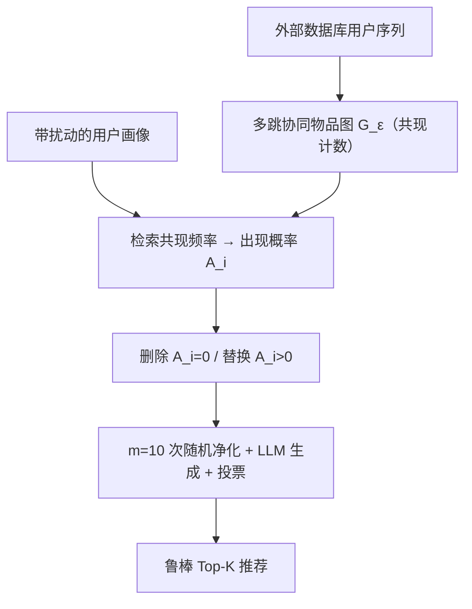

# Retrieval-Augmented Purifier for Robust LLM-Empowered Recommendation (检索增强净化器：面向鲁棒 LLM 推荐的推理期去扰框架)

- **会议/期刊**: TOIS 2026（arXiv 预印本 2025-04）
- **作者与机构**: Liangbo Ning, Wenqi Fan*, Qing Li（香港理工大学）
- **推荐链路定位**: 精排/生成式推荐（LLM 推理阶段前置净化器，不触碰模型参数）
- **研究方向**: 去偏公平、可信隐私与工业架构 / LLM4Rec
- **论文原文**: [arXiv:2504.02458v1](https://arxiv.org/abs/2504.02458v1)
- **开源代码**: 暂未开源

## TL;DR (1分钟核心速览)

LLM 赋能的推荐系统（P5、TALLRec）对用户历史序列中被插入的极少量无关物品（点击诱饵/对抗扰动）极度脆弱，微小改动即可让 H@5 腰斩。本文提出无需训练的 RETURN：以外部数据库中用户共现构建多跳协同物品图，用共现出现概率定位可疑物品，再用“删除 + 替换”混合策略净化提示，并以随机净化 $m$ 次的投票集成输出。在 P5-Sequential 设定与三数据集上，ML1M 的 H@5 由 0.0646 回复至 0.1384（防御率 D-H@5 达 0.5023，为最强基线 RDE 的 2.7 倍），Taobao 上 H@5 由 0.0863 升至 0.1124，逼近无扰动上界 0.1420。

## Background & Motivation (背景与核心矛盾)

- **主流范式**: LLM4Rec 把用户历史（物品 ID 或标题）拼入自然语言提示，由 P5（ID 式）或 TALLRec（文本式）等生成推荐；鲁棒性研究则分“对抗训练”与“推理期免训练防御”两派。
- **前人局限**: ① 现有防御（PD 困惑度过滤、RPD 复述、RTD 重分词）是为自然语言设计的，而 LLM4Rec 的提示里是物品 ID / 标题，复述与重分词会直接破坏 ID 结构与协同语义，实验中 RTD 甚至把 H@5 打到 0.0093；② 传统去噪只在**训练集**上清洗，假设推理期用户画像干净，然而真实点击诱饵导致推理期画像天然带噪，微调重训 LLM 又代价过高。
- **核心洞察 (Key Insight)**: 单个扰动项与用户其余交互在“大众共现分布”上几乎不共现。因此物品间共现图可作为判定“该物品是否属于此人”的外部证据源；且共现统计本身即天然检索器，无需额外训练 retriever（直接用 one-hot 频率查表）。
- **本文切入点**: 把去噪从“训练集净化 + 改参数”搬到“推理期提示净化 + 只查表”，用外部协同图做即插即用的前置净化器。

## Method (核心方法设计)

### 1. 整体框架 (Overall Architecture)

RETURN 由三段构成：(a) **协同物品图生成**——把外部数据库（直接用训练集）中所有用户的历史序列转为多跳（$\epsilon$-hop）共现图，边权为两物品在序列中相隔$\epsilon$个位置的共现次数；(b) **检索增强扰动定位**——对当前用户画像中每个物品，检索其与画像内其他物品的归一化共现频率，聚合为出现概率$A_i$，越接近 0 越可疑；(c) **检索增强去噪 + 鲁棒集成**——概率为 0 的直接删除，低的则从图中检索最佳替代物品替换；因扰动个数未知，随机采样$n\sim\mathcal{N}(3.5,0.5)$净化$m=10$ 次生成 10 条净化提示，分别送入 LLM 后多数投票输出。全流程不更新任何 LLM 参数。

### 2. 关键设计拆解 (Key Designs)

1. **多跳共现图与出现概率定位（Perturbation Positioning）**：朴素共现计数忽略时序邻近性（手机与手机壳常相邻，手机与家具不应相邻）。本文按间隔 $\epsilon=|i-j|$分层建图并统计$C^\epsilon_{I_i,I_j}$，再计算
$o_{i,j}=\frac{R(I_i,I_j\mid G_\epsilon)}{\sum_{z}R(I_i,I_z\mid G_\epsilon)},\quad A_i=\sum_{j\neq i}o_{i,j}$直觉：正常物品的共现能量会分散到画像内多个同伴上，而孤立扰动项$A_i\approx 0$，形成天然的“离群分数”，无需阈值训练。

2. **删除 + 替换混合净化与检索式替换算子**：全部删除会让交互过短触发冷启动。故仅对 $A_i=0$执行删除，对$A_i>0$ 的疑似项执行检索替换：
$C_r(I_i\to\bar{I}_i\mid A_i)=\arg\max_{\bar{I}_i}\sum_{j\neq i}\frac{R(I_j\mid G_\epsilon)\cdot A_j}{\sum_z R(I_j,I_z\mid G_\epsilon)}$即以画像内“可信同伴”的共现强度与可信度$A_j$为权重，选出与整体画像最匹配的替代品$\bar{I}_i$，在净化噪声的同时保住画像长度。

3. **训练目标、负采样与推理效率**：完全免训练，无损失函数、无负采样；防御代价即 $m$ 次 LLM 前向 + 一次图计数（离线一次、可缓存）。实测单次推荐耗时 0.8599 s，与 PD(0.7314 s)、RDE(0.7222 s) 同量级，而防御收益高 2.6 倍；RD/LLMSI 等轻方法虽 <0.31 s，但几乎不防御。

## Experimental Setup & Evaluation Protocol (实验设置与评估协议)

- **数据集与预处理**: 三个真实数据集（ML1M 含评分；LastFM、Taobao 无评分，故 TALLRec 仅用 ML1M）。P5 沿用 Xu et al. 预处理，TALLRec 沿用 Bao et al. 划分。

| 数据集 | #Users | #Items | #Interactions | 稀疏度/密度 | 特征/场景说明 |
| :--- | :---: | :---: | :---: | :---: | :--- |
| ML1M | 6,040 | ~4,000 | 1,000,000 | 密度约 4.1% | 电影评分，含显式反馈 |
| LastFM | 未报告 | 未报告 | 未报告 | 高稀疏 | 音乐收听序列，无评分 |
| Taobao | 987,994 | 4,162,024 | 百万级记录 | 极稀疏 | 电商浏览/搜索/购买 |

- **数据划分与防穿越 (Splitting Strategy)**: 按 P5 / TALLRec 官方协议划分训练/测试集；**训练集直接充当外部数据库**构建共现图（不接触测试用户画像），并在测试集良性画像上注入攻击扰动做评估，无测试信息穿越。
- **排名评测协议 (Ranking Protocol)**: P5 用 Top-K $H@5/H@10/N@5/N@10$；攻击强度以衰减率$A\text{-}H@k$衡量，防御效果以相对降幅$D\text{-}H@k=\frac{\widehat{A\text{-}H@k}}{A\text{-}H@k}-1$衡量。TALLRec 用 AUC 与$D\text{-}A$。
- **对比基线与超参设置**: 7 个基线 RD / PD / RPD / RTD / LLMSI / ICL / RDE；攻击者为 evasion 型 CheatAgent，扰动幅度 $\Delta=3$；受害者 P5（Sequential 与 Random 两种 ID 索引）与 TALLRec；RETURN 默认$m=10$，$n\sim\mathcal{N}(3.5,0.5)$，随机种子固定。

## Key Experimental Results (实验关键数据)

### 1. 主实验对比 (Main Results)

P5（Sequential 索引）下各方法的 H@5 与防御率 D-H@5（括号内）：

| 方法 | ML1M | LastFM | Taobao | 平均 D-H@5 |
| :--- | :---: | :---: | :---: | :---: |
| Benign（无攻击上界） | 0.2116 | 0.0404 | 0.1420 | / |
| CheatAgent（攻击下） | 0.0646 | 0.0138 | 0.0863 | 0.0000 |
| RD | 0.0969 (0.2196) | 0.0220 (0.3103) | 0.0886 (0.0412) | 0.1904 |
| PD | 0.1303 (0.4471) | 0.0183 (0.1724) | 0.0935 (0.1294) | 0.2496 |
| RPD | 0.0627 (-0.0124) | 0.0183 (0.1724) | 0.0811 (-0.0941) | 0.0220 |
| RTD | 0.0093 (-0.3761) | 0.0046 (-0.3448) | 0.0016 (-1.5206) | -0.7472 |
| LLMSI | 0.0624 (-0.0146) | 0.0119 (-0.0690) | 0.0867 (0.0059) | -0.0259 |
| ICL | 0.0546 (-0.0676) | 0.0174 (0.1379) | 0.0557 (-0.5500) | -0.1599 |
| RDE | 0.0924 (0.1892) | 0.0220 (0.3103) | 0.0855 (-0.0147) | 0.1616 |
| **RETURN** | **0.1384 (0.5023)** | **0.0266 (0.4828)** | **0.1124 (0.4676)** | **0.4842** |

TALLRec（文本式，AUC）与 P5-Random 索引下结论一致：RETURN 的 D-A / D-H@5 均为最优，说明该方法与 ID/文本两种提示范式解耦。

### 2. 消融实验 (Ablation Study)

| 变体 | ML1M H@5 | ML1M D-H@5 | LastFM H@5 | Taobao H@5 | 说明 |
| :--- | :---: | :---: | :---: | :---: | :--- |
| CheatAgent（无防御） | 0.0646 | 0.0000 | 0.0138 | 0.0863 | 攻击下界 |
| **RETURN 完整** | **0.1384** | **0.5023** | **0.0266** | **0.1124** | 全组件 |
| w/o 真实协同图 (ROP→随机图) | 0.0747 | 0.0687 | 0.0165 | 0.1008 | 崩掉 86% 防御率 |
| w/o 替换 (RR→全删除) | 0.1093 | 0.3041 | 0.0248 | 0.1122 | 画像过稀 |
| w/o 集成 (固定净化数) | 0.1185 | 0.3671 | 0.0248 | 0.1006 | 净化强度失配 |

### 3. 关键实验发现 (Key Findings)

1. **外部协同图是唯一不可替代的支柱**：把真实共现图换成随机图后，ML1M 的 D-H@5 从 0.5023 崩至 0.0687（−86%），几乎退回“无防御”水平；而替换模块与集成模块各自只贡献 0.14–0.20 的防御率。这说明性能来源是“共现分布的先验正确性”，而非净化算子本身的花哨程度。
2. **混合净化优于纯删除，且对良性用户温和**：RR（只删不换）在 ML1M 上损失 0.0291 H@5；完整 RETURN 与良性推荐结果的 Jaccard 相似度 0.7605、共同物品比例 87.06%、Shannon 熵 9.8292 vs 9.8616，说明净化未明显牺牲推荐多样性与个性化主体。
3. **抗噪稳健但对“数据量”敏感**：向外部库注入 15%/30% 扰动（RETURN-A-k）时防御率反而略升至 0.586，因归一化后的共现分布漂移有限；但删掉 15%/30% 交互（RETURN-D-k）时 D-H@5 跌至 0.1034，即**噪声可容忍、信号缺失不可容忍**。同时 $m\in[5,25]$ 与正态分布参数波动带来的性能起伏均在合理区间。

## Highlights & Limitations (亮点、对比与审稿批判)

- **与代表作对比 (vs. Prior Work)**: 与 PD/RPD/RTD 等“通用 LLM 文本防御”相比，RETURN 首次承认 LLM4Rec 提示中的物品 ID/标题是**领域专有 token**，通用复述会破坏语义，改用结构化协同图作为证据源；与 RDE 相比，同为“多次净化 + 投票”，但 RDE 的无差别随机删除在 Taobao 上防御率为 −0.0147，而 RETURN 以**定位驱动**的净化把同一集成框架的收益提升一个数量级；与传统训练期去噪（GraphRfi、LoRec）相比，RETURN 不改参数、可与之叠加使用。
- **可迁移亮点**: ① 用“$\epsilon$-hop 分层共现计数 + 归一化出现概率”当作零训练离群打分器，可直接迁移到序列推荐样本清洗、会话内异常 item 剔除、长尾 item 归因；② “随机强度多次净化 + 投票”这一测试期增广范式，可复用于任何对提示扰动的 LLM 下游任务。
- **审稿级局限批判**: ① **推理成本未真正解决**：单次推荐需 $m=10$次 LLM 前向，虽文中称 0.86 s 与 RDE 可比，但相对无防御设置仍是 10 倍级放大，工业在线场景难以接受；② **良性用户性能确有下滑**：表 6 显示 ML1M 从 0.2116 降至 0.1675（−21%），与正文“几乎没影响”的表述不符，说明概率阈值$A_i=0$ 对稀疏画像存在误杀；③ 仅评估 CheatAgent 等 evasion 攻击，未覆盖投毒（poisoning）与自适应攻击者 —— 若攻击者把扰动项也做成高共现物品（如热门配件），概率定位将失效；④ 外部库质量依赖强，缺失 30% 数据即防御率掉至 0.16，冷启动平台难以满足。

## Rating (四维评分)

- **方法创新性 (Novelty)**: ⭐⭐⭐⭐ （把多跳共现图当作免训练 retriever + 离群打分器定位提示扰动，思路干净；但“检索共现频率做去噪”与经典 item-CF 平滑同源，理论上限讨论略浅）
- **评估协议与实验扎实度 (Protocol & Experiments)**: ⭐⭐⭐⭐ （三数据集 × 两受害者模型 × 两索引策略 × 7 基线，含攻击强度、外部库噪声、参数敏感性、推理时延与个性化保真度分析，覆盖面优秀；缺显著性检验）
- **写作与数学规范度 (Clarity & Rigor)**: ⭐⭐⭐⭐ （公式链条短而自洽，算法伪代码完整；但符号 $R(\cdot\mid G_\epsilon)$与$\mathcal{I}$ 大小写混用，且良性子集结论与表格数字存在口径张力）
- **工业落地与复现价值 (Industrial & Practical Value)**: ⭐⭐⭐ （即插即用、无需重训、共现图可离线预计算，工程友好；但 $m=10$ 次 LLM 调用与未开源代码拖累了直接落地）

