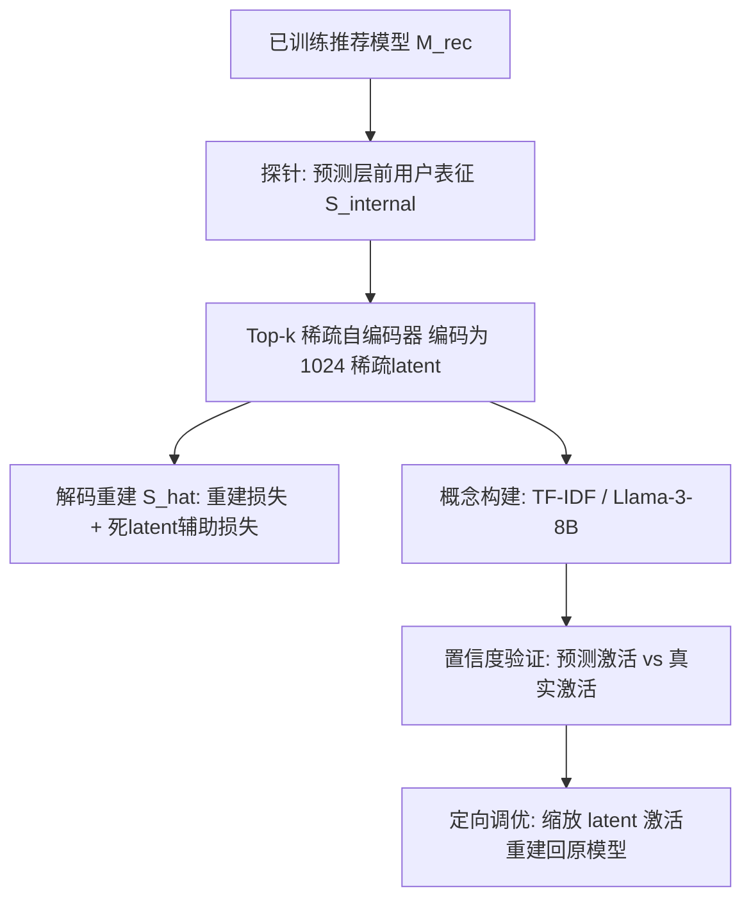

# Understanding Internal Representations of Recommendation Models with Sparse Autoencoders (基于稀疏自编码器理解推荐模型内部表征)

- **会议/期刊**: TOIS 2026
- **作者与机构**: Jiayin Wang, Xiaoyu Zhang, Weizhi Ma, Zhiqiang Guo, Min Zhang（清华大学、泉城实验室）
- **推荐链路定位**: 端到端解释与重排/定向调优（不介入线上召回-精排推理主链路，可插拔探针）
- **研究方向**: 去偏公平与可信工业架构（可解释推荐 / 模型级透明性）
- **论文原文**: [https://arxiv.org/abs/2411.06112v3](https://arxiv.org/abs/2411.06112v3)
- **开源代码**: [https://github.com/Alice1998/RecSAE](https://github.com/Alice1998/RecSAE)

## TL;DR (1分钟核心速览)

针对深度推荐模型内部“黑箱”表征不可解释、且现有方法绑定特定架构或需联合训练破坏性能的痛点，本文提出可插拔探针框架 RecSAE：在预测层前的用户表征处挂载大规模稀疏自编码器（Top-k 激活 + 死 latent 辅助损失），将多语义稠密表征分解为单语义 latent，再用 TF-IDF 与 Llama-3-8B 自动生成概念并给出置信度。在 4 数据集 × 4 模型上，重建 NDCG 损失普遍 <5%，概念 intra-similarity 最高 +215%、inter-similarity 降幅最高 -59.5%，人评相关性 3.89/4，并支持通过缩放 latent 激活实现定向调优。

## Background & Motivation (背景与核心矛盾)

- **主流范式**: 推荐透明性分两类——结果级解释（LLM 增强、解释蒸馏、RL 生成推荐理由）与模型级解释（路径推理、注意力、反事实、聚类），后者旨在揭示模型内部决策机理。
- **前人局限**: (1) 绝大多数模型级方法仅适配特定架构（路径法限图/树、注意力法限 Transformer 序列模型），难以跨 BPRMF/LightGCN/SASRec 通用；(2) 少数通用方法各有硬伤——蒸馏法需与可解释模型联合训练，聚类法牺牲多样性且需多模型集成补偿。
- **核心洞察 (Key Insight)**: SAE 能把大模型中多语义稠密激活拆解为单语义稀疏"神经元"，而推荐交互天然稀疏、用户兴趣是概念级而非 item 级——恰好超声稀疏 SAE 的强项，可将协同信号解耦为人类可读概念。
- **本文切入点**: 构造不改动原模型、训练后即可探测、且能反作用于模型的通用探针框架；这是首个覆盖 general/graph/sequential 三类推荐模型且支持定向调优的模型级解释范式（见表1对比）。

## Method (核心方法设计)

### 1. 整体框架 (Overall Architecture)

RecSAE 分三步闭环：**探测**——在已训练模型 $M_{rec}$的预测层前（用户-物品相似度计算处）截取用户兴趣表征$S_{internal}$；**训练**——用大维度（scale=16，共 1024 latent）+ Top-k 稀疏约束的自编码器重建该表征，提取稀疏 latent$S_{latent}$；**构建与验证**——联合“输入交互、latent 激活、Top-1 推荐输出”三源，用 TF-IDF（词级）与 Llama-3-8B（语义级）生成概念，再以新样本上的激活预测计算置信度。最后通过缩放 latent 激活后重建回原模型，实现定向调优。

### 2. 关键设计拆解 (Key Designs)

1. **Top-k 稀疏编码 + 死 latent 辅助损失（保证单语义与空间利用率）**：常规 L1 只是 L0 的近似，会一致性地把正激活压缩向零、引入偏置。RecSAE 改在前端显式 Top-k：编码 $\;S_{latent}=\mathrm{Top\text{-}k}\!\big(W_{enc}(S_{internal}-b_{pre})\big)\;$，解码$\hat{S}_{internal}=W_{dec}S_{latent}+b_{pre}$。这避免了正则权重按模型类型反复调参，稳定控制稀疏度。Top-k 带来副作用：未被激活的 “死 latent” 收不到重建梯度，故引入辅助损失让死 latent 也参与重建误差拟合：
$$\mathcal{L}=\|\!S_{internal}-\hat{S}_{internal}\!\|_2^2+\alpha\|e-\hat{e}\|_2^2,\quad \hat{e}=W_{dec}\mathrm{Top\text{-}k}_{aux}(W_{enc}(S_{internal}-b_{pre}))$$
   由于编码器共享，额外开销极低——这正是隐空间被充分利用、概念覆盖更全的关键。

2. **三源闭环概念构建与置信度验证（把 latent 变成可读概念）**：仅靠 latent 本身无法命名语义。RecSAE 将每个 latent 的连续激活划为 11 档（0–10 等频分桶），对每个 latent 取激活最高的 2N 个案，N 个用于构建概念、N 个用于验证，另取 N 个未激活负例。构建时，TF-IDF 用项元数据精确匹配取最高分词，LLM 则基于“历史交互+预测项+激活档位”序列生成一句描述。验证时用概念反推新样本激活档位，命中/未命中计入置信度：
$$\text{Precision}_{concept}=\frac{\sum_{p\in pos}\mathbb{I}[\mathrm{level}(p)>thres]+\sum_{n\in neg}\mathbb{I}[\mathrm{level}(n)\le thres]}{|pos|+|neg|}$$
   “正例必激活、负例必不激活”的双向判别使置信度既必要又充分，避免此前只要出现就算命中的宽松口径。

3. **训练/调优开销**：SAE 完全在离线用户表征上无监督训练，重建损失 + 辅助损失，无需负采样（不碰原推荐目标）。推理期只需一次前向 SAE 重建，作为独立探针，不改动线上主链路；调优模式才将重建表征替换回原模型，通过将单 latent 激活从 $-10\times$到$+10\times$ 缩放即可改变输出概念分布。

## Experimental Setup & Evaluation Protocol (实验设置与评估协议)

- **数据集与预处理**（均沿用 ReChorus 内置设置，`5-core` 过滤）：

| 数据集 | #Users | #Items | #Interactions | 正反馈定义 |
| :--- | :---: | :---: | :---: | :--- |
| Amazon (Grocery) | 14,681 | 8,713 | 151,254 | 有评论即正 |
| MovieLens 1M | 6,032 | 3,125 | 574,197 | 评分 ≥4 |
| LastFM | 8,031 | 27,065 | 256,699 | 有收听记录 |
| Yelp | 180,156 | 79,601 | 2,559,541 | 评分 ≥4 |

- **数据划分与防穿越**: `Leave-One-Out`（留一法，train/valid/test）。解释用训练集构图、留出测试集作验证，避免概念构建数据泄漏。
- **排名评测协议**: `Full-Ranking (test-all 全库未交互排序)`，无负采样，指标 HR@10/20、NDCG@10/20；解释质量用 intra/inter-concept cosine similarity、置信度过滤后的概念计数（$P\ge0.8$）、人评相关性。
- **对比基线与超参**: 基线为原模型内部表征（Base）+ 标准自编码器（AE，同 8 激活）；被解释模型 BPRMF/LightGCN/SASRec/TiMiRec，嵌入维度 64，SAE scale=16（1024 latent）、k=8，lr/bs 网格搜索。

## Key Experimental Results (实验关键数据)

### 1. 主实验对比 (Main Results)

解释质量（intra 越高质量越好，inter 越低越好，Base 即原表征）：

| 模型 | 数据集 | Base Intra↑ / Inter↓ | RecSAE Intra↑ / Inter↓ | Impr. Intra | Impr. Inter |
| :--- | :--- | :---: | :---: | :---: | :---: |
| BPRMF | Amazon | 0.1764 / 0.2363 | **0.3056 / 0.1663** | +73.30% | -29.65% |
| BPRMF | MovieLens | 0.1804 / 0.4740 | **0.3795 / 0.2998** | +110.33% | -36.75% |
| LightGCN | Amazon | 0.2161 / 0.2463 | **0.4540 / 0.1496** | +110.03% | -39.23% |
| LightGCN | LastFM | 0.1818 / 0.1565 | **0.4672 / 0.1365** | +156.95% | -12.79% |
| SASRec | Amazon | 0.3777 / 0.1808 | **0.7147 / 0.1587** | +89.21% | -12.20% |
| SASRec | Yelp | 0.1853 / 0.1263 | **0.5836 / 0.1307** | +215.00% | +3.53% |
| TiMiRec | Amazon | 0.3418 / 0.1405 | **0.6288 / 0.1366** | +83.96% | -2.77% |

覆盖度（Table 6）：SASRec 概念命中 MovieLens 89% 类型、LastFM 20% 标签；BPRMF 仅 15%/11%——强模型解释概念更丰富。

### 2. 消融实验 (Ablation Study)

重建性能（替换原表征后 NDCG@10，AE=同 8 激活的标准自编码器）：

| 模型 | 数据集 | Base | AE | RecSAE |
| :--- | :--- | :---: | :---: | :---: |
| BPRMF | Amazon | 0.0200 | 0.0157 | **0.0192** |
| BPRMF | LastFM | 0.0702 | 0.0129 | **0.0544** |
| LightGCN | MovieLens | 0.0373 | 0.0320 | **0.0373** |
| SASRec | MovieLens | 0.1049 | 0.0441 | **0.0973** |
| SASRec | LastFM | 0.1579 | 0.0111 | **0.1207** |

敏感性（Fig.7/8）：scale=16 重建最优，偏离即退化；k↑ 提升重建但概念置信度下降，k=8 为平衡点。

### 3. 关键实验发现 (Key Findings)

1. **稀疏分解显著拉高单语义性**：BPRMF/Amazon intra 0.1764→0.3056（+73.3%）、inter 0.2363→0.1663（-29.7%），同类项聚拢、异类分离，证明“单义 latent”假设在实际协同表征中成立。
2. **Top-k 稀疏优于普通 AE 且近乎无损**：同激活数下 AE 在 LastFM/MovieLens 重建崩塌（0.0129/0.0441），RecSAE 保持 0.0544/0.0973，SASRec 主实验仅损失 ~3–5% NDCG——稀疏约束反而更好地保留关键信息，兼顾解释与保真。
3. **定向调优精确且单调**：将单 latent 激活缩放 $-10\times\!\sim\!+10\times$，相关概念 presence ratio 随激活单调升降、均值波动 >10%，而其他概念变化 <0.5%，证明“latent↔概念”因果可控、且不污染无关语义。

## Highlights & Limitations (亮点、对比与审稿批判)

- **与代表作对比 (vs. Prior Work)**: 相较路径法/注意力法（绑定架构）、Zhang'20 蒸馏（需联合训练）、Du'23 聚类（需集成、损性能），RecSAE 是首个跨 general/graph/sequential 通用、不改性能、支持定向调优的探针框架；相较 SLIM/EASE 这类同为 SAE 结构的“独立推荐模型”，RecSAE 定位于模型级解释与调优而非提升精度。
- **可迁移亮点**: (1) Top-k + 死 latent 辅助损失可复用于任何需要单语义解耦的表征（多兴趣、跨域对齐）；(2) “激活缩放重建回写”提供了一条无需重训即可做概念级干预/去偏的轻量通道。
- **审稿级局限批判**: (1) 仅在预测层前单一探针位验证，未探索残差流/多探针；概念构建高度依赖数据集提供的元数据质量，Amazon 因类别单一无法量化覆盖；(2) 调优需将重建表征回写原模型，若原模型对表征偏移敏感，精度与稳定性的线上代价未量化，缺乏与生成式/排序级干预的端到端对比。

## Rating (四维评分)

- **方法创新性 (Novelty)**: ⭐⭐⭐⭐ （首次把 SAE 单语义解耦系统迁移到推荐模型级解释，Top-k+死 latent+激活回写调优构成新颖闭环，理论深度中等）
- **评估协议与实验扎实度 (Protocol & Experiments)**: ⭐⭐⭐⭐ （4 数据集×4 模型、Full-Ranking、人工评估+Cohen/Fleiss kappa、AE 消融与敏感性完整，句义与细粒度剖析稍欠）
- **写作与数学规范度 (Clarity & Rigor)**: ⭐⭐⭐⭐ （Top-k/辅助损失/置信度公式定义清晰，表格排版略显拥挤，复杂度分析缺显式）
- **工业落地与复现价值 (Industrial & Practical Value)**: ⭐⭐⭐⭐ （开源、ReChorus 基础、探针离线不扰主链路、支持概念级去偏与定向调优，线上回写成本待评估）

