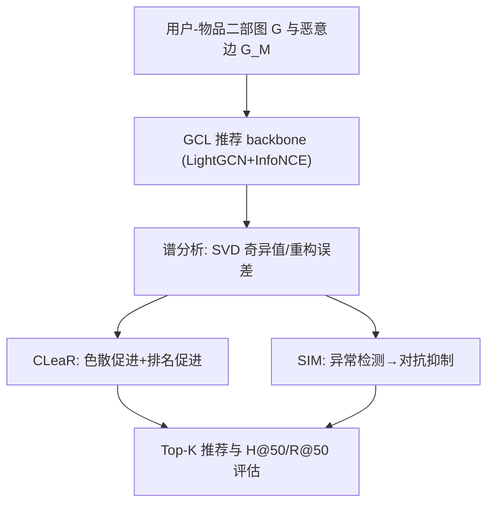

# When Graph Contrastive Learning Backfires: Spectral Vulnerability and Defense in Recommendation (图对比学习反噬：推荐中的谱脆弱性与防御)

- **会议/期刊**: TOIS 2026（arXiv:2507.07436v1）
- **作者与机构**: Zongwei Wang, Min Gao, Junliang Yu, Shazia Sadiq, Hongzhi Yin, Ling Liu；重庆大学、昆士兰大学、佐治亚理工学院
- **推荐链路定位**: 召回/训练阶段（图推荐表征学习）
- **研究方向**: 去偏公平、可信隐私与工业架构 / 自监督对比学习与交互去噪
- **论文原文**: [论文原文链接](https://arxiv.org/abs/2507.07436v1)
- **开源代码**: 暂未开源

## TL;DR (1分钟核心速览)

本文揭示图对比学习（GCL）的 InfoNCE 会平滑奇异值谱、扩散嵌入，反而放大定向推广攻击风险；提出双层优化攻击 CLeaR 与谱不规则性防御 SIM。在 DouBan/Epinions/Gowalla 的 7:1:2 切分与 Top-50 评估下，CLeaR 较最强攻击基线 H@50 提升 4.0%–22.7%，SIM 在保持 Recall 的同时将 H@50 最多降至 0。

## Background & Motivation (背景与核心矛盾)

- **主流范式**: GCL 以 InfoNCE 增强图推荐鲁棒性，SGL/XSimGCL/RecDCL 等通过节点/边/嵌入扰动构造视图提升泛化。
- **前人局限**: 现有鲁棒性评估多只看全局 Recall@K，忽视单物品定向推广；且 GCL 缓解流行度偏置时把冷门物品推向用户邻域，给攻击者可乘之机。
- **核心洞察 (Key Insight)**: 作者从 SVD 谱分析发现，GCL 优化等价于压低最大奇异值乘积、抬升奇异值总和，导致谱平滑与嵌入扩散，目标冷门物品更易进入 Top-K。
- **本文切入点**: 先用 CLeaR 系统放大谱平滑以量化脆弱性，再用 SIM 检测并抑制目标物品的谱异常。

## Method (核心方法设计)

### 1. 整体框架 (Overall Architecture)

输入用户-物品二部图与注入的恶意边；LightGCN+GCL 训练得到嵌入；对嵌入矩阵做 SVD/重构误差分析；CLeaR 在攻击侧联合“色散促进+排名促进”生成恶意交互；SIM 在防御侧先检测谱异常物品，再用抑制损失拉开目标物品与其高相似用户。训练仍以 BPR+InfoNCE 为主，防御额外加正则；推理阶段不改变 Top-K 打分流程。

### 2. 关键设计拆解 (Key Designs)

1. **谱脆弱性命题（解释 GCL 为何更易被推广攻击）**：InfoNCE 的脆弱性此前缺理论解释。作者推出上界 $\mathcal{L}_{gcl}<N\max_j\sigma'_j\sigma''_j-\sum_i\sigma'_i\sigma''_i+N\log N$，最小化它即压低最大奇异值乘积、抬高谱和，使方差从少数主方向摊到更多维度，嵌入更各向同性；冷门目标因此靠近更多用户，暴露风险上升。
2. **CLeaR 双层攻击（主动放大谱平滑+抬排名）**：内层训练推荐模型，外层优化 $\mathcal{L}_{attack}=\mathcal{L}_D+\alpha\mathcal{L}_R$。色散项用 rank-1 近似避免显式 SVD：$\mathcal{L}_D=-\|\mathbf{Z}\mathbf{V}^{\prime}\mathbf{V}^{\prime\top}\|/\|\mathbf{V}^{\prime}\|_2^2$；排名项用 CW 损失$\mathcal{L}_R=\sum_{u,t}g(z_u^\top z_t-\min_{i\in I^{rec}_u\setminus I_T}z_u^\top z_i)$，$g(x)=x$若$x\ge0$，否则$e^x-1$。最后按嵌入近邻贪心注入恶意边。
3. **SIM 两阶段防御（检测+抑制，不牺牲 GCL 平滑性）**：对物品嵌入做 rank-$k$SVD，重构误差$\epsilon_i=\|z_i-\mathbf{L}_{\mathrm{top}k}\Sigma_{\mathrm{top}k}\mathbf{R}_{\mathrm{top}k}^{\top}\|_2$；以$T=\{i|\epsilon_i\ge\mu+\gamma s\}$自适应标记异常。抑制损失$\mathcal{L}_{mit}=\frac{1}{|T|m}\sum_{i\in T}\sum_{u\in Top-m(i)}\frac{z_i^\top z_u}{\|z_i\|\|z_u\|}$惩罚目标物品与最相似用户的过度余弦相似；总损失$\mathcal{L}=\mathcal{L}_{rec}+\omega\mathcal{L}_{gcl}+\lambda_{mit}\mathcal{L}_{mit}$。SVD 按 epoch 执行，推理无额外开销；BPR 采样未交互负例，未用硬负采样。

## Experimental Setup & Evaluation Protocol (实验设置与评估协议)

- **数据集与预处理**:

| 数据集 | #Users | #Items | #Interactions | 密度 | 特征/场景说明 |
| :--- | :---: | :---: | :---: | :---: | :--- |
| DouBan | 2,831 | 36,821 | 805,611 | 0.772% | 电影评分，较稠密 |
| Epinions | 46,846 | 40,706 | 305,249 | 0.016% | 商品评论，极稀疏 |
| Gowalla | 18,737 | 32,495 | 566,791 | 0.093% | 地理位置签到 |

- **数据划分与防穿越**: 7:1:2 随机划分；毒化扰动仅注入训练集；5 次独立运行取均值。
- **排名评测协议**: Top-50 排序评估，指标为 Recall@50 与 HitRatio@50；原文未说明采样负例比例，按全库打分理解，非显式 Full-Ranking 声明。
- **对比基线与超参**: LightGCN+SSL4Rec/SGL/XSimGCL/RecDCL；攻击基线 RandomAttack/AUSH/GOAT/AutoAttack/UBA；防御基线 GraphRfi/BOD/DCF。嵌入 $d=128$、3 层 LightGCN、lr=$10^{-3}$、batch=512；目标物品取交互数后 80% 的冷门物品 10 个；恶意用户占 1%，每用户交互数不超过真实均值；白盒代理模型设定。原文未报告显著性检验。

## Key Experimental Results (实验关键数据)

### 1. 主实验对比 (Main Results)

**攻击效果（XSimGCL，H@50×$10^{-2}$）**：

| 攻击方法 | DouBan | Epinions | Gowalla |
| :--- | :---: | :---: | :---: |
| RandomAttack | 0.2598 | 1.3361 | 0.1126 |
| AUSH | 0.2785 | 0.4693 | 0.0983 |
| GOAT | 0.2457 | 1.0457 | 0.1121 |
| AutoAttack | 0.2934 | 1.1289 | 0.1239 |
| UBA | 0.2786 | 1.2384 | 0.1412 |
| **CLeaR** | **0.3589** | **1.6395** | **0.1469** |

CLeaR 较各数据集最强基线分别提升 **22.3%/22.7%/4.0%**，说明谱平滑是可利用的攻击面。

**防御效果（CLeaR 攻击下，XSimGCL）**：

| 方法 | DouBan R@50 | H@50 | Epinions R@50 | H@50 | Gowalla R@50 | H@50 |
| :--- | :---: | :---: | :---: | :---: | :---: | :---: |
| Normal | 0.1468 | 0.3589 | 0.2392 | 1.6395 | 0.1884 | 0.1469 |
| GraphRfi | 0.1448 | 0.0318 | 0.2399 | 1.4793 | 0.1899 | 0.0495 |
| BOD | 0.1439 | 0.2804 | **0.2445** | 1.6194 | 0.1902 | 0.1255 |
| DCF | 0.1458 | 0.2206 | 0.2438 | 1.5827 | 0.1923 | 0.1261 |
| **SIM** | **0.1489** | **0.0000** | 0.2410 | **1.4395** | **0.1937** | **0.0296** |

SIM 将 H@50 降低 **100%/12.2%/79.8%**，Recall 相对 Normal 为 **+1.4%/+0.8%/+2.8%**。

### 2. 消融实验 (Ablation Study)

| 变体 | DouBan R/H | Epinions R/H | Gowalla R/H |
| :--- | :---: | :---: | :---: |
| SIM w/o AS | 0.1289/0.0 | 0.2258/0.0 | 0.1746/0.0 |
| SIM w/o AD | 0.1483/0.3315 | 0.2402/1.5294 | 0.1924/0.1345 |
| **SIM** | **0.1489/0.0** | **0.2410/1.4395** | **0.1937/0.0296** |

### 3. 关键实验发现 (Key Findings)

- CLeaR 在 DouBan/Epinions/Gowalla 上把 H@50 推到 0.3589/1.6395/0.1469，优于最强攻击基线 22.3%/22.7%/4.0%；Gowalla 增益较小，与其地理签到分布更分散、谱聚集弱有关。
- SIM 在稠密 DouBan 上把 H@50 直接压到 0，Gowalla 降 79.8%，但 Epinions 仅降 12.2%；极稀疏数据中“拉开目标物品与 top 用户”会误伤稀有真实关联，防御收益受限。
- 消融显示：仅检测不抑制（w/o AS）虽 H=0，但 Recall 在 DouBan/Epinions/Gowalla 降至 0.1289/0.2258/0.1746；仅抑制不检测（w/o AD）H 仍高。检测定位与抑制拉开缺一不可。参数上 $\gamma$过大漏检目标，$\lambda_{mit}<0.2$ 时 Recall 较稳。

## Highlights & Limitations (亮点、对比与审稿批判)

- **与代表作对比 (vs. Prior Work)**: RandomAttack/GOAT/UBA 等攻击依赖启发式、GAN 或资源分配，未建模谱结构；CLeaR 首次把 SVD 谱平滑作为攻击目标。GraphRfi 做用户级欺诈检测但牺牲 Recall；BOD/DCF 做通用去噪，对定向推广抑制有限；SIM 做物品级谱异常检测+抑制，兼顾 H@50 与 R@50。
- **可迁移亮点**: 用低秩重构误差做物品异常分，可迁移到虚假评论/刷单检测；用 top-$m$ 高相似用户做“拉开”正则，可迁移到冷门物品曝光治理。
- **审稿级局限批判**: 攻击依赖白盒/代理模型假设；SIM 每 epoch 做 rank-$k$ SVD 且有候选集固定策略，工业级大规模图上有开销；Epinions 极稀疏场景收益有限，且仅三个数据集、无线上 A/B 与显著性检验，代码未开源。

## Rating (四维评分)

- **方法创新性 (Novelty)**: ⭐⭐⭐⭐☆ （从 InfoNCE 上界推出谱平滑，再用 CLeaR/SIM 形成“攻击-防御”闭环，视角新颖）
- **评估协议与实验扎实度 (Protocol & Experiments)**: ⭐⭐⭐☆☆ （三数据集、5 次均值、攻击/防御/消融齐全，但未报告显著性检验，Top-50 是否全库排序表述不清）
- **写作与数学规范度 (Clarity & Rigor)**: ⭐⭐⭐⭐☆ （命题与证明清晰，公式链条完整；部分实验设置与攻击细节放在前作，需跳读）
- **工业落地与复现价值 (Industrial & Practical Value)**: ⭐⭐⭐☆☆ （防御可作训练期正则，推理零开销；但 SVD 开销与无开源代码限制复现部署）

