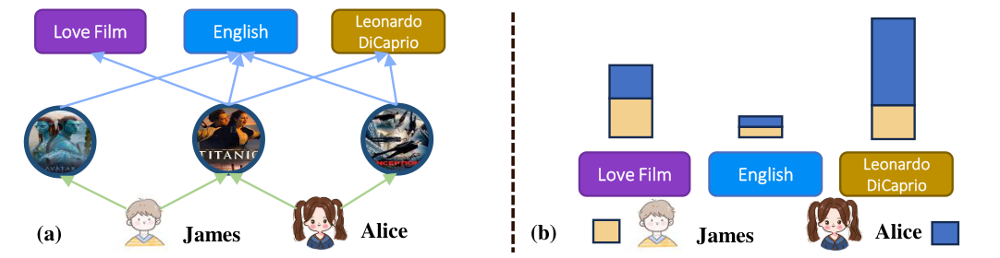
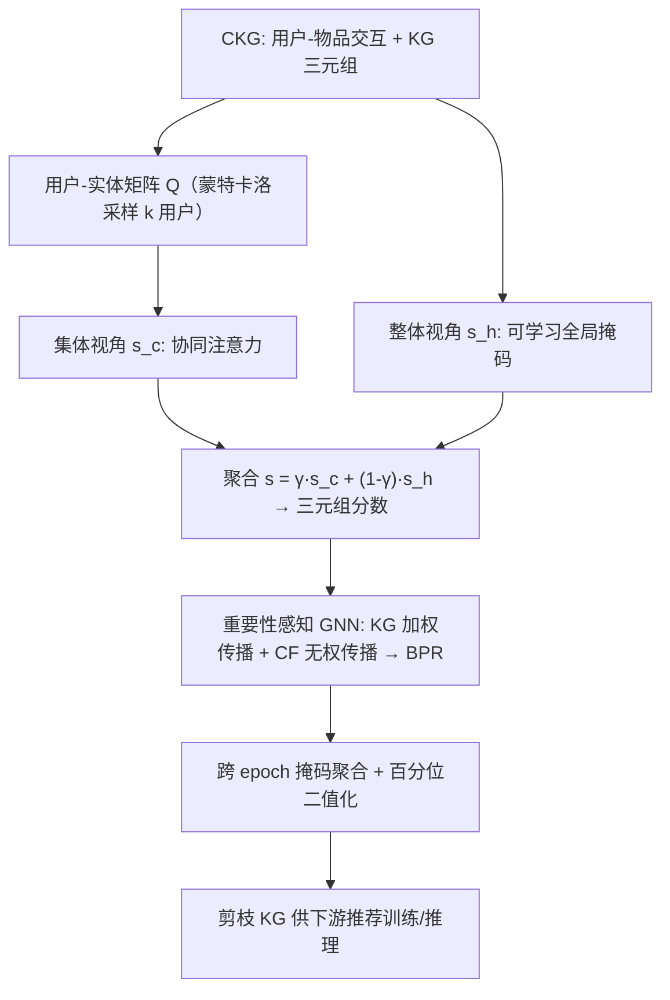
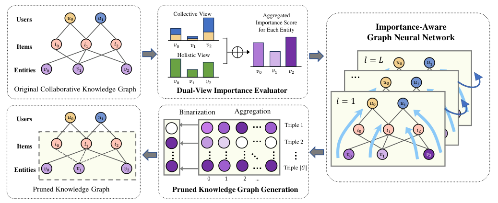

# Knowledge Graph Pruning for Recommendation (面向推荐系统的知识图谱剪枝)

- **会议/期刊**: TOIS 2026
- **作者与机构**: Fake Lin, Xi Zhu, Ziwei Zhao, Deqiang Huang, Tong Xu, Enhong Chen 等（中国科学技术大学）；Yu Yu, Xueying Li（阿里巴巴）
- **推荐链路定位**: 召回（KG 增强表征学习的前置数据治理层）
- **研究方向**: 图神经网络与知识图谱推荐 / 工业效率与数据治理
- **论文原文**: [https://arxiv.org/abs/2405.11531v2](https://arxiv.org/abs/2405.11531v2)
- **开源代码**: 论文未提供专属仓库，实验基于 [KGIN 官方仓库](https://github.com/huangtinglin/Knowledge_Graph_based_Intent_Network) 复现

## TL;DR (1分钟核心速览)

KG 增强推荐（KGRS）受"知识爆炸"拖累：递归邻居聚合代价高昂，而大量三元组对用户偏好刻画毫无增益甚至反噬精度。KGTrimmer 首次把"面向推荐的 KG 剪枝（KGPR）"形式化为三元组掩码学习：集体视角用协同信号聚合"多少用户真正关注该实体"，整体视角用可学习全局掩码捕捉固有属性与总体流行度，二者加权后注入消息传递并约束信息流。在 KGIN/KGRec 双骨干、三数据集 `Full-Ranking` 协议下，Amazon-book 剪除 98% 三元组时 Recall@10 相对最强剪枝基线提升 29.1%，90% 剪枝下训练提速 12.2×。

## Background & Motivation (背景与核心矛盾)

- **主流范式**: KGRS 把用户、物品、KG 实体对齐进协同知识图谱（CKG），用 GNN 递归聚合邻居，以结构知识补充协同信号（KGAT/KGIN/KGRec）。
- **前人局限①**: 图剪枝/稀疏化（MoG、Crumb-Trail、UGS）只按度数、连通性或嵌入范数判重要性——高度节点如"English"连接所有电影却毫无区分度（图 1），剪枝目标与推荐任务脱钩。
- **前人局限②**: KG 摘要把邻居聚成超点（KGist 的 MDL 规则、聚类法），破坏节点作为现实符号抽象的语义与可解释性；错误检测类（CAGED）只识别"异常事实"，而高频却无用的节点恰恰被保留。
- **核心洞察**: "无用"必须由下游任务定义——仅当实体能聚集大量用户注意力、帮助区分偏好时才有价值；且少数无用节点消耗了多数算力（Amazon-book 中 7 个极低分实体贡献近半三元组）。
- **本文切入点**: 把剪枝写成"掩码学习 + 推荐信号反传"的端到端闭环，用协同过滤信号指导剪枝，而非事后按图结构裁剪。

<figure class="paper-figure" markdown="span">
  <figcaption>图1. 来自在线电影平台的动机示例，其中 (a) 展示真实世界的协同知识图谱，(b) 表示每个实体对用户建模的相应集体重要性。</figcaption>
</figure>

## Method (核心方法设计)

### 1. 整体框架 (Overall Architecture)

输入用户-物品交互与 KG 三元组，先由交互与 KG 拼接得到用户-实体可达矩阵 $Q$，并按蒙特卡洛策略采样$k$个用户近似实体总体受关注度；随后双视角评估器分别产出集体分数$s^c$与整体分数$s^h$，加权成实体级掩码$\hat{s}$并广播为三元组分数；重要性感知 GNN 在 KG 侧做掩码加权聚合、在 CF 侧做无权聚合，堆叠$L$ 层后内积打分、BPR 训练；训练中逐 epoch 收集掩码，聚合后按百分位二值化，输出剪枝 KG 供下游 KGRS 复用。

<figure class="paper-figure" markdown="span">
  <figcaption>图2. 所提出的 KGTrimmer 框架的整体结构，由三个组件组成：(a) 双视图重要性评估器，(b) 重要性感知图神经网络，(c) 剪枝知识图谱生成。</figcaption>
</figure>

### 2. 关键设计拆解 (Key Designs)

1. **集体视角：协同注意力打分**：痛点是不该由图的拓扑决定取舍。做法是把实体表征先按关系富化 $\boldsymbol{e}'_v=\frac{1}{|\mathcal{N}^R_v|}\sum_{r\in\mathcal{N}^R_v}\boldsymbol{e}_r\odot\boldsymbol{e}_v^0$，再对采样到的高关注用户求截断余弦：

$$s^c_v=\frac{1}{|\mathcal{N}^Q_v|}\sum_{u\in\mathcal{N}^Q_v}\max\!\left(0,\frac{{\boldsymbol{e}_u^0}^\top \boldsymbol{e}'_v}{\|\boldsymbol{e}_u^0\|\,\|\boldsymbol{e}'_v\|}\right)$$

截断负值使负相似（噪声/事实错误）实体自动得 0 并被优先剪除；Xavier 正交初始化保证各实体从同一分数起点出发，避免 min-max 归一化引入的先验偏置。

2. **整体视角与双视角聚合 + 重要性感知传播**：为覆盖"固有属性/总体流行度"这类与具体用户无关的价值，为每个实体配一个可学习标量 $s^h_v\in[0,1]$（不用 MLP：训练中嵌入持续漂移，MLP 难稳定拟合且参数/算力更贵）。聚合$\hat{s}=\gamma s^c+(1-\gamma)s^h$，三元组分数由尾实体继承$\hat{s}_{(h,r,t)}=\mathcal{T}(\hat{s}_h,\hat{s}_t)=\hat{s}_t$。KG 传播被掩码加权约束：

$$\boldsymbol{e}_v^{(l)}=\frac{1}{|\mathcal{N}^G_v|}\sum_{(r,t)\in\mathcal{N}^G_v}\hat{s}_{(v,r,t)}\left(\boldsymbol{e}_t^{(l-1)}\odot\boldsymbol{e}_r\right)$$

而 CF 侧 $\boldsymbol{e}_u^{(l)}=\frac{1}{|\mathcal{N}_u|}\sum_{i\in\mathcal{N}_u}\boldsymbol{e}_i^{(l-1)}$ 不设权（交互本身即有效信号），从而"过滤后的知识"只用于蒸馏协同信号。

3. **训练目标、负采样与推理效率**：逐层求和 $\boldsymbol{e}_u=\sum_l \boldsymbol{e}_u^{(l)}$、$\boldsymbol{e}_i=\sum_l \boldsymbol{e}_i^{(l)}$后内积打分，采用 BPR 损失$\mathcal{L}=\sum_{u}\sum_{i\in\mathcal{N}_u}\sum_{j\notin\mathcal{N}_u}\log\sigma(\boldsymbol{e}_u^\top\boldsymbol{e}_i-\boldsymbol{e}_u^\top\boldsymbol{e}_j)$，每正样本采$N_{neg}$个均匀负例，可训练参数仅$\{\boldsymbol{e}_u^0,\boldsymbol{e}_v^0,\boldsymbol{s}^h\}$。复杂度$O(k|V|d+L|Y|d+L|G|d)$，采样使集体打分项可忽略；剪枝后推理只走稀疏 KG，无需重训评估器。

## Experimental Setup & Evaluation Protocol (实验设置与评估协议)

- **数据集与预处理**: 采用 `10-core` 过滤（用户/物品至少 10 次交互），KG 侧剔除三元组数 <10 的实体与 <50 的关系；沿用 KGIN/KGAT 发布的处理后版本。

| 数据集 | #Users | #Items | #Interactions | #Entities | #Relations | #Triplets |
| :--- | :---: | :---: | :---: | :---: | :---: | :---: |
| Amazon-book | 70,679 | 24,915 | 847,733 | 88,572 | 39 | 2,557,746 |
| Last-FM | 23,566 | 48,123 | 3,034,796 | 58,266 | 9 | 464,567 |
| Alibaba-Fashion | 114,737 | 30,040 | 1,781,093 | 59,156 | 51 | 279,155 |

- **数据划分与防穿越**: 沿用 KGIN/KGAT 的固定训练-测试划分（每个用户留出最后一次交互作测试），未做全局时间戳切分，属于 `Leave-One-Out` 风格。
- **排名评测协议**: `Full-Ranking`（全库未交互物品排序），报告 Recall@{10,20} 与 NDCG@{10,20}；剪枝率通过百分位保留比例控制以便与基线公平对比。
- **对比基线与超参**: 骨干为 KGIN 与 KGRec；剪枝基线含统计式 Pop、KGRS-IMP（嵌入范数剪枝）、摘要式 KGist、错误检测 CAGED、图稀疏化 MoG、去噪推荐 KRDN。嵌入维度固定 $d=64$，Adam，batch 4096，学习率$\{1\text{e-}5,1\text{e-}4,1\text{e-}3\}$、正则$\{1\text{e-}6\sim1\text{e-}3\}$、层数$\{1,2,3\}$、dropout$0.1\sim0.7$，早停 100 epoch；每实体采样$k\in\{20,50,100,200\}$，网格搜索$\gamma$。

## Key Experimental Results (实验关键数据)

### 1. 主实验对比 (Main Results)

KGIN 骨干，各数据集代表性剪枝率下的全库排序结果（`Improv.` 相对最强剪枝基线）：

| 数据集(剪枝率) | 指标 | Pop | KGRS-IMP | CAGED | KGist | MoG | KRDN | KGTrimmer | Improv. |
| :--- | :--- | :---: | :---: | :---: | :---: | :---: | :---: | :---: | :---: |
| Amazon-book 90% | R@10 | 0.0844 | 0.1133 | 0.0736 | 0.0805 | 0.0796 | 0.0819 | **0.1155** | +1.9% |
| Amazon-book 90% | N@10 | 0.0544 | 0.0729 | 0.0467 | 0.0515 | 0.0506 | 0.0528 | **0.0741** | +1.6% |
| Amazon-book 98% | R@10 | 0.0847 | 0.0851 | 0.0833 | 0.0801 | 0.0824 | 0.0805 | **0.1099** | +29.1% |
| Amazon-book 98% | N@10 | 0.0541 | 0.0540 | 0.0527 | 0.0508 | 0.0526 | 0.0511 | **0.0703** | +30.0% |
| Last-FM 90% | R@10 | 0.0545 | 0.0573 | 0.0562 | 0.0561 | 0.0527 | 0.0553 | **0.0627** | +9.4% |
| Last-FM 90% | N@10 | 0.0607 | 0.0649 | 0.0638 | 0.0630 | 0.0603 | 0.0627 | **0.0720** | +10.9% |
| Alibaba-Fashion 70% | R@10 | 0.0725 | 0.0690 | 0.0604 | 0.0667 | 0.0596 | 0.0652 | **0.0761** | +5.0% |
| Alibaba-Fashion 70% | N@10 | 0.0548 | 0.0515 | 0.0452 | 0.0501 | 0.0442 | 0.0488 | **0.0582** | +6.2% |

KGRec 骨干结论同向：Amazon-book 98% 时 R@10 由最强基线 0.0847 升至 **0.1053**，Last-FM 90% 时 N@10 由 0.0691（CAGED）升至 **0.0764**；但 KGRec 因自带 mask 机制、更依赖 KG 质量，整体增益略小于 KGIN。

### 2. 消融实验 (Ablation Study)

KGIN 骨干，剪枝率 Amazon-book 98% / Last-FM 90% / Alibaba-Fashion 90%，Recall@20、NDCG@20：

| 变体 | Amazon-book R@20 | N@20 | Last-FM R@20 | N@20 | Alibaba R@20 | N@20 |
| :--- | :---: | :---: | :---: | :---: | :---: | :---: |
| w/o 集体视角 | 0.1501 | 0.0790 | 0.0824 | 0.0714 | 0.1013 | 0.0611 |
| w/o 整体视角 | 0.1466 | 0.0778 | 0.0888 | 0.0788 | 0.1083 | 0.0668 |
| 完整 KGTrimmer | **0.1615** | **0.0861** | **0.0889** | **0.0789** | **0.1112** | **0.0694** |

### 3. 关键实验发现 (Key Findings)

1. **压缩越极端，协同信号越不可替代**：90% 剪枝时 KGTrimmer 仅领先 1.9%，98% 时拉开到 29.1%——纯结构剪枝（Pop/KGist/MoG/CAGED/KRDN）在极限压缩下已撞上信息瓶颈，而用户注意力判据仍能保住关键实体。
2. **两视角的重要性与数据形态强相关**：Amazon-book 去掉整体视角损失更大（R@20 0.1615→0.1466，-9.2%），Last-FM/Alibaba 则对集体视角高度敏感（分别 -7.3%、-8.9%），与 $\gamma$敏感性一致——紧凑图在$\gamma=0.1$时骤降，稠密大图在$\gamma=0.1$与$0.9$两端都明显退化，$\gamma=0.5$ 为通用折中。
3. **剪枝既是加速器也是去噪器**：Amazon-book 剪 90% 后 epoch 579→499、总时长 5.5 天→0.45 天（12.2×），R@20 仅 0.1688→0.1667；Alibaba-Fashion 剪 30% 后 R@20 反升至 0.1179（原始 0.1146），印证无用/噪声节点确实在拖累精度（剪枝过程本身耗时 1.43 天于 Amazon-book，端到端收益需多次重训摊薄）。

## Highlights & Limitations (亮点、对比与审稿批判)

- **与代表作对比 (vs. Prior Work)**: 相较 KGist/CAGED，本文不做节点摘要、不判"事实错误"，而是保留原始符号语义、只判"对推荐是否有用"；相较 MoG/UGS 只按图结构稀疏化、Crumb-Trail 只看分类层级，本文首次让协同过滤信号反向定义重要性，且能给出可复用的离散掩码图而非仅"鲁棒表征"（KRDN 的局限）。
- **可迁移亮点**: ① "任务信号反传 + 跨 epoch 掩码聚合 + 百分位二值化"三段式剪枝流程，可直接迁移到跨域特征筛选与 POI 时空图压缩；② 截断余弦 + Xavier 正交初始化使重要性分数从同一起点演化，避免归一化偏置，是通用的重要性打分工程技巧。
- **审稿级局限批判**: ① 掩码依赖完整训练一轮才可产出（Amazon-book 1.43 天），对一次训练场景性价比不足；② 三元组分数仅由尾实体继承，无法区分同一尾实体下不同关系的重要性，粒度偏粗，且路径级信息（作者自述未来工作）未建模；③ 仅三个公开数据集（两个来自同一处理管线）与离线全库排序，缺稀疏用户分桶与在线 A/B 验证。

## Rating (四维评分)

- **方法创新性 (Novelty)**: ⭐⭐⭐⭐ （首次把"面向推荐的 KG 剪枝"形式化为掩码学习，双视角 + 任务反传的闭环设计清晰，但单项技术多为已有模块的组合）
- **评估协议与实验扎实度 (Protocol & Experiments)**: ⭐⭐⭐⭐ （三数据集 × 双骨干 × 三剪枝率 × 六类基线，含时间成本与阈值分布分析，缺显著性检验与在线验证）
- **写作与数学规范度 (Clarity & Rigor)**: ⭐⭐⭐⭐ （KGPR 定义与 $P_\theta(i|u,\mathcal{G})=P_\theta(i|u,\mathcal{G},\hat{s})P_\theta(\hat{s}|u,\mathcal{G})$的分解严谨，复杂度分析完整；$\mathcal{T}$ 的具体形式讨论略显简略）
- **工业落地与复现价值 (Industrial & Practical Value)**: ⭐⭐⭐⭐ （剪枝率可调、12.2× 训练提速、剪枝图可复用，适合大规模 KG 冷启动治理；但评估器本身训练开销与批处理适配仍需工程改造）

