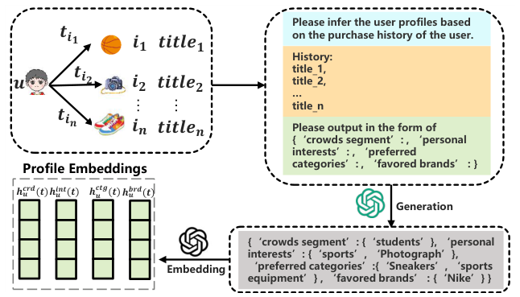
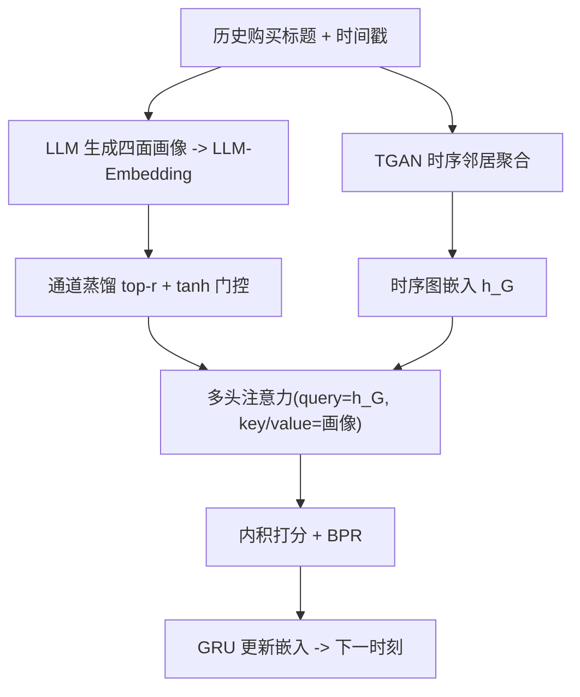
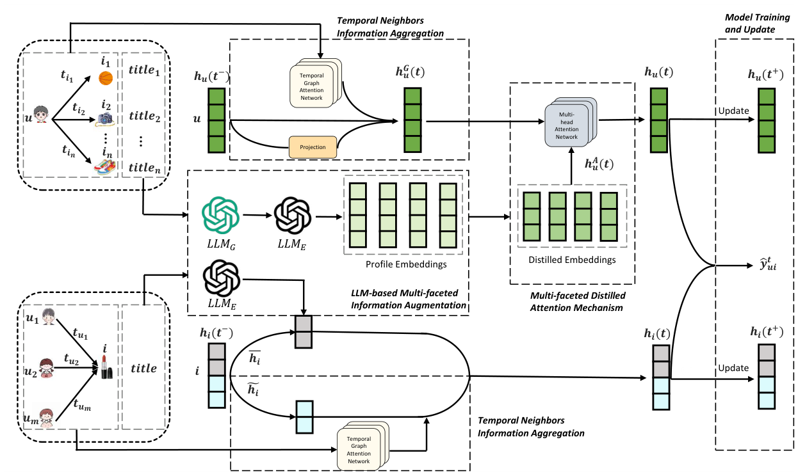

# DynLLM: When Large Language Models Meet Dynamic Graph Recommendation (当大语言模型遇见动态图推荐)

- **会议/期刊**: TOIS（arXiv:2405.07580, 2024-05）
- **作者与机构**: Ziwei Zhao, Fake Lin, Xi Zhu, Zhi Zheng, Tong Xu, Shitian Shen, Xueying Li, Zikai Yin, Enhong Chen（中国科学技术大学 + 阿里巴巴集团）
- **推荐链路定位**: 精排（CTDG 上时刻级 Top-K 打分）
- **研究方向**: 大语言模型推荐 / 图神经网络与知识图谱推荐
- **论文原文**: [https://arxiv.org/abs/2405.07580v1](https://arxiv.org/abs/2405.07580v1)
- **开源代码**: 暂未开源

## TL;DR (1分钟核心速览)

连续时间动态图（CTDG）推荐只能吃「谁在什么时刻买了什么」的结构与时间信号，标题文本里的语义被浪费，且用户侧依旧稀疏。DynLLM 用 LLM 从历史购买商品标题中生成「人群、兴趣、类目、品牌」四面画像并由 LLM-Embedding 编码，再用**通道级蒸馏 + 多头注意力**把画像嵌入挂到 TGAN 的时序图嵌入上。在 Tmall/Alibaba 两个电商数据集、按全局时间戳 70/15/15 切分、全库 Full-Ranking 下，Recall@10 分别相对最优基线提升 40.3% 与 21.7%。

## Background & Motivation (背景与核心矛盾)

- **主流范式**: 静态端用 LightGCN/NGCF 聚合高阶邻居；动态端用 DTDG 快照或 CTDG（TGAT 时间编码、TGN 记忆模块、DynShare 非线性投影器）做时刻级表示。
- **前人局限一**: 快照式 DTDG 的时间粒度是人工设定，粒度粗则丢失细粒度演化，粒度细则图破碎稀疏。
- **前人局限二**: CTDG 模型只消费 ID 与时间戳，商品标题中的类目/品牌/人群语义完全未用；而 LLMRec 一类工作已证明 LLM 侧信息能缓解稀疏，却仍停留在静态图，无法对齐「随时间漂移」的偏好。
- **核心洞察 (Key Insight)**: 用户画像不是常量而是随购买序列漂移的分布——只要按滑动窗口动态重生成画像，LLM 的语义先验就能与 CTDG 的细粒度时间戳互补；但直接拼接 LLM 嵌入会带入生成噪声，需要先蒸馏再融合。
- **本文切入点**: 以 TGAN 为时序主干、LLM 画像为侧通道，用蒸馏注意力做「先降噪、再加权融合」。

<figure class="paper-figure" markdown="span">
  <figcaption>图1：从LLM生成画像嵌入的过程。根据用户𝑢对应已购物品{𝑖1,𝑖2,...,𝑖𝑛}的丰富文本标题{𝑡𝑖𝑡𝑙𝑒1,𝑡𝑖𝑡𝑙𝑒2,...,𝑡𝑖𝑡𝑙𝑒𝑛}，通过设计的提示由LLM生成多面画像，然后通过LLM-embedding生成画像嵌入。</figcaption>
</figure>

## Method (核心方法设计)

### 1. 整体框架 (Overall Architecture)

对每个交互 $(u,i,t)$：先由 TGAN 聚合$u$与$i$在$t^-$前的时序邻居得到时序图嵌入$\boldsymbol{h}^G_u(t),\boldsymbol{h}^G_i(t)$；同时用 LLM 在窗口$[t-\Delta t,t]$上根据$u$已购商品标题生成四面画像，再由 LLM-Embedding + MLP 投影为四段嵌入并蒸馏；多头注意力以时序图嵌入为 query、蒸馏画像拼接为 key/value，输出融合嵌入$\boldsymbol{h}_u(t)$；物品侧$\boldsymbol{h}_i(t)=\bar{\boldsymbol{h}}_i\Vert\boldsymbol{h}^G_i(t)$。内积打分 + BPR 训练后，GRU 把当前交互写回，供下一时刻推荐。

<figure class="paper-figure" markdown="span">
  <figcaption>图2：所提出的DynLLM的整体框架。包含四个主要模块：(a) 时序邻居信息聚合，在CTDGS中聚合用户和物品的时序邻居信息；(b) 基于LLM的多面信息增强，通过LLM生成多面用户画像；(c) 多面蒸馏注意力机制，对LLM生成的嵌入进行蒸馏并融合以增强表示；(d) 模型训练与更新，训练模型并更新嵌入以供未来推荐。</figcaption>
</figure>

### 2. 关键设计拆解 (Key Designs)

1. **LLM 多维画像增强（把文本先验变成动态侧信息）**：痛点是 CTDG 无文本入口、用户交互稀疏。以滑动窗口构造提示 $\mathcal{P}^{t-\Delta t,t}_u$，一次生成四元组$(\text{crd},\text{int},\text{ctg},\text{brd})_u=\mathrm{LLM}_G(\mathcal{P}^{t-\Delta t,t}_u)$，再经$\boldsymbol{h}^{\text{ctg}}_u(t)=\mathrm{MLP}(\mathrm{LLM}_E(\text{ctg}^{t-\Delta t,t}_u))$投影到$d$ 维。有效性直觉：类目/人群是「跨用户可共享」的粗粒度先验，品牌/兴趣是细粒度偏好，二者共同把长尾用户从纯 ID 稀疏中拉出来。
2. **多面蒸馏注意力（先降噪再加权融合）**：LLM 文本嵌入维度高、含生成偏置，直接拼接会让优化不稳。先做通道打分 $s=\boldsymbol{h}^{\text{crd}}_u(t)\boldsymbol{q}/\|\boldsymbol{q}\|$，取 top-$r$维并按$\tilde{\boldsymbol{h}}^{\text{crd}}_u(t)=[\boldsymbol{h}^{\text{crd}}_u(t)\circ\tanh(s)]_j,\ j\in\text{top-indices}(s,r)$输出；随后以$\tilde{\boldsymbol{q}}=\boldsymbol{h}^G_u(t)$、$\tilde{\boldsymbol{K}}=\tilde{\boldsymbol{V}}=\boldsymbol{h}^A_u(t)$做多头注意力得到$\boldsymbol{h}_u(t)$。直觉：top-$r$等价于「软硬混合的通道门控」，只保留与当前图谱状态相关的语义维度，同时把融合计算从$d$维压到$r$ 维，注意力权重则显式回答「哪一面画像此刻更重要」。
3. **训练目标、负采样与推理**：$\hat{y}^t_{ui}=\boldsymbol{h}_u(t)^\top\boldsymbol{h}_i(t)$，损失$\ell=\sum_{(u,i^+,i^-,t)}-\log\sigma(\hat{y}^t_{ui^+}-\hat{y}^t_{ui^-})+\lambda\|\Theta\|^2$；嵌入维度$d=128$（物品 = 64 静态 + 64 动态），TGAN 取 2 层 2 头，$\lambda=10^{-5}$。推理开销上画像由离线/缓存式 LLM 生成（qwen-max-1201 + text-embedding-v2），在线仅跑 TGAN + 一次注意力，成本可控；但原文未给出画像重生成频率与缓存命中策略。

## Experimental Setup & Evaluation Protocol (实验设置与评估协议)

| 数据集 | #Users | #Items | #Interactions | 稀疏度/密度 | 特征/场景说明 |
| :--- | :---: | :---: | :---: | :---: | :--- |
| Tmall | 5,651 | 10,333 | 258,390 | 0.44% | 电商购买，含商品标题（平均 35.51 词） |
| Alibaba | 16,901 | 30,080 | 722,716 | 0.14% | 电商购买，标题平均 34.22 词 |

- **过滤与划分**: 迭代保留购买过 ≥20 个不同商品的用户、被 ≥5 个用户购买的商品（收敛式过滤）；按**全局时间戳**顺序切 70% 训练 / 15% 验证 / 15% 测试，每次交互带唯一时间戳。
- **排名评测协议**: **无偏 Full-Ranking**（验证/测试正样本对全库所有物品排序），指标 Recall@K 与 NDCG@K，$K\in\{10,20,30\}$；以验证集 Recall@10 连续 10 轮不升早停。
- **对比基线与超参**: 静态 GCN/GAT/NGCF/LightGCN，动态 JODIE/DyRep/TGN/DynShare；所有模型统一 $d=128$，Adam，学习率网格$\{10^{-3},5\times10^{-4},10^{-4}\}$，batch 2048（Tmall）/4096（Alibaba）；早期工作均为强化学习无关的直接 Top-K 对比，**未报告显著性检验**。

## Key Experimental Results (实验关键数据)

### 1. 主实验对比 (Main Results)

| 模型 | Tmall R@10 | Tmall N@10 | Tmall R@20 | Tmall N@20 | Alibaba R@10 | Alibaba N@10 | Alibaba R@20 | Alibaba N@20 |
| :--- | :---: | :---: | :---: | :---: | :---: | :---: | :---: | :---: |
| GCN | 0.0287 | 0.0218 | 0.0381 | 0.0241 | 0.0159 | 0.0087 | 0.0322 | 0.0127 |
| NGCF | 0.0594 | 0.0364 | 0.0999 | 0.0465 | 0.0510 | 0.0321 | 0.0732 | 0.0377 |
| LightGCN | 0.0703 | 0.0405 | 0.1105 | 0.0506 | 0.0458 | 0.0296 | 0.0697 | 0.0355 |
| JODIE | 0.0270 | 0.0118 | 0.0516 | 0.0179 | 0.0253 | 0.0107 | 0.0528 | 0.0176 |
| DyRep | 0.0450 | 0.0213 | 0.0826 | 0.0307 | 0.0455 | 0.0199 | 0.0899 | 0.0310 |
| TGN | 0.0726 | 0.0338 | 0.1276 | 0.0476 | 0.0516 | 0.0248 | 0.0923 | 0.0350 |
| DynShare | 0.0750 | 0.0358 | 0.1279 | 0.0491 | 0.0563 | 0.0252 | **0.1039** | 0.0371 |
| **DynLLM** | **0.1052** | **0.0501** | **0.1765** | **0.0680** | **0.0685** | **0.0340** | **0.1120** | **0.0449** |
| Improv.% | +40.3% | +23.7% | +38.0% | +34.4% | +21.7% | +34.9% | +7.8% | +21.0% |

（R@30/N@30 上 DynLLM 为 0.2321/0.0799 与 0.1459/0.0521，相对最优基线分别 +31.4%/+36.8% 与 +1.3%/+14.0%。）

### 2. 消融实验 (Ablation Study)

| 变体 | Tmall R@10 | Tmall N@10 | Tmall R@30 | Alibaba R@10 | Alibaba N@10 | Alibaba R@30 |
| :--- | :---: | :---: | :---: | :---: | :---: | :---: |
| w/o LLM（去画像侧） | 0.0342 | 0.0148 | 0.1027 | 0.0178 | 0.0080 | 0.0565 |
| w/o Distill（直接拼接） | 0.0632 | 0.0294 | 0.1660 | 0.0496 | 0.0219 | 0.1331 |
| **DynLLM** | **0.1052** | **0.0501** | **0.2321** | **0.0685** | **0.0340** | **0.1459** |

| 去单面画像 | Tmall R@10 | Tmall N@10 | Alibaba R@10 | Alibaba N@10 |
| :--- | :---: | :---: | :---: | :---: |
| w/o crd | 0.0916 | 0.0432 | 0.0563 | 0.0263 |
| w/o int | 0.0914 | 0.0422 | 0.0596 | 0.0273 |
| w/o ctg | 0.0832 | 0.0391 | 0.0617 | 0.0289 |
| w/o brd | 0.0916 | 0.0415 | 0.0614 | 0.0298 |

### 3. 关键实验发现 (Key Findings)

1. **LLM 画像不是「锦上添花」而是主增益源**：去掉 LLM 后 Tmall R@10 从 0.1052 跌至 0.0342（-67.5%），甚至低于 TGN 的 0.0726，说明纯时序图主干在 0.44% 稀疏度下几乎无法区分长尾用户，语义先验承担了主要判别力。
2. **蒸馏环节贡献约四成性能**：w/o Distill 仍拼接全部 LLM 嵌入，R@10 只到 0.0632（-39.9%），印证「LLM 文本嵌入直接入模会带入生成噪声」；最优蒸馏系数 $r=112$（Tmall）/96（Alibaba），过大反而回收噪声维度。
3. **画像面重要性存在层级**：去类目（ctg）损伤最大（Tmall R@10 0.0832），人群/兴趣次之，去品牌（brd）几乎无损（0.0916），说明品牌与类目强共线、信息冗余；另外 Alibaba 的 R@30 仅 +1.3%，提示头部容量已被充分占据，增益集中在头部 10–20 位。

## Highlights & Limitations (亮点、对比与审稿批判)

- **与代表作对比 (vs. Prior Work)**: 相较 TGN/DynShare 只建模时序与拓扑，本文额外引入文本语义通道；相较 LLMRec 的静态图侧信息增强，本文将画像做成**随窗口滑动重生成**的动态变量，并把「LLM 噪声」显式建模为可调蒸馏系数 $r$；相较 Chat-REC 等对话式 LLM4Rec，本文不调用 LLM 做在线打分，而是把 LLM 降级为离线特征供给。
- **可迁移亮点**: (1) 用「通道 top-$r$ + tanh 软门控」蒸馏任意 LLM 嵌入，可低成本迁到跨域/多模态侧信息融合；(2) 以图嵌入为 query、侧信息为 key/value 的非对称注意力，天然适配「主信号强、侧信号噪」的工业精排场景。
- **审稿级局限批判**: (1) 负采样策略、LLM 画像离线生成成本与延迟均未披露，Alibaba 上 R@30 增益仅 1.3%，实为头部饱和后的真实信号弱化；(2) 仅两个自采电商数据集、无显著性检验与冷启动划分，且 $N_u=5$、$N_i=2$ 的最优取值与数据集平均交互比例巧合绑定，超参泛化性存疑。

## Rating (四维评分)

- **方法创新性 (Novelty)**: ⭐⭐⭐⭐ （首次将 LLM 画像接入 CTDG 时序推荐，蒸馏注意力与滑动窗口画像的组合有想法，但各模块均为已知组件的拼接式创新）
- **评估协议与实验扎实度 (Protocol & Experiments)**: ⭐⭐⭐ （Full-Ranking 与时间切分规范、消融较完整，但仅两个私有数据集、无显著性检验、负采样与 LLM 成本细节缺失）
- **写作与数学规范度 (Clarity & Rigor)**: ⭐⭐⭐ （公式链完整，但 $\tilde{\boldsymbol{h}}_i$与$\boldsymbol{h}_i(t)$ 符号复用、top-indices 选择不可导的处理未说明，蒸馏的必要性缺少理论分析）
- **工业落地与复现价值 (Industrial & Practical Value)**: ⭐⭐⭐ （离线画像 + 在线轻量融合的架构易落地，但无开源代码、LLM 调用与画像刷新成本未量化，增加了复现门槛）

