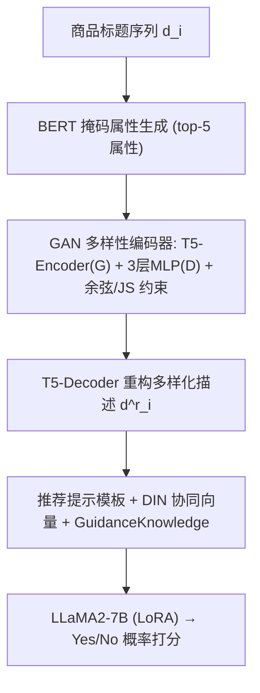
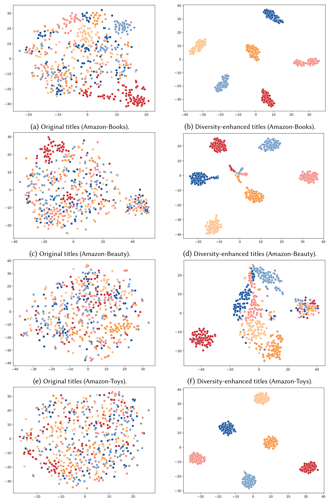

# GANPrompt: Enhancing Robustness in LLM-Based Recommendations with GAN-Enhanced Diversity Prompts (基于 GAN 增强多样性提示的 LLM 推荐鲁棒性提升)

- **会议/期刊**: TOIS (ACM Transactions on Information Systems)
- **作者与机构**: Xinyu Li, Hongke Zhao, Likang Wu (天津大学)、Chuang Zhao (HKUST)、Ming He (联想研究院 AI Lab)
- **推荐链路定位**: 精排（序列下一项判别式打分 `Yes/No`）
- **研究方向**: 大语言模型推荐 (LLM4Rec) / 序列与会话推荐
- **论文原文**: [https://arxiv.org/abs/2408.09671v2](https://arxiv.org/abs/2408.09671v2)
- **开源代码**: 暂未开源

## TL;DR (1分钟核心速览)

本文直击 LLM 推荐的 **prompt sensitivity（提示敏感）** 痛点：同一用户历史换一种措辞，LLaMA2 给出的 `Yes/No` 判断就会翻转。作者提出 GANPrompt，把 T5 编码器当作生成器、三层 MLP 当作判别器，在"原始标题 + 5 个 LLM 生成的属性"这 $k+1$ 类样本上做对抗式分类训练，并叠加余弦相似度与 JS 散度联合的多样性约束；再用重构后的多样化描述微调 LLaMA2-7B，并通过 `<GuidanceKnowledge>` 专家引导 token 显式注入 DIN 协同打分。在 Amazon 四个子集 + 联想工业数据集上，采用 Leave-One-Out 划分与 1:9 负采样排序，AUC 相对最强基线最高提升 2.06%（Toys），HR@1 最高提升 9.09%（Books）。

## Background & Motivation (背景与核心矛盾)

- **主流范式**: 以 TALLRec 为代表的指令微调 + LoRA 路线把用户历史序列转成自然语言模板；以 CoLLM 为代表的混合路线再把传统协同模型的 embedding 经映射层塞进 LLM 的 ID token 位置，以弥补 LLM 只懂语义、不懂共现的缺陷。
- **前人局限**: 其一，模板措辞的微小扰动会让 LLM 输出剧烈抖动，鲁棒性差、结果不可复现；其二，协同向量与 LLM 语义空间之间存在鸿沟，简单 MLP 映射常给出与语义相矛盾的推荐。
- **核心洞察 (Key Insight)**: 既然 LLM 对提示分布敏感，那就**主动把提示分布撑大**——用 GAN 式的对抗信号 + 距离约束，把"同一物品的不同属性视角"在隐空间里推远，使模型在训练时见过足够宽的提示邻域，从而对未见提示不敏感。
- **本文切入点**: 用"GAN 造多样提示 + 距离度量保证多样性不跑偏 + 显式专家 token 补协同"三件套，一次性同时处理鲁棒性与协同知识注入。

## Method (核心方法设计)

### 1. 整体框架 (Overall Architecture)

框架分两阶段、五步走：① **属性生成**：用 BERT 做掩码预测，从商品标题序列中生成属性描述，人工清洗后按频次保留 top-$k$（$k=5$），得到"原始 + 5 属性"共 6 个视角的数据集；② **GAN 多样性编码器训练**：T5 编码器作生成器$G_{LLM_{se}}$输出隐向量，三层 MLP 作判别器做$k+1$类分类，同时在生成器损失中加入余弦+JS 联合多样性约束；③ **数据重构**：用训练好的编码器重新编码原描述，再由 T5 解码器还原为多样化文本$d^r_i$；④ **提示组装**：把$d^r_i$、协同 ID 向量、DIN 的推荐结果分别填入 `<User_History>`、`<UserID>/<TargetID>`、`<GuidanceKnowledge>`；⑤ **两阶段微调**：先 LoRA 学任务范式，再只训映射层对齐协同空间，输出 `Yes/No` 的 token log-prob 作为打分。两阶段分离是为了避免编码器持续漂移导致重构文本抖动、破坏语义一致性。

### 2. 关键设计拆解 (Key Designs)

1. **属性条件化对抗生成（把"多样性"变成可训练目标）**：前人做提示增广只靠随机模板或同义改写，多样性停留在表层词面。本文把第 $n$个属性视角连同历史一起编码为噪声输入：$e^{seq}_{attr_n}=G_{LLM_{se}}(T^{GANs}_{seq}+a^{seq}_n+[d_{u_i^1},\dots,d_{u_i^n}])$，判别器$D_{MLP}=\sigma_3(W_3\sigma_2(W_2\sigma_1(W_1x+b_1)+b_2)+b_3)$ 需区分"原始 + 5 属性"共 6 类。直觉上，判别器逼迫编码器为每个属性视角产出**可区分的**隐向量，等价于在隐空间对同一物品做有监督的视角解耦，而不仅是词面改写。

2. **余弦 + JS 双距离多样性约束（防止多样性退化为噪声）**：仅用余弦只看方向、忽略分布信息；仅用 KL 又不对称。作者联合两者：
$$D_{total}=\alpha D_{cos}(x_i\|x'_i)+\beta D_{JS}(x_i\|x'_i),\quad D_{JS}=\tfrac{1}{2}D_{KL}(x_i\|m)+\tfrac{1}{2}D_{KL}(x'_i\|m),\ m=\tfrac{1}{2}(x_i+x'_i)$$
生成器总损失为 $\mathcal{L}_G=\mathcal{L}_{LLM_{se}}+\gamma D_{total}$，判别器用多类交叉熵$\mathcal{L}_{D_{MLP}}=-\sum_{c=1}^{C}y_c\log\hat{y}_c$。角度项拉开方向、JS 项拉开信息分布，两者互补可避免"只在某一维度上散开"的伪多样性。

<figure class="paper-figure" markdown="span">
  <figcaption>图 6. 四个 Amazon 数据集的商品标题数据在多样性编码器增强前后的可视化，包括添加五个属性特征后的属性数据。</figcaption>
</figure>

3. **专家引导 token 与两阶段训练**：仅靠映射层注入协同向量，LLM 仍可能"读不懂"传统模型意图，故直接把 DIN 的预测结果写进 `<GuidanceKnowledge>` 作为语义化提示。阶段二目标为 $\mathcal{L}_{Rec}=-\frac{1}{N}\sum_i[y_i\log\hat{y}_i+(1-y_i)\log(1-\hat{y}_i)]$，只更新 LoRA 与映射层参数（骨干冻结），无额外负采样（负例来自数据构造阶段的 9 个随机未交互项），推理时对候选逐一拼模板取 `Yes` 概率，开销随候选数线性增长。

## Experimental Setup & Evaluation Protocol (实验设置与评估协议)

| 数据集 | #Users | #Items | #Interactions | 稀疏度 | 说明 |
| :--- | :---: | :---: | :---: | :---: | :--- |
| Amazon-Books | 7,763 | 6,926 | 238,062 | 99.56% | 仅保留评分=5；过滤 <20 交互 |
| Amazon-Beauty | 2,267 | 1,557 | 19,119 | 99.46% | 过滤 <5 交互 |
| Amazon-Toys | 1,774 | 1,390 | 13,106 | 99.47% | 过滤 <5 交互 |
| Amazon-Sports | 6,667 | 4,021 | 51,550 | 99.81% | 过滤 <5 交互 |
| Lenovo (工业) | 4,027 | 3,075 | 54,838 | 99.56% | 联想商城真实日志 |

- **数据划分与防穿越**: `Leave-One-Out`——序列末项 $i_n$作测试，$i_{n-1}$及更早作训练；序列截断长度$[5,20]$，标题限 20 token。
- **排名评测协议**: `Sampled Ranking`，每个正样本随机配 **9 个未交互负例（正负比 1:9）**，指标 AUC / HR@{1,3,5} / NDCG@{3,5} / MRR@{3,5}，**未做 Full-Ranking 全库排序**。
- **对比基线与超参**: 传统序列模型 BERT4Rec、SASRec、Caser、DIN、GRU4Rec；LLM 基线 TALLRec、CoLLM。属性生成用 BERT，多样性编码器用 T5-Encoder，判别器 3 层 MLP，batch 256、lr 1e-5（Adam）；推荐主干 LLaMA2-7B，batch 64、lr 2e-4（AdamW），LoRA 微调。未报告显著性检验。

## Key Experimental Results (实验关键数据)

### 1. 主实验对比 (Main Results)

| 模型 | Books AUC | Books HR@1 | Books NDCG@5 | Beauty AUC | Beauty HR@1 | Beauty NDCG@5 |
| :--- | :---: | :---: | :---: | :---: | :---: | :---: |
| SASRec | 0.5492 | 0.1247 | 0.3430 | 0.5872 | 0.1899 | 0.4188 |
| Caser | 0.6016 | 0.2125 | 0.4407 | 0.6497 | 0.2420 | 0.4917 |
| GRU4Rec | 0.8408 | 0.4434 | 0.7130 | 0.8036 | 0.4555 | 0.6825 |
| DIN | 0.8527 | 0.4775 | 0.7322 | 0.8228 | 0.5050 | 0.7136 |
| TALLRec | 0.7104 | 0.2871 | 0.5319 | 0.7057 | 0.3168 | 0.5374 |
| CoLLM | 0.8301 | 0.4457 | 0.7039 | 0.7980 | 0.4580 | 0.6784 |
| **GANPrompt** | **0.8630** | **0.5209** | **0.7529** | **0.8384** | **0.5227** | **0.7315** |
| Improv.% | +1.20% | +9.09% | +2.83% | +1.34% | +3.49% | +2.51% |

| 模型 | Toys AUC | Toys HR@1 | Sports AUC | Sports HR@1 | Lenovo AUC | Lenovo HR@1 |
| :--- | :---: | :---: | :---: | :---: | :---: | :---: |
| DIN | 0.7477 | 0.3532 | 0.6804 | 0.2513 | 0.7720 | 0.3571 |
| GRU4Rec | 0.7202 | 0.3188 | **0.6837** | 0.2662 | 0.7520 | 0.3218 |
| CoLLM | 0.7414 | 0.3551 | 0.6430 | 0.2352 | 0.7734 | 0.3534 |
| **GANPrompt** | **0.7631** | **0.3638** | **0.6925** | **0.2696** | **0.7811** | **0.3750** |
| Improv.% | +2.06% | +2.44% | +1.78% | +1.01% | +1.00% | +5.01% |

### 2. 消融实验 (Ablation Study)

原文消融以图 7–9 呈现（未给数值表），此处按原文结论归纳相对次序：

| 变体 | 移除内容 | 多样性/排序表现 |
| :--- | :--- | :--- |
| Div-ori | 无（余弦 + JS 全保留） | 四项距离指标均**最优** |
| Div-cos | 去掉余弦相似度 | 次优（多数指标第二） |
| Div-JS | 去掉 JS 散度 | 次优（角度类指标略逊于 Div-cos） |
| Div-all | 两者全去掉 | **最差** |
| Rec-ori | 保留协同信号，仅训映射层 | 最优配置 |
| Rec-col | 去掉协同信号 | 显著下降 |
| Rec-lora / Rec-sm / Rec-lora&sm | 同时放开 LoRA / 传统模型参数 | 均不及 Rec-ori |

### 3. 关键实验发现 (Key Findings)

1. **LLM 纯语义路线的天花板清晰可见**：TALLRec 在 Books 上 AUC 仅 0.7104，比 DIN 低 14.2 个点，说明不加协同信号时语义微调无法替代共现建模；CoLLM 补上协同后升到 0.8301，但仍低于 DIN，印证"映射层对齐不充分"的痛点真实存在。
2. **收益主要落在排序前端**：GANPrompt 的 AUC 提升仅 1.0%–2.06%，而 HR@1 提升 1.01%–9.09%（Books 9.09%、Lenovo 5.01%）。这说明多样性增广主要改善"把正确项顶到第一位"的能力，对正负样本整体可分性的边际贡献有限——与提示扰动主要影响解码局部稳定性的假设一致。
3. **数据越稠密、文本越丰富，增益越稳定**：Books/Beauty（交互更密、标题语义更连贯）AUC 增益 1.2%–1.34%，而 Sports 仅 1.78% 且 GRU4Rec 已接近最优；Toys 这类稀疏小集上 CoLLM 甚至被 DIN 反超，说明协同注入在低密数据上更易引入噪声，多样性约束的收益也随之放大。

## Highlights & Limitations (亮点、对比与审稿批判)

- **与代表作对比**: 相比 TALLRec 只做指令模板 + LoRA，本文把"提示"当作可优化的数据分布而非固定文本；相比 CoLLM 只做协同向量映射，本文额外加了 `<GuidanceKnowledge>` 显式语义引导，绕开映射层的表达瓶颈；相比 SGL/SimGCL 类对比增广，本文的多样性来自 LLM 生成的属性视角而非图扰动，增广语义更强但成本更高。
- **可迁移亮点**: ①"用 LLM 生成属性 → 构造多视角监督 → 距离约束拉开隐空间"这套流程可直接迁移到冷启动物品的内容增广；②把传统模型的预测值以自然语言 token 形式写入提示，是一种低成本的模型级蒸馏接口。
- **审稿级局限批判**: ①所谓"GAN"实为 $k+1$类**有监督分类器**，生成器与判别器并未构成真正的极小极大博弈，对抗性名不副实；②全流程依赖 BERT 属性生成 + T5 编码解码 + LLaMA2-7B 推理，且需对每个候选拼模板打分，工业级时延与成本缺乏讨论；③评估仅用 1:9 采样排序而非全库排序，且未做显著性检验，AUC 1% 级别的提升说服力偏弱；④消融仅以图形呈现、无具体数值，$\alpha,\beta,\gamma$ 的敏感度分析缺失。

## Rating (四维评分)

- **方法创新性 (Novelty)**: ⭐⭐⭐ （"多样性即鲁棒性"的视角与双距离约束有新意，但 GAN 框架实为分类器，对抗博弈的理论支撑偏弱）
- **评估协议与实验扎实度 (Protocol & Experiments)**: ⭐⭐ （五个数据集覆盖面尚可，但仅 1:9 采样排序、无全库排序与显著性检验，消融无表格数值）
- **写作与数学规范度 (Clarity & Rigor)**: ⭐⭐⭐ （两阶段流程与损失函数交代清楚，但符号混用、模型名 GANPrompt/PromptGANs 前后不一致，GAN 部分推导较浅）
- **工业落地与复现价值 (Industrial & Practical Value)**: ⭐⭐ （含真实联想数据集是加分项，但无开源代码，三级 LLM 级联与逐候选打分使线上部署成本高昂）

