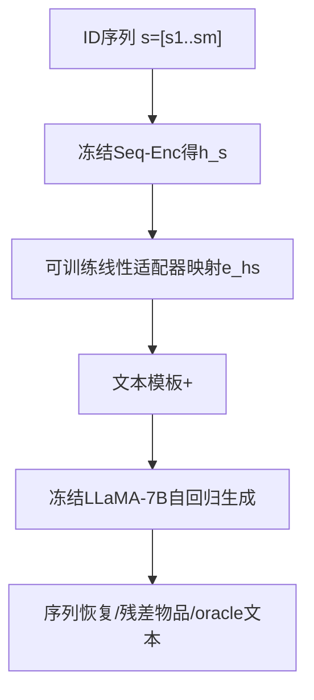
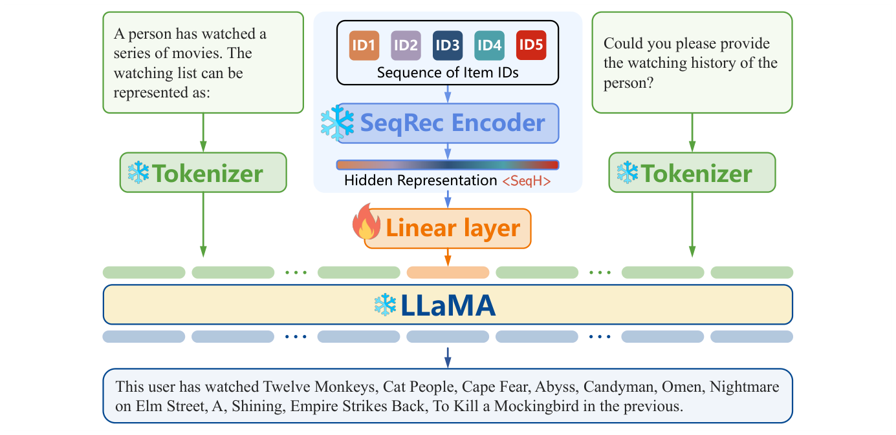
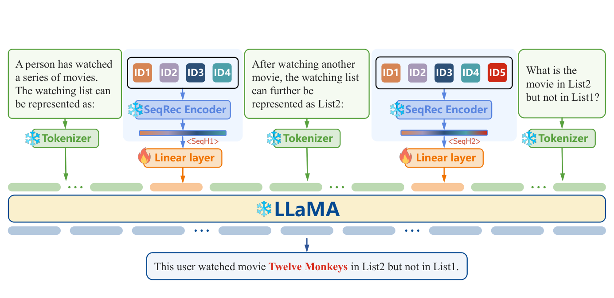

# Large Language Model Can Interpret Latent Space of Sequential Recommender (大语言模型可解读序列推荐器隐空间)

- **会议/期刊**: TOIS 2026（arXiv:2310.20487v1, 2023）
- **作者与机构**: Zhengyi Yang, Jiancan Wu, Yanchen Luo, Jizhi Zhang, Yancheng Yuan, An Zhang, Xiang Wang, Xiangnan He；USTC、PolyU、NUS
- **推荐链路定位**: 端到端生成式（隐空间解读 / 生成式推荐解释）
- **研究方向**: 大语言模型推荐 / 序列推荐
- **论文原文**: [https://arxiv.org/abs/2310.20487v1](https://arxiv.org/abs/2310.20487v1)
- **开源代码**: [https://github.com/YangZhengyi98/RecInterpreter](https://github.com/YangZhengyi98/RecInterpreter)

## TL;DR (1分钟核心速览)

针对 LLM4Rec 只读文本提示、无法解读 ID-based 序列推荐器隐表示的问题，RecInterpreter 冻结 LLaMA-7B 与 SeqRec，仅训线性适配器，将序列隐向量映射为 `<SeqH>` 词元，并以序列恢复/残差提示让 LLaMA 输出物品文本。MovieLens/Steam 按时间 8:1:1 切分下，残差识别最高达 97.89%/86.33%，并首次将 DreamRec 的 oracle 向量具象为文本。

## Background & Motivation (背景与核心矛盾)

- **主流范式**: 序列推荐以离散 ID 序列学习隐表示 $h_s$，再预测下一物品；LLM4Rec 则把历史交互转写成文本提示，让 LLM 直接推荐或重排。
- **前人局限**: ① 多模态 LLM 已能通过投影理解图像/音频隐表示，但推荐器隐空间仍未被探索；② LLM4Rec 将推荐器隐状态隔离在外，LLM 无法“看见”协同/序列模型已压缩的行为信号。
- **核心洞察 (Key Insight)**: 交互序列隐表示可视为一种“推荐模态”，只需轻量适配器即可对齐到 LLaMA 词元空间；相比恢复整条序列，对比加入残差前后的两个隐表示更容易隔离新物品。
- **本文切入点**: 冻结推荐器与 LLM，仅训练线性投影；用恢复任务检验可读性，用残差任务提升精度，并解码生成式推荐器的 oracle 向量。

## Method (核心方法设计)

### 1. 整体框架 (Overall Architecture)

输入用户交互序列，先用冻结序列推荐器编码为 $h_s$，再经可训练线性层投影为 LLaMA 词元空间中的 `<SeqH>`；文本模板与 `<SeqH>` 拼接后送入冻结 LLaMA，自回归生成物品描述。训练仅更新适配器；推理时根据任务生成整段历史或残差物品，并可将 DreamRec 生成的 oracle 向量追加到序列末尾，让 LLaMA 输出其文本具象。

### 2. 关键设计拆解 (Key Designs)

1. **Sequence-Recovery Prompt（序列恢复提示）**：痛点在于 $h_s$高度压缩，直接让 LLM 读向量不可行。先编码$h_s=\mathrm{SeqEnc}(E_s)$，再投影$e_{h_s}=\mathrm{LinearProj}_{\theta}(h_s)$，把$e_{h_s}$作为 `<SeqH>` 插入“用户看过哪些电影”的模板，并以目标物品文本做自回归监督：$p(X^{Target}\mid X^{Input})=\prod_{i=1}^{N}p(X_i^{Target}\mid X^{Input},X_{1:i-1}^{Target})$。其有效性来自冻结 LLM 的语义先验与仅$d\times4096$ 的轻量对齐。

<figure class="paper-figure" markdown="span">
  <figcaption>图2：序列恢复框架示意图。我们提供任务特定的文本提示，以及由线性层投影得到的交互序列隐藏表示，旨在引导LLaMA以文本回复恢复交互。火焰表示可调模块，雪花表示冻结模块。</figcaption>
</figure>

2. **Sequence-Residual Prompt（序列残差提示）**：恢复整条序列仍受压缩与候选规模限制。对 $s_1=[s_1,\ldots,s_{m-1}]$与$s_2=[s_1,\ldots,s_m]$分别编码得$h_{s_1}=\mathrm{SeqEnc}(E_1)$、$h_{s_2}=\mathrm{SeqEnc}(E_2)$，共享适配器投影后提示 LLaMA“List2 比 List1 多了哪部电影”。差分信号抵消共有序列语义，只保留残差物品，因而比全序列恢复更可辨。

<figure class="paper-figure" markdown="span">
  <figcaption>图3：序列残差框架示意图。我们提供任务特定的文本提示，以及序列加入残差物品前后的隐藏表示。这两个隐藏表示由共享线性层投影。火焰表示可调模块，雪花表示冻结模块。</figcaption>
</figure>

3. **Oracle 具象化与训练/推理**：DreamRec 生成 oracle 向量 $e_{s^*}$后，构造$E^*=[e_{s_1},\ldots,e_{s_n},e_{s^*}]$，编码并投影得$e_{h_{s^*}}$，再用残差提示让 LLaMA 输出其文本描述，突破候选集限制。总目标为自回归 NLL$\mathcal{L}=-\sum_i\log p(X_i^{Target}\mid X^{Input},X_{1:i-1}^{Target})$；无负采样、不训练排序损失；推理需 1–2 次编码投影与 LLM 解码，成本主要来自生成。

## Experimental Setup & Evaluation Protocol (实验设置与评估协议)

- **数据集与预处理**: MovieLens100K 保留电影标题；Steam 过滤少于 20 条评论用户后，采样 1/3 用户与 1/3 游戏。序列截取最后 10 个交互，不足补 padding。

| 数据集 | #Sequences/Users | #Items | #Interactions | 密度 | 特征/场景说明 |
| :--- | :---: | :---: | :---: | :---: | :--- |
| MovieLens | 943 | 1,682 | 100,000 | 6.31% | 电影标题，经典序列推荐 |
| Steam | 11,938 | 3,581 | 274,726 | 0.64% | 游戏标题，含版本/多语言文本 |

- **数据划分与防穿越**: 按交互时间顺序做 **8:1:1 比例划分**，保证未来交互不进入训练集。
- **排名评测协议**: 非传统 **Full-Ranking / Sampled Ranking**；序列恢复统计恢复物品数分布，残差任务报告残差物品识别准确率，oracle 具象化用 ChatGPT 三选一评估。原文未报告 HR@K/NDCG@K 与显著性检验。
- **对比基线与超参**: 被解读的序列编码器为 GRU4Rec、Caser、SASRec、DreamRec，另有 Pop/Random 对照；LLM 为 LLaMA-7B，适配器为单线性层，嵌入维度在 [16,64,256,1024] 搜索，输出 4096；Adam，学习率 1e-4 热身至 5e-4，batch 256，单张 A40。

## Key Experimental Results (实验关键数据)

### 1. 主实验对比 (Main Results)

**表1 序列残差识别准确率（%）**

| 数据集 | GRU4Rec | Caser | SASRec | DreamRec | 最优相对提升 |
| :--- | :---: | :---: | :---: | :---: | :---: |
| MovieLens | 52.63 | 78.95 | 93.68 | **97.89** | +85.99% vs GRU4Rec |
| Steam | 17.11 | 55.03 | 52.60 | **86.33** | +404.56% vs GRU4Rec |

**表2 ChatGPT 三选一推荐偏好（%）**

| 数据集 | Random | SASRec | DreamRec |
| :--- | :---: | :---: | :---: |
| MovieLens | 13.68 | 35.79 | **50.53** |
| Steam | 0.76 | **51.15** | 48.09 |

### 2. 消融实验 (Ablation Study)

原文未做组件级消融；下表为可核验的恢复/残差对照。

| 配置 | 评估信号 | MovieLens | Steam |
| :--- | :--- | :---: | :---: |
| Pop 恢复 | 0 个物品被恢复的样本占比 | 74.74% | 58.56% |
| LLaMA + `<SeqH>` 恢复 | >3 个物品恢复占比（Caser/SASRec/DreamRec） | ≈80% | 原文未给统一值 |
| 序列残差（SASRec） | 残差识别 Acc | 93.68% | 52.60% |
| 序列残差（DreamRec） | 残差识别 Acc | **97.89%** | **86.33%** |

### 3. 关键实验发现 (Key Findings)

- **残差提示显著优于全序列恢复**：MovieLens 上 SASRec 残差识别 93.68%，DreamRec 达 97.89%；而 Pop 在 74.74% 样本中一个物品都恢复不出，说明 LLaMA 确实在读隐表示而非靠热度猜。
- **编码器架构与文本复杂度共同决定可读性**：MovieLens 上 DreamRec > SASRec > Caser > GRU4Rec（97.89 > 93.68 > 78.95 > 52.63）；Steam 上 DreamRec 仍达 86.33%，比 SASRec 的 52.60% 高 33.73 个百分点，部分抵消了游戏标题含版本号/多语言的干扰。
- **Oracle 具象化打开生成式推荐评估新路径**：28.13% 的 MovieLens oracle 文本与 48.67% 的 Steam oracle 文本超出候选物品集；ChatGPT 评估中 MovieLens 上 DreamRec 50.53% 优于 SASRec 35.79%，Steam 上二者接近（48.09% vs 51.15%）。

## Highlights & Limitations (亮点、对比与审稿批判)

- **与代表作对比 (vs. Prior Work)**: 相比 MiniGPT-4/Flamingo 对视觉/音频隐表示做投影对齐，本文首次把**推荐器隐表示**接入 LLM；相比 LLM4Rec 的文本化历史，本文直接读取冻结 SeqRec 的隐状态；相比 DreamRec 仅生成无解释向量，本文用残差提示把 oracle 解码为文本。
- **可迁移亮点**: ① 线性适配器可作为任意黑盒编码器到 LLM 的轻量“语义探针”；② 前后表示差分提示适合为隐向量变化生成可读标签，可用于解释召回/生成结果。
- **审稿级局限批判**: ① 仅用 LLaMA-7B、线性适配器与 ML100K/采样 Steam，未做组件消融、超参敏感性与显著性检验；② 评估非传统排序指标，oracle 依赖 ChatGPT 判断，存在评审偏置；在线部署还需承担 LLM 解码延迟，且恢复能力受隐表示压缩上限约束。

## Rating (四维评分)

- **方法创新性 (Novelty)**: ⭐⭐⭐⭐ （首次系统验证 LLM 可读序列推荐隐空间，残差提示设计简洁且有明确直觉）
- **评估协议与实验扎实度 (Protocol & Experiments)**: ⭐⭐⭐ （时间切分合理、对照可核验，但数据集小、无显著性检验、主评估非标准排序指标）
- **写作与数学规范度 (Clarity & Rigor)**: ⭐⭐⭐⭐ （任务、模板与公式定义清晰，适配器与编码器接口交代充分；理论分析偏少）
- **工业落地与复现价值 (Industrial & Practical Value)**: ⭐⭐⭐ （代码开源、仅训线性层成本低，但依赖大模型推理，线上时延与稳定性仍需工程验证）

