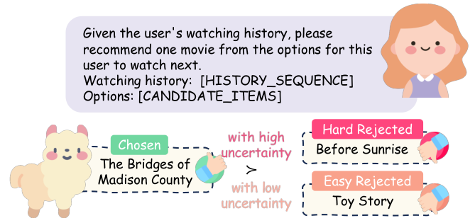
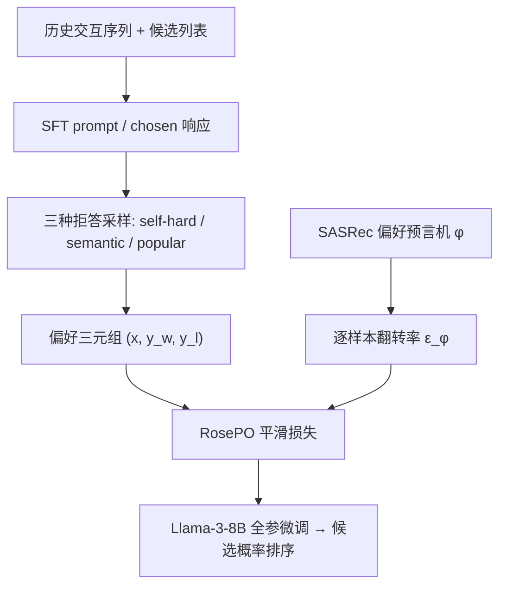
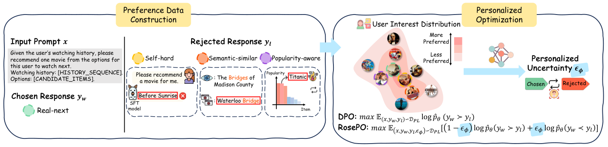

# RosePO: Aligning LLM-based Recommenders with Human Values (面向人类价值的 LLM 推荐器偏好对齐)

- **会议/期刊**: TOIS
- **作者与机构**: Jiayi Liao, Xiangnan He, Jiancan Wu, Xiang Wang（USTC）；Ruobing Xie, Xingwu Sun, Zhanhui Kang（腾讯机器学习平台）；Yancheng Yuan（PolyU）
- **推荐链路定位**: 精排 / 候选集打分（LLM 后训练对齐阶段）
- **研究方向**: 大语言模型推荐 / 去偏与可信推荐
- **论文原文**: [https://arxiv.org/abs/2410.12519v1](https://arxiv.org/abs/2410.12519v1)
- **开源代码**: 暂未开源

## TL;DR (1分钟核心速览)

LLM4Rec 主流做法是点式 SFT 拟合 next-item，既无法建模同一用户对不同物品的**比较关系**，又会放大语义表层相关与流行度偏置。RosePO 在 SFT 之后追加 DPO 后训练：用 self-hard / semantic-similar / popularity-aware 三种拒答采样构造“helpful & harmless”偏好对，并让轻量 SASRec 预言机预测逐样本标签翻转率 $\epsilon_\phi$ 作为平滑目标。在 MovieLens/Goodreads/Steam 的 1:20 采样排序协议下，HR@1 较 SFT 相对提升 8.11%/4.51%/4.25%，同时语义偏置与流行度偏置分布整体左移。

## Background & Motivation (背景与核心矛盾)

- **主流范式**: 将历史交互序列转成 prompt、目标物品作监督响应，用自回归 SFT 把通用 LLM 改造成序列推荐器（LLaRA、TALLRec 一类）。
- **前人局限**: ① 点式 SFT 只拟合被选响应，忽略 chosen/rejected 之间的细粒度偏好差；② SFT 直接拟合含噪交互，会把共现语义当作因果偏好（semantic hallucination），并在物品侧积累流行度偏置（SFT 模型在 Goodreads 上流行度偏置高达 24.58%）。
- **核心洞察 (Key Insight)**: 推荐中的偏好标签并非“置信度=1”。如图 2，同一用户对“爱恋片 vs 同为爱恋片”的不确定性远高于“爱恋片 vs 动画片”；负样本越**难**（越像真阳性），标签翻转概率越高，固定平滑系数 $\epsilon$ 必然失配。
- **本文切入点**: 把 DPO 迁移到推荐，用“拒答样本设计”编码价值观、用“逐样本 $\epsilon_\phi$”编码标签噪声，二者解耦。

<figure class="paper-figure" markdown="span">
  <figcaption>图 2：由于该用户喜爱爱情电影，她后续与“The Bridges of Madison County”而非“Before Sunrise”交互的偏好，比与“Toy Story”交互的偏好表现出更大的不确定性。</figcaption>
</figure>

## Method (核心方法设计)

### 1. 整体框架 (Overall Architecture)

对每个用户序列，沿用 SFT 阶段的 prompt $x$（任务指令 + 历史 + 候选列表）与真实 next-item 作 chosen$y_w$；再按三种策略各采一个 rejected$y_l$组成偏好三元组。同时用已在同一数据上训练好的轻量 SASRec 作为 **preference oracle**$\phi$，对$y_w,y_l$分别打出交互概率$s_w,s_l$，折算成该样本的翻转率$\epsilon_\phi$，注入 DPO 损失得到 RosePO 目标。全参微调 Llama-3-8B-Instruct 一个 epoch 后，模型以候选物品标题的输出概率做 grounding 排序。

<figure class="paper-figure" markdown="span">
  <figcaption>图 3：RosePO 的框架包含两个主要部分：偏好数据构建和个性化优化。(1) 被拒物品根据针对 HH 的特定偏好进行采样。(2) 我们在偏好预言机的引导下估计每个数据点的偏好不确定性，并将这种个性化不确定性作为平滑因子注入优化目标。</figcaption>
</figure>

### 2. 关键设计拆解 (Key Designs)

1. **HH 导向的三类拒答采样（决定“对齐什么价值”）**: 随机均匀负采样既太简单又无价值导向。**self-hard**：在 SFT 预测概率**高于**真实物品的候选中均匀采样（即模型自己的错题），把 DNS 思想搬到 LLM 输出层；**semantic**：取与历史序列平均余弦相似度最高的物品 $i^\*=\arg\max_{i_k}\frac{1}{n}\sum_{t=1}^{n}\text{CosSim}(\mathbf{e}_k,\mathbf{e}_t)$ 作负例，逼迫模型放弃纯语义捷径；**popular**：按物品流行度分布采样热门物品作负例。前两者分别对应 helpful 与去语义幻觉，后者对应物品侧公平。

2. **个性化平滑 DPO（决定“多信任标签”）**: 固定 $\epsilon$的 cDPO 无法区分难易样本。令$\Delta=\beta\log\frac{\pi_\theta(y_w|x)}{\pi_{ref}(y_w|x)}-\beta\log\frac{\pi_\theta(y_l|x)}{\pi_{ref}(y_l|x)}$，按 Bradley-Terry 由预言机打分定义
$$\epsilon_\phi=\frac{e^{s_l}}{e^{s_w}+e^{s_l}},\qquad \mathcal{L}_{\text{RosePO}}=-(1-\epsilon_\phi)\log\sigma(\Delta)-\epsilon_\phi\log\sigma(-\Delta)$$
直觉：当 SASRec 认为被拒物品其实也很可能被点击（$s_l$大）时，$\epsilon_\phi\to0.5$，目标退化为对$y_w,y_l$无差别，从而抑制假阴性样本把模型拉向错误方向；反之难负例但预言机判“确实不相关”时$\epsilon_\phi\to 0$，退化为标准 DPO。

3. **训练目标、负采样与推理开销**: 纯离线偏好对、免人工标注、免负采样器在线更新；$\beta\in\{0.1,0.2,0.5,1.0,2.0\}$，batch 为 512/256/256，仅训练 1 epoch + warm-up；推理时仍需把 20 个候选拼进上下文做一次前向，成本与 SFT 模型相同（不引入额外大模型）。

## Experimental Setup & Evaluation Protocol (实验设置与评估协议)

| 数据集 | #Users | #Items | #Interactions | 过滤/采样规则 | 场景说明 |
| :--- | :---: | :---: | :---: | :--- | :--- |
| MovieLens | — | — | — | 保留评分 ≥ 3 | 电影 |
| Goodreads | — | — | — | 保留评分 ≥ 5，剔除交互 < 20 的用户 | 图书 |
| Steam | — | — | — | 采样 30% 的游戏与序列 | 游戏 |

（原文未在正文给出统计量，详见附录 A。）

- **数据划分与防穿越**: 按**序列时间戳**以 8:1:1 划分 train/val/test，滑窗长度 11，末位物品作下一项标签，严格避免未来交互泄漏。
- **排名评测协议**: **Sampled Ranking**——每个测试样本随机抽 20 个未交互候选与真值共同排序（受 LLM 上下文长度与推理速度限制），指标 HR@{1,5,10}、NDCG@{5,10}；非 Full-Ranking。
- **对比基线与超参**: 传统模型 GRU4Rec / Caser / SASRec；LLM4Rec 的 MoRec（enhancer）、Chat-REC（GPT-4 zero-shot）、LLaRA（Llama2-7B + LoRA）；以及自建 PT / SFT 检查点。传统模型 $d=64$、lr=1e-3；LLM 侧统一 Llama-3-8B-Instruct 全参微调，8×A800，报告 5 个随机种子均值（原文未做显著性检验）。

## Key Experimental Results (实验关键数据)

### 1. 主实验对比 (Main Results)

| Model | ML HR@1 | ML N@5 | ML N@10 | GR HR@1 | GR N@5 | GR N@10 | ST HR@1 | ST N@5 | ST N@10 |
| :--- | :---: | :---: | :---: | :---: | :---: | :---: | :---: | :---: | :---: |
| GRU4Rec | 0.2767 | 0.4614 | 0.4902 | 0.4048 | 0.6087 | 0.6523 | 0.3610 | 0.5542 | 0.6050 |
| Caser | 0.3783 | 0.5143 | 0.5430 | 0.4161 | 0.6284 | 0.6630 | 0.3810 | 0.5803 | 0.6225 |
| SASRec | 0.2817 | 0.4598 | 0.4928 | 0.4102 | 0.6067 | 0.6475 | 0.3927 | 0.5817 | 0.6211 |
| MoRec | 0.2050 | 0.3638 | 0.4168 | 0.3152 | 0.5147 | 0.5670 | 0.3942 | 0.5918 | 0.6323 |
| Chat-REC | 0.2105 | 0.4534 | 0.4978 | 0.3694 | 0.5412 | 0.5814 | 0.4012 | 0.5785 | 0.6128 |
| LLaRA | 0.4379 | 0.6285 | 0.6602 | 0.5158 | 0.6747 | 0.7005 | 0.4927 | 0.6988 | 0.7236 |
| SFT | 0.4674 | 0.6865 | 0.7111 | 0.5165 | 0.7053 | 0.7373 | 0.5105 | 0.7100 | 0.7348 |
| **RosePO-h** | **0.5053** | **0.7144** | **0.7348** | **0.5398** | **0.7221** | **0.7520** | **0.5322** | **0.7239** | **0.7494** |
| Improv. vs SFT | +8.11% | +4.06% | +3.33% | +4.51% | +2.38% | +2.00% | +4.25% | +1.96% | +1.99% |

### 2. 消融实验 (Ablation Study)

**(a) 优化目标**（同一 self-hard 偏好数据）

| 目标函数 | ML HR@1 | ML N@10 | GR HR@1 | GR N@10 | ST HR@1 | ST N@10 |
| :--- | :---: | :---: | :---: | :---: | :---: | :---: |
| DPO | 0.4484 | 0.7061 | 0.5092 | 0.7309 | 0.4669 | 0.7068 |
| IPO | 0.4716 | 0.7202 | — | — | 0.5020 | 0.7242 |
| cDPO (固定 ε) | 0.4821 | 0.7222 | 0.5131 | 0.7320 | 0.4744 | 0.7120 |
| rDPO | 0.4505 | 0.7120 | 0.5095 | 0.7309 | 0.4761 | 0.7118 |
| RPO | 0.5011 | 0.7291 | 0.5344 | 0.7484 | 0.5293 | 0.7472 |
| SimPO | 0.3389 | 0.6294 | 0.4369 | 0.6848 | 0.3211 | 0.6096 |
| S-DPO | 0.4632 | 0.6915 | 0.5188 | 0.6953 | 0.5101 | 0.7132 |
| **RosePO-h** | **0.5053** | **0.7348** | **0.5398** | **0.7520** | **0.5322** | **0.7494** |

**(b) 拒答采样策略**

| 采样策略 | ML HR@1 | ML N@10 | GR HR@1 | GR N@10 | ST HR@1 | ST N@10 |
| :--- | :---: | :---: | :---: | :---: | :---: | :---: |
| Uniform | 0.4632 | 0.7056 | 0.5285 | 0.7458 | 0.5283 | 0.7472 |
| Semantic | 0.4400 | 0.7042 | 0.5314 | 0.7482 | 0.5121 | 0.7379 |
| Popular | 0.4758 | 0.7196 | 0.5328 | 0.7477 | 0.5261 | 0.7467 |
| **Self-hard** | **0.5053** | **0.7348** | **0.5398** | **0.7520** | **0.5322** | **0.7494** |

**(c) 混合采样 RosePO-m（HH 兼顾）**: MovieLens HR@1 0.4674→0.4737、语义偏置 0.0850→**0.0424**；Goodreads HR@1 0.5165→**0.5401**、流行度偏置 −0.2583→**−0.3300**；Steam HR@1 0.5105→0.5261、流行度偏置 0.2458→**0.1743**。

### 3. 关键实验发现 (Key Findings)

1. **对齐增益集中在头部指标**：HR@1 提升（8.11%/4.51%/4.25%）显著大于 NDCG@10（3.33%/2.00%/1.99%），说明 DPO 主要修正“top-1 是否踩中”这种排序盲点，而非整体分布重排。
2. **逐样本 $\epsilon_\phi$是主要增益源**：同为 self-hard 数据，固定$\epsilon$ 的 cDPO 在 Goodreads 仅 0.5131、rDPO 0.5095，比 RosePO 低 2.6–3.0 个点；免 reference 的 SimPO 直接崩到 0.4369（低于 SFT），证明推荐偏好标签噪声极大、绝对 margin 假设不成立；RPO 靠 NLL 锚定 SFT 拿到次优 0.5344，进一步说明“抗噪”而非“更强对齐”才是该场景关键。
3. **无害化采样以有用性为代价，混合才双赢**：semantic/popular 单独使用时 MovieLens HR@1 掉到 0.4400/0.4758（低于 SFT 0.4674），因为语义与流行度本身是有效捷径；RosePO-m 以 1/3 概率混采后，HR@1 与偏置同时改善（Goodreads 语义偏置 0.1099→0.0774）。

## Highlights & Limitations (亮点、对比与审稿批判)

- **与代表作对比**: 相比 LLaRA（用 projector + 课程学习把协同信号塞进 LLM 输入），RosePO 不动输入表征、只改**后训练目标**，因而可与任意 LLM4Rec 底座叠加；相比 S-DPO（把多个随机负例塞进 softmax，无个性化），本文关键差异在“**采什么样** + **信多少**”两件事；相比 cDPO（全局标量 $\epsilon$），把$\epsilon$ 变成逐样本、由领域模型导出的量。
- **可迁移亮点**: ① 用轻量序列模型充当 preference oracle，为任何偏好学习/蒸馏提供逐样本置信度，成本可忽略；② 把“去偏”从推理期重排前移到**训练期负采样**，是一种零推理开销的公平性干预手段。
- **审稿级局限批判**: ① 仅 1 正 + 20 随机负的 Sampled Ranking，无法反映真实全库排序能力，且 Chat-REC 在 MovieLens HR@10 高达 0.8211（超过 SFT），说明该协议对生成式方法并不公平，主结论的外推性受限；② 8×A800 全参微调 Llama-3-8B + 每样本 SASRec 打分，训练成本高、$\epsilon_\phi$ 完全继承 SASRec 自身的偏置（预言机有偏则平滑失效），且无显著性检验与延迟/显存分析。

## Rating (四维评分)

- **方法创新性 (Novelty)**: ⭐⭐⭐⭐ （把 DPO 的“拒答样本设计”上升为价值观显式编码，并以偏好预言机实现逐样本不确定性平滑，机制干净且有明确物理直觉）
- **评估协议与实验扎实度 (Protocol & Experiments)**: ⭐⭐⭐ （三数据集 + 8 个目标函数 + 4 种采样 + 偏差分布分析较完整，但仅 20 候选采样排序、无全库评测、无显著性检验）
- **写作与数学规范度 (Clarity & Rigor)**: ⭐⭐⭐⭐ （$\epsilon_\phi$的 Bradley-Terry 推导与冷启动式直觉解释清晰，目标函数对照表信息密度高；缺$\epsilon_\phi$ 校准质量与敏感度分析）
- **工业落地与复现价值 (Industrial & Practical Value)**: ⭐⭐⭐ （后训练阶段插件式改造、可复用已有 SASRec，工程侵入小；但全参 8B 微调与长 prompt 推理成本高，且未开源代码）

