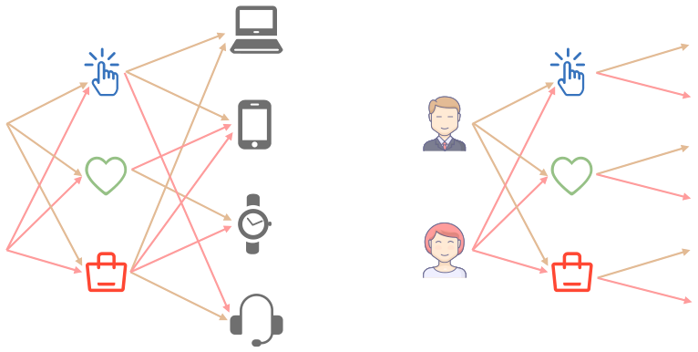
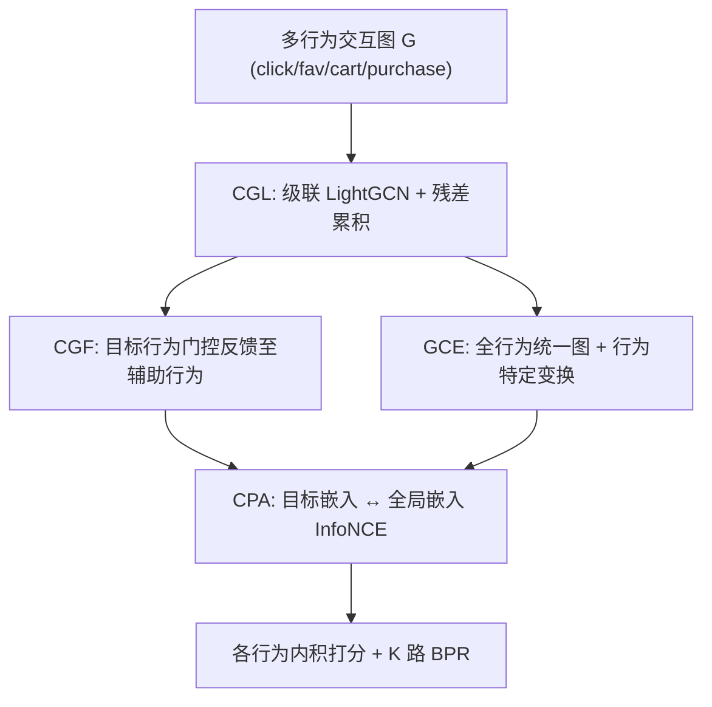
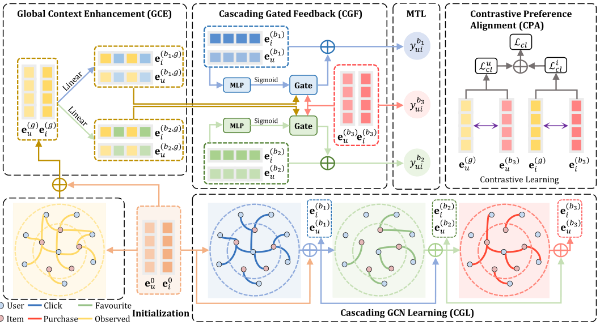

# Towards Multi-Behavior Multi-Task Recommendation via Behavior-informed Graph Embedding Learning (基于行为感知图嵌入学习的多行为多任务推荐)

- **会议/期刊**: TOIS 2026
- **作者与机构**: Wenhao Lai, Weike Pan, Zhong Ming（深圳大学计算机与软件学院；粤港澳大湾区人工智能与数字经济实验室）
- **推荐链路定位**: 精排（多任务多行为列表生成）
- **研究方向**: 多任务学习与列表级重排 / 图神经网络推荐
- **论文原文**: [https://arxiv.org/abs/2601.07294v1](https://arxiv.org/abs/2601.07294v1)
- **开源代码**: 暂未开源

## TL;DR (1分钟核心速览)

现有级联图范式（CRGCN/MB-CGCN/AutoDCS）把点击、收藏当作"免费信号"单向灌入购买任务，导致辅助行为自身排序质量极差，且中间行为缺失时残差会把他人交互灌入用户表征，形成偏好偏置。本文提出 BiGEL，用级联门控反馈（CGF）把目标行为反哺辅助行为、全局上下文增强（GCE）补回跨行为高阶信息、对比偏好对齐（CPA）校正级联偏置。在 JD/UB 两套工业数据集、全局时间戳切分 + Top-5 全库排序下，JD 购买 NDCG@5 达 0.0739（+6.2%），UB 点击 NDCG@5 达 0.0398（+128.7%）。

## Background & Motivation (背景与核心矛盾)

- **主流范式**: 多行为推荐（MBR）沿真实行为链 `click ≻ favourite ≻ purchase` 构建级联图，用 LightGCN 逐行为传播并残差累积，仅优化目标行为（购买）。
- **前人局限**: ① 辅助行为只作为购买任务的输入特征，其自身 Top-K 列表精度无人优化，而点击率/收藏量直接决定平台活跃与留存；② 级联残差在用户缺失中间行为（如收藏）时，卷积会用"同物品其他用户"的交互填补该层，偏好被替换并向下游层层放大。
- **核心洞察 (Key Insight)**: 目标行为 embedding 是用户最终决策最明确的表达，可作为高质量"监督信号"反向调制辅助行为；而全行为统一图保留跨行为高阶共现，可作为校正级联偏置的锚点。
- **本文切入点**: 把单向级联链改造为"反馈—全局—对齐"三闭环的双向多任务结构。

<figure class="paper-figure" markdown="span">
  <figcaption>图1. 多行为多任务推荐示意图。</figcaption>
</figure>

## Method (核心方法设计)

### 1. 整体框架 (Overall Architecture)

输入用户/物品 one-hot ID 得到初始嵌入，先经**级联 GCN 学习（CGL）**：按 `click≻favourite≻purchase` 顺序对每个行为子图做 LightGCN 传播，并以残差把前一行为嵌入累加到后一行为（$k>1$时$\boldsymbol{e}^{(b_k)}=\boldsymbol{e}^{(b_{k-1})}+\text{norm}(\boldsymbol{e}^{(b_k)})$）。随后 **CGF** 用门控把目标行为嵌入反馈给每个辅助行为，**GCE** 从全行为统一图注入全局偏好，二者均以加性门控写回辅助行为嵌入；**CPA** 以 InfoNCE 拉近目标行为嵌入与全局嵌入。最后对 K 个行为各算内积打分，联合 K 个 BPR 损失与对比损失端到端训练，推理时每个行为独立输出一份 Top-K 列表。

<figure class="paper-figure" markdown="span">
  <figcaption>图2. 以三种用户行为类型（即点击（𝑏1）、收藏（𝑏2）和购买（𝑏3））为例的BiGEL示意图。首先，级联GCN学习（CGL）组件捕获不同行为间的自然依赖关系，并建模其序列关系。然后，级联门控反馈（CGF）模块利用门控机制将目标行为（𝑏3）的嵌入传播回先前的辅助行为（𝑏1, 𝑏2），并设计全局上下文增强（GCE）模块来细化这些行为。接下来，对比投影对齐（CPA）</figcaption>
</figure>

### 2. 关键设计拆解 (Key Designs)

1. **级联门控反馈 CGF（把单向链变双向）**：痛点是级联只从辅助流向目标，辅助行为嵌入从未被目标行为"校准"。做法是对每个辅助行为学习 $d$维（而非 MMoE/PLE 的$m$ 专家维）细粒度门控，再做加性反馈：
$\boldsymbol{g}_u^{(b_k)}=\sigma(\mathbf{W}_2^{(b_k)}\text{LeakyReLU}(\mathbf{W}_1^{(b_k)}\boldsymbol{e}_u^{(b_k)}+\boldsymbol{b}_1^{(b_k)})+\boldsymbol{b}_2^{(b_k)}),\ \tilde{\boldsymbol{e}}_u^{(b_k)}=\boldsymbol{e}_u^{(b_k)}+\boldsymbol{g}_u^{(b_k)}\odot\boldsymbol{e}_u^{(b_K)}$。
直觉：门控按"该用户在该辅助行为上的表征"逐维决定吸收多少购买意图，避免 MMoE 式混合输入抹平行为差异。

2. **全局上下文增强 GCE（补回被切碎的高阶共现）**：行为子图割裂后，辅助行为（尤其稀疏的收藏，UB 仅占 0.04%）无法获得跨行为高阶邻居。做法是在合并全部行为边的统一图上做 LightGCN 得 $\boldsymbol{e}_u^{(g)}$，再行为特定变换 + 门控注入：$\hat{\boldsymbol{e}}_u^{(b_k,g)}=\mathbf{W}_3^{(b_k)}\boldsymbol{e}_u^{(g)}+\boldsymbol{b}_3^{(b_k)}$，$\tilde{\boldsymbol{e}}_u^{(b_k)}=\boldsymbol{e}_u^{(b_k)}+\boldsymbol{g}_u^{(b_k)}\odot\hat{\boldsymbol{e}}_u^{(b_k,g)}$。注意**目标行为不注入全局信息**，因其已通过级联吸收全部前置行为，再注入会冗余冲突。

3. **对比偏好对齐 CPA + 训练目标**：残差在中间行为缺失时累积噪声，故用 InfoNCE 对齐目标行为与全局视图（仅目标侧，因辅助行为已被 CGF 动态调制）：
$\mathcal{L}_{cl}^{(u)}=-\sum_{u\in\mathcal{U}}\log\frac{\exp(\Phi(\boldsymbol{e}_u^{(b_K)},\boldsymbol{e}_u^{(g)})/\tau)}{\sum_{v\in\mathcal{U}}\exp(\Phi(\boldsymbol{e}_u^{(b_K)},\boldsymbol{e}_v^{(g)})/\tau)}$，
物品侧同理。总损失 $\mathcal{L}=\sum_{k=1}^{K}\mathcal{L}_{b_k}+\lambda\mathcal{L}_{cl}+\beta\|\Theta\|_2^2$，各行为 BPR 权重相等；负采样为标准逐正样本均匀随机负采样，无难负样本挖掘。复杂度$O((M+N)d+Kd^2)$ 参数、单次前向即处理全部行为，较 CRGCN 的逐行为分别计算更省。

## Experimental Setup & Evaluation Protocol (实验设置与评估协议)

- **数据集与预处理**: 去重保留最早交互；物品过滤（JD 购买数 $\ge 20$，UB$\ge 10$）；会话过滤（购买数$\ge 5$）；删除仅在验证/测试出现过的用户。

| 数据集 | #Users | #Items | #Interactions | 稀疏度 | 行为类型 |
| :--- | :---: | :---: | :---: | :---: | :--- |
| JD | 10,690 | 13,465 | 334,580（购 71,872 / 点 253,898 / 藏 8,810） | 0.50‰(购买) | 3 类 |
| UB | 20,443 | 30,947 | 874,917（购 133,708 / 点 631,608 / 藏 26,856 / 车 82,745） | 0.21‰(购买) | 4 类 |

- **数据划分与防穿越**: **全局时间戳切分** 80%/10%/10%（训练/验证/测试），明确规避 Leave-One-Out 的数据泄漏。
- **排名评测协议**: Top-K 全库排序，指标 Prec@5 / Rec@5 / NDCG@5 / HR@5，并补充 NDCG@10/@15 验证小截断结论稳健性。
- **对比基线与超参**: 10 个基线分三类——单行为（MF-BPR、LightGCN）、多行为（GHCF、CRGCN、MB-CGCN、BCIPM、AutoDCS、DA-GCN）、多行为多任务（BVAE、POGCN）；$d=100$、batch 500、Adam，$\beta=10^{-3}$，$\lambda\in\{0.001,0.01,0.1,1\}$，$\tau\in\{0.1,0.2,0.5,0.8\}$；级联层数按行为顺序递增（JD 1/2/3，UB 1/2/3/4）；结果取 3 个随机种子均值，并做$p\le 0.05$ 显著性检验。

## Key Experimental Results (实验关键数据)

### 1. 主实验对比 (Main Results)

| 模型 | JD-Pur NDCG@5 | JD-Pur Prec@5 | JD-Click NDCG@5 | UB-Pur NDCG@5 | UB-Pur Prec@5 | UB-Click NDCG@5 |
| :--- | :---: | :---: | :---: | :---: | :---: | :---: |
| LightGCN | 0.0530 | 0.0304 | 0.0460 | 0.0047 | 0.0022 | 0.0075 |
| GHCF | 0.0678 | 0.0360 | 0.0509 | 0.0159 | 0.0078 | 0.0165 |
| CRGCN | 0.0595 | 0.0349 | 0.0407 | 0.0334 | 0.0149 | 0.0105 |
| AutoDCS | 0.0691 | 0.0375 | 0.0198 | 0.0373 | 0.0157 | 0.0023 |
| BVAE | 0.0696 | 0.0360 | 0.0513 | 0.0140 | 0.0068 | 0.0174 |
| POGCN | 0.0571 | 0.0324 | 0.0464 | 0.0217 | 0.0095 | 0.0071 |
| **BiGEL** | **0.0739** | **0.0408** | **0.0526** | **0.0406** | **0.0176** | **0.0398** |
| Improv. | +6.2% | +8.8% | +2.5% | +8.8% | +12.1% | +128.7% |

### 2. 消融实验 (Ablation Study)

ΔNDCG@5（相对 BiGEL，负值为下降；依原文图 4 读图整理）：

| 变体 | JD-Pur | JD-Click | UB-Pur | UB-Click |
| :--- | :---: | :---: | :---: | :---: |
| w/o GCE | 0.0000 | −0.0011 | −0.0016 | −0.0052 |
| w/o CGF（连带 GCE） | −0.0033 | −0.0024 | −0.0049 | −0.0170 |
| w/o CPA | −0.0170 | −0.0183 | −0.0156 | −0.0046 |
| w/o GCE&CPA | −0.0101 | −0.0099 | −0.0046 | −0.0275 |
| w/o GCE&CPA&CGF | −0.0093 | −0.0106 | −0.0017 | −0.0037 |

### 3. 关键实验发现 (Key Findings)

1. **辅助行为不是"零和牺牲品"**：UB 点击 Prec@5 由 BVAE 的 0.0107 提升到 0.0215（+101%），而购买任务同时 +12.1%；说明 CGF 的双向门控让辅助任务从"被抽取"转为"被增益"，这是纯级联方法（AutoDCS 在 UB 点击 NDCG 仅 0.0023）完全无法达到的。
2. **CGF 是平衡多任务的第一贡献项，CPA 是纠偏项**：移除 CGF 使 UB 点击 NDCG 掉 −0.0170（最大单项跌幅），印证目标→辅助反馈的关键性；移除 CPA 主要损伤购买（JD −0.0170、UB −0.0156），定量验证了"中间行为缺失 → 残差灌入他人交互 → 偏好偏置"的因果链。
3. **行为链的"数量与顺序"必须与真实依赖一致**：UB 从 U1（仅购买）到 U6（Click≻Fav≻Cart≻Purchase）购买 NDCG 单调上升，但把顺序改成 U7–U11 任一排列均下降；JD 上从 J3（Click≻Purchase）加入 favourite（J4）反而使点击下降，因收藏与点击在 JD 弱相关（仅 0.06‰），引入噪声。此外 $\lambda$ 随行为数增大而增大（JD 最优 0.01，UB 点击/购买最优 0.1，cart 最优 1），行为链越长越需强对比约束。

## Highlights & Limitations (亮点、对比与审稿批判)

- **与代表作对比 (vs. Prior Work)**: 相比 CRGCN/MB-CGCN 的单向级联，本文首次让目标行为反向调制辅助行为；相比 BVAE 的并行 VAE 编码，保留了真实行为顺序且具备高阶图传播能力；相比 POGCN 的单一共享嵌入，BiGEL 为每个行为保留独立嵌入，行为区分度更高。
- **可迁移亮点**: ① 用 $d$维逐维门控替代 MMoE 的$m$ 专家门控，在需要"细粒度行为区分"的多任务场景可直接复用；② 对级联/序列式传播中"缺失中间环节"造成的表征污染，用"全局视图 + 目标侧对比对齐"做无标注纠偏，可迁移到序列推荐与跨域迁移。
- **审稿级局限批判**: ① 行为顺序（如 Click≻Fav≻Cart≻Purchase）依赖人工先验，实验显示顺序错误即掉点，缺少自动学习行为依赖图的能力；② 每个行为各需一套门控与 BPR 损失，行为数增长时训练与调参成本线性上升，且论文未给出线上推理延迟或多任务权重自适应（GradNorm）的实测；③ 未显式说明排序是否为全库打分及负采样比例，与部分采用采样评估的 MBR 工作不完全可比。

## Rating (四维评分)

- **方法创新性 (Novelty)**: ⭐⭐⭐⭐ （在成熟级联范式上做"反向反馈 + 全局锚点 + 对比纠偏"的组合式创新，单点新意有限但问题定位（辅助行为被牺牲、级联偏好偏置）准确且首次系统化解决）
- **评估协议与实验扎实度 (Protocol & Experiments)**: ⭐⭐⭐⭐ （两套大规模工业数据集、全局时间戳切分避免泄漏、10 个强基线 + 3 seed 均值 + $p\le0.05$ 检验，并补 @10/@15、行为数与顺序、MTL 模块替换等系统性分析）
- **写作与数学规范度 (Clarity & Rigor)**: ⭐⭐⭐⭐ （四个模块公式与算法伪代码完整、复杂度对比 CRGCN 清晰；但门控中复用同一 $\boldsymbol{g}$ 符号指代 CGF 与 GCE 两处不同门控，符号略有歧义）
- **工业落地与复现价值 (Industrial & Practical Value)**: ⭐⭐⭐⭐ （单次前向处理全部行为、参数量仅 $O((M+N)d+Kd^2)$，易于在电商多目标精排中落地；但代码未开源、行为顺序需人工设定，复现与上线调优成本偏高）

