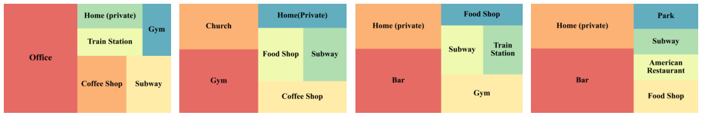
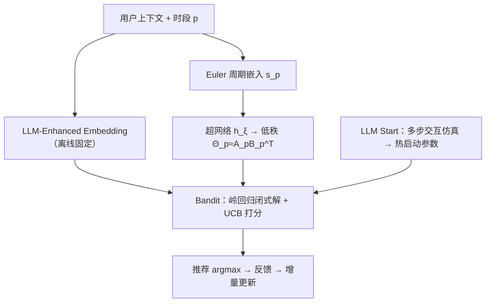
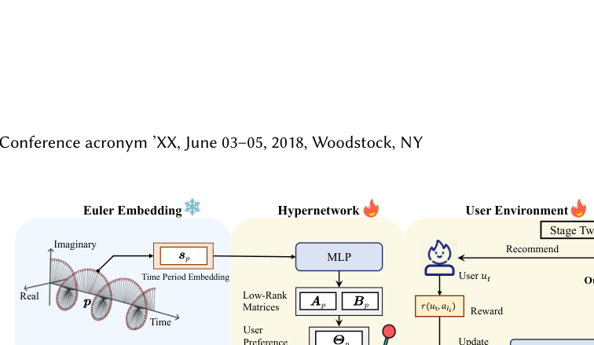

# Enhancing Bandit Algorithms with LLMs for Time-varying User Preferences in Streaming Recommendations (以 LLM 增强 Bandit 算法以应对流式推荐中的时变用户偏好)

- **会议/期刊**: TOIS 2026
- **作者与机构**: Chenglei Shen, Yi Zhan, Weijie Yu, Xiao Zhang, Jun Xu（中国人民大学高瓴人工智能学院、对外经贸大学）
- **推荐链路定位**: 精排/在线决策（流式上下文 Bandit 打分与动作选择）
- **研究方向**: 强化学习与动态探索推荐 / 大语言模型推荐
- **论文原文**: [https://arxiv.org/abs/2602.08067v1](https://arxiv.org/abs/2602.08067v1)
- **开源代码**: [https://github.com/Starrylay/HyperBandit.git](https://github.com/Starrylay/HyperBandit.git)

## TL;DR (1分钟核心速览)

流式推荐中用户偏好呈"周/日"双周期波动，但现有 Bandit 把时间当作普通上下文特征，且冷启阶段奖励稀疏导致探索-利用低效。HyperBandit+ 用 Euler 周期嵌入驱动超网络生成低秩用户偏好矩阵 $\Theta_p$，再用 LLM 两步增广（画像补全 + 交互仿真）做离线热启动。在 KuaiRec/NYC/TKY 的"1 正 + 24 负"采样排序协议下，归一化累积奖励较最优基线最高提升 **68.2%**，并给出$\tilde{O}(d^{2/3}\mathcal{P}_T^{1/3}T^{2/3})$ 的近最优动态遗憾界。

## Background & Motivation (背景与核心矛盾)

- **主流范式**: 流式推荐普遍采用上下文 Bandit（LinUCB/FactorUCB 假设平稳环境，DLinUCB/ADTS 假设分段平稳并做变更点检测），通过岭回归维护每个臂的奖励估计。
- **前人局限 ①**: 时间信息被当作普通特征拼接进上下文，无法表达"同一时段奖励分布相似"的周期性；而分段平稳方法一旦检测到变化就**丢弃历史知识**，在周期性场景下反复重启，等价于周期性遗忘。
- **前人局限 ②**: 首周数据极度稀疏（半数物品被访问 < 12 次、半数用户交互 < 9 次），候选动作空间巨大导致奖励稀疏，在线算法早期几乎随机探索，用户体验差。
- **核心洞察 (Key Insight)**: 作者把一周切成 7 天 × 5 时段共 **35 个时段**，同一时段的真实奖励 $r^*(u,a,p)$服从近似同分布；进一步对$\Theta_p^{(N)}$ 做 SVD 发现奇异值集中在前几维（图 5），即偏好矩阵存在**强低秩结构**，可压缩超网络输出。
- **本文切入点**: 时间嵌入 $\to$ 超网络直接"生成"偏好矩阵（而非拼接特征），并用 LLM 世界知识在离线阶段仿真交互做 warm start。

<figure class="paper-figure" markdown="span">
  <figcaption>图1. 树图可视化展示 Foursquare-NYC 兴趣点（POI）数据集在工作日与周末的早晨和夜间时段的周期性变化。区块大小对应访问频率，区块越大表示访问次数越多。</figcaption>
</figure>

## Method (核心方法设计)

### 1. 整体框架 (Overall Architecture)

离线阶段先由 LLM-Enhanced Embedding 补全用户画像与物品属性并编码为固定观测特征，再由 LLM Start 让 LLM 扮演用户在多时段上批量"选品"，生成模拟交互流，预训练超网络与 Bandit 内部统计量；在线阶段每个时间步把当前时段 $p$经 Euler 嵌入送入超网络，输出低秩分解的偏好矩阵$\Theta_p$，Bandit 用岭回归闭式解更新物品隐特征并计算 UCB 得分完成推荐，反馈后再增量更新统计量。超网络与 Bandit 交替训练：Bandit 每步更新，超网络每$T_n=2000$（KuaiRec/NYC）或 5000（TKY）步 mini-batch 更新一次，兼顾实时性与稳定性。

<figure class="paper-figure" markdown="span">
  <figcaption>图3. HyperBandit+ 的结构（在时间 𝑡 对 HyperBandit 扩展 LLM Start、Euler Embedding 和 LLM-Enhanced Embedding）。工作流程为：赌博机策略从候选池中选择一个臂（推荐一个物品），与环境交互以获取反馈，随后更新赌博机策略。“Stage One”和“Stage Two”表示依次与赌博机策略交互的两个环境。图示符号分别表示在线阶段模块的可用性和离线策略。</figcaption>
</figure>

### 2. 关键设计拆解 (Key Designs)

1. **Euler 周期嵌入 + 时间感知超网络**：痛点是把时间拼进 context 后模型难以分离时段效应，且直接输出 $d_a\times d_u$矩阵参数爆炸。作者用 Fourier 特征把离散时段映射到高维超球面，双周期（周/日）$m=2$：$\boldsymbol{s}_p=[\cos(2\pi a_1(p)),\sin(2\pi a_1(p)),\cos(2\pi a_2(p)),\sin(2\pi a_2(p))]^\top$，再由 MLP 超网络生成$\Theta_p=h_\xi(\boldsymbol{s}_p)\approx \boldsymbol{A}_p\boldsymbol{B}_p^\top$。物理直觉：周期映射保证"周一早晨"与"下周一早晨"嵌入几乎重合，从而使偏好矩阵在同类时段间共享统计强度；低秩因式分解把输出维度由$d_ad_u$降至$\tau(d_a+d_u)$。

2. **双分支岭回归 + 选择性 UCB 探索**：物品上下文拆成可学习隐特征 $\boldsymbol{x}_a$与 LLM 给出的固定观测特征$\boldsymbol{s}_a$，对$\boldsymbol{x}_a$ 做岭回归得闭式解
   $\boldsymbol{x}_a(t)=\Psi_{a,t}^{-1}\boldsymbol{b}_{a,t}$，其中$\Psi_{a,t}=\sum_{u}(\Theta_p^x\boldsymbol{c}_u)(\Theta_p^x\boldsymbol{c}_u)^\top+\lambda\boldsymbol{I}$、$\boldsymbol{b}_{a,t}=\sum_{u}(\Theta_p^x\boldsymbol{c}_u)[r-(\Theta_p^s\boldsymbol{c}_u)^\top\boldsymbol{s}_a]$；UCB 打分为
   $f_t=[\boldsymbol{s}_a^\top,\boldsymbol{x}_a^\top]\Theta_p\boldsymbol{c}_u+\alpha\sqrt{(\Theta^x_p\boldsymbol{c}_u)^\top\Psi_{a,t}^{-1}(\Theta^x_p\boldsymbol{c}_u)}$。关键细节：探索项只含$\Theta^x_p$，因为不确定性仅来自在线更新的隐特征，固定观测特征无需探索，避免了对 LLM 静态特征的无效抖动。

3. **LLM Start 两步增广与超网络 ListNet 训练**：稀疏与隐私导致画像缺失，故第一步用 LLM 依据首周（少量）交互推断年龄/职业/预算/时变偏好，并补全物品的功能、峰时、消费层级等属性；第二步让 LLM 在 BPR 粗筛的候选池中按给定时段挑 top-$k$作为正样本，生成覆盖 35 个时段的模拟交互流用于预训练。超网络损失取 ListNet 形式$\mathcal{L}_\xi=-\sum_{t}\sum_{k=1}^{M}P(y_{u_t,a_k,p_t})\log\hat{P}(\hat{r}_{u_t,a_k,p_t})$，标签设为点击 1、被推荐未点击$-1$、候选但未被推荐 0，利用"未曝光候选"的弱负信号。在线推理仅需一次矩阵-向量内积与$O(l_a^3)$岭回归，实测毫秒级（$3.7\times10^{-3}$ s/步）。

## Experimental Setup & Evaluation Protocol (实验设置与评估协议)

- **数据集与预处理**: KuaiRec 取稠密子矩阵，动作空间收缩为视频 **tag 类别**（529 类）；Foursquare 以 POI 类别（400/385 类）为动作。

| 数据集 | #Users | #Items | #Interactions | 密度 | 场景说明 |
| :--- | :---: | :---: | :---: | :---: | :--- |
| KuaiRec | 1,411 | 3,327 (529 tags) | 4.69M | ≈100%（稠密子矩阵） | 短视频，watch ratio > 2.0 记正反馈 |
| Foursquare-NYC | 1,083 | 38,333 | 227,428 | $5.5\times10^{-6}$ | POI 签到，约 10 个月 |
| Foursquare-TKY | 2,293 | 61,858 | 573,703 | $4.0\times10^{-6}$ | POI 签到，约 10 个月 |

- **数据划分与防穿越**: 全局时间戳切分（strictly streaming）。KuaiRec 取 2020-08-10~08-16 一周，按时段重采样 16 次构造 16 周以显式注入周期结构；POI 用首周数据做画像增强与初始嵌入，**测试时剔除首周**，避免信息泄漏。
- **排名评测协议**: `Sampled Ranking`——每步候选集固定 $|\mathcal{A}_t|=25$（1 个真实正样本 + 24 个当前时段负样本随机采样）；指标为**归一化累积奖励**（累积奖励 / 随机策略累积奖励），并报告遗憾曲线。
- **对比基线与超参**: 6 个 Bandit 基线（LinUCB、HybridLinUCB、DLinUCB、ADTS、FactorUCB、前作 HyperBandit）；$d_u=d_a=25$，隐/观测特征维 10/15，$\alpha=\lambda=0.1$，LLM 为 Llama-3.1-8B-Instruct + text-embedding-ada-002 + PCA 降至 25 维；5 次独立运行，配对$t$检验$p<0.05$。

## Key Experimental Results (实验关键数据)

### 1. 主实验对比 (Main Results)

| 算法 | KuaiRec | NYC | TKY | BP 运行时间(s) |
| :--- | :---: | :---: | :---: | :---: |
| LinUCB | 3.02±0.03 | 4.70±0.10 | 10.44±0.03 | $4.55\times10^{-4}$ |
| HybridLinUCB | 2.53±0.02 | 4.04±0.03 | 10.31±0.10 | $2.97\times10^{-2}$ |
| DLinUCB | 2.22±0.01 | 4.07±0.05 | 7.96±0.02 | $5.61\times10^{-4}$ |
| ADTS | 1.46±0.01 | 2.90±0.01 | 6.49±0.04 | $3.78\times10^{-3}$ |
| FactorUCB | 3.02±0.01 | 4.30±0.14 | 9.70±0.24 | $9.54\times10^{-2}$ |
| HyperBandit (前作) | 4.55±0.08 | 7.99±0.17 | 13.93±0.08 | $2.13\times10^{-3}$ |
| **HyperBandit+ (τ=5, 实时配置)** | 4.92±0.15 | 8.27±0.08 | 13.99±0.05 | $3.81\times10^{-3}$ |
| **HyperBandit+ (全秩)** | **5.08±0.11** | **8.49±0.25** | **14.00±0.05** | $3.71\times10^{-3}$ |
| **Improv. vs 最优基线** | **+68.2%** | **+80.6%** | **+34.1%** | — |
| Improv. vs 前作 HyperBandit | +11.6% | +6.3% | +0.5% | — |

### 2. 消融实验 (Ablation Study)

| 变体（超网输出秩 τ） | KuaiRec | NYC | TKY | HN 训练耗时(KuaiRec / FS) |
| :--- | :---: | :---: | :---: | :---: |
| HyperBandit+ τ=1 | 4.80 | 6.91 | 13.27 | $3.17\times10^{-4}$/$1.91\times10^{-4}$ |
| HyperBandit+ τ=3 | 4.83 | 7.91 | 13.92 | $3.25\times10^{-4}$/$2.01\times10^{-4}$ |
| HyperBandit+ τ=5 | 4.92 | 8.27 | 13.99 | $3.72\times10^{-4}$/$2.07\times10^{-4}$ |
| HyperBandit+ 全秩 (w/o Low-Rank) | 5.08 | 8.49 | 14.00 | $4.11\times10^{-4}$/$2.54\times10^{-4}$ |
| HyperBandit（去掉 LLM Start/Euler/LLM-Emb.） | 4.55 | 7.99 | 13.93 | $3.26\times10^{-4}$/$3.71\times10^{-4}$ |

组件层面，去掉 LLM Start 的 RestartUCB 在三个数据集上的**遗憾曲线全程高于**含 LLM Start 的版本（图 7），差距在 $10^5$ 步后仍未被追平；Euler 嵌入提供跨周时段对齐，LLM-Enhanced Embedding 提供高质量观测特征（RQ3–RQ5 详表见原文）。

### 3. 关键实验发现 (Key Findings)

1. **低秩是"低成本高保真"的压缩**：$\tau=5$相比全秩仅损失 3.1%/2.6%/0.07% 的累积奖励，却把超网单步训练时间降低 9.5%（KuaiRec）与 18.5%（Foursquare）；而$\tau=1$在 NYC 掉到 6.91（$-18.6\%$），说明秩过小会破坏偏好矩阵时段分辨力，$\tau$ 存在明显下限。
2. **分段平稳方法在周期环境下系统性失效**：DLinUCB（2.22/4.07/7.96）与 ADTS（1.46/2.90/6.49）全面低于静态 LinUCB（3.02/4.70/10.44），因为它们把"周而复始"误判为"环境变更"并丢弃历史——这直接印证了"周期环境应复用而非重启"的动机。
3. **LLM 热启动的收益集中在早期，且随交互积累衰减**：KuaiRec 上前 5 万步的累积奖励斜率最陡，相对前作提升 11.6%；但在 TKY 的长程（约 50 万步）上仅 +0.5%，甚至略低于前作（13.99 vs 13.93 在噪声范围内），说明 warm start 主要解决冷启动遗憾，长期收益需靠超网络的周期建模。

## Highlights & Limitations (亮点、对比与审稿批判)

- **与代表作对比**: vs **HyperBandit**（同组前作），本文新增 LLM Start（解决冷启）+ Euler 嵌入（解决跨周时段对齐）+ 低秩压缩（解决训练开销），把"能建模周期"升级为"低成本可实时建模周期"；vs **DLinUCB/ADTS**，本质区别是拒绝"变更点—重启"范式，改用连续时段条件化；vs **FactorUCB**，用超网络生成的偏好矩阵替代用户邻接矩阵更新，运行时间低一个数量级（$10^{-3}$vs$10^{-1}$ s）。
- **可迁移亮点**: ①"固定观测特征不探索、仅对在线学习部分做 UCB 探索"的探索项裁剪，可直接迁移到任何混合静态/动态表征的 Bandit 排序；②用 LLM 在粗筛候选池内生成 top-$k$ 伪正样本做离线 warm start，是一种低成本、免标注的离线预训练范式。
- **审稿级局限批判**: ①**增益结构性问题**——真实增益主要来自"vs 非超网基线"，而与同组前作 HyperBandit 的对比在 TKY 上仅 +0.5%，缺少数值敏感的显著性说明；②**LLM 依赖与数据构造偏置**——依赖 Llama-3.1-8B 仿真 + 人工构造的 16 周重采样流，模拟交互的分布偏置、离线调用成本与 prompt 敏感性均未量化，且 KuaiRec 的周期性带有较强人工注入成分；③**假设偏强**——奖励被建模为 $r=\boldsymbol{c}_a^\top\Theta_p\boldsymbol{c}_u$ 的双线性形式，对非线性偏好表达受限，且仅与 Bandit 基线比较，未与全监督流式模型或轻量序列模型（如 SASRec/流式 GRU）对照。

## Rating (四维评分)

- **方法创新性 (Novelty)**: ⭐⭐⭐⭐ （把超网络从"生成权重"落到"生成时变偏好矩阵"并结合 Euler 双周期嵌入与低秩压缩，机制自洽且有 SVD 实证支撑）
- **评估协议与实验扎实度 (Protocol & Experiments)**: ⭐⭐⭐ （三数据集 + 5 次运行 + 配对 $t$ 检验齐全，但采样排序仅 1:24、缺 Full-Ranking 与组件级完整消融表，与前作差距偏小）
- **写作与数学规范度 (Clarity & Rigor)**: ⭐⭐⭐⭐⭐ （岭回归闭式解、LLM 增广降低方差引理与 $\tilde{O}(d^{2/3}\mathcal{P}_T^{1/3}T^{2/3})$ 动态遗憾界推导完整，达近最优下界）
- **工业落地与复现价值 (Industrial & Practical Value)**: ⭐⭐⭐⭐ （毫秒级在线开销 + 低秩超参可调，代码开源；但离线 LLM 仿真管线较重，工程化需替换为自有 LLM 与粗筛召回）

