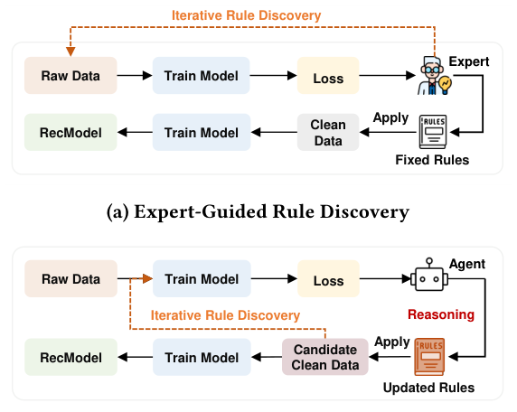
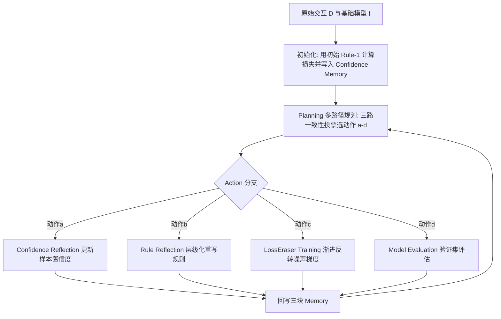

# RuleAgent: Discovering Rules for Recommendation Denoising with Autonomous Language Agents (以自主语言智能体发现推荐去噪规则)

- **会议/期刊**: TOIS 2026
- **作者与机构**: Zongwei Wang, Min Gao (重庆大学); Junliang Yu, Shazia Sadiq, Hongzhi Yin (昆士兰大学); Yupeng Hou (UCSD)
- **推荐链路定位**: 训练期数据清洗 / 隐式反馈去噪
- **研究方向**: 自监督对比学习与交互去噪 / LLM4Rec
- **论文原文**: [arXiv:2503.23374](https://arxiv.org/abs/2503.23374v1)
- **开源代码**: 暂未开源（仅使用 Gemma-2B / Llama3-8B 作为 backbone 权重）

## TL;DR (1分钟核心速览)

针对隐式反馈中手工去噪规则"人力密集、跨场景不迁移"的痛点，RuleAgent 用 LLM 驱动的四模块语言智能体（Profile/Memory/Planning/Action）模拟数据专家，通过多轮反思动态生成层级化去噪规则；并配套 LossEraser——一种将噪声样本由正样本翻转成负样本的遗忘式训练策略，免去反复重训。在 Beauty/Yelp2018/Gowalla 小规模稠密子集上，相对 LightGCN 基线 Recall@20 提升 **7.5%**（Beauty）、**58.9%**（Yelp）、**13.3%**（Gowalla），并比 re-training 快约 **4 倍**。

## Background & Motivation (背景与核心矛盾)

- **主流范式**: 无辅助信息时，去噪主流做法是从训练损失轨迹推断噪声，例如 T-CE（高 loss 即噪声）、DeCA（两模型预测分歧）、BOD（双层优化样本权重）、DCF（双重校正重标注），核心均是人工观察 $\mathcal{L}$曲线后写出一条固定规则$\mathcal{R}$，据此清洗数据集$\mathcal{D}_c=\mathcal{R}(\mathcal{L}_{\text{rec}}(\mathcal{D}))$ 再重训。
- **前人局限**: ① 规则依赖领域专家反复"猜测-验证"迭代，人力与试错成本极高；② 一旦写死 $\mathcal{R}$，跨数据集/模型分布迁移能力差，需整体推倒重来。
- **核心洞察 (Key Insight)**: LLM 天然具备"归纳-假设-验证"的推理能力，如果能赋予它**记忆化上下文**、**反思式迭代**与**可操控推荐模型的工具接口**，就能把本来属于人类专家的 Rule Mining 流程完全自动化，并让规则随数据/模型状态动态自适应。
- **本文切入点**: 提出 RuleAgent——首个将语言智能体用于推荐去噪工作流的框架；配合 LossEraser 遗忘式算子替代重训，同时解决"自动化规则发现"与"高频重训开销"两个核心瓶颈。

<figure class="paper-figure" markdown="span">
  <figcaption>图1：专家引导与智能体驱动的推荐去噪规则发现对比。</figcaption>
</figure>

## Method (核心方法设计)

### 1. 整体框架 (Overall Architecture)

RuleAgent 把去噪流程建模为 `Agent(f, D) → D_c` 的多轮闭环：Profile 模块以 Prompt 形式定义"数据去噪专家"角色与评分目标；Memory 模块分三块存储——**Confidence Memory**（逐样本 $[0,2]$ 噪声置信度与解释）、**Rule Memory**（层级结构 `Rule-i.i.i` 的候选去噪规则）、**Action Memory**（历次动作+反馈）；每轮由 Planning 模块对三块记忆独立拟定下一步（自一致性投票选出最优），再由 Action 模块执行 {Confidence Reflection、Rule Reflection、LossEraser Training、Model Evaluation} 之一，完成后回写 Memory 并循环，直至模型验证指标连续 5 轮下降或达到预算。整个流程无人为干预，最终输出为"层级规则 + 清洗后最优模型 + 逐样本置信解释"三件套。

### 2. 关键设计拆解 (Key Designs)

1. **三记忆融合的多路径规划 (Multi-Path Planning)**：痛点在于 LLM 单步推理随机性大、易陷入局部错误动作。RuleAgent 借鉴 self-consistency，要求 LLM **从 Confidence Memory 视角、Rule Memory 视角、Action History 视角**分别独立拟定下一动作，再比较三者给出终选，即 $M_A \leftarrow \text{Planning}(M_C, M_R, M_A)$。这样三路不同来源的"证据链"相互校正，避免仅凭单一置信度噪音而误判为规则修改。

2. **层级化规则反思 (Hierarchical Rule Reflection)**：为突破 LLM 输入 token 限制与规则膨胀，Rule Reflection 阶段**随机采样 1000 条交互**读取 Confidence Memory，再按"Value-Related / Fluctuation-Related / Outlier-Related"三大类目**自动生成/合并/层级化**规则 $M_R \leftarrow \text{Reflection}_R(M_C, M_R)$。层级化（如 `Rule-1.1.1(Multiple Exceedances)`）让专家能直接审阅逻辑树，也让"规则发现"过程本身可视可溯源。

3. **LossEraser 遗忘式免重训 (Unlearning-based Training)**：痛点在于 Agent 每更新规则都要从零重训一次模型，代价不可忽略。LossEraser 把 Agent 判定为噪声的样本 $n$ 从正样本**翻转**为负样本，让梯度反向"擦除"先前正样本训练留下的影响：
$$\mathcal{L}_{\text{eraser}}=\mathbb{E}_{(u,i,n)\in\mathcal{D}_c}-\log\sigma\!\big(f(z_u,z_i)-\alpha_t\cdot w_{u,n}\cdot f(z_u,z_n)\big)$$
进一步引入两个增强：(i) **Progressive Reversal** $\alpha_t=t/T$，起始梯度反转弱、随训练渐进增强，避免参数剧烈震荡；(ii) **Adaptive Reversal**$w_{u,n}=1-c_{u,n}$，$c_{u,n}$为归一化置信度，权重越大的噪声样本被"遗忘"得越彻底。最终训练目标$\mathcal{L}=\mathcal{L}_{\text{rec}}+\alpha\mathcal{L}_{\text{eraser}}$，其中$\alpha\in[0.01,0.1]$，实验证实可省掉约 4× 训练时间且几乎不损精度。同时，"观察损失"仍沿用$\mathcal{L}_{\text{rec}}$，避免 Agent 把擦除损失误读为信号。

## Experimental Setup & Evaluation Protocol (实验设置与评估协议)

- **数据集与预处理**: 3 个公共 Benchmark，因 LLM API 调用成本高，均按 [28,41] 的做法**从全量中抽取 top-100 最活跃用户的稠密子集**（"small"版）；同时报告全量数据集上的迁移测试。注意"小"指用户数少而非物品少，稠密度反而高于全量。

| 数据集 | #Users | #Items | #Interactions | 密度 | 场景 |
| :--- | :---: | :---: | :---: | :---: | :--- |
| Beauty (full) | 22,363 | 12,099 | 198,503 | 0.073% | 亚马逊美妆 |
| Beauty-small | 100 | 2,776 | 8,604 | 3.099% | 子集 |
| Yelp2018 (full) | 31,668 | 38,048 | 1,561,406 | 0.130% | 本地生活 |
| Yelp-small | 100 | 2,882 | 4,662 | 1.617% | 子集 |
| Gowalla (full) | 18,737 | 32,495 | 741,906 | 0.122% | LBSN |
| Gowalla-small | 100 | 2,498 | 4,096 | 1.639% | 子集 |

- **数据划分与防穿越 (Splitting Strategy)**: 按 **7:1:2 比例划分**训练/验证/测试，属比例划分（非时间戳切分），因此评测不严格防未来信息泄漏；复现时需注意其"动态兴趣"假设较弱。
- **排名评测协议 (Ranking Protocol)**: 采用 **Full-Ranking（全库未交互物品排序）**，指标 Recall@{10,20} 与 NDCG@{10,20}，各指标跑 10 次取均值；未采用采样负例排序，评测较客观。
- **对比基线与超参设置**: 三种 backbone（GMF、LightGCN、XSimGCL）× 五种去噪基线（T-CE/DeCA/BOD/DCF/Normal）。嵌入维度 $d=64$、batch=512、lr=1e-3、Adam、Xavier 初始化、LightGCN/XSimGCL 层数 2；RuleAgent 主干 LLM 为 GPT-4o mini，消融对比 Gemma-2B、Llama3-8B、Qwen-Turbo、GLM-4-Flash。

## Key Experimental Results (实验关键数据)

### 1. 主实验对比 (Main Results)

下表取 LightGCN 为 base，三个小数据集的核心指标（原文 Table 2，全部排在 12 个指标单元格内均有提升）：

| Method | Beauty R@20 | Beauty N@20 | Yelp R@20 | Yelp N@20 | Gowalla R@20 | Gowalla N@20 |
| :--- | :---: | :---: | :---: | :---: | :---: | :---: |
| Normal (无去噪) | 0.14056 | 0.16844 | 0.05524 | 0.03851 | 0.09652 | 0.05872 |
| T-CE (2021) | 0.14333 | 0.17022 | 0.05729 | 0.04022 | 0.10608 | 0.05955 |
| DeCA (2022) | 0.14632 | 0.17321 | 0.05879 | 0.04782 | 0.09808 | 0.05903 |
| BOD (2023) | 0.14402 | 0.17812 | 0.05681 | 0.04802 | 0.09913 | 0.06132 |
| DCF (2024) | 0.13902 | 0.16705 | 0.05952 | 0.04171 | 0.10152 | 0.06502 |
| **RuleAgent** | **0.15113** | **0.18264** | **0.08782** | **0.05958** | **0.10938** | **0.06921** |
| **Improv.** | +7.5% | +8.4% | **+58.9%** | +54.7% | +13.3% | +17.8% |

在 GMF 上提升更激烈：Yelp-small R@20 / N@20 从 0.01666/0.01265 → 0.04643/0.03335（**+178%/+163%**），Gowalla-small R@20 从 0.04472 → 0.08912（**+99%**）。在**全量数据集**（Table 3，将发现规则迁移回 full 数据）上亦稳定领先，Beauty R@20 0.12982→0.13358、Gowalla R@20 0.10892→0.11342。

### 2. 消融实验 (Ablation Study)

**(a) LossEraser vs Re-training vs Normal（如图3，GMF backbone）**

| 训练策略 | Beauty-small R@20 | Yelp-small R@20 | Gowalla-small R@20 | 训练时间 |
| :--- | :---: | :---: | :---: | :---: |
| Normal（无去噪） | 0.12109 | 0.01666 | 0.04472 | 1× |
| 规则+Re-training | 0.14296 | 0.04643 | 0.08912 | ~4× |
| 规则+**LossEraser** | 0.14296 | 0.04643 | 0.08912 | **1×** |

**(b) 不同 LLM Backbone（Beauty-small / Table 4, R@20）**

| Backbone | Beauty R@20 | Yelp R@20 | Gowalla R@20 |
| :--- | :---: | :---: | :---: |
| Gemma-2B | 0.12551 | 0.02136 | 0.04615 |
| Llama3-8B | 0.13350 | 0.03215 | 0.05218 |
| Qwen-Turbo | 0.14084 | 0.04582 | 0.08248 |
| GLM-4-Flash | 0.13945 | 0.04445 | 0.08465 |
| **GPT-4o mini** | **0.14196** | **0.04643** | **0.08910** |

### 3. 关键实验发现 (Key Findings)

- **规则迁移能力已被验证**：在 small 子集上发现的规则用于 full 数据集（Table 3），LightGCN/GMF/XSimGCL 三 backbone 下的 12 项指标全部优于人工/自动去噪基线，说明"小样本上调用 LLM 反推规则、大样本上轻量应用"是一种划算的部署范式。
- **提升幅度极大但不均衡**：在 GMF 上 Yelp 的提升高达 +178%（R@20），远超 LightGCN/XSimGCL，说明越弱的基础模型越依赖清洗数据；而 XSimGCL（强对比学习基线）的提升收窄到 +2%-4%，暗示强表征正则本身可能部分抵消了噪声。这一点原文仅一句带过，缺乏深层归因。
- **LLM 推理能力决定上限**：Gemma-2B 与 GPT-4o mini 在 Beauty-small R@20 上相差 13%（0.1255 vs 0.1420），Yelp/Gowalla 差距更大（0.021 vs 0.046、0.046 vs 0.089）；小模型推理链太短，无法支撑层级化规则发现，说明 RuleAgent 本质上是"能力杠杆"而非常规小模型可替代。
- **LossEraser 时间-精度权衡极优**：相对 re-training，在 R@20/N@20 几乎等价的情况下，训练时长从 20s+ 降到 5s 量级（图3），4× 加速对需要多轮迭代的 Agent 工作流是刚需。

## Highlights & Limitations (亮点、对比与审稿批判)

- **与代表作对比 (vs. Prior Work)**：T-CE [29] 依赖"高 loss=噪声"这一**单闸值规则**，DeCA [32] 依赖双模型分歧，BOD [33] 依赖双 loss 一致性，DCF [14] 依赖双重校正——它们本质都只捕捉**某一静态统计量**；RuleAgent 首次把规则发现建模为**动态、多层、可反思的 LLM Agent 工作流**，天然整合了 value/fluctuation/outlier 多类信号，并让规则随训练轮次自我演化。相对 AgentCF [41] 只把智能体用于模拟用户，本文是首个把语言智能体直接用于数据清洗的范式。
- **可迁移亮点**: ① **三记忆融合 + 多路径自一致性投票**的规划模板可迁移到任何需要 LLM 迭代决策的推荐任务（如负采样策略搜索、超参调优、Reward 设计）。② **LossEraser 的 $\alpha_t\cdot w_{u,n}$ 渐进/自适应翻转机制**广泛适用于"在线样本重加权"与"清洗期免重训"场景，比如对比学习中的假阳负例修正。
- **审稿级局限批判**: (1) **LLM API 成本被实验设计隐藏**：只跑 top-100 用户的子集，full 数据集评测依赖"用 discovered rules 替代实时 Agent"，实质上回避了"Agent 能否 scale 到百万用户级工业数据"的核心问题；(2) **评测不严格防数据泄漏**：7:1:2 随机划分而非时间戳切分，且 item popularity 相关，Recall@20 在 Beauty 等长尾差异大的数据集上可能受流行度偏置影响，未测量覆盖度/公平性；(3) **α 与 T 的敏感性仅一句话带过**，缺 $\alpha\in\{0.01,0.05,0.1,0.5\}$ 曲线，消融主实验上也只有 LossEraser 一项，Missing 对 Planning 模块本身的消融（多路径投票 vs 单路径）以及 Memory 三块移除对比；(4) 未与近期基于 VAE/Bayesian 的 SOTA 隐式去噪方法对比，baseline 均属 2021-2024 规则类，家族偏窄。

## Rating (四维评分)

- **方法创新性 (Novelty)**: ⭐⭐⭐⭐ （将 LLM Agent 引入数据去噪，首次把"数据集清洗"建模成反思式闭环，认知跃迁清晰；LossEraser 是渐进反向梯度的扎实增量）
- **评估协议与实验扎实度 (Protocol & Experiments)**: ⭐⭐⭐ （Full-Ranking 与 10 次均值较严谨，3 backbone 交叉验证 + 全量集迁移扎实；但恶意噪声子集采样与缺失的价格/时延敏感度、Planning 模块消融拉低分数）
- **写作与数学规范度 (Clarity & Rigor)**: ⭐⭐⭐⭐ （决策流程与公式完整自洽，给全 Prompt 示例利于复现；但 Eq.(3)–(4) 仅作概念定义，Memory/Planning 的形式化偏弱，没有专门复杂度分析）
- **工业落地与复现价值 (Industrial & Practical Value)**: ⭐⭐⭐⭐ （LossEraser 可脱离 LLM 独立复用，4× 训练加速对在线服务直接算收益；但原题 API 成本与未开源限制了端到端复现的可行性）

