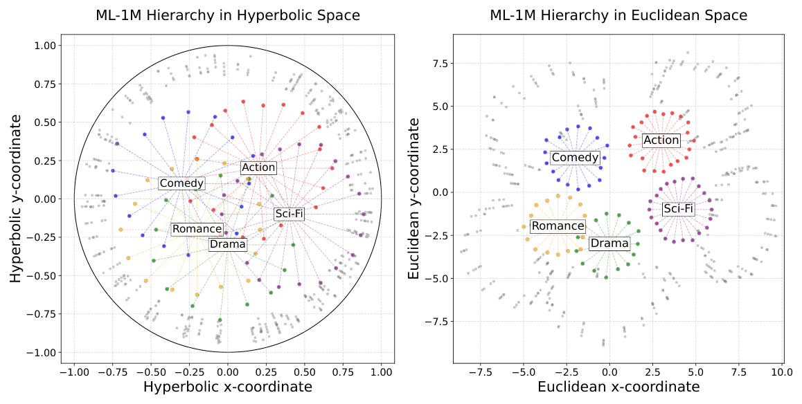
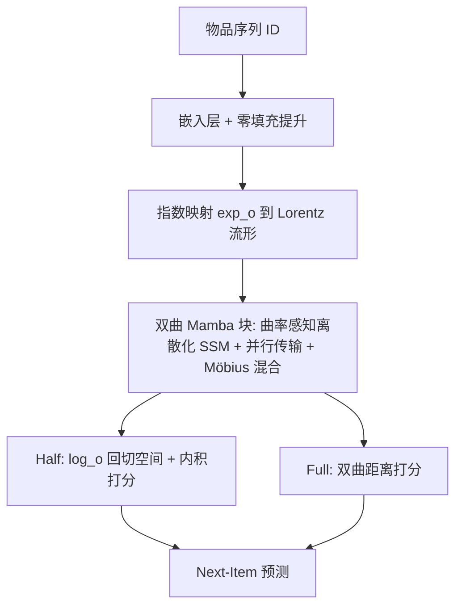
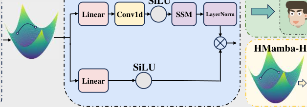

# HMamba: Hyperbolic Mamba for Sequential Recommendation (双曲 Mamba 序列推荐)

- **会议/期刊**: TOIS (ACM Transactions on Information Systems)，arXiv:2505.09205
- **作者与机构**: Qianru Zhang, Honggang Wen, Siu-Ming Yiu (香港大学)；Menglin Yang (HKUST)；Wei Yuan, Hongzhi Yin (昆士兰大学)；Crystal Chen (波士顿大学)
- **推荐链路定位**: 召回（Next-Item 序列建模）
- **研究方向**: 序列与会话推荐 / 图与层次表征
- **论文原文**: [https://arxiv.org/abs/2505.09205v1](https://arxiv.org/abs/2505.09205v1)
- **开源代码**: 暂未开源

## TL;DR (1分钟核心速览)

Transformer 序列推荐有 $O(L^2)$ 复杂度与"浅层注意力"，而现有 Mamba 序列模型虽线性高效却全部困在欧氏空间，无法表达用户-物品的类型/层级树结构。本文提出 HMamba：把选择性状态空间的离散化、并行传输与非线性混合全部改造到 Lorentz 双曲流形上，并派生 Full / Half 两个变体。在 4 个基准（HR@10/NDCG@10/MRR@10）上相对 Mamba4Rec 提升 3–11%，训练速度约 3.1× 于 BERT4Rec、GPU 显存低 18–22%。

## Background & Motivation (背景与核心矛盾)

- **主流范式**: 序列推荐以 GRU4Rec/SASRec/BERT4Rec 的 RNN-注意力为主线，近期 Mamba4Rec 用选择性 SSM 把复杂度降到 $O(L)$。
- **前人局限**: ① Transformer 的 $O(L^2)$注意力在长序列上代价高，且注意力偏向短期高频交互，难以沉淀"持久偏好层级"；② Mamba 系与 HSASRec 之外的方案均在欧氏空间做嵌入，欧氏度量对树状/幂律数据产生$\alpha\sim h^2$ 的距离畸变，层级被"压平"。
- **核心洞察 (Key Insight)**: 推荐数据本质是"时序 + 分类层级"双重结构——双曲空间体积随半径指数增长，可用 $O(\log h)$维无损嵌入$h$ 层树，恰好匹配"类型→物品→用户"的嵌套关系（图 1 中双曲嵌入保持中心扇区/中环/外环三层，欧氏嵌入则混为一团）。
- **本文切入点**: 不改数据、不改任务，只把 Mamba 的算子几何化，让"线性效率"与"双曲表达力"同时成立。

<figure class="paper-figure" markdown="span">
  <figcaption>图 1. ML-1M 层次结构的双曲与欧几里得嵌入，展示 (1) 类型（4 种：动作、喜剧、剧情、科幻、爱情）聚类（中心彩色扇区），(2) 电影（带类型关联的中间环）和 (3) 用户（按偏好模式聚集的外围点）。</figcaption>
</figure>

## Method (核心方法设计)

### 1. 整体框架 (Overall Architecture)

物品 ID 先过标准嵌入层得 $\mathbf{E}_u\in\mathbb{R}^{L\times d}$，用零填充提升算子$\mathbf{E}'_u=\mathbf{0}\oplus\mathbf{E}_u$变成 Lorentz 兼容的$(d+1)$维向量，再由指数映射$\exp_o$投到常曲率$-k$的双曲面$\mathbb{H}^{d+1}_k$；随后进入**双曲 Mamba 块**（曲率感知离散化 SSM + 并行传输 + Möbius 陀螺向量混合），得到双曲隐状态序列；最后分两条打分路径：Half 用对数映射回切空间做内积 + 欧氏交叉熵，Full 直接在流形上算双曲距离 + 双曲损失。两变体共享同一编码器，差别只在输出几何与损失。

<figure class="paper-figure" markdown="span">
  <figcaption>图 2. 该图展示 HMamba 的配置。上部表示输入数据，包含带物品 ID 的物品序列。底部展示 Hyperbolic Mamba 块以及两类 HMamba 框架，即 HMamba-Full 和 HMamba-Half。</figcaption>
</figure>

### 2. 关键设计拆解 (Key Designs)

1. **双曲选择性状态空间（并行传输 SSM）**：欧氏 SSM 的隐状态递推 $\mathbf{h}_t=\bar{\mathbf{A}}\mathbf{h}_{t-1}+\bar{\mathbf{B}}\mathbf{x}_t$ 做线性组合会脱离流形。本文在每个时刻把隐状态用 Lorentz 平行传输搬到当前 token 的切空间再递推：
$\mathbf{h}'_i=\mathrm{PTrans}_{o\to\mathbf{E}^{(h)}_{u,i}}(\mathbf{A}\mathbf{h}_i)+\mathbf{B}\mathbf{E}^{(h)}_{u,i}$，其中$\mathrm{PTrans}_{\mathbf{x}\to\mathbf{y}}(\mathbf{v})=\mathbf{v}-\frac{\langle\mathbf{y}-\mathbf{x},\mathbf{v}\rangle_L}{\langle\mathbf{x}+\mathbf{y},\mathbf{x}+\mathbf{y}\rangle_L}(\mathbf{x}+\mathbf{y})$。直觉：传输是等距同构，时序推进时层级距离不被扭曲，梯度也不会因流形外溢爆炸。
2. **曲率感知离散化 + 陀螺向量混合**：ZOH 离散化在双曲空间需按度量缩放时间步，作者用 $\bar{\mathbf{A}}=\exp(\Delta\mathbf{A}\odot\mathbf{K}(k))$，$\mathbf{K}(k)=\mathrm{diag}(\sqrt{|k|},1,\dots,1)$，仅对时间维注入曲率因子；非线性混合改用 Möbius 陀螺向量积$\otimes_k$替代逐元素乘：$\hat{\mathbf{E}}^{(h)}_{u,i}=\mathrm{Linear}\big(\mathrm{GeomMult}(\mathrm{SSM}(\cdot),\ \mathrm{SiLU}(\mathrm{Linear}(\mathbf{E}^{(h)}_{u,i})))\big)$。这样门控仍在流形内闭合，且额外开销只是$d\log(1/c)$ 量级。
3. **训练目标与推理开销**：Half 变体 $\mathcal{L}_{half}=-\sum_{u}\sum_{i}[y\log\sigma(s_{u,i})+(1-y)\log(1-\sigma(s_{u,i}))]$，$s_{u,i}=\sum_j\hat{\mathbf{E}}_{u,j}\mathbf{E}^{(w)}_{j,i}$（欧氏内积）；Full 变体把打分换成负双曲距离$\mathcal{L}_{full}$，$d_L=-\sqrt{k}\cdot\mathrm{arcosh}(-\langle\hat{\mathbf{E}}^{(h)}_u,\mathbf{E}^{(h)}_w\rangle_L/k)$。参数上 Full 为$O(\log(1/c)(Ld^2+|V|d))$、空间$O(|V|d+d^2+d\log(1/c))$，相对 Transformer 的$O(L^2)$ 保持线性；推理为全库打分，单批 1000 样本约 68ms。

## Experimental Setup & Evaluation Protocol (实验设置与评估协议)

- **数据集与预处理**:

| 数据集 | #Users | #Items | #Interactions | 平均交互/用户 | 场景 |
| :--- | :---: | :---: | :---: | :---: | :--- |
| ML-1M | 6,040 | 3,416 | 999,611 | 165.6 | 电影，稠密 |
| New York | 6,195 | 4,500 | 478,903 | 106.4 | LBS 签到 |
| California | 7,272 | 6,206 | 369,469 | 50.8 | LBS 签到（最稀疏） |
| Texas | 24,559 | 20,375 | 1,344,379 | 66.0 | LBS 签到（最大规模） |

- **数据划分与防穿越 (Splitting Strategy)**: 论文沿用 Mamba4Rec/SSD4Rec 的评测惯例，但正文**未显式声明**划分方式（应为 Leave-One-Out 或全局时间戳切分），属复现需注意的缺口。
- **排名评测协议 (Ranking Protocol)**: 报告中 HR@10 / NDCG@10 / MRR@10（Top-10 截断），打分覆盖全物品集合（全库排序）；显著性检验以 $p<0.01$ 标注（表中 `*`）。训练负采样策略同样未明示，从损失形式看为 BCE + 采样负例。
- **对比基线与超参**: 基线覆盖 4 类——传统序列（Caser, GRU4Rec, NARM）、注意力（SASRec, BERT4Rec, LRURec）、图（SR-GNN）、SSM（Mamba4Rec）、双曲（HSASRec）。隐层 $d=32$、1 层 Mamba、dropout 0.1、batch 2048、lr$1\times10^{-3}$、SSM 扩张 64、状态扩张 4、卷积宽 2、曲率$c=1.0$。

## Key Experimental Results (实验关键数据)

### 1. 主实验对比 (Main Results)

| 模型 | ML-1M HR@10 | ML-1M NDCG@10 | NY HR@10 | CA HR@10 | TX HR@10 | TX NDCG@10 | TX MRR@10 |
| :--- | :---: | :---: | :---: | :---: | :---: | :---: | :---: |
| GRU4Rec | 0.2934 | 0.1642 | 0.0355 | 0.0326 | 0.0350 | 0.0172 | 0.0119 |
| SASRec | 0.2977 | 0.1687 | 0.0360 | 0.0335 | 0.0352 | 0.0178 | 0.0123 |
| BERT4Rec | 0.2958 | 0.1674 | 0.0367 | 0.0331 | 0.0354 | 0.0180 | 0.0125 |
| LRURec | 0.3057 | 0.1772 | 0.0392 | 0.0340 | 0.0356 | 0.0179 | 0.0126 |
| SR-GNN | 0.2997 | 0.1683 | 0.0402 | 0.0338 | 0.0355 | 0.0181 | 0.0130 |
| Mamba4Rec | 0.3121 | 0.1822 | 0.0544 | 0.0505 | 0.0450 | 0.0203 | 0.0140 |
| HSASRec | 0.1455 | 0.0738 | 0.0442 | 0.0483 | 0.0416 | 0.0203 | 0.0140 |
| **HMamba-Full** | **0.3265** | **0.1881** | **0.0549** | **0.0518** | 0.0474 | 0.0221 | 0.0145 |
| **HMamba-Half** | 0.3177 | 0.1854 | 0.0544 | 0.0513 | **0.0483** | **0.0226** | **0.0150** |
| *Improv.* | *+4.6%* | *+3.2%* | *+0.9%* | *+2.5%* | *+7.3%* | *+11.3%* | *+7.1%* |

### 2. 消融实验 (Ablation Study)

| 变体 (Texas) | HR@10 | NDCG@10 | MRR@10 | 说明 |
| :--- | :---: | :---: | :---: | :--- |
| Mamba4Rec (欧氏基线) | 0.0450 | 0.0203 | 0.0140 | 原始欧氏 Mamba |
| EMamba (架构改进+欧氏) | — | — | — | 论文仅定性称"具竞争力"，未给数值 |
| HMamba-Half (双曲编码+欧氏输出) | **0.0483** | **0.0226** | **0.0150** | +4–6% |
| HMamba-Full (端到端双曲) | 0.0474 | 0.0221 | 0.0145 | +3–11%（跨数据集） |

### 3. 关键实验发现 (Key Findings)

1. **几何比架构更值钱**：同为 Mamba、同参数量级，仅把算子搬到双曲空间，Texas 上 NDCG@10 从 0.0203 涨到 0.0221（+11.3%），ML-1M HR@10 从 0.3121 抬到 0.3265——增益来自流形而非更深网络。
2. **双曲并非"越彻底越好"**：Texas 上 Half（0.0483）反超 Full（0.0474），ML-1M 则 Full 领先；说明双曲损失在稀疏/大规模数据上方差偏大，混合方案是更稳的工程折中。
3. **层级收益随序列变长而放大**：图 3 中序列长度 <100/<200/<300 三档，HMamba 优势单调扩张；同时参数量显著少于注意力基线（作者称约 58% 参数削减），印证"低维双曲 = 高维欧氏"的参数效率定理。

## Highlights & Limitations (亮点、对比与审稿批判)

- **与代表作对比 (vs. Prior Work)**: 与 Mamba4Rec 的差别是"几何"而非"模块"——同样选择性 SSM、同样 $O(L)$，但离散化/传输/混合三处算子全部曲率化；与 HSASRec 的差别是"时序建模器"——HSASRec 把双曲嵌入塞进自注意力（$O(L^2)$ 且把序列当无序集合），HMamba 用状态空间显式表达连续时间演化，故 HSASRec 在 ML-1M 上甚至崩到 0.1455，而 HMamba 全面领先。
- **可迁移亮点**: ①"只对时间维注入曲率因子"的 $\mathbf{K}(k)$ 离散化技巧，可直接套到任何流形上的 RNN/SSM；②零填充提升 + 指数映射的轻量嵌入改造，几乎不增加参数即可获得层级先验，适合作为现有序列模型的 plug-in。
- **审稿级局限批判**: ①**评估协议不透明**——划分方式、负采样策略、是否采样排序均未交代，且未给方差/多次运行结果，"3–11%"的提升幅度在 NY/CA 上仅 0.9–2.5%，说服力偏弱；②**双曲损失定义与稳定性存疑**——$\mathcal{L}_{full}$以距离直接作损失、缺少 log-softmax 归一化项，曲率$c$固定为 1 且无敏感性分析，长序列下 arcosh 数值溢出风险未讨论；③**效率叙事与理论表格不一致**——正文声称$O(Ld\log L)$，表 2 却为$O(Ld^2\log(1/c))$，且 Full 变体实际比 Mamba4Rec 训练慢 1.8× 的反面数据被淡化。

## Rating (四维评分)

- **方法创新性 (Novelty)**: ⭐⭐⭐⭐ （首个把选择性 SSM 全算子几何化的双曲序列推荐，配以近似误差界与参数效率定理，理论骨架完整）
- **评估协议与实验扎实度 (Protocol & Experiments)**: ⭐⭐⭐ （4 个跨规模数据集 + 10 个基线 + $p<0.01$ 检验尚可，但划分/负采样协议缺失、消融仅给曲线与定性描述）
- **写作与数学规范度 (Clarity & Rigor)**: ⭐⭐⭐⭐ （Lorentz 模型、并行传输、陀螺向量公式完备，符号表清晰；但复杂度表述前后不一致、Full 损失式偏简化）
- **工业落地与复现价值 (Industrial & Practical Value)**: ⭐⭐⭐⭐ （线性复杂度、显存低 18–22%、68ms/千样本推理对长序列召回友好；可惜未开源，曲率与状态维需重调）

