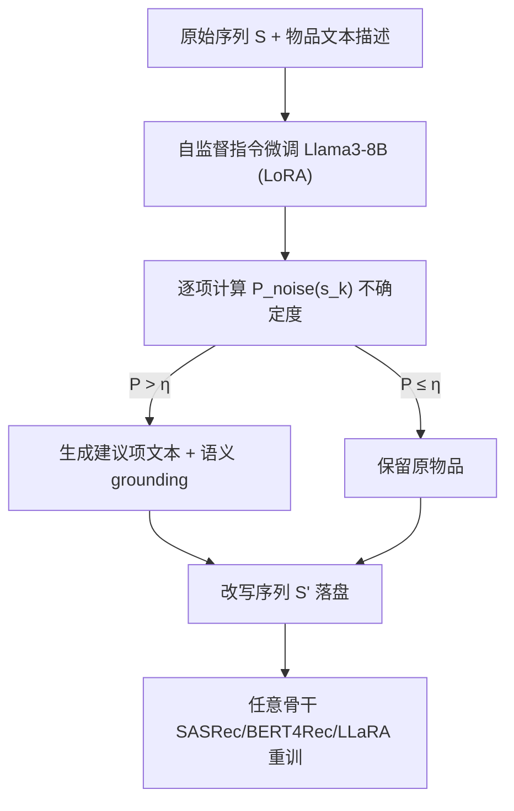

# LLM4DSR: Leveraging Large Language Model for Denoising Sequential Recommendation (利用大语言模型为序列推荐去噪)

- **会议/期刊**: TOIS 2026（预印本 arXiv:2408.08208v3, 2025-06）
- **作者与机构**: Bohao Wang, Jiawei Chen, Yudi Wu, Sheng Zhou, Yan Feng, Chun Chen, Can Wang 等（浙江大学）；Feng Liu, Changwang Zhang, Xingyu Lou, Jun Wang（OPPO）
- **推荐链路定位**: 召回前置的数据清洗层（模型无关、可插拔预处理，端到端不改动推荐器）
- **研究方向**: 序列与会话推荐 / 自监督对比学习与交互去噪
- **论文原文**: [论文原文链接](https://arxiv.org/abs/2408.08208v3)
- **开源代码**: 暂未开源

## TL;DR (1分钟核心速览)

真实交互序列普遍被误点击、位置偏置、标题党等噪声污染，但噪声无标签、推荐损失本身也被污染，导致显式启发式去噪（HSD/STEAM）精度低且迁移性差。本文提出 LLM4DSR：先用"随机替换物品"构造自监督指令数据微调 Llama3-8B，让 LLM 学会"指出噪声项 + 生成替代项"；再用 token 级生成概率作为不确定度、以分位数阈值 $\eta$ 只采纳高置信判决，最后用语义 grounding 把生成文本映射回真实物品完成序列改写。在 Games/Toy/Movie 三个 Amazon 数据集、全库排序协议下，对 SASRec/BERT4Rec/LLaRA 三种骨干均稳定优于所有基线（自然噪声 NDCG@20 最高 +11.1%，10% 人工噪声下最高 +24.8%）。

## Background & Motivation (背景与核心矛盾)

- **主流范式**: 序列去噪分两类——隐式（FMLP 频域滤波、CL4SRec 对比增广）在表征层压低噪声权重；显式（HSD 长短期兴趣不一致、STEAM 判别器+生成器、BERD 损失-不确定度）直接删改序列项。
- **前人局限**: ①**无监督信号**：噪声标签缺失，只能用人工启发式先验或"下一项"推荐损失做监督，而后者本身已被污染；②**误删即信息损失**：显式方法只删不补，短序列场景下 HSD 甚至把 NDCG@20 从 0.0299 拉到 0.0246；隐式方法与骨干强耦合（无法用于 LLaRA 这类 LLM 推荐器），且噪声仍在参与表征。
- **核心洞察 (Key Insight)**: 序列表征需要"语义常识"，而 LLM 的开放世界知识恰好能补上无标签这一信息鸿沟——如用户历史多为喜剧片，偶现恐怖片即高度可疑；更关键的是 LLM 的生成能力可"补位"而非单纯"删除"，把误删损失转化为新增偏好信息。
- **本文切入点**: 把去噪完全解耦为**数据侧预处理**：自监督微调让 LLM 会做去噪，不确定度模块让它只在高置信时动手，生成+grounding 让删掉的项有替代品。

<figure class="paper-figure" markdown="span">
  ![图 2. SASRec \[28\]（传统序列推荐模型）和 LLaRA \[34\]（基于大语言模型的序列推荐模型）在不同噪声比例下的性能，以及相对于无噪声条件的性能下降比例。噪声通过以概率 𝛼 随机替换序列中的每个物品引入，并通过设置不同的 𝛼 值引入不同噪声水平。实验在 Amazon Games 上进行，数据集细节见第 4.1.1 节。随着噪声，两种模型均表现出显著的性能下降。](../../../../assets/papers/2408.08208v3/figure_2.png)<figcaption>图 2. SASRec [28]（传统序列推荐模型）和 LLaRA [34]（基于大语言模型的序列推荐模型）在不同噪声比例下的性能，以及相对于无噪声条件的性能下降比例。噪声通过以概率 𝛼 随机替换序列中的每个物品引入，并通过设置不同的 𝛼 值引入不同噪声水平。实验在 Amazon Games 上进行，数据集细节见第 4.1.1 节。随着噪声，两种模型均表现出显著的性能下降。</figcaption>
</figure>

## Method (核心方法设计)

### 1. 整体框架 (Overall Architecture)

给定长度为 $|S|$的交互序列，先把每个物品的标题等文本描述拼成 prompt，送入经 LoRA 微调的 Llama3-8B；对其中的每个候选物品$s_k$，模型并不直接输出最终答案，而是计算"该物品被生成为噪声项"的 token 概率$P_{noise}(s_k)$，超过分位数阈值$\eta$者判为噪声；被判噪声的位置再触发一次生成式补全，得到建议项文本，经文本嵌入相似度 grounding 到真实物品集$\mathcal{V}$ 上完成替换；改写后的干净序列被离线落盘，交由任意下游序列推荐器（SASRec/BERT4Rec/LLaRA）重训。整个流程不参与推荐损失的反传，是一条纯前置数据管线。

### 2. 关键设计拆解 (Key Designs)

1. **自监督去噪指令微调（制造监督信号）**：痛点是无噪声标签。做法是从原序列随机挑一项 $s_t$用$\mathcal{V}$中随机物品$\hat{s}_t$替换得$\hat{S}$，构造"Input: 用户历史物品文本 / Output: Noise Items:$text(\hat{s}_t)$, Suggested Items:$text(s_t)$"的指令对，用标准自回归损失微调：
$$\max_{\Phi}\sum_{(x,z)}\sum_{i=1}^{|z|}\log P_{\Phi}(z_i\mid x,z_{<i})$$
直觉：让模型同时学"判别异常项"和"还原真实兴趣项"两个互为逆的操作，比单纯判别更能逼出语义推理；仅采样 5000 条 prompt、LoRA 训练 50 epoch 即可激活该能力（未微调时 >40% 回复被判无意义）。

2. **不确定度估计替代"直接读回复"（抗幻觉 + 支持多处噪声）**：微调后模型每次仍只输出一个噪声项且可能编造不存在物品。作者改为审视生成概率而非生成结果：
$$P_{noise}(s_k)=P(z_{noise}=T_k\mid x)=\prod_{j=1}^{|T_k|}P(T_{k,j}\mid x,T_{k,<j}),\qquad y_k=\mathbb{I}\left[P_{noise}(s_k)>\eta\right]$$
工程上只算首 token 概率（物品标题首 token 近似唯一，后续 token 概率≈1）。直觉：这样可对序列中**任意多个**物品独立打分，且高置信项才动手，避免"全判噪声"式灾难；图 5 证实 $P_{noise}$ 分位越高，噪声占比单调上升。

3. **生成式补全 + Grounding 与训练目标**：对每个噪声项 $s_k$ 用 `<User Interactions, Noise Items: text(s_k), Suggested Items:>` 触发补全，得建议文本；因可能是不存在的假物品，用语义相似度落地到真实物品：
$$s'_k=\arg\min_{v_i\in\mathcal{V}} f\left(text_{suggest},\,text(v_i)\right)$$
不引入额外推荐侧损失；负采样策略无（纯监督式改写）；推理开销 = 每条序列 $|S|$次前向（可用首-token 近似降低）+ 噪声位置每处一次生成，另有全局 `b∈{1,2,3}` 限制单序列最多改$b$ 项以防过修。

## Experimental Setup & Evaluation Protocol (实验设置与评估协议)

- **数据集与预处理**: 三个 Amazon 域，沿用 LLaRA 的预处理——序列长度 >11 者以窗口 11 滑窗切分（Movie 随机保留 20,000 物品）。Movie 的 #Sequences(121,690) 大于 #Users(9,329)，即一用户多序列。

| 数据集 | #Users | #Items | #Interactions | #Sequences | 密度 |
| :--- | :---: | :---: | :---: | :---: | :---: |
| Games | 54,955 | 17,256 | 494,934 | 149,393 | 0.0522% |
| Toy | 19,124 | 11,758 | 165,247 | 47,931 | 0.0735% |
| Movie | 9,329 | 5,101 | 214,980 | 121,690 | 0.4518% |

- **数据划分与防穿越**: 按时间戳升序做 **8:1:1 比例划分**（train/valid/test），非 Leave-One-Out。人工噪声在**滑窗切分之前**注入，避免跨序列信息泄漏。
- **排名评测协议**: **Full-Ranking（全库未交互排序）**，指标 HR@{20,50} 与 NDCG@{20,50}；为让 LLaRA 可算排序指标，作者对 LLaRA 追加 grounding 以支持全库打分（原版只取 Top-1）。
- **噪声设置**: ①自然噪声（原始数据自带）；②人工噪声 $\alpha\in\{10\%,20\%,30\%\}$，每项以概率$\alpha$ 被随机替换（仅此设置有噪声真值，可算 F1）。
- **对比基线**: 显式 HSD、STEAM；隐式 FMLP、CL4SRec；骨干 SASRec / BERT4Rec / LLaRA（隐式法因耦合仅测前两者）。微调 Llama3-8B + LoRA，阈值 $\eta$在概率分位 [0,1] 上以 0.05 步长搜索，$b\in\{1,2,3\}$。

## Key Experimental Results (实验关键数据)

### 1. 主实验对比 (Main Results)

自然噪声，NDCG@20（"None"即未去噪骨干本身）：

| 骨干 | 方法 | Games | Toy | Movie |
| :--- | :--- | :---: | :---: | :---: |
| SASRec | None | 0.0299 | 0.0190 | 0.0468 |
| SASRec | FMLP | 0.0297 | 0.0200 | 0.0488 |
| SASRec | CL4SRec | 0.0331 | 0.0201 | 0.0492 |
| SASRec | HSD | 0.0246 | 0.0121 | 0.0369 |
| SASRec | STEAM | 0.0233 | 0.0187 | 0.0475 |
| SASRec | **LLM4DSR** | **0.0315** (+5.4%) | **0.0208** (+9.5%) | **0.0505** (+7.9%) |
| BERT4Rec | None | 0.0351 | 0.0205 | 0.0584 |
| BERT4Rec | CL4SRec | 0.0359 | 0.0192 | 0.0587 |
| BERT4Rec | STEAM | 0.0373 | 0.0195 | 0.0548 |
| BERT4Rec | **LLM4DSR** | **0.0375** (+6.8%) | **0.0222** (+8.3%) | **0.0604** (+3.4%) |
| LLaRA | None | 0.0261 | 0.0224 | 0.0388 |
| LLaRA | STEAM | 0.0200 | 0.0182 | 0.0396 |
| LLaRA | **LLM4DSR** | **0.0290** (+11.1%) | **0.0241** (+7.6%) | **0.0409** (+5.4%) |

10% 人工噪声，NDCG@20（噪声可判别性更强，增益放大）：

| 骨干 | None | HSD | STEAM | **LLM4DSR** | Improv. |
| :--- | :---: | :---: | :---: | :---: | :---: |
| SASRec / Games | 0.0252 | 0.0198 | 0.0261 | **0.0292** | +15.9% |
| SASRec / Movie | 0.0390 | 0.0340 | 0.0401 | **0.0431** | +10.5% |
| BERT4Rec / Games | 0.0266 | 0.0288 | 0.0294 | **0.0316** | +18.8% |
| BERT4Rec / Toy | 0.0150 | 0.0152 | 0.0182 | **0.0183** | +22.0% |
| LLaRA / Games | 0.0202 | 0.0146 | 0.0207 | **0.0252** | +24.8% |
| LLaRA / Movie | 0.0323 | 0.0197 | 0.0325 | **0.0358** | +10.8% |

### 2. 消融实验 (Ablation Study)

SASRec 骨干，NDCG@20 / HR@20：

| 变体 | Game | Toy | Game+10%噪声 | Toy+10%噪声 |
| :--- | :---: | :---: | :---: | :---: |
| 原始骨干 None | 0.0299 / 0.0646 | 0.0190 / 0.0501 | 0.0252 / 0.0526 | 0.0139 / 0.0348 |
| w/o uncertainty | 0.0309 / 0.0648 | 0.0191 / 0.0501 | 0.0277 / 0.0572 | 0.0133 / 0.0361 |
| w/o completion（只删不补） | 0.0241 / 0.0566 | 0.0185 / 0.0478 | 0.0264 / 0.0548 | 0.0142 / 0.0359 |
| w/ popularity completion | 0.0239 / 0.0460 | 0.0156 / 0.0417 | 0.0241 / 0.0472 | 0.0106 / 0.0267 |
| **LLM4DSR** | **0.0315 / 0.0696** | **0.0208 / 0.0557** | **0.0292 / 0.0624** | **0.0152 / 0.0401** |

### 3. 关键实验发现 (Key Findings)

1. **补全 >> 删除，且补全质量决定成败**：去掉生成式补全后 Game 自然噪声 NDCG@20 由 0.0315 跌至 0.0241（−23.5%），比不做任何去噪（0.0299）还差；换成按热度随机补全更差（0.0239，HR@20 仅 0.0460），说明收益来自"语义对齐的替代项"而非"填补空位"这一动作本身。
2. **不确定度模块是抗幻觉的保险丝，在强噪声下收益更明显**：自然噪声下去掉该模块反而略升（Game 0.0299→0.0309），但在 10% 人工噪声 Toy 上从 0.0152 掉到 0.0133（−12.5%），即噪声越干净可辨，直接信任 LLM 生成结果的风险越大；同时 $\eta$ 分位在 >0.7 区间表现稳定，Movie 上甚至呈"越低越稳"，因替换补偿了误删损失。
3. **去噪应同时作用于训练与测试两侧，训练侧更关键**：图 8 显示单独清洗训练集带来的提升大于单独清洗测试集，两者同时清洗取得最大增益；此外显式方法的噪声识别 F1 在 10%/20%/30% 三档噪声下 LLM4DSR 均居首，印证"LLM 语义知识 > 手工启发式"这一立论。

## Highlights & Limitations (亮点、对比与审稿批判)

- **与代表作对比 (vs. Prior Work)**: 相比 STEAM（自建判别器+生成器，同样自监督但用小型序列模型、依赖推荐损失，跨骨干迁移时 Game 上 NDCG@20 从 0.0351 掉到 0.0233）、HSD（纯启发式不连续度，短序列严重误删）、CL4SRec/FMLP（隐式、与骨干强耦合且噪声仍在表征中），LLM4DSR 是唯一在三种异构骨干上全线正收益、且天然适配 LLM-based 推荐器的方案；与同期 LLMHD（CF 场景、直接用未微调 LLM 重估样本）相比，本文额外做了指令微调 + 不确定度 + 生成补全三件套。
- **可迁移亮点**: ①"生成概率当置信度、分位数当阈值"的抗幻觉范式可直接搬到 LLM 做样本清洗、标签纠错、难负样本挖掘；②只算首 token 概率的近似、以及 grounding 回真实 item 集的做法，是低成本落地 LLM 打分的关键工程 trick。
- **审稿级局限批判**: ①**成本**：每条序列需对 $|S|$个物品各做一次前向（即使只算首 token），再加噪声位置生成，比 HSD/STEAM 高一个数量级，论文自己承认需靠蒸馏下沉；②**监督信号仍是人造的**：微调用"随机替换"制造噪声，与真实噪声分布（位置偏置、标题党、群体从众）差异大，自然噪声下增益明显缩水（BERT4Rec/Movie 仅 +3.4%），且自然噪声设置无真值，无法验证"究竟删对了还是删错了"；③阈值$\eta$ 采用数据集相关的概率分位搜索，跨域迁移需重调，缺少自适应方案；④表格中方法名混写为 "LLM4SRD"，且仅三个 Amazon 域、无线上 A/B，工业结论有限。

## Rating (四维评分)

- **方法创新性 (Novelty)**: ⭐⭐⭐⭐ （首次把 LLM 作为序列推荐去噪器，自监督"替换-还原"任务与 token 级不确定度结合思路清晰，但各组件均为已有技术的巧妙拼装）
- **评估协议与实验扎实度 (Protocol & Experiments)**: ⭐⭐⭐⭐ （三数据集 × 三异构骨干 × 自然/人工双噪声 × 多噪声比例 + F1 识别率 + 训练/测试分离去噪 + 阈值敏感性，覆盖全面；扣分在无显著性检验、无开源代码）
- **写作与数学规范度 (Clarity & Rigor)**: ⭐⭐⭐⭐ （$P_{noise}$ 的分解与首 token 近似有图 5 实证支撑，流程表述干净；但缺复杂度分析与方法名拼写不一致）
- **工业落地与复现价值 (Industrial & Practical Value)**: ⭐⭐⭐ （模型无关、可离线批量预处理是最大卖点，但 LLM 前向成本与阈值调参阻碍大规模在线部署，且未开源）

