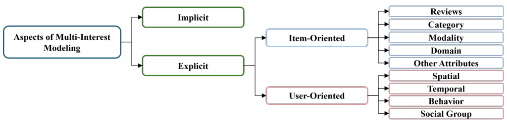
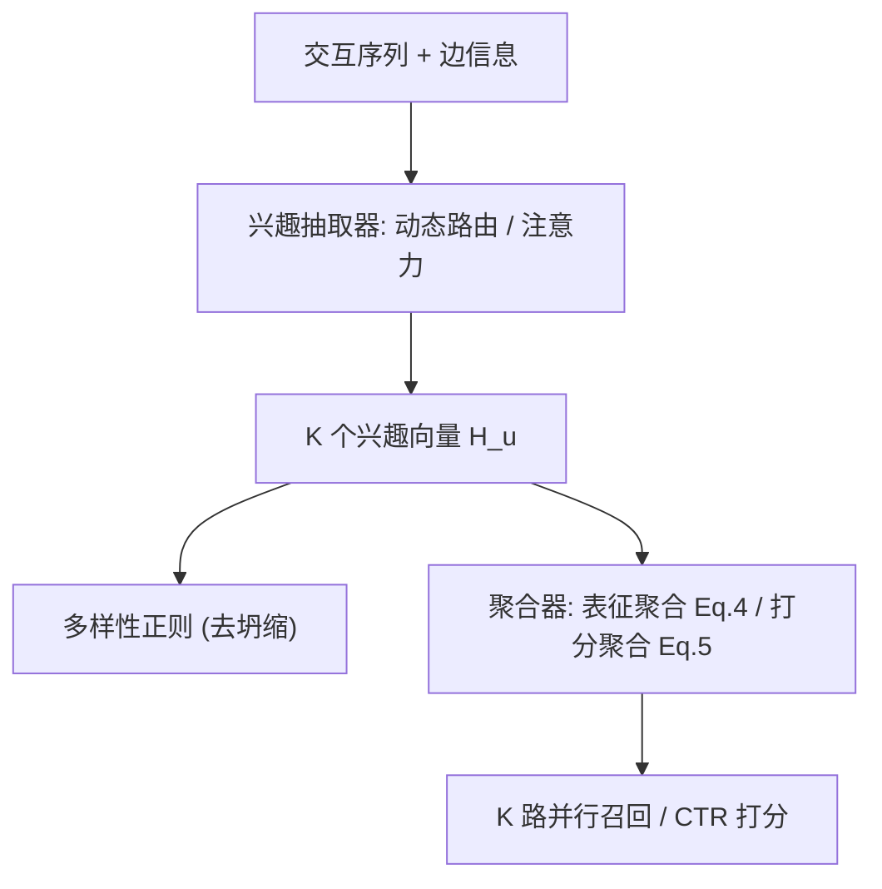
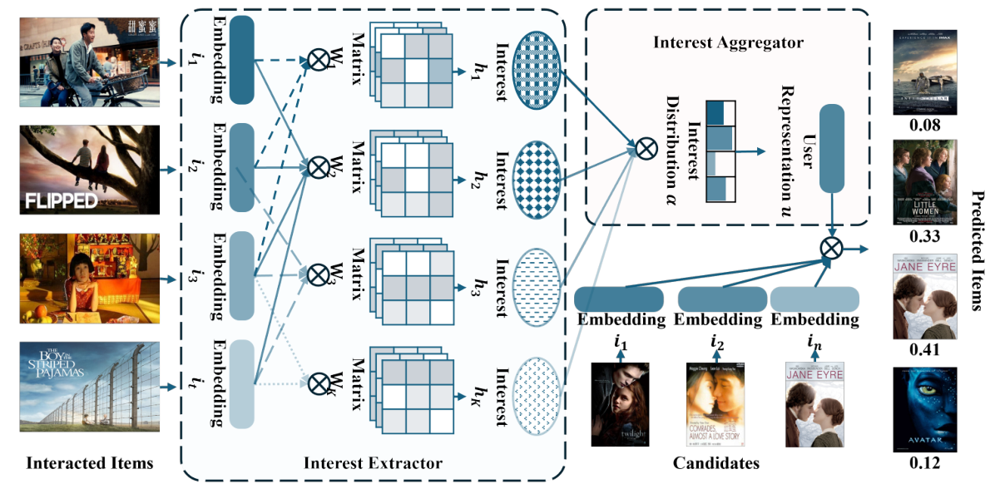

# Multi-Interest Recommendation: A Survey (多兴趣推荐综述)

- **会议/期刊**: ACM Transactions on Information Systems (TOIS)
- **作者与机构**: Zihao Li、Lixin Zou、Chenliang Li（武汉大学国家网络安全学院空天信息安全与可信计算教育部重点实验室）、Qiang Chen（腾讯微信）、Aixin Sun（南洋理工大学）
- **推荐链路定位**: 召回（多兴趣向量并行检索，部分工作用于 CTR 精排建模）
- **研究方向**: 序列与会话推荐 / 图神经网络与知识图谱推荐
- **论文原文**: [论文原文链接](https://arxiv.org/abs/2506.15284v1)
- **开源代码**: [开源代码仓库链接](https://github.com/WHUIR/Multi-Interest-Recommendation-A-Survey)

## TL;DR (1分钟核心速览)

单向量用户表征（$\mathbf{h}_u\in\mathbb{R}^{1\times d}$）把用户多峰、漂移的兴趣压成均值，召回只能命中最强的那一面。本文是首篇专门针对**多兴趣推荐**的综述，以“为什么需要 / 关注哪些 aspect / 如何实现”三问组织至 2025 年 3 月的 172 篇文献，提出 **隐式建模 vs 显式建模（用户导向 / 物品导向）** 的分类学，并把技术栈统一收敛为 **兴趣抽取器（动态路由 / 注意力 / 迭代注意力 / 非线性变换）+ 兴趣聚合器（表征聚合 vs 打分聚合）** 两段式框架，另单列兴趣表征去坍缩正则。该文不含自有实验与统一 Benchmark，价值在于分类框架、失效模式归纳（兴趣坍缩、固定$K$、效率开销）与问题清单，而非指标提升。

## Background & Motivation (背景与核心矛盾)

- **主流范式**: 以 MIND/ComiRec 为分野，用 $K$个兴趣向量$\mathbf{H}_u=[\mathbf{h}_u^1,\dots,\mathbf{h}_u^K]$ 替代单向量，逐兴趣召回后合并；2019 年 MIND 在 Tmall 首页主流量验证有效性后，KDD/SIGIR/WSDM/TOIS 等场所相关论文从 2021 年前的 27 篇增至 2024 年单年 53 篇，累计 172 篇。
- **前人局限**: ① 用户兴趣在时间、空间、社交群体与跨域上动态演化，单向量表征无法区分“周末滑雪”与“夏季游泳”这类并存兴趣，长尾兴趣被主导兴趣吞噬；② 物品本身多属性、多模态（类型/品牌/评论/图像），以单一 ID 表征对齐多面兴趣必然语义失配。
- **核心洞察 (Key Insight)**: 多兴趣 ≠ 意图（intent）。意图刻画“当前这一次推荐的动机”，多兴趣刻画“长期、可并存的偏好集合”，因此必须把 $K$显式化为结构化表征，并警惕训练中的 **表征坍缩**——$K$ 个兴趣向量退化为高维空间中的同一点，表征能力与单向量无异。
- **本文切入点**: 不做新模型，而以统一符号（任务定义 → 抽取 → 聚合 → 正则）重建领域坐标系，横向对比 40 余个代表方法的组件选型，并把“坍缩、固定 $K$、路由开销”等痛点提炼为后续研究方向。

<figure class="paper-figure" markdown="span">
  <figcaption>图5. 多兴趣建模方面的分类。根据多兴趣建模中是否使用外部信息，可大致分为两类（隐式多兴趣建模与显式多兴趣建模）。进一步，根据所关联的是物品信息还是用户信息，显式多兴趣建模可细分为物品导向或用户导向。</figcaption>
</figure>

## Method (核心方法设计)

### 1. 整体框架 (Overall Architecture)

输入为用户时序交互物品表征 $\{\mathbf{x}_1,\dots,\mathbf{x}_t\}$及其可选边信息（时空、群体、属性、评论、多模态、跨域），兴趣抽取器输出$K$个兴趣向量；随后由聚合器二选一：**表征聚合** 先把$\mathbf{H}_u$融合成单向量再打分，或 **打分聚合** 逐兴趣算分后合并。训练阶段额外挂一项多样性正则抑制坍缩，推理阶段以$K$路向量并行检索候选。两条聚合路径的选择直接决定在线算力落在“融合模块参数”还是“$K\times|\mathcal{I}|$ 的候选打分”上。

<figure class="paper-figure" markdown="span">
  <figcaption>图7. 多兴趣建模与推荐框架。其包括两个主要组件：兴趣提取器和兴趣聚合器，分别由虚线框圈出。</figcaption>
</figure>

### 2. 关键设计拆解 (Key Designs)

1. **动态路由抽取（迭代式软聚类）**：痛点是把 $t$个物品“分配”给$K$个兴趣而不预设硬划分。路由以耦合系数$c_{ij}=\text{softmax}(b_{ij})$ 加权求和，并用 squash 压缩模长使向量长度表达“兴趣存在概率”：
$\mathbf{s}_j=\sum_{i=1}^{t}c_{ij}\mathbf{W}_{ij}\mathbf{x}_i,\quad \mathbf{h}_j=\text{squash}(\mathbf{s}_j)=\frac{\|\mathbf{s}_j\|^2}{1+\|\mathbf{s}_j\|^2}\frac{\mathbf{s}_j}{\|\mathbf{s}_j\|}$再以$b_{ij}\leftarrow b_{ij}+\mathbf{h}_j^\top\mathbf{W}_{ij}\mathbf{x}_i$迭代 agreement。直觉上它等价于“软 K-means + 一致性投票”，聚类质量好但需$R$轮前向且参数量随$t\times K$ 二次增长。
2. **注意力抽取（单次前向的软选择）**：以可学习兴趣 query $\mathbf{e}_j$对物品做加权池化，温度$\tau$ 控制分布锐度：
$w_{ji}=\frac{\exp\!\big(\mathbf{e}_j^\top\sigma(\mathbf{W}_j\mathbf{x}_i+\mathbf{b}_j)/\tau\big)}{\sum_{i'=1}^{t}\exp\!\big(\mathbf{e}_j^\top\sigma(\mathbf{W}_j\mathbf{x}_{i'}+\mathbf{b}_j)/\tau\big)},\quad \mathbf{h}_j=\sum_{i}w_{ji}\mathbf{x}_i$工程上常令所有兴趣共享$\mathbf{W},\mathbf{b}$以省参数；变体用幂次$\gamma$调节锐度（$\gamma=0$退化为平均池化，$\gamma\to\infty$ 退化为硬注意力）、用余弦相似度替代内积、或用 Gumbel-softmax 注入随机性。
3. **聚合与训练目标**：表征聚合 $\hat{y}_{ui}=\phi_u(\mathbf{H}_u)\phi_i(\mathbf{X}_i)^\top$把多兴趣压回单向量；打分聚合$\hat{y}_{ui}=\phi(\mathbf{H}_u\mathbf{X}_i^\top)$保留多峰，$\phi$取 max 为事实标准（无需负采样、天然取“最匹配的那一面”）。去坍缩正则有三式：余弦抑制$\mathcal{L}_{reg}=\frac{1}{K^2}\sum_{i,j}\frac{\mathbf{h}_i\cdot\mathbf{h}_j}{\|\mathbf{h}_i\|\|\mathbf{h}_j\|}$、兴趣间 InfoNCE、以及对路由矩阵$\mathbf{C}$的协方差正则$\mathcal{L}_{reg}=\|\text{diag}(\text{Cov}(\mathbf{C},\mathbf{C}))\|_F^2$。总损失$\mathcal{L}=\mathcal{L}_{rec}+\lambda\mathcal{L}_{reg}$，$\mathcal{L}_{rec}$ 依任务取 BPR 或交叉熵；多数工作沿用原论文的负采样策略而非统一协议。

## Experimental Setup & Evaluation Protocol (实验设置与评估协议)

- **说明**: 本综述**不提供自有实验、统一划分与统一打分协议**，其 Table 2/3 仅为方法—组件映射。因此下文不列可横比指标，仅给出原文归纳的应用场景与公开数据集规格；跨方法数值比较需回到各原始论文（序列任务多为 Leave-One-Out + 全库排序 HR@N/NDCG@N，CTR 任务多为采样负例下的 AUC/GAUC），不可直接混比。

| 应用场景 | 公开数据集 | 规模/内容要点 |
| :--- | :--- | :--- |
| 新闻 | MIND | 约 16 万篇英文新闻、100 万用户、1500 万条曝光日志 |
| 电影/微视频 | MovieLens、ReDial、TG-ReDial | ML 含 100K/1M/10M 三档；ReDial 10,006 段对话覆盖 51,699 部电影；TG-ReDial 1 万对话、129,392 语句、33,834 部电影 |
| 生活服务/出行 | FourSquare、Fliggy、Yelp、Gowalla | Gowalla 约 20 万用户、640 万次签到（2009–2010），时空信息为核心 |
| 电商 | Amazon、Taobao、RetailRocket、Ta Feng | Taobao 约 100 万用户、400 万物品、9 天行为（点击/加购/收藏/购买）；Ta Feng 为 4 个月杂货购物日志 |
| 在线教育 | MOOCCube | 约千门课程、数万学习者交互记录 |

### 1. 主实验对比 (Main Results)

综述无主实验表，改为给出原文 Table 3 的**代表方法—组件映射**（最能反映领域技术选型分布）：

| 代表方法 | 兴趣抽取器 | 兴趣聚合器 | 聚合范式 |
| :--- | :--- | :--- | :--- |
| MIND | 动态路由 + 注意力 | 注意力 | 表征聚合 |
| ComiRec | 动态路由 / 注意力 | Max Pooling | 打分聚合 |
| MINER | 动态路由 / 注意力 | Mean/Max、注意力 | 打分聚合 |
| TimiRec | 注意力（余弦相似度） | Max Pooling | 打分聚合 |
| M2GNN | 动态路由 + 注意力 | Concat/Pooling、RL 选择器 | 表征聚合 |
| REMIT | 注意力 | Max Pooling | 打分聚合 |
| MIMCR | 迭代注意力 | RL 兴趣选择器（Dueling Q） | 打分聚合 |
| UMI / PIMI | 动态路由 / 注意力 | Max Pooling | 打分聚合 |
| DisMIR | 注意力 | 注意力 | 打分聚合 |

### 2. 消融实验 (Ablation Study)

原文未做消融，但其正则化分类可作为“组件归因”的替代视角（图 10/11）：表征正则在**语义空间**推远兴趣对，分布正则则在**路由分布层面**由均匀转向各向异性；两类正则均针对坍缩这一单一失效模式，缺少对“$K$取值 / 正则权重$\lambda$”的横向敏感性汇总。

### 3. 关键实验发现 (Key Findings)

- **领域规模翻倍**: DBLP 检索显示相关论文从 2021 年前累计 27 篇跃升至 2024 年单年 53 篇、累计 172 篇，说明多兴趣已从单点工作（MIND）演化为独立子方向，但综述指出的统一评测仍缺位。
- **选型高度收敛**: Table 3 中注意力抽取器出现频次最高、动态路由次之；打分聚合侧 max pooling 成为事实标准——因其免参数、免负采样且天然只取最匹配兴趣，比表征聚合更适合大规模候选召回。
- **效率瓶颈可量化**: 动态路由需 $R$轮迭代且胶囊间权重矩阵数为$t\times K$，随兴趣数$K$与序列长度$t$二次增长；这解释了为何工业落地更倾向单次前向的注意力方案，以及“自适应$K$”被列为首要开放问题。

## Highlights & Limitations (亮点、对比与审稿批判)

- **与代表作对比 (vs. Prior Work)**: 与 [73] 的意图感知综述本质不同——意图建模捕获“当前动机”，多兴趣建模捕获“长期并存偏好集合”，二者不可互相替代；与序列推荐综述 [144]、CTR 综述 [217] 相比，本文首次以“建模 aspect（隐式 / 显式-用户导向 / 显式-物品导向）”与“抽取器+聚合器”双轴正交切分，覆盖跨任务、跨场景的 172 篇文献并单列去坍缩正则这一类此前无综述归纳的组件。
- **可迁移亮点**: ① **打分聚合 + max** 可直接迁移到多向量召回/多兴趣双塔的在线合并逻辑，避免额外融合层带来的训练— serving 不一致；② **协方差 / 逐元素路由正则** 对任何“多专家 / 多向量 / 多原型”结构（如 MMoE 专家同质化、RQ-VAE 码本坍缩）都具有直接的抗坍缩借鉴价值。
- **审稿级局限批判**: ① 全篇无统一 Benchmark 与任何自有实验，Table 2/3 只做定性映射，读者无法判断“动态路由 vs 注意力”孰优，也无法获知 $K$的推荐取值区间；② 对效率问题仅停留在定性描述（迭代轮数、$t\times K$ 参数），缺少 FLOPs/时延的量化对比；③ LLM/多模态部分仅列为 future direction，未深入技术细节；④ 分类维度存在交叠（“隐式 vs 显式”与“用户导向 vs 物品导向”并非严格互斥），部分方法在 Table 2 中可被多重归属。

## Rating (四维评分)

- **方法创新性 (Novelty)**: ⭐⭐⭐ （作为综述其“创新”在分类学：隐式/显式 + 抽取器/聚合器双轴切分与去坍缩正则单列确有增量，但无新模型、无理论分析）
- **评估协议与实验扎实度 (Protocol & Experiments)**: ⭐⭐ （无统一数据集、划分与打分协议，无消融与效率量化，仅有方法映射与场景/数据集清单）
- **写作与数学规范度 (Clarity & Rigor)**: ⭐⭐⭐⭐ （任务定义、Eq.1–5 的聚合两范式、路由与注意力公式及变体（温度/幂次/余弦/Gumbel）交代清楚，符号统一，适合作为入门坐标系）
- **工业落地与复现价值 (Industrial & Practical Value)**: ⭐⭐⭐⭐ （GitHub 维护论文清单与实现索引，直接点明 MIND 在 Tmall 主流量验证、max 打分聚合的工程优势与路由的二次开销，对召回链路选型有实操指导）

