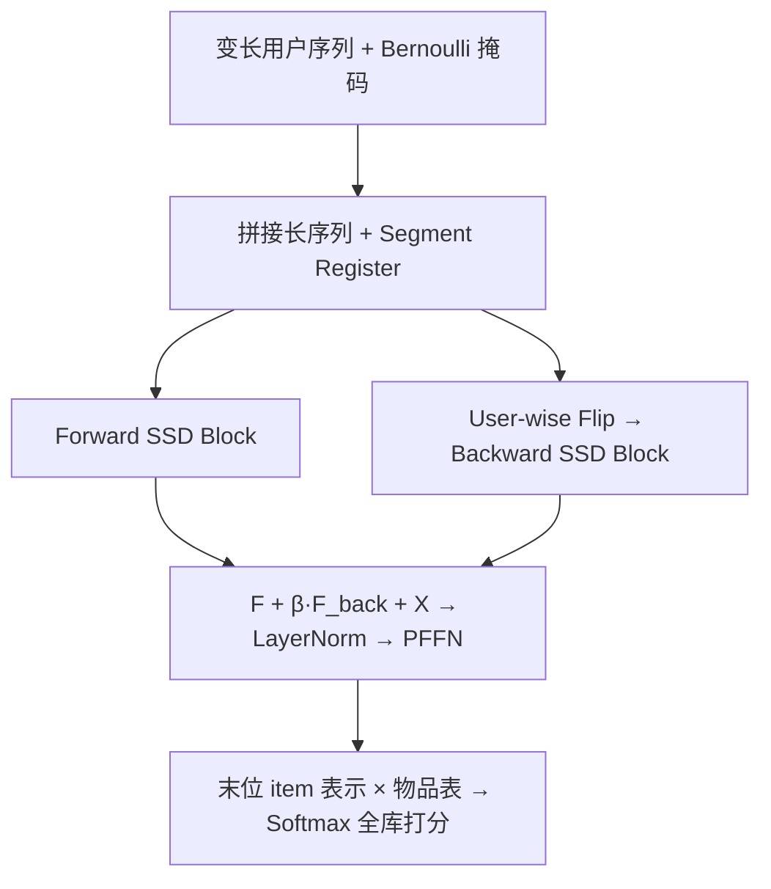

# SSD4Rec: A Structured State Space Duality Model for Efficient Sequential Recommendation (结构化状态空间对偶的高效序列推荐模型)

- **会议/期刊**: TOIS (ACM Transactions on Information Systems)
- **作者与机构**: Haohao Qu, Yifeng Zhang, Liangbo Ning, Wenqi Fan, Qing Li（香港理工大学 COMP / MM）
- **推荐链路定位**: 召回（Next-Item 序列召回骨干网络）
- **研究方向**: 序列与会话推荐 / 自监督掩码与鲁棒表征
- **论文原文**: [https://arxiv.org/abs/2409.01192v2](https://arxiv.org/abs/2409.01192v2)
- **开源代码**: [https://github.com/ZhangYifeng1995/SSD4Rec](https://github.com/ZhangYifeng1995/SSD4Rec)

## TL;DR (1分钟核心速览)

现有序列推荐在长行为序列上面临 RNN 串行不可并行、Transformer 自注意力 $O(L^2)$ 二次爆炸的两难；同时工业批处理被迫 padding/截断，既浪费算力又丢失长尾用户信息。本文提出 SSD4Rec：把 batch 内变长用户序列直接拼接为一条长序列并用 segment register 分段，交由双向 Structured State Space Duality (Bi-SSD) 块做块矩阵乘建模。在 ML1M/Beauty/Games/KuaiRand 四个基准的 Leave-One-Out 全库排序下，NDCG@10 相对 SASRec 最高提升 18.99%，ML1M 上训练速度比 SASRec/Mamba4Rec 快 68.5%/116.7%。

## Background & Motivation (背景与核心矛盾)

- **主流范式**: 以 Caser(CNN)、GRU4Rec(RNN)、SASRec/BERT4Rec(自注意力) 为代表的深度序列模型，将定长窗口 $S^L_k$编码为用户偏好$\hat{p}_k$ 后与物品表内积排序。
- **前人局限**: 其一，RNN 逐步递推无法 GPU 并行，实时推荐场景延迟高；其二，自注意力训练 FLOPs 为 $L^2N$，用户交互上千条（短视频/新闻）时不可承受。
- **次要矛盾**: 为凑 batch 必须 padding（额外算力）或截断（丢失长尾信息），二者在变长分布差异大的场景下均次优；而原生 Mamba 是严格从左到右单向的，每个 item 只能看到前文，与推荐中"历史顺序并非强因果"的事实不符。
- **核心洞察 (Key Insight)**: SSM 的 State Space Duality 可把递推展开为类注意力的显式矩阵 $\mathbf{M}$，训练仅$LN^2$；当序列长度$L \gg$隐维$N$ 时显著优于注意力。且不同用户之间天然独立，只要能在拼接序列上"认领"各自片段，就能把变长批处理转化为一次超长序列建模。
- **本文切入点**: 用 segment register 打通变长拼接，用共享权重的双向 SSD 块补足上下文。

## Method (核心方法设计)

### 1. 整体框架 (Overall Architecture)

模型首先对 batch 内 $K$个用户的变长历史做 Bernoulli 掩码，随后将各自的 item embedding 直接首尾拼接为一条超长序列$E_b$，并附加与序列等长的用户 ID 段寄存器$R_b$；两者组成输入$X=(E_b,R_b)$。$M$层 Bi-SSD 层依据寄存器逐用户并行执行块矩阵乘，前向与反向（翻转）分支以权重$\beta$ 融合，经残差、LayerNorm、PFFN 输出每个用户末位 item 的偏好表示，与物品表内积后 softmax 得到全库打分。训练端用交叉熵端到端优化，无需负采样。

### 2. 关键设计拆解 (Key Designs)

1. **变长拼接 + 段寄存器（免 padding/截断）**：针对定长窗口的信息损失与冗余计算，令 $E_b=[E'_{u_1},\dots,E'_{u_K}]$、$R_b=\{[u_k,\dots,u_k]_{L_k}\}$，寄存器本身不查 embedding 表，只作为"归属掩码"告知 SSD 该片段属于谁，使并行计算变为$\mathcal{F}(X)=(\mathbf{M}_1E_{u_1},\dots,\mathbf{M}_KE_{u_K})$，其中$\mathbf{M}^k_{ji}=(C^k_j)^\top A^k_j\cdots A^k_{i+1}B^k_i$。直觉上它把"批内对齐"问题转化为"段内索引"问题，长尾用户的完整历史得以保留，且计算量随真实交互数而非窗口上限增长。

2. **双向 SSD 与无泄漏翻转**：单向 Mamba 使每个 item 只编码前文，本文增加一条反向分支，但反向输入是对**目标 item 之前的子序列**做 user-wise flip，即 $\{v_1,\dots,v_{L-1}\}\to\{v_{L-1},\dots,v_1\}$，从而避免 BERT4Rec 式"看到未来"的信息泄漏。融合式为$\mathcal{F}'(X)=\mathcal{F}_{forward}(X)+\beta\cdot\mathcal{F}_{backward}(X)+X$，且前后向共享同一 SSD 权重以省显存；$\beta$起到控制反向信息注入强度的作用，实验显示$\beta\ge 0.5$ 即过度平滑、性能反降。

3. **训练目标与推理开销**：损失为全库 softmax 的交叉熵 $\mathcal{L}=-\sum_{k=1}^{K}\sum_{d=1}^{D}g_{u_k,d}\log \hat{y}_{u_k,d}$，无需 BPR/负采样。复杂度上训练 FLOPs 为$LN^2$、推理为$N^2$、显存为$LN$——相较注意力的$L^2N$，在$L\gg N$ 时是数量级优势，同时保留矩阵乘（Mamba-1 的并行关联扫描不具备）。

## Experimental Setup & Evaluation Protocol (实验设置与评估协议)

- **数据集与预处理**: 四个公开集均按 **5-core** 过滤（用户与物品交互数 <5 剔除）：

| 数据集 | #Users | #Items | #Interactions | 稀疏度 | 特征/场景说明 |
| :--- | :---: | :---: | :---: | :---: | :--- |
| ML1M | 6,040 | 3,416 | 999,611 | 95.15% | 平均长度 165.5，最长 2,314 |
| Beauty | 22,363 | 12,101 | 198,502 | 99.92% | 平均长度 8.9，极稀疏短序列 |
| Games | 24,303 | 10,673 | 231,780 | 99.91% | 平均长度 9.5，极稀疏短序列 |
| KuaiRand | 23,951 | 7,111 | 1,134,420 | 99.33% | 短视频随机曝光日志，平均 47.4 |

- **数据划分与防穿越**: 采用 `Leave-One-Out`（最后一次交互为测试、倒数第二次为验证），与 SASRec/BERT4Rec 一致，无时间戳级切分。
- **排名评测协议**: 无偏 `Full-Ranking`（对全物品表 softmax 排序，非采样排序），报告 HR@10/20、NDCG@10/20、MRR@10/20。
- **对比基线与超参**: 基线含 CNN(Caser)、RNN(GRU4Rec)、注意力(BERT4Rec/SASRec)、Mamba 系(Mamba4Rec/SIGMA)。隐维 $d=256$、SSM 状态扩展因子 64、batch 1024、学习率 0.001、Bi-SSD 层数 1–2（ML1M/KuaiRand 用 2 层），dropout 0.4(Beauty/Games)/0.2(ML1M/KuaiRand)，基线定长窗口 ML1M 取 200、其余取 50，单卡 4090 + RecBole 实现。

## Key Experimental Results (实验关键数据)

### 1. 主实验对比 (Main Results)

| 数据集-指标 | Caser | GRU4Rec | BERT4Rec | SASRec | Mamba4Rec | SIGMA | **SSD4Rec** | Improv. |
| :--- | :---: | :---: | :---: | :---: | :---: | :---: | :---: | :---: |
| ML1M NDCG@10 | 0.1714 | 0.1655 | 0.1846 | 0.1718 | 0.1847 | 0.1777 | **0.1955** | +13.80% |
| ML1M MRR@10 | 0.1354 | 0.1276 | 0.1441 | 0.1320 | 0.1456 | 0.1361 | **0.1533** | +16.14% |
| Beauty NDCG@10 | 0.0294 | 0.0307 | 0.0219 | 0.0395 | 0.0442 | 0.0376 | **0.0470** | +18.99% |
| Beauty MRR@10 | 0.0222 | 0.0221 | 0.0159 | 0.0261 | 0.0361 | 0.0284 | **0.0383** | +46.74% |
| Games NDCG@10 | 0.0460 | 0.0520 | 0.0372 | 0.0531 | 0.0605 | 0.0592 | **0.0611** | +15.07% |
| Games MRR@10 | 0.0330 | 0.0373 | 0.0263 | 0.0330 | 0.0461 | 0.0430 | **0.0464** | +40.61% |
| KuaiRand NDCG@10 | 0.0545 | 0.0563 | 0.0534 | 0.0567 | 0.0558 | 0.0572 | **0.0593** | +4.59% |
| KuaiRand MRR@10 | 0.0414 | 0.0426 | 0.0404 | 0.0426 | 0.0427 | 0.0433 | **0.0448** | +5.16% |

注：`Improv.` 以 SASRec 为参照（原文标注口径）；Beauty/Games 的 HR@10 反而低于 SASRec 8.81%/7.57%、低于 SIGMA 约 18%/27%。

### 2. 消融实验 (Ablation Study)

| 变体 | ML1M NDCG@10 | ML1M HR@10 | KuaiRand NDCG@10 | KuaiRand HR@10 |
| :--- | :---: | :---: | :---: | :---: |
| Full | **0.1955** | **0.3334** | **0.0593** | **0.1075** |
| w/o Bidirection | 0.1921 | 0.3222 | 0.0585 | 0.1049 |
| w/o Mask | 0.1897 | 0.3235 | 0.0581 | 0.1034 |
| w/o VarLen | 0.1891 | 0.3222 | 0.0572 | 0.1025 |
| w/o Register | 0.1920 | 0.3262 | 0.0565 | 0.1022 |
| w/ Position Embedding | 0.1901 | 0.3225 | 0.0585 | 0.1049 |
| 1 Layer (vs. 2) | 0.1930 | 0.3258 | 0.0584 | 0.1055 |
| 3 Layers (vs. 2) | 0.1926 | 0.3303 | 0.0557 | 0.1020 |

### 3. 关键实验发现 (Key Findings)

1. **收益集中在排序前端而非命中广度**：ML1M/Beauty 的 MRR@10 提升（16.14%/46.74%）远高于 NDCG@10，但 Beauty/Games 的 HR@10 分别下降 8.81%/7.57%——说明"掩码+双向"强化了对少数强相关 item 的精准定位，却压缩了短序列数据集上的候选覆盖面。
2. **变长与分段各司其职，寄存器比拼接更关键**：去掉变长输入使 ML1M NDCG@10 掉至 0.1891（−3.3%）；而去掉 Register 在 KuaiRand 掉至 0.0565（−4.7%，降幅最大），证明"能否正确认领用户片段"比"是否拼长"更决定上限；额外位置 embedding 反而降点（0.1901），因 SSD 递推本身携带序信息。
3. **效率优势严格服从 $L\gg N$条件**：$L=400,N=256$时训练 115.38s vs SASRec 349.94s（+203%）、推理 176ms vs 496ms；但$N=256,L=50$ 时降速 1.96%（训练）与 29.79%（推理），且反向分支使同配置训练时间从 45.56s 增至 79.71s（约 1.75×）。

## Highlights & Limitations (亮点、对比与审稿批判)

- **与代表作对比 (vs. Prior Work)**: 相较 SASRec/BERT4Rec，本文以 $LN^2$取代$L^2N$ 并规避双向注意力的信息泄漏；相较 Mamba4Rec 的单向定长，本文补足反向上下文与免 padding 变长输入；相较 SIGMA（Mamba+GRU 混合、部分翻转），本文坚持纯 Mamba 的双向 SSM 对偶路线，结构更简洁且保留块矩阵乘加速。
- **可迁移亮点**: ①"拼接 + segment register + 归属索引"的批处理技巧可迁移到任意需要变长批输入的序列/会话模型，替代 padding-mask；②共享权重的前后向翻转 + $\beta$ 弱融合，是一种低成本的双向数据增广范式。
- **审稿级局限批判**: ①短序列数据集上 HR 系统性下降未给出解释或补救（如与召回导向损失联合训练），作者仅以"长程依赖优势"一笔带过；②掩码比例 $\rho$与$\beta$需对每个数据集独立网格搜索（$\rho$ 取 0.1/0.2 不一），超参敏感且缺乏自适应方案；③实验中未报告多随机种子方差与显著性检验，KuaiRand 上 4.59% 的提升幅度可能落在噪声区间；④拼接使同 batch 内所有用户共享一条超长序列，显存随 batch 总长度线性膨胀，工业级万级长序列场景的可行性未经在线 A/B 验证。

## Rating (四维评分)

- **方法创新性 (Novelty)**: ⭐⭐⭐⭐ （首次将 SSD 对偶与段寄存器结合解决推荐变长批处理，双向无泄漏设计有明确理论依据）
- **评估协议与实验扎实度 (Protocol & Experiments)**: ⭐⭐⭐⭐ （四数据集 + Full-Ranking + 全组件消融与效率/超参扫描齐备，但缺显著性检验与短序列退化分析）
- **写作与数学规范度 (Clarity & Rigor)**: ⭐⭐⭐⭐ （$\mathbf{M}_{ji}$ 矩阵展开与复杂度对比表清晰，部分符号在正文与公式间略有混用）
- **工业落地与复现价值 (Industrial & Practical Value)**: ⭐⭐⭐⭐⭐ （代码开源、基于 RecBole、免 padding 免负采样，长序列场景加速 1–3 倍，直接可用于短视频/新闻召回）

