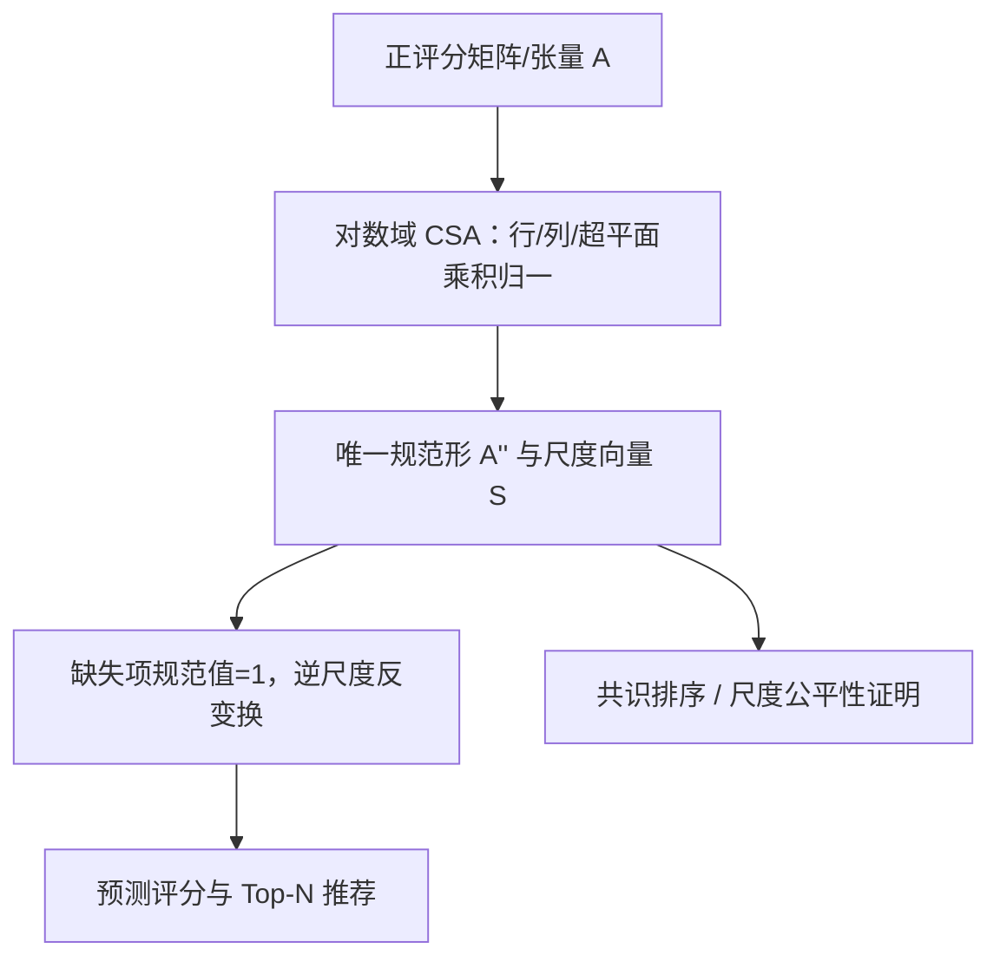
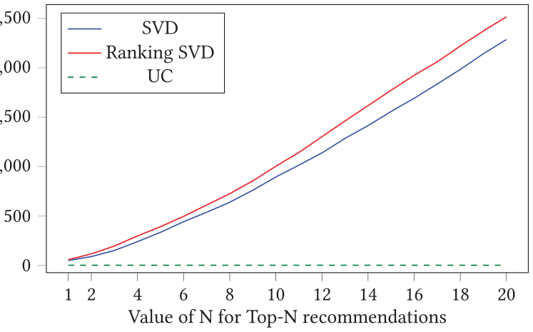
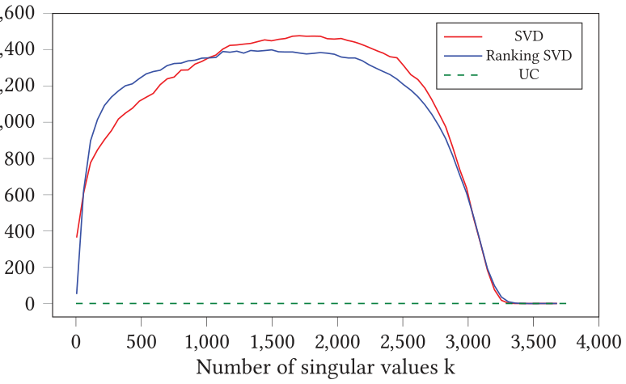

# Tensor Completion with Provable Consistency and Fairness Guarantees for Recommender Systems (面向推荐系统的可证明一致性与公平性张量补全)

- **会议/期刊**: ACM Transactions on Recommender Systems (TORS), 2023
- **作者与机构**: Tung Nguyen, Jeffrey Uhlmann；University of Missouri, USA
- **推荐链路定位**: 召回（矩阵/张量补全式评分预测与 Top-N 推荐）
- **研究方向**: 协同过滤与双塔召回 / 去偏公平、可信隐私与工业架构
- **论文原文**: [https://arxiv.org/abs/2204.01815v6](https://arxiv.org/abs/2204.01815v6)
- **开源代码**: 暂未开源

## TL;DR (1分钟核心速览)

本文针对评分矩阵/张量补全中“最小化 RMSE/秩”依赖评分单位、缺乏可证明公平与排序一致性的痛点，提出单位一致性(UC)约束：将正张量规范化为行/列/超平面乘积为 1，再反变换补全缺失项。理论上证明唯一性、共识排序与尺度公平；MovieLens-1M 单用户缩放及 X/Y/Z 共识扰动测试中 UC 零违例，而 SVD 类出现 >250 用户 top-5 变化。

## Background & Motivation (背景与核心矛盾)

- **主流范式**: 以 SVD/低秩分解、范数最小化或 RMSE 优化定义矩阵补全，再以保留奇异值比例控制模型容量。
- **前人局限**: 平方误差会放大大数值评分的权重，使“评分单位”不同的用户影响力不等；低秩截断还会破坏“所有用户都认为 X>Y>Z”这类基本排序共识。
- **核心洞察 (Key Insight)**: 用户评分中的“主观单位”可视为未知尺度；只要解对行/列/超平面的乘性缩放保持一致，就足以确定唯一补全，并导出公平性与共识排序。
- **本文切入点**: 用“单位一致性”这一约束替代应用任意的秩/范数目标，构造可证明性质的可解补全框架。

## Method (核心方法设计)

### 1. 整体框架 (Overall Architecture)

输入正评分矩阵/张量 \(A\)，先在对数域迭代 CSA：对每个行、列或 \((d-1)\) 维超平面，将已知项的 log 均值移入尺度向量，使规范形 \(A''\) 的每个超平面已知项乘积为 1；收敛后对缺失位置令规范值 \(=1\)，用尺度向量逆变换得到预测。训练即约束投影，无梯度、无负采样；离线复杂度与已知项数线性相关，固定 \(d\) 时单缺失项补全为 \(O(1)\)。

### 2. 关键设计拆解 (Key Designs)

1. **UC 规范缩放与补全（Unit-Consistent Canonical Scaling）**：痛点是用 RMSE 补全会把用户评分尺度当作真实信息；本文改为强制规范形满足  
\(\prod_{\vec{\alpha}\in\sigma(A_i)}A''(\vec{\alpha})=1\)，且 \(A''(\vec{\alpha})=A(\vec{\alpha})\prod_{k=1}^{d}S_{\{k\}}(\alpha_k)\)。缺失项在规范形中取 1 后反变换：  
\(\hat{A}(\vec{\alpha})=\prod_{k=1}^{d}S_{\{k\}}(\alpha_k)^{-1}\)。这样任一行/列乘性缩放只会整体移动预测尺度，而不会改变“同一用户内部”的相对偏好。

2. **共识排序与 full support 唯一性**：若所有用户都认为 X>Y>Z，则对新用户的补全也必须保持该顺序；矩阵情形要求缺失项 \((i,j)\) 周围存在已知的 \((i+p,j)\)、\((i,j+q)\)、\((i+p,j+q)\) 构成“超立方体”支撑。满足 full support 时，即使尺度向量不唯一，最终补全值仍唯一，从而把“可解释的排序共识”变成可证明性质。

3. **训练目标、负采样与推理效率**：无神经网络训练，等价于对数域约束最小二乘  
\(\min_{x}\frac12\sum_{\vec{\alpha}\in\sigma(A)}(x(\vec{\alpha})-a(\vec{\alpha}))^2\quad \text{s.t.}\sum_{\vec{\alpha}\in\sigma(A_i)}x(\vec{\alpha})=0,\forall i\)。  
无负采样；每轮 CSA 为 \(O(|\sigma(A)|)\)，固定维度下总预处理线性于已知项数，单次补全 \(O(1)\)，内存 \(O(|\sigma(A)|)\)。尺度公平性可写成  
\(\mathrm{MCA}(\mathbf{D}A\mathbf{E})=\mathbf{D}\,\mathrm{MCA}(A)\,\mathbf{E}\)，因此缩放某一用户整行不会改变对其他用户的预测。

## Experimental Setup & Evaluation Protocol (实验设置与评估协议)

- **数据集与预处理**: 使用 MovieLens-1M 的显式 1–5 分评分；共识实验使用其中 3,604 部影片子集，并人工加入 X/Y/Z 三部影片。论文未采用传统 `5-core` 过滤。

| 数据集 | #Users | #Items | #Interactions | 稀疏度/密度 | 特征/场景说明 |
| :--- | :---: | :---: | :---: | :---: | :--- |
| MovieLens-1M | 6,040 | 3,706（实验用 3,604 片子集） | 1,000,209 | 约 4.47% | 显式 1–5 评分；用户缩放与共识排序扰动测试 |

- **数据划分与防穿越 (Splitting Strategy)**: 不是 `Leave-One-Out` 或比例切分；实验直接在全评分矩阵上做“单用户评分缩放”和“人工加入 X/Y/Z”的性质扰动测试，不存在时间切分。
- **排名评测协议 (Ranking Protocol)**: 非传统 `Full-Ranking` 指标；统计单用户缩放前后其他用户 Top-N 列表的变化数量，以及控制组用户对 X/Y/Z 的推荐是否违反共识排序。无负采样排序，也未报告显著性检验。
- **对比基线与超参设置**: 对比 UC、SVD、Ranking SVD。SVD 类通过保留奇异值比例控制秩；UC 无学习率、秩、负采样超参，仅有 CSA 收敛阈值 \(\epsilon\)。

## Key Experimental Results (实验关键数据)

### 1. 主实验对比 (Main Results)

原文未提供传统 RMSE/Recall 的 5–8 个 SOTA 主表；唯一实证对比为性质扰动测试，故下表仅摘录三种方法。

| 方法 | 单用户评分 ×5/4 后 top-5 变化用户数 | X/Y/Z 共识排序 | 可证明性质 |
| :--- | :---: | :---: | :--- |
| **UC (本文)** | **0** | **全部遵守** | 唯一性、共识排序、尺度公平 |
| SVD | >250 | 显著违例 | 无 |
| Ranking SVD | >250 | 保留 >90% 奇异值前仍违例 | 无 |

<figure class="paper-figure" markdown="span">
  <figcaption>图2. 本图展示MovieLens1M数据集中标记为4360的单个用户将其评分按5/4缩放的效果，使其最高评分为4的评分变为最大评分值5。更具体地说，我们考虑这种缩放对其他用户所获推荐排序的影响程度。横轴表示top-N中的变化数量，纵轴表示因该单个用户缩放其评分而导致系统给出的top-N排序推荐发生变化的用户数量。例如，在50</figcaption>
</figure>

### 2. 消融实验 (Ablation Study)

原文未做传统 `w/o module` 消融；以下用“去掉 UC 约束”的 SVD 类方法作等价性质消融。

| 配置 | 尺度敏感性 | 共识排序违例 | 结论 |
| :--- | :---: | :---: | :--- |
| UC 完整 | 0 变化 | 0 | 同时满足尺度公平与共识排序 |
| w/o UC：SVD | >250 用户 top-5 变化 | 有 | 最小平方误差对评分单位敏感 |
| w/o UC：Ranking SVD | >250 用户 top-5 变化 | 保留 >90% 奇异值前有 | 排序优化不保证共识排序 |

<figure class="paper-figure" markdown="span">
  <figcaption>图3. 本测试使用MovieLens数据集中3,604部影片的子集，并向其中加入影片X、Y和Z。一半用户对这三部影片的评分分别为3、2和1。其余对照用户组对这三部影片均无评分。结果表明，给予对照用户组的所有UC推荐均遵守了对这三部影片都评过分用户的一致偏好排序，而两种基于SVD的方法均未如此。</figcaption>
</figure>

### 3. 关键实验发现 (Key Findings)

1. 仅将 MovieLens-1M 中用户 4360 的评分乘以 \(5/4\)，SVD/Ranking SVD 就使 **>250 名用户**的 top-5 推荐发生变化，而 UC 为 **0**，直接验证尺度公平性。
2. 在 X/Y/Z 共识测试中，半数用户给出 3/2/1、对照组完全未评分；UC 对控制组的全部推荐均保持 X>Y>Z，SVD 类需保留 **>90% 奇异值**才基本消除违例。
3. 复杂度上，UC 预处理为 \(O(|\sigma(A)|)\) 每轮、单缺失补全 \(O(1)\)（固定 \(d\)），优于 SVD 的 \(O(mnk)\) 或 \(O(n^3)\)；但论文没有给出标准推荐精度优势的量化证据。

## Highlights & Limitations (亮点、对比与审稿批判)

- **与代表作对比 (vs. Prior Work)**: 相比 SVD/Ranking SVD，本文不靠秩截断和 RMSE 调参，而是用单位一致性直接约束解空间，因而能证明唯一性、共识排序和尺度公平；相比统计/AI 描述式模型，本文是“规定式”模型，强调可证明性质而非拟合噪声。
- **可迁移亮点**: 可把“用户评分单位”作为 nuisance 变量，在训练前做行/列乘积归一化；也可把共识排序作为推荐系统上线前的 admissibility sanity check。
- **审稿级局限批判**: (1) 缺少标准 accuracy、Full-Ranking 与多数据集主实验，无法证明推荐精度不逊于 SOTA；(2) full support 假设在极稀疏/冷启动场景可能不成立，且仅证明尺度公平，shift-fairness 与整数化后的等分曝光偏置仍未解决；(3) 无开源代码，CSA 收敛阈值与等分商品随机化策略影响复现。

## Rating (四维评分)

- **方法创新性 (Novelty)**: ⭐⭐⭐⭐⭐ （用单位一致性替代秩/范数目标，并给出唯一性、共识排序与公平性的严格证明，思路罕见）
- **评估协议与实验扎实度 (Protocol & Experiments)**: ⭐⭐ （仅 MovieLens-1M 性质扰动测试，无标准精度主表、无 Full-Ranking、无显著性检验）
- **写作与数学规范度 (Clarity & Rigor)**: ⭐⭐⭐⭐⭐ （定义、定理、复杂度和证明链条完整，UC 与 full support 的直觉解释清楚）
- **工业落地与复现价值 (Industrial & Practical Value)**: ⭐⭐⭐ （线性复杂度与无超参有吸引力，但无开源代码，精度与稀疏支撑假设仍需工业验证）

