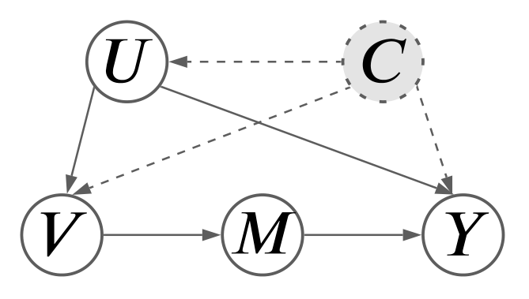
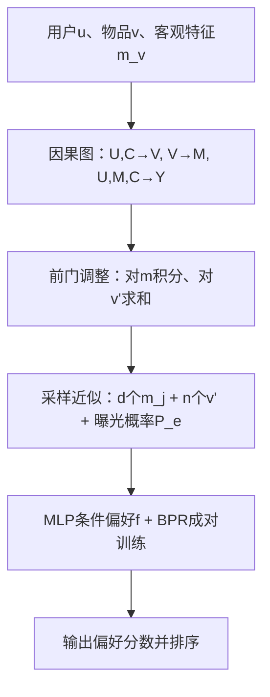
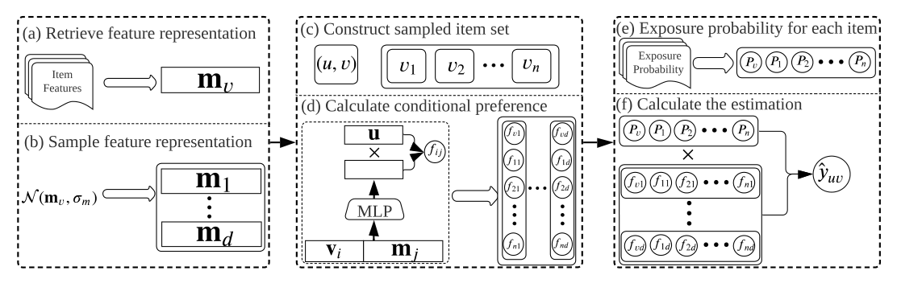

# Deconfounded Causal Collaborative Filtering (去混杂因果协同过滤)

- **会议/期刊**: ACM Transactions on Recommender Systems (TORS)
- **作者与机构**: Shuyuan Xu, Juntao Tan, Shelby Heinecke, Vena Jia Li, Yongfeng Zhang；Rutgers University, Salesforce Research, Meta
- **推荐链路定位**: 精排（用户-物品偏好估计，可扩展至召回）
- **研究方向**: 去偏公平、可信隐私与工业架构 / 因果去偏推荐
- **论文原文**: [https://arxiv.org/abs/2110.07122v2](https://arxiv.org/abs/2110.07122v2)
- **开源代码**: 暂未开源（论文称发表后释放；文中的 sentence-transformers 仅为文本编码依赖，非本文实现）

## TL;DR (1分钟核心速览)

针对推荐系统中大量不可观测、且难以逐一举证的全局/个人混杂，DCCF 将客观物品特征设为前门中介，用前门调整估计 $P(y\mid u,do(v))$，并以曝光概率加权、物品与特征双重采样使其可计算。在 Amazon/Yelp 的 SKEW 与 RAND 采样排序协议下，nDCG@5 相对最强去偏基线平均提升 18.2%/4.9%。

## Background & Motivation (背景与核心矛盾)

- **主流范式**: 现有去偏推荐多针对流行度、曝光、点击、位置等单一显式混杂设计专用模型，或在有偏数据上做 IPS 重加权。
- **前人局限**: 真实系统的混杂数量巨大，逐混杂建模不现实；更关键的是心情、天气等隐混杂不可观测，后门调整因 $C$ 不可测而失效，且非交互样本未必等于未曝光。
- **核心洞察 (Key Insight)**: 物品的客观内在特征（颜色、品牌、文本描述等）只由物品决定，不被用户或混杂直接影响，可作为满足前门准则的中介 $M$，从而在$C$ 不可观测时仍识别因果偏好。
- **本文切入点**: 将用户行为写成含未观测 $C$ 的因果图，用前门调整 + 采样近似 + 倾向校正曝光模型，统一去除全局与个人混杂。

<figure class="paper-figure" markdown="span">
  <figcaption>图3. 变量含义为：𝑈表示用户，𝑉表示曝光物品，𝑀表示中介变量（即物品固有特征），𝑌表示用户偏好，𝐶表示未观测混杂因素。虚线节点表示未观测变量，虚线箭头表示由未观测变量指出的因果关系。</figcaption>
</figure>
图3：未观测混杂下的推荐因果图，虚线节点/边表示不可观测变量与关系。

## Method (核心方法设计)

### 1. 整体框架 (Overall Architecture)

输入为 $(u,v)$及物品文本元数据；先用 sentence-transformer 固化客观特征$\mathbf{m}_v$，按因果图将$M$视为$V\rightarrow M\rightarrow Y$的中介。前门调整把偏好拆成“物品曝光$P(v'\mid u)$”与“给定$v'$、$m$的条件偏好$f$”的加权和；为适配大物品库，对$m$做高斯采样、对$v'$做物品采样，并以 IPS 校正曝光概率；最后用 BPR 成对训练，输出$\hat{y}_{uv}$ 排序。

<figure class="paper-figure" markdown="span">
  <figcaption>图4. 估计偏好ˆ𝑦𝑢𝑣的过程。m𝑣是数据集中描述的物品𝑣的特征表示；m1 · · · m𝑑为从 N (m𝑣, 𝜎𝑚) 中采样的固有物品特征；𝑣1, 𝑣2 · · · 𝑣𝑛为n个采样物品；𝑓𝑖𝑗为用户𝑢对具有固有物品特征m𝑗的物品𝑣𝑖的条件偏好𝑓(𝑢, 𝑣𝑖, m𝑗)（式(13)）；𝑃𝑖为物品𝑣𝑖对用户𝑢的曝光概率（即根据式(11)得到的𝑃𝑒𝑢𝑣𝑖值）；ˆ𝑦𝑢𝑣为用户𝑢与物品𝑣的最终偏好得分（式(14)）。</figcaption>
</figure>
图4：DCCF 的采样前门估计流程（特征采样、物品采样、曝光加权、条件偏好）。

### 2. 关键设计拆解 (Key Designs)

1. **前门因果识别（把不可测混杂“绕过去”）**：后门调整需可观测 $C$，本文把$C$留作未观测，令客观特征$M$作中介，识别式为$P(y\mid u,do(v))=\sum_m P(m\mid v)\sum_{v'}P(v'\mid u)P(y\mid u,v',m)$。直觉是$M$不受$U/C$直接影响，切断$V\leftarrow C\rightarrow Y$的后门，只保留$V\rightarrow M\rightarrow Y$ 的因果通道。
2. **采样式前门近似（让大物品库可计算）**：严格遍历全物品并对 $m$积分不可行；对$m$采样$d$次、对$v'$从$R(u,v)$采$n$个，得到$\hat{y}_{uv}=\frac{1}{d}\sum_{j=1}^{d}\sum_{v'\in R(u,v)}P_e(v'\mid u)f(u,v',\mathbf{m}_j)$。曝光概率用 MF 打分再除倾向$p_{uv}$校正：$P_e(u,v)=(p_uq_v^\top+b_u+b_v+b_g)/p_{uv}$，缓解“非交互即未曝光”的偏差。
3. **条件偏好与训练目标**：条件偏好用 MLP 拼接物品与特征后与用户内积，$f(u,v',\mathbf{m}_j)=\mathbf{u}^\top\phi(\mathbf{W}_\ell\phi(\cdots[\mathbf{v}';\mathbf{m}_j]))$；总损失为 BPR：$\mathcal{L}=-\sum_{u}\sum_{v_i\in V_u^+}\sum_{v_j\in V_u^-}\ln\sigma(\hat{y}_{ui}-\hat{y}_{uj})+\lambda_\Theta\|\Theta\|_2^2$。每正样本采 1 个负样本，推理复杂度约$O(ndD^2)$，$n$线性于$D$时升至$O(D^3)$。

## Experimental Setup & Evaluation Protocol (实验设置与评估协议)

- **数据集与预处理**: 评分 $\ge4$视为正反馈、$\le3$ 视为负反馈；Amazon 与 Yelp 统计如下：

| 数据集 | #Users | #Items | #Interactions | 稀疏度 | 特征/场景说明 |
| :--- | :---: | :---: | :---: | :---: | :--- |
| Electronics | 33,602 | 16,448 | 788,143 | 99.86% | Amazon 标题/卖点/描述作客观特征 |
| CDs and Vinyl | 6,867 | 6,953 | 249,456 | 99.48% | Amazon 音乐品类 |
| Yelp | 21,439 | 15,914 | 996,118 | 99.71% | 商户名称/地址/属性/类别 |

- **数据划分与防穿越 (Splitting Strategy)**: 采用 70%/10%/20% 训练/验证/测试；同时报告 RAND 随机划分与 SKEW 倾斜划分。SKEW 按物品流行度决定进入测试集的概率，模拟随机曝光试验分布，更接近去偏评估。
- **排名评测协议 (Ranking Protocol)**: `Sampled Ranking`，real-plus-N：真实数据每用户采 1000 个负物品、合成数据采 100 个；报告 nDCG@5、Recall@5、Precision@5，$K=5$。训练时每正样本采 1 个负样本。
- **对比基线与超参设置**: 基线含 MF、DMF、DecRS、IPW-MF、DCF、HCR，以及 DCCF_NS/DCCF_ND 消融；用户/物品维度搜索 $\{32,64,128\}$，MLP 两层 64 维，Adam 批大小 128，学习率$\{0.0005,0.001,0.003,0.005\}$，$L_2$正则$\{10^{-3},10^{-4},10^{-5}\}$，100 epoch；显著性$p<0.01$。

## Key Experimental Results (实验关键数据)

### 1. 主实验对比 (Main Results)

下表仅列核心指标 nDCG@5；DCCF 在全部数据集与两种划分下均为最优。

| 方法 | Elec-SKEW | CDs-SKEW | Yelp-SKEW | Elec-RAND | CDs-RAND | Yelp-RAND |
| :--- | :---: | :---: | :---: | :---: | :---: | :---: |
| MF | 0.0201 | 0.1567 | 0.1013 | 0.1463 | 0.2891 | 0.2980 |
| DMF | 0.0253 | 0.1363 | 0.1107 | 0.0948 | 0.1618 | 0.2483 |
| DecRS | 0.0687 | 0.2046 | 0.1108 | 0.1589 | 0.3093 | 0.3055 |
| IPW-MF | 0.0447 | 0.1959 | 0.1099 | 0.1502 | 0.2954 | 0.3034 |
| DCF | 0.0317 | 0.1573 | 0.1115 | 0.1463 | 0.2885 | 0.2995 |
| HCR | 0.0790 | 0.2033 | 0.1123 | 0.1613 | 0.3059 | 0.3045 |
| **DCCF** | **0.0934** | **0.2289** | **0.1184** | **0.1742** | **0.3237** | **0.3073** |
| **Improv.%** | **+18.2%** | **+11.9%** | **+5.4%** | **+8.0%** | **+4.7%** | **+0.9%** |

相对各数据集最强基线：Electronics/CDs/Yelp 的 SKEW nDCG@5 分别提升 18.2%/11.9%/5.4%，RAND 分别提升 8.0%/4.7%/0.9%；原文跨数据集平均提升为 SKEW 18.2%、RAND 4.9%。

### 2. 消融实验 (Ablation Study)

| 变体（SKEW, nDCG@5） | Electronics | CDs and Vinyl | Yelp | 说明 |
| :--- | :---: | :---: | :---: | :--- |
| DCCF_ND | 0.0413 | 0.1427 | 0.0991 | 去掉前门调整，仅用条件偏好 |
| DCCF_NS | 0.0429 | 0.1581 | 0.1087 | 去掉物品采样，仅曝光重加权 |
| DCCF_Random† | 0.0340 | 0.0831 | 0.0722 | 随机曝光概率 |
| DCCF_Uniform† | 0.0338 | 0.0853 | 0.0717 | 均匀曝光概率 |
| DCCF_Bias† | 0.0687 | 0.2053 | 0.1106 | 有偏曝光估计 |
| **DCCF/Unbias†** | **0.0846** | **0.2167** | **0.1124** | IPS 校正曝光 |
| **DCCF（主设置）** | **0.0934** | **0.2289** | **0.1184** | 完整模型，$n=20$ |

†曝光模型消融固定 $n=10$；其余主设置为$n=20$。

### 3. 关键实验发现 (Key Findings)

- **去混杂本身是主要收益来源**：Electronics-SKEW 上 DCCF_ND 仅 0.0413，而完整 DCCF 达 0.0934（+126%）；仅做曝光重加权 DCCF_NS 为 0.0429，仍远低于前门调整版本，说明“采样前门 + 曝光加权”缺一不可。
- **曝光模型质量决定前门调整上限**：同一 SKEW 设置下，IPS 校正的 Unbias 为 0.0846，Bias 为 0.0687，Uniform/Random 仅 0.0338/0.0340；错误曝光概率会把采样物品变成噪声，反而误导因果估计。
- **采样数存在效率-收益拐点**：准确曝光下 nDCG@5 随采样物品数增加而上升，但有偏曝光约在 5 个样本后开始下降；说明工业部署需同时控制 $n$ 与曝光模型精度，而非盲目增大采样。

## Highlights & Limitations (亮点、对比与审稿批判)

- **与代表作对比 (vs. Prior Work)**: DecRS 假设流行度混杂，DCF 构造替代混杂并条件化，HCR 把点击当媒介做多任务；DCCF 不枚举具体混杂，而用客观物品特征作前门中介，统一处理未观测全局/个人混杂，并用样本近似落地。
- **可迁移亮点**: 将“客观元数据”固化为因果中介，可迁移到多模态/内容推荐去偏；采样式前门调整 + IPS 曝光校正也可用于大物品库的因果排序建模。
- **审稿级局限批判**: 其一，方法强依赖可获取且足够客观的物品特征，纯 ID 或无元数据场景难用；若 $M$不能拦截大部分$V\rightarrow Y$直接效应，前门准则被破坏。其二，MNAR 下目标不可识别，且$n,d$ 采样与逐物品打分带来训练/推理开销；把所有混杂都当有害也可能抹去有用的场景上下文。

## Rating (四维评分)

- **方法创新性 (Novelty)**: ⭐⭐⭐⭐ （把前门调整、客观物品特征中介与采样近似结合，为未观测混杂提供统一去偏框架）
- **评估协议与实验扎实度 (Protocol & Experiments)**: ⭐⭐⭐⭐ （三真实集 + 两合成集、SKEW/RAND 双划分与显著性检验较完整，但仅采样排序、无全库排序）
- **写作与数学规范度 (Clarity & Rigor)**: ⭐⭐⭐⭐ （因果图、识别式与采样推导清晰，但可识别性讨论偏定性，复杂度分析较简）
- **工业落地与复现价值 (Industrial & Practical Value)**: ⭐⭐⭐ （思路可落地，但依赖文本特征与曝光模型，采样带来额外开销，且暂未开源）

