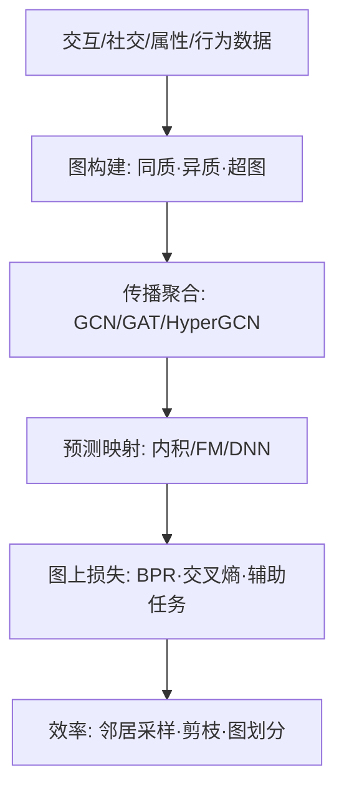
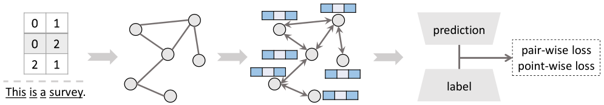

# A Survey of Graph Neural Networks for Recommender Systems: Challenges, Methods, and Directions (图神经网络推荐系统综述：挑战、方法与方向)

- **会议/期刊**: ACM Transactions on Recommender Systems (TORS)
- **作者与机构**: Chen Gao, Yu Zheng, Nian Li, ... Depeng Jin, Xiangnan He, Yong Li（清华大学 BNRist 电子工程系、中国科学技术大学）
- **推荐链路定位**: 全链路综述（召回/匹配 → 排序 → 重排），并覆盖生成式之外的非精度目标
- **研究方向**: 图神经网络与知识图谱推荐 / 去偏公平与工业架构
- **论文原文**: [论文原文链接](https://arxiv.org/abs/2109.12843v3)
- **开源代码**: [开源代码仓库链接](https://github.com/tsinghua-fib-lab/GNN-Recommender-Systems)

## TL;DR (1分钟核心速览)

本文是首篇同时覆盖推荐**阶段、场景、目标、应用**四个维度的 GNN 推荐综述。作者指出 MF/FM/NCF 只能利用一阶交互、协同效应仅被隐式捕捉，也无法统一异构多源数据；进而把 GNN 的价值归纳为**结构数据统一建模、高阶连通性、增强监督信号**三点，并把落地难点拆解为**图构建 → 传播聚合 → 模型优化 → 计算效率**四环闭环，据此梳理匹配/排序/重排与社交、序列、会话、捆绑、跨域、多行为等场景的代表工作。全文不提出新模型，而附开源"论文—代码"索引库作为复现入口。

## Background & Motivation (背景与核心矛盾)

- **主流范式**: 推荐从浅层相似度/矩阵分解，走到 NCF、DeepFM 等神经模型，本质上把推荐重构为"稀疏特征 → 稠密表征 → 打分"的有监督映射。
- **前人局限其一**: 训练样本仅为观测正例与采样负例，更新某用户参数时只有其直接交互物品参与，协同过滤效应只是被隐式逼近，**高阶邻居信息被丢弃**。
- **前人局限其二**: 用户画像、物品属性、社交关系、多行为等异构信号缺乏统一承载结构，常规模型只能各自拼接特征，难做跨源推理。
- **核心洞察 (Key Insight)**: CF 效应的物理本质就是图上的**多跳可达性**；堆叠 $L$层传播即可把$L$ 阶邻居写进节点表征，且社交/属性/行为天然可作为不同边类型统一入图。
- **本文切入点**: 不再按"模型名"罗列，而是以四维分类法 + 四环挑战为主轴重组文献，使每篇工作能在统一坐标系内定位。

## Method (核心方法设计)

### 1. 整体框架 (Overall Architecture)

综述首先界定推荐的四维坐标：阶段（匹配、排序、重排）、场景（社交、序列、会话、捆绑、跨域、多行为）、目标（精度、多样性、可解释、公平）、应用（商品、POI、新闻、影视）。随后给出 GNN 落地的通用闭环——把表格/文本/交互数据抽象为同质、异质或超图，用传播-聚合层迭代更新节点表征，将表征映射为预测并在边上定义损失，最后通过邻居采样、剪枝、去非线性等手段压回工业可承受的时延预算。方法章节即按上述四环挑战逐环展开，并对每一环给出备选算子的优劣权衡（如采样型 GCN 适合大规模稠密边，去非线性型适合中小图精度）。

<figure class="paper-figure" markdown="span">
  <figcaption>图 10. 实现 GNN 模型的整体流程：从数据（例如表格或文本）构建图，</figcaption>
</figure>

### 2. 关键设计拆解 (Key Designs)

1. **四维正交分类法（纠正场景并列的层级混淆）**：前人综述把 CF、序列推荐、社交推荐、KG 推荐并列，但序列只是"输入输出特设的场景"，CF 却是"阶段"。本文将维度解耦，任一工作可表示为 (阶段, 场景, 目标, 应用) 四元组，代价是牺牲单场景的深度，收益是暴露了"重排、跨域、非精度目标"等被前作忽略的空白区。

2. **三类图 + 两类传播算子的统一表述**：谱方法用图傅里叶滤波 $\mathbf{g}\star\mathbf{x}=\mathcal{F}^{-1}(\mathcal{F}(\mathbf{g})\odot\mathcal{F}(\mathbf{x}))$，以一阶近似的 GCN 为代表$\mathbf{H}^{l+1}=\delta(\tilde{\mathbf{D}}^{-\frac{1}{2}}\tilde{\mathbf{A}}\tilde{\mathbf{D}}^{-\frac{1}{2}}\mathbf{H}^{l}\mathbf{W}^{l})$；空间方法（GraphSAGE、GAT）直接加权聚合，后者用注意力$\alpha_{ij}$区分邻居重要性。超图则以关联矩阵$\mathbf{E}$做"节点→超边→节点"两阶段传播$\mathbf{H}^{l+1}=\mathbf{D}_v^{-\frac{1}{2}}\mathbf{E}\mathbf{D}_e^{-1}\mathbf{E}^{\top}\mathbf{D}_v^{-\frac{1}{2}}\mathbf{H}^{l}\mathbf{W}^{l}$，用一条超边直接建模多人共享的高阶社交圈，规避层叠过平滑。

3. **优化目标与采样、以及效率取舍**：推荐损失被统一改写为图上链路预测，pair-wise 形式即 $\mathcal{L}=\sum_{(i,j,k)\in\mathcal{O}}-\ln\sigma(s(i,j)-s(i,k))$，其中负例$k$ 从用户未交互集合采样；综述强调采样应**依赖图结构**（社交图上随机游走可产出"朋友交互过的物品"这类弱正例）。效率侧结论明确：GCN 类谱模型的逐层矩阵运算在千万级物品上不可行，PinSage 式的邻居采样 + 剪枝是工业主流，代价是精度回落。

## Experimental Setup & Evaluation Protocol (实验设置与评估协议)

- **综述的"评估协议"**: 本文为定性综述，**无自建统一实验台**；其"评测"体现为对 2018–2022 顶会/顶刊工作的纳入标准（新颖图结构设计或对四环挑战的实质改进）与跨表对比（原文 Table 2–4 汇总阶段、场景、目标三类代表模型及会场/年份）。
- **配套资源**: 开源仓库按场景与阶段分类维护论文 + 代码链接，构成可检索的复现索引。
- **综述中反复出现的基准数据集**（决定其结论的外部有效性）：

| 数据集 | 场景 | 主要用途 | 特点 |
| :--- | :--- | :--- | :--- |
| Amazon | 商品 | 匹配/捆绑/多行为 | 类目丰富，可构异质属性图 |
| Tmall / 阿里 | 电商 | 排序/CTR | 含点击-加购-购买多行为链 |
| Yelp | POI | 时空/社交 | 含地理与好友关系 |
| Gowalla | POI | 序列/社交 | 签到序列、稀疏性高 |
| MIND | 新闻 | 序列/内容 | 需文本建模，时效性强 |
| 通用 U-I 二分图 | 匹配 | LightGCN 类对比 | 常以 10-core 过滤 + 全库排序评估 |

- **对比基线口径**: 综述归纳的基线谱系为 MF/FM → NCF/DeepFM → NGCF/GCMC → LightGCN/DGCF/SGL，多数原文采用全库排序的 Recall@20 / NDCG@20 并做配对显著性检验（$p<0.05$），但**各文过滤与划分不统一**，这正是本文无法给出聚合结论的根本原因。

## Key Experimental Results (实验关键数据)

### 1. 匹配阶段代表方法的结构化对比（原文 Table 5 重排）

| 模型 | 图构建 | 网络设计 | 面向 CF 的特殊设计 |
| :--- | :--- | :--- | :--- |
| GCMC | user-item | GCN | 按关系类型共享权重 |
| NGCF | user-item | GCN | 显式注入高阶传播信息 |
| DGCF | user-item | GAT | 意图解耦表征 |
| **LightGCN** | user-item | LightGCN | **移除变换矩阵与非线性** |
| SGL | user-item | GCN | 图自监督对比辅助任务 |
| NIA-GCN | user-item | NIA-GCN | 邻居间交互建模 |
| PinSage | item-item | GCN | 邻居采样，工业级部署 |
| IMP-GCN | user-item | GCN | 先筛邻居再传播 |
| HS-GCN | user-item | GCN | 重定义节点间距离度量 |
| LGCN | user-item | 低通 GCN | 可训练谱核 |

### 2. 覆盖度对照（替代消融：与前作综述的维度覆盖比较）

| 覆盖维度 | 本综述 | 前作 GNN 推荐综述 | 前作 HIN 综述 |
| :--- | :---: | :---: | :---: |
| 匹配阶段 | ✔ 系统覆盖 | ✔ | ✔ |
| 排序 / 重排阶段 | ✔ 独立成节 | ✘ | ✘ |
| 跨域 / 多行为场景 | ✔ | ✘ | 部分 |
| 多样性·可解释·公平 | ✔ | ✘ | ✘ |
| 计算效率专章 | ✔ | ✘ | ✘ |
| 论文-代码索引库 | ✔ | ✘ | ✘ |

### 3. 关键实验发现 (Key Findings)

1. **"减法"优于"加法"的结构证据**：LightGCN 证明去掉 $\mathbf{W}^{l}$与$\delta(\cdot)$ 后多数数据集指标不降反升，说明 GCN 在推荐中的收益主要来自邻域平滑（低通滤波）而非非线性表达力；而部分数据上带非线性的 NGCF 仍可比，暗示收益与图密度强相关。
2. **层数存在硬上限**：综述明确指出绝大多数有效模型取 $L\le 4$，层数增加后表征趋于一致（过平滑），这解释了为何深层 GNN 推荐长期难落地。
3. **社交信号的两条融合路线并无定论**：DiffNet/GraphRec/MHCN 采用"社交图与交互图分别学习后 sum/concat/attention 融合"，DiffNet++ 采用"异构统一图联合学习"，前者可控性强、后者高阶交互更充分，综述未给出统一的胜负结论——这本身是评估协议缺失的体现。

## Highlights & Limitations (亮点、对比与审稿批判)

- **与代表作对比**: 相比早期 GNN 推荐综述只覆盖 CF + 序列 + 社交 + KG 四块并列主题，本文把排序/重排阶段、跨域与多行为场景、以及多样性/公平等非精度目标纳入同一坐标系；相比 HIN 综述，它把"异质图表示学习"扩展为完整的传播算子设计空间。
- **可迁移亮点**: ①四维 (阶段, 场景, 目标, 应用) 标签可直接用作团队文献库与实验登记表的字段体系，避免"场景与阶段混谈"；②"图构建 → 传播 → 优化 → 效率"的四环检查表可作为新模型设计时的自检清单；③开源索引库可直接作为复现选型的入口。
- **审稿级局限批判**: ①作为综述未提供任何统一重跑实验，各方法因数据集过滤（4/5/10-core）、划分（LOO vs 比例切分）、候选打分（Full-Ranking vs 采样排序）不一致而**无法横向比较**，文中的"state-of-the-art"仅是对原文声明的转述；②截稿于 2022 年，对生成式推荐、LLM 语义 ID、以及工业级图训练（分布式采样、图分区）讨论缺失，深度 GNN 与效率章节停留在定性层面，未给出显存的量级估算。

## Rating (四维评分)

- **方法创新性 (Novelty)**: ⭐⭐⭐⭐ （无新模型，但四维正交分类法 + 四环挑战闭环是结构化贡献，纠正了前人层级混淆）
- **评估协议与实验扎实度 (Protocol & Experiments)**: ⭐⭐⭐ （覆盖广、表格完整，但无统一实验台与定量对比，结论依赖原文口径）
- **写作与数学规范度 (Clarity & Rigor)**: ⭐⭐⭐⭐ （GCN/GAT/超图算子表述清晰、符号统一，但推导均为引用式、未展开谱分析）
- **工业落地与复现价值 (Industrial & Practical Value)**: ⭐⭐⭐⭐⭐ （附分类维护的论文-代码库，效率与部署权衡讨论直接可指导工程选型）

