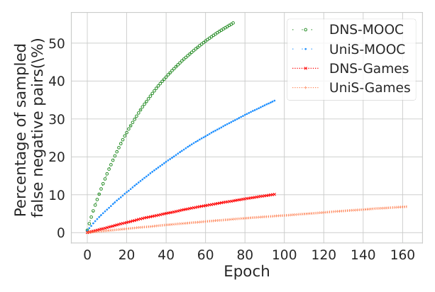
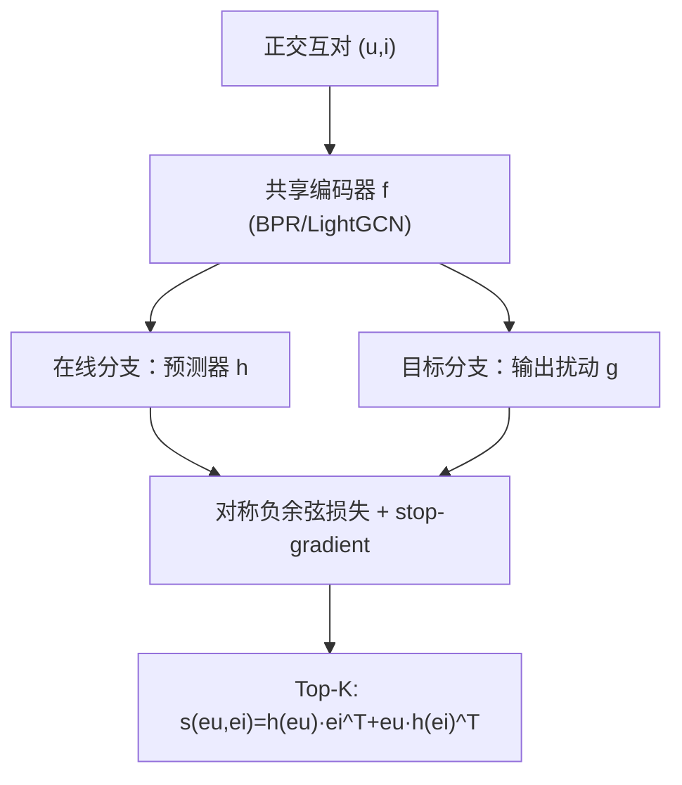
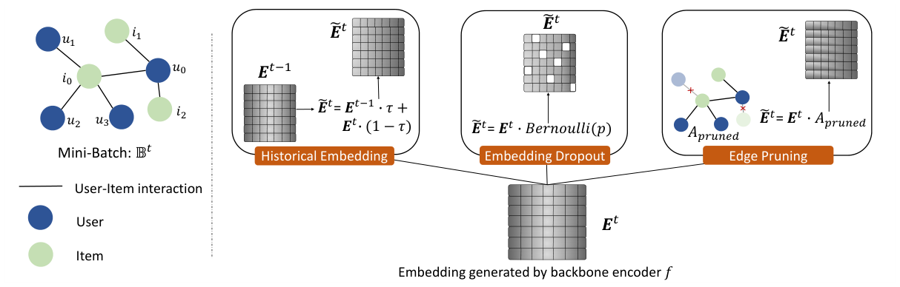

# SelfCF: A Simple Framework for Self-supervised Collaborative Filtering (自监督协同过滤的简单框架)

- **会议/期刊**: ACM Transactions on Recommender Systems (TORS)
- **作者与机构**: Xin Zhou, Aixin Sun, Yong Liu, Jie Zhang, Chunyan Miao; Nanyang Technological University
- **推荐链路定位**: 召回/排序（表征学习与 Top-K 排序）
- **研究方向**: 自监督对比学习与交互去噪 / 协同过滤
- **论文原文**: [论文原文链接](https://arxiv.org/abs/2107.03019v3)
- **开源代码**: [开源代码仓库链接](https://github.com/enoche/SelfCF)

## TL;DR (1分钟核心速览)

针对隐式反馈负采样成本高且会采到测试集未来正例的问题，SelfCF 把 SimSiam 简化为共享编码器，只在输出嵌入上做历史动量、Dropout、边剪枝三种扰动，以对称负余弦相似度训练，无需负样本。四数据集 5-core、按时间 7:1:2 切分、Full-Ranking 评测下，较 BUIR 平均提升 17.79%，较 LightGCN 最高 6.55%，训练快 2–4×。

## Background & Motivation (背景与核心矛盾)

- **主流范式**: 隐式反馈 CF（BPR、LightGCN 等）把观测交互当正例，未观测对当负例，依赖 Uniform/DNS 采样区分物品。
- **前人局限**: DNS 负采样开销高且在 MOOC 早停时假负样本超过 50%，采样耗时占训练的 80.3%–89.6%；同时未观测对可能是测试集未来正例，错误负样本会污染表征。

<figure class="paper-figure" markdown="span">
  <figcaption>图2. 使用LightGCN的不同采样方法所采样的假负样本对百分比。该百分比通过将采样的假负样本对数量除以测试集中的实例数，再将结果乘以100计算得到。</figcaption>
</figure>

- **核心洞察**: 视觉 SSL 的输入增广依赖图像连续变换，用户/物品离散 ID 难以直接增广；但可在骨干网络的输出嵌入空间制造“不同而相关”的视图。
- **本文切入点**: 用单编码器共享参数 + 输出扰动 + stop-gradient，避开负采样和双编码器动量更新。

## Method (核心方法设计)

### 1. 整体框架 (Overall Architecture)

输入正交互 $(u,i)$，由骨干$f$（BPR 或 LightGCN）输出$(e_u,e_i)$；在线分支经预测器$h$得$(\hat{e}_u,\hat{e}_i)$，目标分支经输出扰动$g$得$(\tilde{e}_u,\tilde{e}_i)$；两分支共享$f$，目标分支停止梯度。训练最小化对称负余弦相似度，推理用交叉预测打分。整体不采样负例，也不构建额外图视图（除边剪枝外）。

### 2. 关键设计拆解 (Key Designs)

1. **输出扰动三选一（替代输入增广）**：历史嵌入 $\tilde{\mathbf{E}}_t=\tau\mathbf{E}_{t-1}+(1-\tau)\mathbf{E}_t$；嵌入 Dropout$\tilde{\mathbf{E}}_t=\mathbf{E}_t\odot\mathrm{Bernoulli}(p)$；边剪枝$\tilde{\mathbf{E}}_t=\mathbf{E}_t\mathbf{A}_{\mathrm{pruned}}$。直觉：离散 ID 无法像图像裁剪那样增广，输出空间扰动既能保留正对语义，又能制造非平凡对比视图；前两者无需辅助图，边剪枝适合图骨干但有构图开销。

<figure class="paper-figure" markdown="span">
  <figcaption>图4. 在一个批次上执行输出扰动的示意图。扰动后的嵌入表示为˜E。</figcaption>
</figure>

2. **共享编码器 + stop-gradient（去冗余）**：BYOL/BUIR 需在线/目标双编码器与动量更新，显存和收敛慢；SelfCF 目标分支复用同一 $f$，只对扰动后的$\tilde{e}$停止梯度，在线分支更新$f,h$。损失$\mathcal{L}=\frac12[\mathcal{C}(\hat{e}_u,\mathrm{sg}(\tilde{e}_i))+\mathcal{C}(\mathrm{sg}(\tilde{e}_u),\hat{e}_i)]+\lambda_1(\|e_u\|_2^2+\|e_i\|_2^2)+\lambda_2\|h\|_1$，其中$\mathcal{C}(a,b)=-\frac{a^\top b}{\|a\|_2\|b\|_2}$。直觉：stop-grad 形成学生-教师式非对称，避免两分支同向塌缩。

3. **无负采样训练与交叉预测推理**：总损失仅用正交互，无需 Uniform/In-batch/Hard Negative；Top-K 分数用 $s(e_u,e_i)=h(e_u)^\top e_i+e_u^\top h(e_i)$，同时建模用户→物品和物品→用户两个方向。训练复杂度与骨干同阶，仅多一个轻量预测器；推理仍是全库内积排序（无额外负采样）。

## Experimental Setup & Evaluation Protocol (实验设置与评估协议)

- **数据集与预处理**: 四个公开数据集均做 `5-core` 过滤：

| 数据集 | #Users | #Items | #Interactions | 稀疏度/密度 | 特征/场景说明 |
| :--- | :---: | :---: | :---: | :---: | :--- |
| Arts | 45,624 | 21,104 | 396,556 | 99.9588% | Amazon Arts 评论 |
| Games | 50,677 | 16,897 | 454,529 | 99.9469% | Amazon Video Games |
| Food | 115,144 | 39,688 | 1,025,169 | 99.9776% | Amazon Grocery 大图 |
| COCO | 144,773 | 20,969 | 1,204,697 | 99.9603% | 教育课程平台 |

- **数据划分与防穿越 (Splitting Strategy)**: 按全局时间戳 `7:1:2` 切分训练/验证/测试，避免未来交互泄漏。
- **排名评测协议 (Ranking Protocol)**: 无偏 `Full-Ranking`，未交互物品全作为候选；报告 Recall@10/20/50 与 NDCG@10/20/50。
- **对比基线与超参设置**: 对比 Pop、BPR、MultiVAE、EHCF、NGCF、LR-GCCF、LightGCN、SimGCL、BUIR；嵌入维度 $d=64$，Xavier 初始化，Adam，早停 50/总 1000，验证集 Recall@20 选模；未报告显著性检验。

## Key Experimental Results (实验关键数据)

### 1. 主实验对比 (Main Results)

下表摘取 Food/Games 的 R@20 与 N@20（原文表 4 的代表性列），加粗为列最优：

| 模型 | Food R@20 | Food N@20 | Games R@20 | Games N@20 |
| :--- | :---: | :---: | :---: | :---: |
| BPR | 0.0222 | 0.0124 | 0.0369 | 0.0183 |
| MultiVAE | 0.0208 | 0.0116 | 0.0376 | 0.0196 |
| EHCF | 0.0243 | 0.0137 | 0.0445 | 0.0227 |
| NGCF | 0.0254 | 0.0132 | 0.0425 | 0.0217 |
| LR-GCCF | 0.0277 | 0.0154 | 0.0446 | 0.0228 |
| LightGCN | 0.0286 | 0.0157 | 0.0461 | 0.0231 |
| SimGCL | 0.0265 | 0.0147 | 0.0502 | 0.0251 |
| BUIR-LightGCN | 0.0236 | 0.0141 | 0.0384 | 0.0192 |
| SelfCFed-LightGCN | **0.0316** | **0.0173** | 0.0485 | 0.0240 |
| SelfCFep-LightGCN | 0.0296 | 0.0161 | **0.0517** | **0.0255** |

SelfCFed 较 BUIR-LightGCN：Food R@20 +33.9% / N@20 +22.7%，Games +26.3% / +25.0%；SelfCFep 在 Games 较 LightGCN R@20 +12.2% / N@20 +10.4%。

### 2. 消融实验 (Ablation Study)

以 Food 上 SelfCFed-LightGCN 为基准（原文表 6–8）：

| 设置 | R@20 | N@20 |
| :--- | :---: | :---: |
| Full SelfCFed | **0.0316** | **0.0173** |
| w/o predictor | 0.0191 | 0.0132 |
| fixed random predictor | 0.0191 | 0.0129 |
| 2-layer MLP predictor | 0.0313 | 0.0173 |
| 交叉熵相似度损失 | 0.0191 | 0.0133 |
| w/o stop-gradient | 0.0191 | 0.0133 |
| w/o stop-grad & predictor | 0.0191 | 0.0132 |

### 3. 关键实验发现 (Key Findings)

1. SelfCFed 在 Food 上 R@20=0.0316，超监督 LightGCN 的 0.0286 约 10.5%；Games 上 R@20=0.0485 超 LightGCN 的 0.0461 约 5.2%。封装 BPR 时 SelfCFed 也可将 BPR 平均提升 7.36%，说明框架对经典 CF 与图 CF 均有效。
2. 相对 BUIR，SelfCFed 在 Food/Games 的 R@20 分别提升 33.9%/26.3%，N@20 提升 22.7%/25.0%，四数据集平均 17.79%；且 Food 训练 17.2s vs LightGCN 4 层 59.81s，Games 3.75s vs 8.22s，实测量级 2–4× 加速。
3. 嵌入 Dropout 整体最优；边剪枝在 Games 上 R@20=0.0517 最高，但需构图且稳定性较差；历史动量在 Arts/COCO 等稀疏数据上增益有限（COCO R@20 仅 +0.74%）。冷启动用户 Recall@50 提升 14.4%，忠诚用户提升 12.80%，说明无负采样减少未来正例误判的伤害。

## Highlights & Limitations (亮点、对比与审稿批判)

- **与代表作对比 (vs. Prior Work)**: BUIR 沿用 BYOL 双编码器 + 动量更新，显存大、收敛慢；SelfCF 共享编码器、输出扰动，训练快 2–4×，且不修改骨干内部逻辑。SimGCL 仍需负样本/噪声注入；SelfCF 完全不采样负例，靠输出扰动和 stop-grad 抗塌缩，在 Food/Games 上接近或超过 SimGCL。监督 LightGCN 依赖 BPR 负采样；SelfCF 仅用正交互，仍保留图传播，Food R@20 +10.5%。
- **可迁移亮点**: 输出扰动可封装任意 embedding-like backbone，尤其适合无法做输入增广的 ID 类特征；交叉预测打分 + 对称损失可迁移到双塔召回/排序，提升用户-物品双向一致性。
- **审稿级局限批判**: 仅离线 Full-Ranking，无线上 A/B；未报告显著性检验。对正则系数 $\lambda_1$敏感，$\lambda_1\ge 10^{-2}$ 性能骤降；边剪枝构图开销大，历史动量在部分数据集增益小。

## Rating (四维评分)

- **方法创新性 (Novelty)**: ⭐⭐⭐⭐ （输出扰动替代输入增广，适配离散 ID；机制简洁，但理论分析主要靠协方差实证）
- **评估协议与实验扎实度 (Protocol & Experiments)**: ⭐⭐⭐⭐ （四数据集 5-core、时间切分、全库排序、多指标；但无显著性检验与线上验证）
- **写作与数学规范度 (Clarity & Rigor)**: ⭐⭐⭐⭐ （公式和伪代码清晰；stop-grad 与三种扰动对比充分；部分表格过大）
- **工业落地与复现价值 (Industrial & Practical Value)**: ⭐⭐⭐⭐ （开源 RecBole 实现，训练 2–4× 加速，可黑盒封装；边剪枝构图开销需注意）

