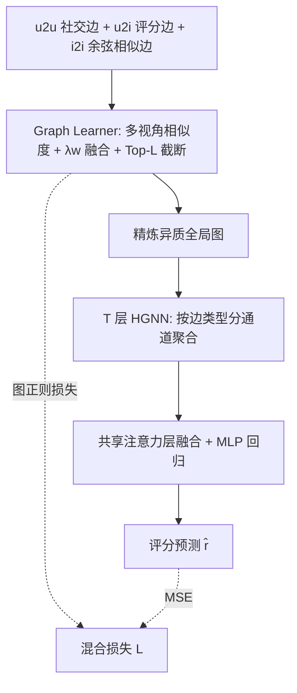
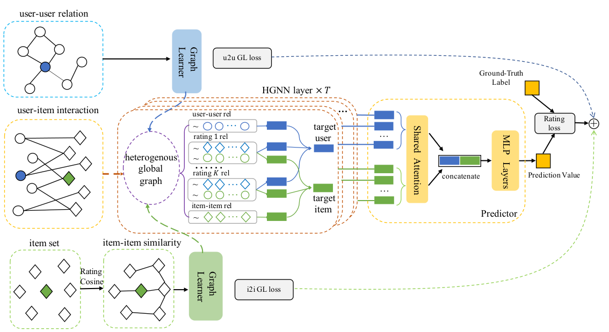

# Graph Learning Augmented Heterogeneous Graph Neural Network for Social Recommendation (图学习增强的异质图神经网络用于社交推荐)

- **会议/期刊**: ACM Transactions on Recommender Systems (TORS；arXiv 预印本 2021-09)
- **作者与机构**: Yiming Zhang, Qi Shen, Yitong Pang, Zhihua Wei (同济大学)；Lingfei Wu, Bo Long (京东硅谷研究中心)；Fangli Xu (Squirrel AI)；Ethan Chang (Middlesex School)
- **推荐链路定位**: 精排（评分回归打分）
- **研究方向**: 社交与群组推荐 / 图神经网络与知识图谱推荐
- **论文原文**: [https://arxiv.org/abs/2109.11898v1](https://arxiv.org/abs/2109.11898v1)
- **开源代码**: 暂未开源

## TL;DR (1分钟核心速览)

社交推荐的主流 GNN 做法把 u2u 社交图与 u2i 交互图割裂建模，既忽略三者联合的跨语义高阶信息，又默认"社交边=偏好相似"（实际常含噪声且缺边），i2i 关系则仅靠评分/类别属性硬构造。本文提出 GL-HGNN：先按评分向量余弦建 i2i 子图，再用 Graph Learner 以多视角嵌入相似度重写 u2u 与 i2i 邻接（隐式图与初始图加权融合 + Top-L 截断），送入 T 层异质 HGNN 按边类型分通道聚合，最后用共享注意力融合各层 + MLP 回归评分。在 Ciao-5 上 RMSE 0.8615（相对 DANSER 降 4.68%），MAE 0.6497（降 5.25%）。

## Background & Motivation (背景与核心矛盾)

- **主流范式**: GraphRec/GraphRec+/DANSER 等在 u2u 与 u2i 二部图上做消息传递，部分工作额外用评分共现或类别属性构造 i2i 边以扩大感受野。
- **前人局限**: (i) 三路关系（u2u、u2i、i2i）未放入**单一异质全局图**联合建模，消息传递被割裂，跨语义高阶路径缺失；(ii) 原始社交边被默认可信，但"丈夫—妻子—同事"式的拓扑中，近邻兴趣可能冲突、非近邻反而高度相似，噪声与缺失同时存在；(iii) 已有 i2i 图仅用初始评分属性或类目 ad-hoc 构造，与下游评分任务不对齐，是次优的。
- **核心洞察 (Key Insight)**: 图结构本身应是**可学习参数**——以任务损失反向驱动边权更新，让"隐式相似度图"补全缺失边、削弱噪声边，并与初始拓扑（仍含宝贵结构先验）做加权融合。
- **本文切入点**: 用统一的异质全局图 + Graph Learner 结构学习 + 异质 GNN 表示学习端到端联合优化。

## Method (核心方法设计)

### 1. 整体框架 (Overall Architecture)

输入为用户社交邻接、K 档评分交互与由评分列余弦相似度初始化的 i2i 子图；三者合并为含 2 类节点、3 类元路径、$K+2$类边的异质全局图。Global Graph Learning 模块分别对 u2u、i2i 邻接做"多视角相似度打分 → 与初始邻接加权融合 → Top-$L$截断"得到精炼子图；精炼图送入$T$ 层 HGNN，按边类型分通道聚合后平均融合；各层输出经共享注意力加权得最终用户/物品表征，拼接后由 MLP 输出评分。训练采用评分 MSE + 两侧图正则的混合损失端到端联合优化，推理即一次前向打分。

<figure class="paper-figure" markdown="span">
  <figcaption>图1：我们的模型 GL-HGNN 概览。我们首先建立物品-物品子图结构。我们采用 Graph Learner 更新和优化图结构。我们利用 HGNN 对全局图建模，以提取复杂的跨语义信息。输出嵌入被送入预测器进行预测。我们设计了一种混合损失，包括 Graph Learner 损失和评分损失，用于训练。</figcaption>
</figure>

### 2. 关键设计拆解 (Key Designs)

1. **多视角 Graph Learner（把邻接当参数学）**：痛点是用初始社交边传播会把"亲友≠同好"的偏好偏差放大。对目标节点 $u_i$，在$F$个视角下计算嵌入相似度并平均：$\text{sim}(u_i,u_n)=\frac{1}{F}\sum_{f=1}^{F}\text{sim}_f(u_i,u_n)$，其中$\text{sim}_f=\cos(\mathbf{W}_f^c\mathbf{p}_i,\mathbf{W}_f^c\mathbf{p}_n)$（另备 attention / add-attention 两种算子）。再与初始邻接加权融合并截断：$\tilde{\mathbf{A}}_u=\lambda_w\mathbf{A}'_u+(1-\lambda_w)\mathbf{A}_u$。直觉：$\lambda_w$控制"新学隐式关系"与"原始拓扑先验"的信任配比，截断长度$L$ 控制有效信息/冗余噪声的边界。
2. **锚点加速 AGL（把 $O((N+M)^2)$降到线性）**：全节点两两算相似度的复杂度为$O((N+M)^2D)$，大规模不可用。随机抽$H_u\ll N$、$H_v\ll M$个锚点，仅计算 target–anchor 相似度矩阵$\mathbf{A}'_{u,anchor}\in\mathbb{R}^{B\times H_u}$，同法做融合截断。整体复杂度降为$O(TX'(N+M)D)$，对节点数线性。
3. **HGNN + 图正则混合损失**：每层按边类型分通道归一化聚合，再平均：$\mathbf{p}_i^{(t+1)}=\sigma\!\left(\frac{1}{K+1}\big(\mathbf{p}_{i,u}^{(t+1)}+\sum_{k=1}^{K}\mathbf{p}_{i,k}^{(t+1)}\big)\right)$，使 i2i 语义经多层回传进入用户表征。图学习侧先把$\tilde{\mathbf{A}}_u$对称化为$\hat{\mathbf{A}}_u=\tilde{\mathbf{A}}_u\Delta^{-1}\tilde{\mathbf{A}}_u^{T}$，用平滑损失$\mathcal{L}(\hat{\mathbf{A}}_u,\mathbf{P})=\frac{1}{B^2}\mathrm{tr}(\mathbf{P}^{T}\mathbf{L}\mathbf{P})$配约束项$C(\hat{\mathbf{A}}_u)=-\frac{\beta_1}{B}\mathbf{1}^{T}\log(\hat{\mathbf{A}}_u\mathbf{1})+\frac{\beta_2}{B^2}\|\hat{\mathbf{A}}_u\|_2$防过度平滑，最终$\mathcal{L}=\mathcal{L}_r+\gamma_u\mathcal{L}_G^{u}+\gamma_v\mathcal{L}_G^{v}+\eta\Omega(\Theta)$，$\mathcal{L}_r$ 为 MSE。**无负采样**（回归任务），推理开销为单次 HGNN 前向。

## Experimental Setup & Evaluation Protocol (实验设置与评估协议)

| 数据集 | #Users | #Items | #Interactions | 稀疏度/密度 | 特征/场景说明 |
| :--- | :---: | :---: | :---: | :---: | :--- |
| Ciao-5 | 2,248 | 16,861 | 36,065 | 0.095% | 5 类商品，评分 [1,5]，52,907 社交边 |
| Ciao-28 | 10,994 | 112,802 | 304,493 | 0.025% | 28 类全量，131,427 社交边 |
| Epinions | 22,164 | 296,277 | 922,267 | 0.014% | 商品评论社区，362,433 社交边 |
| Flixster | 147,612 | 48,794 | 8,196,067 | 0.114% | 电影社交，评分 [0.5,5]，2.44M 社交边 |

- **数据划分与防穿越**: 随机 `比例划分` 70% 训练 / 10% 验证 / 20% 测试，未按全局时间戳切分（存在轻度未来信息泄漏风险）。
- **排名评测协议**: 本文为**评分回归**任务，不涉及 Full-Ranking / Sampled Ranking，直接对测试集已观测 (u,i) 对回归打分，报告 RMSE 与 MAE（RMSE 对离群更敏感）。
- **对比基线与超参设置**: 基线含 MF 系（SocRec、TrustMF、TrustSVD）、深度系（DSCF）、GNN 系（GC-MC、GraphRec、DANSER、GraphRec+）。嵌入维 $D=64$，batch 128，Adam lr 1e-3，dropout 0.4，i2i 每物品 Top-20 邻居，$\lambda_w\in[0.1,0.9]$，$F\in[1,4]$，$L\in\{20,40,60,80,100\}$（最优 40），$T\in[1,4]$（最优 3），锚点率$\tau\in[0.01,0.2]$。

## Key Experimental Results (实验关键数据)

### 1. 主实验对比 (Main Results)

| Model | Ciao-5 RMSE | Ciao-5 MAE | Ciao-28 RMSE | Ciao-28 MAE | Epinions RMSE | Epinions MAE | Flixster RMSE | Flixster MAE |
| :--- | :---: | :---: | :---: | :---: | :---: | :---: | :---: | :---: |
| TrustSVD | 0.9796 | 0.7845 | 1.0986 | 0.8480 | 1.1394 | 0.8601 | 1.0402 | 0.8097 |
| DSCF | 0.9785 | 0.7651 | 1.0932 | 0.8391 | 1.1295 | 0.8532 | 1.0220 | 0.8034 |
| GC-MC | 0.9260 | 0.7230 | 1.0736 | 0.8226 | 1.1168 | 0.8594 | 0.9870 | 0.7571 |
| GraphRec | 0.9226 | 0.7006 | 1.0503 | 0.8157 | 1.1036 | 0.8485 | 0.9360 | 0.7161 |
| DANSER | 0.9038 | 0.6857 | 1.0496 | 0.8102 | 1.0821 | 0.8164 | 0.9400 | 0.7113 |
| GraphRec+ | 0.9191 | 0.7065 | 1.0477 | 0.8088 | 1.0943 | 0.8377 | 0.9225 | 0.7054 |
| **GL-HGNN** | **0.8615** | **0.6497** | **1.0320** | 0.7763 | **1.0709** | **0.8017** | 0.9142 | 0.6993 |
| **AGL-HGNN** | 0.8676 | 0.6535 | 1.0330 | **0.7758** | 1.0727 | 0.8092 | **0.9091** | **0.6899** |
| **Improv.%** | **4.68%** | **5.25%** | **1.50%** | **4.08%** | **1.03%** | **1.79%** | **1.45%** | **2.20%** |

（Improv.% 相对各数据集最优基线计算。）

### 2. 消融实验 (Ablation Study)

| 变体 | Ciao-5 RMSE | Ciao-5 MAE | Epinions RMSE | Epinions MAE |
| :--- | :---: | :---: | :---: | :---: |
| GL-HGNN (full) | **0.8615** | **0.6497** | **1.0709** | **0.8017** |
| w/ Attention 相似度 | 0.8642 | 0.6539 | 1.0745 | 0.8059 |
| w/ Add-Attention 相似度 | 0.8692 | 0.6531 | 1.0738 | 0.8065 |
| w/o u2u GL | 0.8708 | 0.6889 | 1.0746 | 0.8164 |
| w/o i2i GL | 0.8654 | 0.6632 | 1.0764 | 0.8212 |
| w/o 两侧 GL | 0.8813 | 0.6893 | 1.0795 | 0.8258 |
| w/o GL 且无 i2i 边 | 0.9171 | 0.7077 | 1.0860 | 0.8369 |

### 3. 关键实验发现 (Key Findings)

1. **结构学习贡献远大于"加边"本身**：Ciao-5 上去掉 i2i 边与 GL（0.9171/0.7077）比去掉 GL 但保留 i2i（0.8813/0.6893）差 4.1%/2.7%，说明增益来自**边的重写**而非仅扩感受野；两侧 GL 全去掉后 MAE 恶化 6.1%，是消融中最大跌幅。
2. **i2i GL 在稠密社交图上更关键**：Epinions 上去掉 i2i GL 使 MAE 从 0.8017 升至 0.8212（+2.43%），而去掉 u2u GL 仅 +1.83%；反之 Ciao-5 社交边更密（1.047%）时 u2u GL 缺失对 MAE 影响更大（+6.04%），说明 GL 主要补的是**信息更稀缺的那一路图**。
3. **深度与超参存在明确拐点**：HGNN 层数 $T{=}3$最优，$T{=}4$在 Epinions 上 RMSE 回升至 1.0846（过平滑）；截断长度$L{=}40$最佳，$L$过大引入无关边、过小丢失有效关系；锚点率$\tau\le0.1$ 时 RMSE 与全量 GL 相当而训练时间近似线性可压。

## Highlights & Limitations (亮点、对比与审稿批判)

- **与代表作对比 (vs. Prior Work)**: 相比 GraphRec+（u2u/u2i/i2i 三图但 i2i 为静态构造、u2u 不可修正），本文把 i2i 与 u2u 都做成**可学习、可微、任务对齐**的子图；相比 DANSER（大图 + 动态/静态属性双融合但图固定），本文的 Graph Learner 直接以评分损失反传图结构；相比通用图结构学习 IDGL（节点分类场景），本文首次将其迁移至社交推荐异质全局图。
- **可迁移亮点**: (i) 隐式图与初始图 $\lambda_w$加权 + Top-$L$ 截断的"重写而非替换"范式，可低成本套用到任何带噪声先验图的推荐场景（如知识图谱边、序列转移图）；(ii) 锚点近似把 pairwise 相似度计算降到线性，工程上极易落地。
- **审稿级局限批判**: (i) 随机 70/10/20 划分而非时间切分，同一用户的未来评分可能进入训练，实际线上收益可能被高估；(ii) Flixster 上增益仅 1.45%/2.20%，且 AGL 与 GL 结果互有胜负，未给显著性检验，说明在超大规模稠密数据上收益边际递减；(iii) 只做评分回归，未验证 Top-N 排序 / 冷启动用户，缺少 Full-Ranking 协议与推理时延的端到端报告。

## Rating (四维评分)

- **方法创新性 (Novelty)**: ⭐⭐⭐⭐ （把"社交边≠偏好相似"的观察转化为可微图结构重写，$K+2$ 类边统一异质全局图的建模视角清晰，但多视角相似度算子属于已有组件的组合式创新）
- **评估协议与实验扎实度 (Protocol & Experiments)**: ⭐⭐⭐ （四个真实数据集 + 完整消融与超参敏感性，但随机比例划分存在时间泄漏、缺少显著性检验、无 Top-N 排序与冷启动评估）
- **写作与数学规范度 (Clarity & Rigor)**: ⭐⭐⭐⭐ （图正则与混合损失推导完整，复杂度分析给出 $O((N+M)^2D)\to O(TX'(N+M)D)$ 的明确对照；但式(19)约束项的直觉解释略简）
- **工业落地与复现价值 (Industrial & Practical Value)**: ⭐⭐⭐⭐ （AGL 锚点近似使结构学习可扩展到百万级节点，与现有 GNN 召回/精排管线兼容；但代码未开源、图学习需周期性离线重训，实时性受限）

