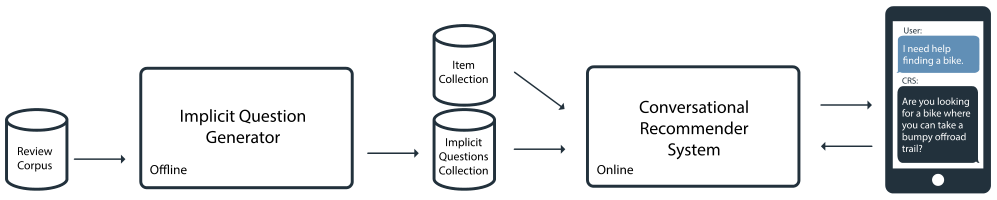
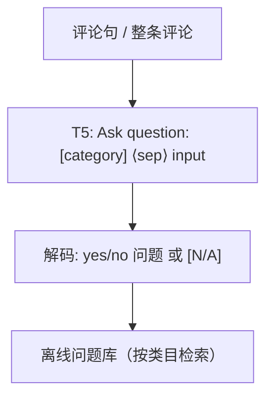
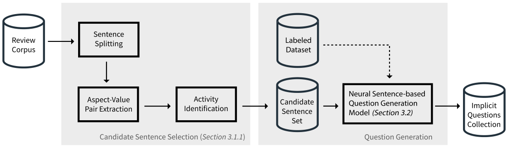

# Generating Usage-related Questions for Preference Elicitation in Conversational Recommender Systems (面向对话推荐中偏好引导的使用场景问题生成)

- **会议/期刊**: ACM Transactions on Recommender Systems (ToRS), Vol. 2, No. 2, Article 12
- **作者与机构**: Ivica Kostric, Krisztian Balog (University of Stavanger), Filip Radlinski (Google)
- **推荐链路定位**: 对话交互前端 / 偏好引导（推荐前置阶段，离线问题库构建）
- **研究方向**: 对话推荐与智能体仿真 / 大语言模型推荐
- **论文原文**: [https://arxiv.org/abs/2111.13463v2](https://arxiv.org/abs/2111.13463v2)
- **开源代码**: [https://github.com/iai-group/tors2023-crs-questions](https://github.com/iai-group/tors2023-crs-questions)

## TL;DR (1分钟核心速览)

传统 CRS 的偏好引导直接追问**物品属性槽位**（"轮胎多粗？""几档变速？"），但冷启动/新域用户根本没有这种领域知识。本文提出改用**隐式使用场景提问**（"是否要一辆适合通勤的车？"），从 Amazon 评论文本中把"aspect-value + usage"句转化为 yes/no 引导问题；构建三步众包标注数据集（12 类 838 句 × 5 问题），并比较 2 个模板基线与 2 个 T5 端到端模型。在 80/20 留出集上，句子级 NSQG 的 BLEU-4 从 0.607 提升至 0.730（+20.3%）、METEOR 0.420→0.494，人工成对评测中 44% 胜模板基线。

## Background & Motivation (背景与核心矛盾)

- **主流范式**: CRS 通过多轮自然语言交互实时引导偏好，主流做法是 item-based（对推荐列表给反馈）或 attribute-based（槽位填充式追问属性值），并常借 Bandits/序列网络决定"下一个问什么"。
- **前人局限**: ① 物品空间巨大，逐项反馈收敛慢、用户易流失；② 属性提问要求用户掌握领域词汇（如"轮径""齿数"），而新手只知道自己"打算怎么用"这件商品，问属性等于把领域知识负担转嫁给用户。
- **核心洞察 (Key Insight)**: 用户在评论中天然会写"胖胎很适合征服烂路"这类 **usage→aspect** 语句，说明使用场景是比属性更低门槛、更贴近真实需求的表达；这类句子可被逆向改写为单轮 yes/no 问题，离线批量生成后即成为可检索的"问题库"。
- **本文切入点**: 把偏好引导重构为**评论文本到问题的 text-to-text 生成任务**，只做离线问题生成（在线多轮策略与推荐器留作下游）。

<figure class="paper-figure" markdown="span">
  <figcaption>图 1. 概念系统概览。本文重点研究隐式问题生成组件。</figcaption>
</figure>

## Method (核心方法设计)

### 1. 整体框架 (Overall Architecture)

流程为：Amazon 评论 → 高精度候选句抽取（Sentires 抽取 aspect-value 短语 + 词性规则筛 `for + V-ing`）→ 众包三步标注（问题生成 / 质量校验过滤 / 改写扩充）→ 训练四种问题生成器 → 离线批量生成问题库，实时对话中作为候选问题检索使用。四种模型构成自动化程度递增的谱系：TQG 纯模板必出题；TQG+CLS 前置 RoBERTa 判定句是否 applicable；NSQG 用 T5 端到端完成"判定 + 生成"；NRQG 进一步取消句子级启发式，直接以整条评论为输入。区别核心在于**启发式边界放在哪一层**。

### 2. 关键设计拆解 (Key Designs)

1. **高精度候选句抽取 + N/A 判定（把"该不该问"显式建模）**：痛点是不加筛选的模板法会对 "Thank you so much for coming up with such a great product" 也硬造问题（必然 yes、零信息量）。TQG+CLS 用 RoBERTa 做二分类 $p(\text{app}\mid s)=\mathrm{softmax}(\mathbf{W}\mathbf{h}_{[\text{CLS}]}+\mathbf{b})$；NSQG 则把同一判断嵌进生成空间，让模型输出特殊 token `[N/A]`。物理直觉：**"不问"与"问什么"是同一个决策**，交由同一解码器统一建模可避免分类器与生成器误差级联。
2. **模板构造与 T5 端到端生成**：TQG 分析训练集人工问题的最频繁 n-gram 得到模板 `Are you looking for a [category] that is great for [usage]?`，输入句直接填槽。NSQG 改为条件生成，输入为 $x=\texttt{Ask question: }[c]\ \langle sep\rangle\ s\ \langle eos\rangle$，输出$q=\arg\max_y\prod_t p_\theta(y_t\mid y_{<t},x)$；推理用 temperature 采样 + top-$k$=25 与 nucleus top-$p$=0.90 提高问法多样性。为何有效：模板绑定原句句法，长句必病句；T5 在预训练中已习得 English 语法与问句模式，只需学"usage 片段→疑问式"的迁移，小样本即可收敛。
3. **训练目标、负采样与推理开销**：纯监督 MLE 交叉熵（teacher forcing + early stopping + AdamW 线性衰减），**无负采样**；N/A 与 5 条参考问题样本按句子聚合。训练集仅 ~2.6k 句级样本，T5-large 微调成本低；因问题是离线批量生成后存库、在线仅做检索匹配，故推理延迟不构成瓶颈。

<figure class="paper-figure" markdown="span">
  <figcaption>图 3. 我们基于神经句子的问题生成系统的组成部分。该方法与基于模板的问题生成类似，但模型不创建固定模板，而是使用神经模型从整个数据集自动学习问题模式。</figcaption>
</figure>

## Experimental Setup & Evaluation Protocol (实验设置与评估协议)

- **数据集与预处理**: 从 Amazon 3 大类中选 12 子类（Bikes、Tents、Grills、Espresso Machines 等），先经 aspect-value 与 POS 规则过滤（Precision 优先，召回故意放弃）：

| 数据集 | #Users | #Items | #Interactions | 稀疏度/密度 | 特征/场景说明 |
| :--- | :---: | :---: | :---: | :---: | :--- |
| Amazon 3 大类 | — | 15.5M 商品 | 40M 评论 | — | 原始池，无用户级建模 |
| 12 子类筛选后 | — | — | 989k | — | Sentires + POS 规则过滤 |
| 候选句集 | — | — | 1,098 句 | 277 句 N/A (24.8%) | 每类约 100 句（Birdhouses 仅 15） |
| 最终标注集 | — | — | 838 句 × 5 问题 | 3 生成 + 2 改写 | 有效句占比 52%–84%（Espresso 最低）|

- **数据划分与防穿越**: 比例划分 80% 训练 / 20% 测试（句级随机切分；同一评论不跨集，因数据集中不存在一条评论含多个使用句）。
- **排名评测协议**: 非 ranking 任务。自动评测含 ① **N/A Accuracy**（二分类准确率）② **BLEU-4 / ROUGE-L / METEOR**（以人工问题为多参考译文）。人工评测：Amazon MTurk，3 标注者取均值，**Pointwise**（1–5 Likert，fluency / usefulness / answerability 三维）+ **Pairwise**（5 点强制偏好，报告胜率与"强偏好"率）。
- **对比基线与超参设置**: TQG、TQG+CLS、NSQG、NRQG 四模型；T5-small/base/large（60.5M/222M/737M）；显著性用 McNemar 检验（Accuracy）与 paired bootstrap（BLEU/ROUGE/METEOR），$p<0.05$。

## Key Experimental Results (实验关键数据)

### 1. 主实验对比 (Main Results)

| Model | N/A Accuracy | BLEU-4 | ROUGE-L | METEOR |
| :--- | :---: | :---: | :---: | :---: |
| Baseline 1 (TQG) | 0.728 | 0.604 | 0.723 | 0.418 |
| Baseline 2 (TQG+CLS) | **0.870** | 0.607 | 0.727 | 0.420 |
| NSQG (T5-large) | 0.858 | **0.730** | **0.806** | **0.494** |
| NRQG (T5-large) | 0.832 | 0.684 | 0.769 | 0.466 |
| Improv. (NSQG vs. 最佳基线) | −1.4% | **+20.3%** | **+10.9%** | **+17.6%** |

人工评测（Pointwise，1–5）：NSQG 在 fluency 4.02、usefulness 3.81、answerability 3.98 三项全部最高（TQG 为 3.69/3.48/3.71）。Pairwise 中 NSQG 对 TQG 的 fluency 胜率 44%（强偏好 20%）、usefulness 36%（17%）、answerability 41%（18%）；NRQG 对 TQG usefulness 亦达 36%。

### 2. 消融实验 (Ablation Study)

| 消融维度 | 设置 | N/A Acc | BLEU-4 | ROUGE-L | METEOR |
| :--- | :--- | :---: | :---: | :---: | :---: |
| 组件（加分类器） | TQG → TQG+CLS | 0.728→0.870 | 0.604→0.607 | 0.723→0.727 | 0.418→0.420 |
| 输入粒度 | NSQG（句）→ NRQG（整评论） | 0.858→0.832 | 0.730→0.684 | 0.806→0.769 | 0.494→0.466 |
| 骨干规模 | T5-small / base / large | 0.724 / 0.819 / **0.858** | 0.716 / 0.693 / **0.730** | 0.810 / 0.794 / **0.806** | **0.497** / 0.493 / 0.494 |
| 训练句数 | ≤25%（<1000 句） | 明显下降 | 轻微下降 | 轻微下降 | — |
| 每题问题数 | 5 → 3 → 1 | 几乎无影响 | 几乎无影响 | 几乎无影响 | — |

### 3. 关键实验发现 (Key Findings)

1. **N/A 判定能力比生成流畅度更决定实用性**：TQG+CLS 仅靠一个 RoBERTa 分类器就把 N/A Accuracy 从 0.728 拉到 0.870（+19.5%），而生成指标几乎不动（BLEU 0.604→0.607）；人工 usefulness 却从 3.48 升至 3.67——说明"少问废问题"的收益被人评捕捉、被 BLEU 严重低估。
2. **句子级输入优于整条评论，但代价是流水线复杂度**：NSQG 比 NRQG 全面领先（BLEU +6.7%、ROUGE +4.8%），因候选句已滤掉噪声；不过 NRQG 在个别"启发式选错句"的案例中反能用评论其他片段生成更有信息量的问题（如把泛化的"grilling certain things"改成"satay and quick grilling using smaller amounts of charcoal"），说明端到端并非纯粹劣势。
3. **数据预算应优先扩"句子覆盖"而非"每题问法数"**：训练句数降到 25% 以下（<1000 样本）时 Accuracy 才明显下滑，而每题问题数由 5 减到 1 几乎无损；骨干从 60.5M 到 737M 主要提升的是 N/A 判定（0.724→0.858），生成指标仅 +0.014 BLEU。故标注预算的最优分配是"广采句子 + 每题少量问法 + 较大骨干"。

## Highlights & Limitations (亮点、对比与审稿批判)

- **与代表作对比 (vs. Prior Work)**: 相比 Zhang et al. 把评论 aspect-value 对直接转为属性提问、Christakopoulou et al. 的 Q&R 代理任务，本文提问对象从"物品/属性值"整体上移到"使用场景"，把领域知识负担从用户转移到评论语料；相比 Facet 式电商筛选（单维线性约束），使用场景可跨越多个属性子空间，允许"既通勤又能越野"这类组合需求。
- **可迁移亮点**: ① "**问与不问同一解码器**"的设计（生成 `[N/A]` 而非外挂分类器）可迁移到澄清式检索、对话重排的候选生成；② 三步众包协议（生成→多维度校验→改写扩样）为低资源生成任务提供了低成本高质量标注范式。
- **审稿级局限批判**: ① **召回被系统性放弃**：整条管线以 precision 为唯一目标，问题库对某类目的使用场景覆盖度未做任何量化（Birdhouses 仅 15 句），下游推荐效果可能受限于覆盖不足；② **闭环缺失**：论文自认最关键的方向——用户回答如何映射回物品打分——完全未验证，"问题有用"仅由众包主观判定，缺少 A/B 或离线仿真证据；③ 生成仍有泛化/复合问句失败模式（"good for grilling certain things?"、"飞机托运或露营或几天打包"式多选问句），且修复该问题并无训练信号支撑。

## Rating (四维评分)

- **方法创新性 (Novelty)**: ⭐⭐⭐⭐ （把偏好引导的提问单位从属性迁移到使用场景，任务定义本身是主要贡献；但模型侧仅 T5 微调，方法新颖度有限）
- **评估协议与实验扎实度 (Protocol & Experiments)**: ⭐⭐⭐⭐ （自动 + Pointwise + Pairwise 三重评测相互印证，显著性检验完备；但无下游推荐闭环、无覆盖度指标）
- **写作与数学规范度 (Clarity & Rigor)**: ⭐⭐⭐⭐ （四种模型的输入构造与差异表述极清晰，案例表逐条对照失败模式；形式化程度偏低，全文几乎无复杂度分析）
- **工业落地与复现价值 (Industrial & Practical Value)**: ⭐⭐⭐⭐ （数据与代码全开源、离线生成存库的架构对线上零延迟压力；但小数据集训练与冷启动域外泛化仍需工业级验证）

