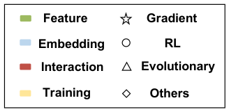
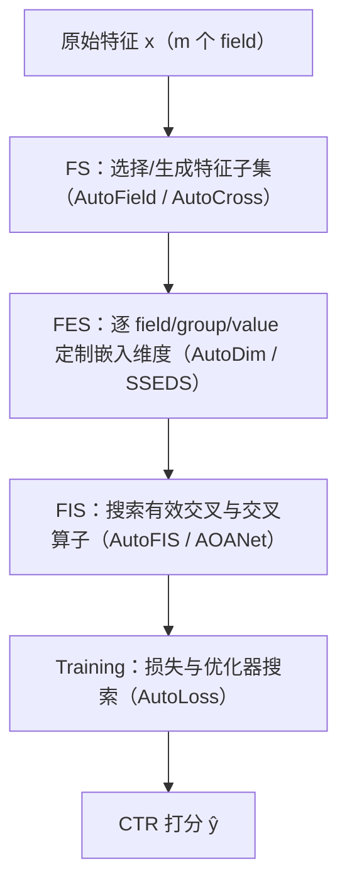

# A Comprehensive Survey on Automated Machine Learning for Recommendations (面向推荐系统的自动化机器学习综述)

- **会议/期刊**: ACM Transactions on Recommender Systems (TORS)；arXiv 预印本 2022-04
- **作者与机构**: Bo Chen、Huifeng Guo、Ruiming Tang（华为诺亚方舟实验室）；Xiangyu Zhao、Yejing Wang（香港城市大学）；Wenqi Fan（香港理工大学）
- **推荐链路定位**: 精排（CTR 模型架构与特征层自动化设计），可外延至粗排
- **研究方向**: CTR/CVR 预估与特征交叉 / 多任务与列表级重排
- **论文原文**: [arXiv:2204.01390v2](https://arxiv.org/abs/2204.01390v2)
- **开源代码**: 暂未开源

## TL;DR (1分钟核心速览)

深度推荐系统（DRS）长期依赖“特征嵌入 + 特征交叉”的人工架构设计，专家门槛高、工程成本大且易受人为偏见影响。本文是一篇**系统性综述**，首次以 DRS 的四大可自动化组件（特征选择 FS、特征嵌入 FES、特征交叉 FIS、模型训练 Training）为主线，对每个组件给出**细粒度子分类**并逐一对比其搜索空间量级与搜索算法；核心论点是 AutoML4Rec 正沿三条轴演进——**单组件 → 多组件联合搜索、详细空间 → 抽象空间、RL/进化 → 梯度松弛主导**。注意：本文**不含一手基准实验**，其贡献在于分类法与量化对比表（搜索空间从 $2^{Vd}$压缩至$a^{m}$ 量级）。

## Background & Motivation (背景与核心矛盾)

- **主流范式**: 以“Feature Embedding & Feature Interaction”四层范式（输入层-嵌入层-交叉层-输出层）为骨架的 DRS，其嵌入维度、交叉算子、交叉阶数、损失函数全部由专家手工指定。
- **前人局限**: ①手工设计需要同时精通深度学习与推荐业务，且不同场景（如 DeepFM 的内积 vs. CFM 的外积 vs. DCN 的 cross 层）需要重新设计组件，泛化性差；②参数绝大部分集中在嵌入表 $\mathbf{E}\in\mathbb{R}^{V\times d}$，而统一维度会造成高频特征欠参数化、低频特征过参数化。
- **核心洞察 (Key Insight)**: 组件自动化的真正瓶颈不是“搜索算法不够强”，而是**搜索空间过大**——$p$阶特征交叉的朴素空间为$2^{\binom{m}{p}}$，逐特征值嵌入搜索为$2^{Vd}$。因此近年工作的主轴是**空间抽象化**而非算法复杂化。
- **本文切入点**: 以“搜索空间（单/多组件 × 抽象/详细） + 搜索策略 + 性能估计”三要素为坐标系，把上百篇工作放到同一张演进地图上，给出可比较的复杂度刻度。

<figure class="paper-figure" markdown="span">
  <figcaption>图 2. 推荐系统中 AutoML 的发展趋势。搜索空间按两个正交维度划分，即单组件或多组件搜索空间，以及抽象或详细搜索空间。颜色表示 DRS 的组件，形状表示不同的搜索策略。</figcaption>
</figure>

## Method (核心方法设计)

### 1. 整体框架 (Overall Architecture)

综述将 DRS 构建流程切为数据收集—特征工程—模型构建—训练—部署五个环节，并指出 AutoML 的介入点集中在中间的三个：特征工程被拆为**特征生成/特征选择**与**特征嵌入**，模型构建被映射为**特征交叉搜索**，训练环节被映射为**损失函数与优化器搜索**。每一类方法都统一用 DARTS 式双线性规划表述架构参数 $\mathbf{A}$与模型参数$\mathbf{W}$ 的交替优化：

$\min_{\mathbf{A}}\ \mathcal{L}_{val}(\mathbf{W}^{*}(\mathbf{A}),\mathbf{A})\quad \text{s.t.}\ \mathbf{W}^{*}(\mathbf{A})=\arg\min_{\mathbf{W}}\mathcal{L}_{train}(\mathbf{W},\mathbf{A})$

这构成了综述贯穿全文的“元结构”：几乎所有被收录的梯度类方法都只是在该骨架上替换**离散空间的松弛方式**。

### 2. 关键设计拆解 (Key Designs)

**1) 特征选择的连续松弛：把“保留/丢弃”写成可微门控。** 早期 RL 方案（FSTD、MARLFS）把 $2^m$子集空间当作 MDP，样本效率极低。AutoField 借用 DARTS 的并行节点图，为每个 field 分配一对概率$(\alpha_i^1,\alpha_i^0)$：

$\hat{\boldsymbol{e}}_i=\alpha_i^1\cdot\mathbf{1}\cdot\boldsymbol{e}_i+\alpha_i^0\cdot\mathbf{0}\cdot\boldsymbol{e}_i,\qquad \alpha_i^1+\alpha_i^0=1$由于“丢弃”被写成乘$\mathbf{0}$，梯度可穿过$\alpha$回传，搜索阶段即可与模型联合训练，最终按$\alpha_i^0$排序裁剪。AdaFS 进一步把标量门控换成由样本$\boldsymbol{e}_j$ 驱动的 Controller，实现**样本级自适应**（同一 field 对不同用户权重不同）。

**2) 嵌入维度的四象限压缩：从 Full 到 Column&Row。** 这是综述最有价值的分类贡献。Full 搜索（AMTL 的孪生掩码层、PEP 的 $\mathbf{L}_0$软阈值重参数化）粒度最细但空间为$d^V$或$2^{Vd}$；PEP 的关键算子是用可学习阈值$s$ 替代人工剪枝阈值：

$\hat{\mathbf{E}}=\mathrm{sign}(\mathbf{E})\,\mathrm{ReLU}\big(|\mathbf{E}|-\mathrm{sigmoid}(s)\big)$该式把不可微的硬剪枝变成$|\mathbf{E}|$上的软收缩，$s$与模型参数联合反传。Row-based（SSEDS、AutoSrh）按频次/聚类把特征值分成$b$组，空间降到$2^{bd}$甚至$2^{md}$；SSEDS 用损失扰动近似显著性$s_{i,j}=\Delta\mathcal{L}_{i,j}\approx\partial\mathcal{L}/\partial\alpha_{i,j}$，把$md$次前向压缩为一次反向。Column&Row（AutoDim）进一步降到$a^{m}$，并用 Gumbel-Softmax 采样候选子维度：

$p_{i,j}=\frac{\exp((\log\alpha_{i,j}+G_j)/\tau)}{\sum_{k=1}^{a}\exp((\log\alpha_{i,k}+G_k)/\tau)}$**3) 高维交叉搜索的降维三件套：门控、分组、低秩/图递归。** AutoFIS 给二阶交叉加重要性门控并插入 BN 层解耦幅度与重要性，使 GRDA 能产出稀疏$\boldsymbol{\alpha}$：$\sum_{i<j}\alpha_{ij}\langle\boldsymbol{e}_i,\boldsymbol{e}_j\rangle$。高阶场景下$2^{\binom{m}{p}}$爆炸，AutoGroup 用 Gumbel-Softmax 做特征分组压到$2^{gm}$；PROFIT 利用“低阶优先”性质把架构张量低秩分解：

$\boldsymbol{\alpha}\approx\sum_{r=1}^{R}\boldsymbol{\beta}_r\circ\boldsymbol{\beta}_r\circ\cdots\circ\boldsymbol{\beta}_r$将空间降到$mR$，并按阶递进搜索（搜$p$阶时冻结$<p$ 阶参数）。FIVES 把特征视为图、用逐层邻接矩阵递归建模高阶交叉：

$\mathbf{A}^{(p)}\triangleq(\mathbf{D}^{(p-1)})^{-1}\psi(\mathbf{A}^{(p-1)})\sigma(\mathbf{H}^{(p)}),\quad \mathbf{A}^{(0)}=\mathbf{I}$从而把$2^{\binom{m}{p}}$压到$2m^2$，且层间依赖天然保持“低阶优先”。AOANet 则走“泛化算子”路线，把交叉统一写成 Projection–Interaction–Fusion 三段式$\mathbf{Z}_{i,j}=(\boldsymbol{e}_i\otimes\boldsymbol{e}_j)\odot\mathbf{W}$、$P=\mathbf{h}^{\top}\sum_{i,j}\alpha_{i,j}\mathbf{Z}_{i,j}$，避免枚举人工算子集合。

**4) 训练目标与推理开销**: 综述指出训练环节的自动化（AutoLoss、$\lambda$Opt、AutoFT）覆盖率远低于前三类；推理侧核心代价来自搜索阶段（双线性规划需 2 倍训练开销 + 验证集切分），而搜索完成后通常需**重训练（retrain）**一次以恢复精度，线上推理与人工设计模型同构、无额外延迟。

## Experimental Setup & Evaluation Protocol (实验设置与评估协议)

**重要声明**：本文为综述，**不含作者自建的基准实验**、无统一数据集管线、无 Full-Ranking/Sampled Ranking 协议，亦无显著性检验。因此本节记录的是其**跨论文对比所依据的多源评估口径**，以及综述自身给出的量化对比表。

- **数据集与预处理**: 被收录方法各自沿用 Criteo / Avazu / Frappe / MovieLens / Amazon 等公开 CTR 与 CF 数据集，过滤与划分各不相同（多数为按时间或随机比例切分），**这是综述未能统一的关键短板**。

| 组件 | 代表方法 | 搜索空间 | 搜索算法 | 是否真正省内存 |
| :--- | :--- | :---: | :---: | :---: |
| 嵌入(Full) | AMTL / PEP | $d^{V}$/$2^{Vd}$ | 梯度 / 正则 | ✗ |
| 嵌入(Col) | AutoEmb / ESAPN | $d^{V}$/$a^{V}$ | 梯度 / RL | ✗ |
| 嵌入(Row) | SSEDS / AutoSrh | $2^{md}$/$2^{bd}$ | 梯度 | ✓ |
| 嵌入(Col&Row) | AutoDim / NIS / RULE | $a^{m}$/$a^{b}$/$2^{ab}$ | 梯度 / RL / 进化 | ✓ |
| 嵌入(Comb) | ANT / AutoDis | $2^{kV}$ | 梯度 | ✓ |

- **数据划分与防穿越**: 综述未对所收录方法做统一防穿越审计，仅指出 DARTS 式方法必须依赖**独立验证集**做架构选择，实际工业落地中易与训练集时间窗重叠。
- **排名/预测评测协议**: 以 CTR 场景的 **AUC / LogLoss** 为主，CF 场景用 HR@K / NDCG@K；无统一负采样比例约定。

## Key Experimental Results (实验关键数据)

### 1. 主对比：特征交叉搜索的空间—算法对照（源自原文 Table 4）

| 方法 | 搜索类别 | 搜索空间 | 支持阶数 | 搜索算法 |
| :--- | :--- | :---: | :---: | :---: |
| AutoFIS | 交叉选择 | $2^{\binom{m}{2}}$ | 二阶 | 梯度 |
| **AutoGroup** | 交叉选择 | $\mathbf{2^{gm}}$ | 高阶 | 梯度(Gumbel) |
| **PROFIT** | 交叉选择 | $\mathbf{mR}$ | 高阶 | 梯度(递进) |
| FIVES | 交叉选择 | $2m^{2}$ | 高阶 | 梯度(GNN) |
| $\mathbf{L_0}$-SIGN | 交叉选择 |$2m^{2}$ | 二阶 | 梯度 |
| BP-FIS | 交叉选择 | $u\,2^{\binom{m}{2}}$ | 二阶 | 贝叶斯 |
| SIF | 算子搜索 | $C_n^{c}$ | 二阶 | 梯度 |
| AutoFeature | 算子搜索 | $c\,n^{n\binom{m}{p}}$ | 高阶 | 进化 |
| AOANet | 算子搜索 | $2^{|\text{pairs}|}$ | 高阶 | 梯度 |
| AutoCTR | 模块搜索 | $c^{\binom{n}{2}}$ | 高阶 | 进化 |
| AutoPI | 模块搜索 | $c^{\binom{n}{2}}$ | 高阶 | 梯度 |

### 2. 消融式对比：抽象化带来的空间压缩倍率

| 抽象手段 | 代表 | 空间变化 | 压缩量级（$m=100$ 量级示意） |
| :--- | :--- | :--- | :--- |
| 逐值 → 逐 field | PEP → SSEDS | $2^{Vd}\rightarrow 2^{md}$| 由$V$主导降为由$m$ 主导 |
| 逐 field → 逐 group | SSEDS → AutoSrh | $2^{md}\rightarrow 2^{bd}$|$b\ll m$ 时指数级下降 |
| 分组 + 子维度 | AutoGroup + AutoDim | $2^{\binom{m}{2}}\rightarrow a^{m}$ | 组合爆炸→多项式 |
| 张量低秩分解 | PROFIT | $2^{\binom{m}{p}}\rightarrow mR$ | 指数→线性 |

### 3. 关键实验发现 (Key Findings)

1. **搜索空间抽象化而非算法升级才是效率主引擎**：把 PEP 的 $2^{Vd}$替换为 AutoDim 的$a^{m}$（$a\approx 6$），在$m$为数十、$V$ 为百万级时压缩超过十个数量级，这使得梯度类方法在推荐场景全面压过 RL 与进化算法。
2. **梯度松弛占据绝对主导**：综述统计的嵌入与交叉方法中约 12 项使用 DARTS 式双线性梯度优化，RL 仅在两类场景存活——离散性本质无法松弛（ESAPN 的流式决策、NIS 的块采样）与端侧硬内存预算（RULE）。
3. **“细粒度最优”在工程上常常不可兑现**：逐特征值嵌入搜索（AMTL、PEP）虽理论上最优，但变长嵌入无法存入定宽嵌入表，**实际内存节省为零**；相反 Row-based / Col&Row（SSEDS、AutoDim）因组内等宽才真正减少显存占用——这是综述隐含的最强工程结论。

## Highlights & Limitations (亮点、对比与审稿批判)

- **与代表作对比 (vs. Prior Work)**: 相比 Zheng 等 [128] 的 AutoML4Rec 综述，本文的增量是把“损失函数搜索/交叉函数搜索”从“其他组件”中解放出来，纳入 FS/FES/FIS/Training 四支细粒度分类，覆盖面更全；相比通用 NAS 综述 [19,109]，本文明确了推荐场景特有的搜索对象是**嵌入表与交叉算子**而非卷积单元。
- **可迁移亮点**: ①PEP 的 $\mathrm{sign}(\mathbf{E})\mathrm{ReLU}(|\mathbf{E}|-\mathrm{sigmoid}(s))$ 软阈值重参数化可直接迁移到任何需要稀疏化的嵌入表/专家网络；②Gumbel-Softmax 在离散架构选择上的稳定实现，可复用于多任务网络中 MMoE/PLE 的专家路由搜索。
- **审稿级局限批判**: ①**无统一基准与复现实验**——所有精度结论均转述自原文，且各方法数据集/划分/负采样口径不一，跨方法性能排序不可信；②**时效断层**——稿件定稿于 2022 年初，完全缺失 LLM4Rec、生成式推荐（语义 ID / RQ-VAE）、DLRM 式大规模嵌入分片与 Mamba 序列建模等 2023 后主流方向，作为 TORS 2024 刊出的综述已明显滞后；③未讨论搜索阶段的计算成本核算（GPU-hours）与碳开销，弱化了“自动化是否划算”这一核心工程判断。

## Rating (四维评分)

- **方法创新性 (Novelty)**: ⭐⭐⭐ （本身不提出新算法，创新在于四组件细粒度分类法与“单→多、详细→抽象”演进轴的提炼，属于组织性贡献而非技术性贡献）
- **评估协议与实验扎实度 (Protocol & Experiments)**: ⭐⭐ （无一手实验、无统一基准、无显著性检验，仅提供搜索空间复杂度对照表，量化支撑薄弱）
- **写作与数学规范度 (Clarity & Rigor)**: ⭐⭐⭐⭐ （符号表完整、每类方法均给出统一双线性规划骨架与核心松弛算子公式，跨方法可比性强，但部分公式排版有明显笔误）
- **工业落地与复现价值 (Industrial & Practical Value)**: ⭐⭐⭐ （对工业界选型极具指导意义，尤其“定宽嵌入表才省内存”等实践结论；但无开源代码、无参考实现，复现需回溯各原始论文）

