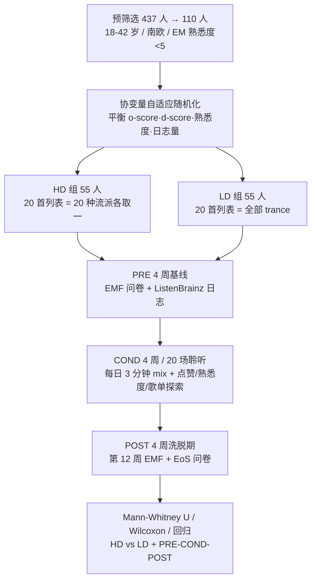
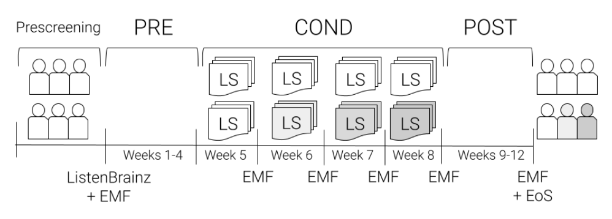

# Assessing the Impact of Music Recommendation Diversity on Listeners: A Longitudinal Study (音乐推荐多样性对听众影响的纵向研究)

- **会议/期刊**: ACM Transactions on Recommender Systems (TORS)
- **作者与机构**: Lorenzo Porcaro, Emilia Gómez (UPF 音乐技术组 / 欧盟联合研究中心), Carlos Castillo (UPF Web Science 组 & ICREA)
- **推荐链路定位**: 重排 / 曝光层（Exposure Diversity）
- **研究方向**: 去偏公平、可信隐私与工业架构 / 推荐影响评估 (AIA)
- **论文原文**: [https://arxiv.org/abs/2212.00592v1](https://arxiv.org/abs/2212.00592v1)
- **开源代码**: [https://github.com/LPorcaro/longterm-musdiv](https://github.com/LPorcaro/longterm-musdiv)

## TL;DR (1分钟核心速览)

现有推荐多样性研究几乎全靠仿真环境或短期离线指标，无法回答"曝光多样性是否真的改变人的态度"。本文做了一项 12 周、110 名南欧被试的纵向对照实验：将被试随机分为高多样性 (HD，覆盖 20 种电子音乐流派) 与低多样性 (LD，纯 trance) 两组，连续 4 周每日投喂 3 分钟推荐 mix，并用 6 次 EMF 问卷（Guttman 开放性 o-score + SC-IAT 隐式联想 d-score）追踪态度。结论：HD 组歌单探索率与点击量显著更高 (CLES=0.77/0.75)，但即时喜好更低；两组态度变化幅度无显著差异，说明"接触本身"比"多样性水平"更能驱动态度中性化。

## Background & Motivation (背景与核心矛盾)

- **主流范式**: 推荐影响评估 (AIA) 近年在公平性文献中兴起，但长期影响几乎全部通过 Agent-Based Modelling 与反馈回路仿真来推断（如 Mansoury 的多样性衰减模型、Chaney 的算法混淆）。
- **前人局限**: 其一，仿真假设用户是固定效用函数，无法刻画"偏好本身被推荐改变"这一核心因果链；其二，仅有的纵向研究（Liang & Willemsen、Hauptmann）聚焦行为指标，未触及态度、刻板印象与隐式联想。
- **核心洞察 (Key Insight)**: 音乐心理学已证实"重复曝光—熟悉度—偏好"存在因果链（Berlyne 理论），且音乐曝光可削弱对外族群体的偏见。因此多样性不该只被当作列表内指标，而应被当作**态度干预变量**。
- **本文切入点**: 用受控的 HD/LD 两组推荐投喂 + 心理学量表（SC-IAT、Guttman），首次在音乐推荐场景做态度层面的纵向因果测量。

## Method (核心方法设计)

### 1. 整体框架 (Overall Architecture)

研究分四阶段：预筛选 → PRE 基线 (第 1–4 周，仅收集 EMF 问卷与 ListenBrainz 日志) → COND 干预期 (第 5–8 周，工作日每日一场聆听会话，共 20 场) → POST 洗脱期 (第 9–12 周)。所有被试经**协变量自适应随机化**分组，以 EM 熟悉度、o-score、d-score、PRE 期 EM 播放量为平衡变量，最终 HD/LD 各 55 人。推荐列表由音频 embedding 离线构造，与线上平台解耦（歌单托管于私密 YouTube 链接，避免污染 ListenBrainz 日志与平台算法）。

<figure class="paper-figure" markdown="span">
  <figcaption>图 1. 纵向研究概览。参与者被分为两组：低多样性推荐（白色）和高多样性推荐（灰色阴影）。LS 表示聆听环节。EMF 表示电子音乐反馈问卷。EoS 表示研究结束问卷。</figcaption>
</figure>

### 2. 关键设计拆解 (Key Designs)

1. **基于音频 Embedding 的多样性操控算子**：痛点在于"多样性"常被定义为流派标签数，粒度粗糙且受元数据噪声污染。作者先用 EfficientNet（在 Discogs 标注数据上训练）抽取曲目音频 embedding，并用 tempo/danceability/acousticness/instrumentalness 四项手工 MIR 特征验证嵌入空间的语义一致性；随后以**跨列表质心距离**定义 HD/LD：HD 每个列表取一个不同流派，LD 全部取 trance；同时两种条件均约束**列表内**多样性最小——选 4 首嵌入空间平均距离最小的曲目，即 $\min \sum_{i<j}\lVert \boldsymbol{z}_i-\boldsymbol{z}_j\rVert_2$。这样"跨列表多样、列表内同质"，把多样性变量与单场聆听舒适度解耦，避免 HD 组因列表杂乱而单纯"听不下去"。

2. **态度三通道测量：o-score / d-score / 刻板印象**：显式问卷易受社会赞许偏差，故引入隐式测量。开放性用二值 Guttman 累积量表（"是否愿意每月/每两周/每周/每周两次/每天听 1 小时 EM"），得 $o\in\{0,\dots,5\}$，单调性保证答"否"即后续全否；隐式联想用单类别 IAT (SC-IAT)，令被试尽快将"积极词/消极词/EM 流派"归类，由反应时差计算$d=\frac{\overline{RT}_{\text{不相容}}-\overline{RT}_{\text{相容}}}{s}$，$d<0$ 表示对 EM 持负向内隐评价；第三通道用 5 点 Likert 测量三类刻板印象（聆听场景、曲目属性、艺人画像）。

3. **统计推断与训练/推理开销**：组间用 Mann-Whitney U 检验（非正态、小样本），配 CLES 效应量；组内前后用 Wilcoxon 符号秩检验；多样性效应量用双重差分式回归——随访分析 $Y_{i1}=\beta_0+\beta_1 X_i+\epsilon_i$（$X_i=1$表 HD），变化分析$(Y_{i1}-Y_{i0})=\beta_0+\beta_1 X_i+\epsilon_i$，$\beta_1$ 即多样性对态度变化的净效应。全流程无在线训练，推理成本为离线 1444 首曲目的 embedding 抽取 + 20 次列表构造，可一次性预计算。

## Experimental Setup & Evaluation Protocol (实验设置与评估协议)

- **数据集与被试构成**:

| 数据来源 | 样本量 | 关键内容 | 备注 |
| :--- | :---: | :--- | :--- |
| 候选曲库 | 1,444 首 | 20 流派 / 165 子流派 | 从 ~16k 曲目按 Spotify/YouTube 热度过滤后每子流派随机取 10 首 |
| EMF 问卷 | 94 人 (HD 45 / LD 49) | 6 次 × 12 周 | o-score、SC-IAT d-score、刻板印象 |
| 聆听会话 | 102→96 人 | 20 场，每场 3 分钟 mix | 点赞、熟悉度、歌单访问与播放量 |
| ListenBrainz 日志 | 66 账户 | 人均 1,479 首（其中 EM 仅 56 首） | 因 Spotify 连接不稳定部分丢失 |

- **筛选与防穿越 (Splitting Strategy)**: 属**受控纵向分组设计**而非数据集划分。预筛选硬性条件为 18–42 岁、意/西/葡居住、Spotify 为主力平台、日均听歌 >1 小时、自评"不常听 EM"、且 EM 艺人/流派熟悉度测验得分 <5（满分 10.5，按 GAP0 流行度加权，认识冷门艺人得分更高）；最终 110 人两组在四个协变量上平衡。PRE 期仅观测不干预，构成天然基线，规避了"曝光前差异"的混淆。
- **评测协议 (Evaluation Protocol)**: 采用**组间 + 组内双轨显著性检验**：H1–H5 用单/双侧 Mann-Whitney U + CLES，H6–H7 用 Wilcoxon 符号秩 + CLES；显著性阈值 $\alpha=0.05$（探索性研究可放宽至 0.10），power=0.80 对应每组 50 人的样本量估算（Cohen）。
- **对比基线与超参**: "基线"为 LD 组与 PRE 基线测量；被试流失控制为"至少参加 4 场聆听 + 3 次 EMF"，最终保留 85%。

## Key Experimental Results (实验关键数据)

### 1. 主实验对比 (HD vs LD 行为与态度差异)

| 假设 | 指标 | $M_{HD}$|$M_{LD}$|$U$|$p$ | CLES |
| :--- | :--- | :---: | :---: | :---: | :---: | :---: |
| H1 | 歌单访问次数 | **15.0** | 9.0 | 307 | **<.01** | .77 |
| H2 | 歌单播放交互量 | **11.5** | 3.5 | 301 | **<.01** | .75 |
| H3 | 点赞评分 | 9.0 | **13.0** | 152 | .10 | .62 |
| H4 | 未访问者点赞评分 | -1.0 | **1.0** | 120 | **.01** | .70 |
| H5 | 熟悉度评分 | -21.5 | -24.0 | 180 | .60 | .45 |

### 2. 消融式对照 (PRE→COND→POST 组内变化与多样性净效应)

| 检验 | 变量 | $M_1$(PRE) |$M_2$|$W$/$\beta_1$|$p$ | CLES |
| :--- | :--- | :---: | :---: | :---: | :---: | :---: |
| H6 | d-score (PRE-COND) | .065 | .008 | 2519.5 | **<.01** | .53 |
| H6 | d-score (PRE-POST) | .069 | .016 | 2260.0 | **<.05** | .55 |
| H7 | o-score (PRE-COND) | 4.0 | 4.0 | 414.5 | **<.05** | .54 |
| H7 | o-score (PRE-POST) | 4.0 | 4.0 | 434.5 | .16 | .52 |
| 随访 | d-score $\beta_1$| — | — |$-.04\ (SE=.08)$ | .66 | — |
| 变化 | d-score $\beta_1$| — | — |$-.09\ (SE=.10)$ | .38 | — |
| 随访 | o-score $\beta_1$| — | — |$-.09\ (SE=.26)$ | .73 | — |
| 变化 | o-score $\beta_1$| — | — |$.10\ (SE=.27)$ | .71 | — |

### 3. 关键实验发现 (Key Findings)

1. **多样性以短期满意度换取长期探索**：HD 组歌单访问与播放量显著高于 LD（CLES 0.77 / 0.75），但在未访问歌单的被试中 LD 点赞显著更高（CLES 0.70，$p=.01$）。行为链条清晰——高多样性诱发"想再听深一点"的探索欲，却因陌生曲目降低即时愉悦，二者构成真实的效用权衡而非测量噪声。
2. **真正改变态度的是"接触"而非"多样性水平"**：全样本 d-score 从 .069 显著降至 .016（$p<.05$），o-score 开放比例 HD 由 73.3%→85.7%、LD 由 75.5%→81.9%，隐式中性区间占比 LD 由 38.8%→52.3%。但 HD/LD 净效应回归四项$\beta_1$全部不显著（$p\ge.38$），说明连续 4 周标准化 EM 曝光本身即足以解构先验联想，多样性只是"加速度"而非"开关"。
3. **单一流派条件会反向强化刻板印象**：LD 组把 EM 与"跑步"关联的同意率由 62% 升至 76%（trance 为高能量曲风），HD 组反而由 73% 降至 66%；同时 HD 组对"EM 多含原声乐器"的否定率由 79% 降至约 50%（$p=.01$，CLES=.32；组间$p=.04$）。可见多样性是**刻板印象解构的必要条件**，而低多样性推荐会制造新的、被数据支撑的偏见。

## Highlights & Limitations (亮点、对比与审稿批判)

- **与代表作对比 (vs. Prior Work)**: 相较 Mansoury 等人的反馈回路仿真与 Chaney 的算法混淆模型，本文首次在真实用户身上做因果干预，能区分"行为变化"与"态度变化"；相较 Liang & Willemsen 的短期纵向研究，其 12 周跨度 + 隐式测量 (SC-IAT) 把因变量从"满意度"下沉到"内隐联想"，在方法论上是明确增量。
- **可迁移亮点**: (1) 用音频/内容 embedding 的**跨列表质心距离**作为多样性操控算子，比流派标签计数更细粒度且可直接复用于短视频、播客重排；(2) "跨列表多样 + 列表内最小平均距离"的双约束构造，是解耦"多样性"与"列表可听性"的干净实验设计，值得任何做曝光多样性 A/B 的团队借鉴；(3) 协变量自适应随机化在小样本在线实验中可直接替代纯随机分组。
- **审稿级局限批判**: 其一，**样本与功效偏弱**——94 人有效样本、CLES 多在 0.52–0.55 的边缘区间，且 d-score 组间基线因 HD 组初始流失而失衡（虽用协变量平衡仍残留），H7 的 POST 检验 $p=.16$ 已跌破显著性，结论稳健性存疑；其二，**生态效度不足**——推荐为离线构造的 3 分钟固定 mix、歌单置于私密 YouTube 而非真实流媒体界面，且 LD 组被强制限定为 trance 单一流派，"低多样性"操控过于极端，无法回答"多样性取何值最优"这一工业界最关心的问题；其三，ListenBrainz 仅 66 账户可用，日志侧结论代表性有限。

## Rating (四维评分)

- **方法创新性 (Novelty)**: ⭐⭐⭐⭐ （首次把 SC-IAT 隐式联想引入推荐影响评估，并以音频 embedding 距离操控多样性，实验范式本身即贡献）
- **评估协议与实验扎实度 (Protocol & Experiments)**: ⭐⭐⭐⭐ （12 周 4 阶段纵向 + 双轨非参检验 + 效应量齐备，但样本量与部分边缘显著性、组间基线失衡拉低了说服力）
- **写作与数学规范度 (Clarity & Rigor)**: ⭐⭐⭐⭐ （量表构造、CLES 与随访/变化回归定义清晰可复现，符号规范；但缺少对多重比较校正的说明）
- **工业落地与复现价值 (Industrial & Practical Value)**: ⭐⭐⭐ （代码与全部曲目、音频 mix、问卷均开源，可直接复用为曝光多样性的评测协议；但离线 mix 构造与真实流媒体场景差距较大，短期难直接上线）

