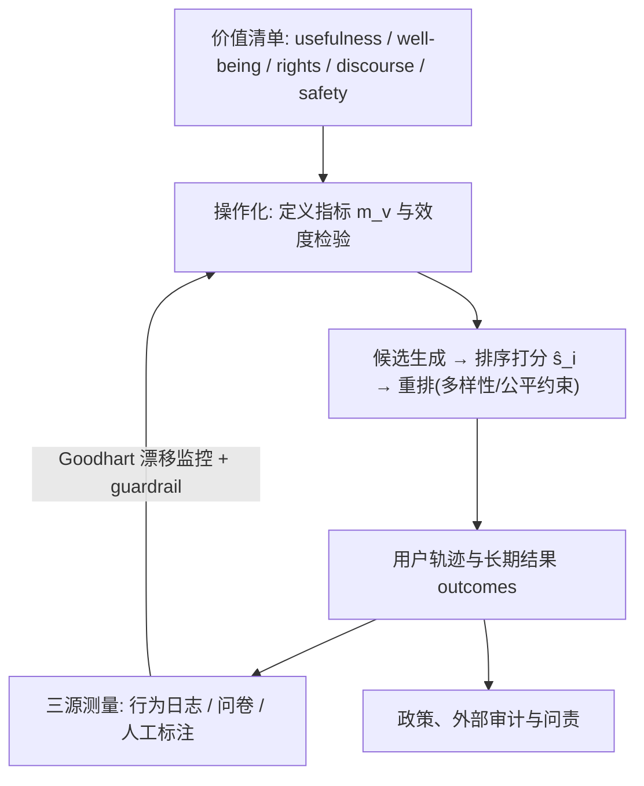
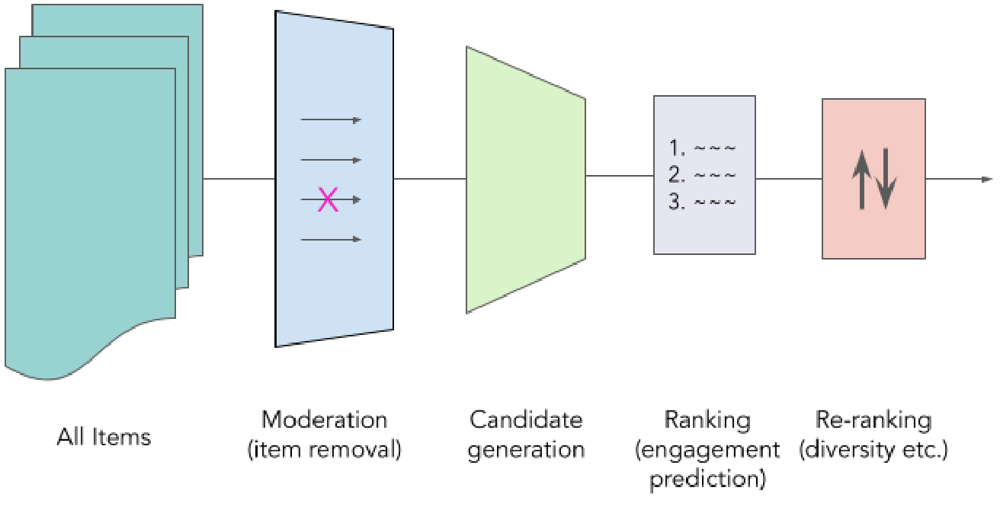

# Building Human Values into Recommender Systems: An Interdisciplinary Synthesis (将人类价值建构进推荐系统：一项跨学科综合)

- **会议/期刊**: ACM Transactions on Recommender Systems (TORS) 2(3), Article 20, 57 pages
- **作者与机构**: J. Stray (UC Berkeley CHAI)、A. Halevy、P. Assar (Meta AI)、D. Hadfield-Menell (MIT EECS)、C. Boutilier (Google Research)、A. Ashar (Spotify)、M. Ekstrand (Boise State)、N. Helberger (UvA IViR)、A. Zhang (UW) 等 22 位，横跨学界/工业/公民社会/媒体
- **推荐链路定位**: 全链路（候选生成 → 排序 → 重排）与产品治理层；重点落在重排与目标函数设计
- **研究方向**: 去偏公平、可信隐私与工业架构 / 多任务学习与列表级重排
- **论文原文**: [arXiv:2207.10192v1](https://arxiv.org/abs/2207.10192v1)
- **开源代码**: 暂未开源

## TL;DR (1分钟核心速览)

本文不是算法论文，而是一篇面向工业落地的**立场/综合论文**：它回答"如何让推荐系统践行其服务对象的价值"。核心贡献是把抽象价值**操作化（operationalize）为可优化指标**，给出从价值选择→指标构造→排序干预→A/B 论证→数值护栏→长期监控的七步流程，并系统梳理三类价值度量数据源（行为日志、问卷、人工标注）与三类设计可供性（物品选择、控件反馈、权衡优化）。全文无数据集、无基准实验，收益体现为概念框架与工程流程，而非相对指标提升。

## Background & Motivation (背景与核心矛盾)

- **主流范式**: 工业推荐普遍是「审核后的物品池 → 候选生成（数百~数千）→ 逐物品排序打分 → 重排保证信息流属性」的级联管线，最终分数由多类行为概率的加权组合给出，即"为参与度（engagement）优化"。
- **前人局限**: (1) engagement 只是价值的**弱代理**，用户行为受认知偏差、信息不对称、期望被压低等因素污染，与福祉/公平并不同构；(2) 多数系统是"短视（myopic）"的，只预测下一屏的即时反应，而福祉、极化、成瘾等后果在**月—年量级**才显现。
- **核心洞察**: 价值之争往往被误写成"价值 vs 伤害"，但若只规避"坏"而不定义"好"，目标函数根本无法指定；价值本质上**多利益相关者、多时间尺度、彼此冲突**（隐私 vs 有用性、表达自由 vs 安全、个体 vs 社会）。
- **本文切入点**: 不做通用价值对齐理论，而是用**工业实践语言**把价值拆成指标、把指标拆成排序改动、把改动拆成可监控的组织流程。

## Method (核心方法设计)

### 1. 整体框架 (Overall Architecture)

论文用一条"价值闭环"贯穿全篇：先由多源清单与专家问卷收敛出一组价值 → 把每个价值操作化为指标 $m_v$（同时接受效度/信度/公平性/合法性四项检验）→ 在排序阶段通过打分信号、约束或多目标加权改变物品选择 → 用户据此产生新轨迹与长期结果 → 用行为/问卷/标注三源数据回测指标是否仍代表价值 → 若漂移则修订，并以数值护栏防止其他团队的改动隐式回退已有改进。整条链路的关键在于：**度量本身就是对被观测价值的建模**，因此必须与定性研究、外部审计并置，而非当作真值。

<figure class="paper-figure" markdown="span">
  <figcaption>图1：许多现代推荐系统工作方式的图示，改编自（Google，2020；Lada 等，2021）。全局物品集合首先经过审核，以移除违反平台政策的内容。其余步骤在向用户提供推荐时发生：候选生成选择一组可能相关的大范围物品，排序为每个物品打分，重排序确保信息流层面的属性（如多样性）。</figcaption>
</figure>

### 2. 关键设计拆解 (Key Designs)

1. **价值落地的七步产品流程（本文最具工程价值的增量）**：以往文献停在"呼吁对齐价值"，本文把它拆成可执行步骤——研究意外后果（含 backfire 效应）、定义指标、比较产品设计方案、实施（把集合级属性并入排序）、评估并向内部利益相关者游说、建立护栏、持续监控。核心机制是**护栏约束**：任何后续改动不得使多样性指标下降超过阈值，即 $\Delta m_{\text{div}} \ge -\epsilon$。直觉在于：单次 A/B 的正向收益极易被后续无关改动稀释，只有写成跨团队硬约束才能长期保值。

2. **集合级属性进入逐物品排序**：多样性、公平等是**列表级**属性，而工业排序器逐物品独立打分，故最终分数需显式写成多信号加权 $s_i=\sum_{k} w_k\,\hat{p}_k(i)+\lambda\,g_{\text{div}}(\mathcal{L})$，其中$\mathcal{L}$为待出列表。代价是打分复杂度从$O(n)$ 升至集合搜索，论文明确指出这是需要新高效算法的开放问题。

3. **训练目标、负采样与推理效率**：本文不定义损失函数（无训练/无负采样）；其"优化目标"是多利益相关者效用 $\max \sum_{s}\alpha_s U_s$，受公平/多样性下界约束。推理开销的讨论集中在重排阶段需要列表级打分，以及人工标注作为最贵数据源的可持续性瓶颈。

## Experimental Setup & Evaluation Protocol (实验设置与评估协议)

- **性质声明**: 本文为跨学科综合/立场论文，**不含数据集、划分方式、排名协议与统计显著性检验**。其"论证协议"替代实验协议，见下表。

| 论证材料 | 规模与来源 | 在文中的作用 |
| :--- | :--- | :--- |
| 价值清单汇编 | 4 份既有清单（AI 伦理政策综述、BBC 用户研究、IEEE 福祉指标、IEEE 伦理设计流程）+ 技术-道德德性、关怀伦理、非洲关系伦理 | 生成候选价值集合，避免凭空立论 |
| 多利益相关者问卷与工作坊 | PAI 成员约 **40 人**（学界/公民社会/工业/媒体），先选系统类型再对价值重要性打分，随后小组讨论 | 精炼价值定义与抽象粒度（介于"do good"与具体指标之间） |
| 生产级案例走查 | 新闻推荐系统的"政治多样性"变更 | 展示价值→指标→排序改动→评估的全流程 |
| 作者 cohort | **22 位**，跨 Berkeley/Meta/MIT/Google/Spotify/BBC/UvA/UW/Stanford/PAI | 保证跨部门视角；作者自陈非系统性综述 |

- **案例设定（替代超参）**: 以"提升政治观点多样性"为目标，指标构造拆为三步：给人工评分者写多样性定义（"是否包含多视角的建设性贡献"）→ 构造正负样例训练集 → 训练启发式/ML 模型预测列表级"生产性多样性"。
- **对比基线**: 概念层面对比 engagement-only 排序、人类编辑排序、纯内容审核（moderation-only）；实证层面对比引自社会科学实验（停用社媒、投票动员）而非推荐基线。

## Key Experimental Results (实验关键数据)

### 1. 主实验对比 (Main Results)

本文无主实验表，下表为**核心内容映射**（价值 → 指标 → 干预 → 张力），即论文实际交付的知识结构：

| 价值主题 | 代表价值 | 典型指标 | 典型设计干预 | 核心张力 |
| :--- | :--- | :--- | :--- | :--- |
| Usefulness | 有用性、控制感、能动性 | 点击/留存、控件使用率 | 主题订阅、播放列表、候选生成调整 | 控制感 ≠ 实际控制（安慰剂控件） |
| Well-being | 主观福祉、社会连接、免于成瘾 | 自评幸福感、屏时、社会资本 | 屏幕时间上限、正向内容加权 | 短期愉悦 vs 长期福祉 |
| Legal & Human Rights | 隐私、透明、公平 | DP 噪声、解释披露、曝光基尼 | 差分隐私、解释生成、曝光配额 | 隐私 vs 有用性/可解释性 |
| Public Discourse | 准确性、多样性、反极化 | 主题/来源熵、跨立场曝光率 | 重排多样化、跨立场关联推荐 | 多样性与参与度、相关性冲突 |
| Safety | 免于仇恨与激进化 | 违规内容曝光率 | 审核 + 降权/去推荐 | 表达自由 vs 安全 |

### 2. 消融实验 (Ablation Study)

以**三类度量数据源的"消融式"对比**替代组件消融（移除任一源即对应一种现实失败模式）：

| 数据源 | 规模 | 成本/偏差 | 与价值对齐度 | 移除后的失效模式 |
| :--- | :--- | :--- | :--- | :--- |
| 行为日志 | 极大量（比另两源高数个量级） | 采集成本低；但对人口学、位置、交互新近性敏感（如 dwell time 在列表首位被系统性高估） | 弱代理 | 系统只能优化"被展示后的反应"，无法识别偏好被压制 |
| 问卷 | 极小比例抽样 | 中等；社会赞许偏差、跨群体作答差异、严肃性不足 | 较强 | 失去对"是否值得这段时间"这类判断的直接观测 |
| 人工标注 | 中等量、成本最高 | 标注者偏差、类别政治争议、标注者心理健康风险 | 强（可定义复杂概念） | 无法构造"生产性多样性""建设性对话"等复杂标签 |

### 3. 关键实验发现 (Key Findings)

1. **现有 engagement 指标与福祉目标存在系统性缺口**：论文引证的社会科学证据（停用社媒约 4 周后主观福祉改善；社媒使用与自评心理健康下降 **5%–8% 个标准差**；社媒动员使投票率约 **+1%**）全部来自行为/实验数据而非平台内部排序指标，说明"参与度↑ ⇒ 价值↑"的默认假设不成立。
2. **护栏（guardrail）比单次增益更决定长期效果**：由于多样性提升常伴随参与度波动，若只做一次性 A/B 而不写入 $\Delta m_{\text{div}} \ge -\epsilon$ 的数值约束，改进会被后续无关产品迭代隐式回退——这是流程层面的"归因失效"。
3. **度量即模型，故必然漂移**：任何价值指标都是对不可观测构念的建模（construct validity），一旦用于高利害决策即触发 Goodhart 效应；作者因此主张"指标 + 定性研究 + 外部审计"三元并置，并指出用行为数据回归预测问卷答案的"代理模型"虽可把稀疏问卷外推到全体用户，但必须持续与真实问卷比对以防偏离。

## Highlights & Limitations (亮点、对比与审稿批判)

- **与代表作对比**: 与常规去偏/公平推荐工作（如曝光公平约束、多利益相关者排序）相比，本文不提出新算子，而是提供**组织流程层**的框架：把"谁定义价值、谁定义指标、谁守护栏"讲清楚；与一般 AI 伦理综述相比，它深入到候选生成/排序/重排的工程细节与三类数据源的可用性权衡。
- **可迁移亮点**: (1) **指标护栏化**——把多样性/公平指标写成跨团队不可回退的数值下界，可直接迁移到多场景推荐平台的指标治理；(2) **问卷代理模型**——用行为特征回归稀疏问卷满意度，再做外推，是工业界低成本对齐长期价值的通用手法；(3) 七步流程可作为价值敏感设计（VSD）在推荐系统的落地 checklist。
- **审稿级局限批判**: (1) **无任何实证验证**：七步流程、"生产性多样性"指标与护栏阈值均未给出线上 A/B 或仿真结果，$\epsilon$与$\alpha_s$ 的取值完全依赖经验，缺乏可复现的敏感度分析；(2) **流程与算力成本被低估**：列表级打分的复杂度、人工标注的持续成本与标注者心理负担仅被"点出"而未量化，但这两项恰恰是最容易使方案在中等规模平台失效的瓶颈；(3) 价值清单虽经 40 人问卷精炼，样本集中在 PAI 成员与西方语境，跨文化效度存疑。

## Rating (四维评分)

- **方法创新性 (Novelty)**: ⭐⭐⭐ （不提出新模型或新损失，创新在于把价值敏感设计细化为可执行的七步工程流程与护栏机制，概念增量清晰但技术增量有限）
- **评估协议与实验扎实度 (Protocol & Experiments)**: ⭐⭐ （全文无数据集、无基准、无显著性检验，仅靠文献引证与生产案例走查支撑，实证厚度明显不足）
- **写作与数学规范度 (Clarity & Rigor)**: ⭐⭐⭐⭐ （术语与价值粒度定义克制、跨学科语言统一、案例走查结构清晰；但几乎无形式化建模，仅给出加权打分与约束的骨架式表达）
- **工业落地与复现价值 (Industrial & Practical Value)**: ⭐⭐⭐⭐ （七步流程、护栏约束与三源度量对工业团队可直接照搬，但无开源代码、无参考实现，复现需自建指标与标注管线）

